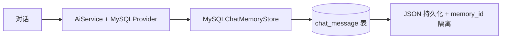

# 22. 自定义 MySQL 持久化 ChatMemory 存储介质

## 纲要

- **入口**：实现 `ChatMemoryStore` 接口（getMessages / updateMessages / deleteMessages）
- **建表**：`chat_message`（id / uid / memory_id / messages / 时间）
- **数据格式**：messages 字段存 JSON，每条含 `type=user|ai` 与内容
- **整合**：`@Bean` 自定义 Provider 指向 MySQL Store；`@AiService(chatMemoryProvider=...)` 引用
- **验证**：数据库中按 memoryId=1/2 各生成一条持久化记录

> 本章把记忆落到 MySQL，解决重启丢数，按课程口径重构；代码为课程示意，去品牌与脱敏处理。

## 一、实现 ChatMemoryStore

自定义类实现接口的三个方法，用 JDBC / Hutool 与 MySQL 交互：

```java
public class MySQLChatMemoryStore implements ChatMemoryStore {

    @Override
    public List<ChatMessage> getMessages(String memoryId) {
        // SELECT messages FROM chat_message WHERE memory_id = ?
        // 取出 JSON → 反序列化为 List<ChatMessage>
    }

    @Override
    public void updateMessages(String memoryId, List<ChatMessage> messages) {
        String json = Messages.serialize(messages);   // LangChain4j 自带序列化
        // 不存在则 INSERT，存在则 UPDATE（按 memory_id）
    }

    @Override
    public void deleteMessages(String memoryId) {
        // DELETE FROM chat_message WHERE memory_id = ?
    }
}
```

## 二、建表

```sql
CREATE TABLE chat_message (
    id          BIGINT PRIMARY KEY AUTO_INCREMENT,
    uid         VARCHAR(64),
    memory_id   VARCHAR(64),
    messages    LONGTEXT,
    create_time DATETIME,
    update_time DATETIME
);
```

## 三、整合进 AiService

```java
@Bean
public ChatMemoryProvider mySQLProvider() {
    ChatMemoryStore store = new MySQLChatMemoryStore();
    return memoryId -> MessageWindowChatMemory.builder()
            .id(memoryId)
            .chatMemoryStore(store)     // 指向 MySQL 持久化
            .maxMessages(10)
            .build();
}

@AiService(chatMemoryProvider = "mySQLProvider")
public interface Assistant {
    String chat(@MemoryId String memoryId, @UserMessage String message);
}
```

## 四、持久化数据格式

`messages` 字段为 JSON 数组，每条消息带 `type` 与内容：

```json
[
  {"type":"user", "text":"我是玄风"},
  {"type":"ai",   "text":"你好，玄风！"},
  {"type":"user", "text":"我是谁？"},
  {"type":"ai",   "text":"你是玄风。"}
]
```

数据库按 `memory_id` 隔离不同会话，验证可见 memory_id=1 与 memory_id=2 各一条记录。



## 五、FAQ

**Q1：必须实现几个方法？**
三个：`getMessages` / `updateMessages` / `deleteMessages`。

**Q2：messages 字段存什么？**
LangChain4j 序列化的 JSON 消息列表，含 type 与文本。

**Q3：update 是新增还是修改？**
按 memory_id 判断：不存在 INSERT，存在 UPDATE。

## 六、面试高频问答

1. **自定义存储的步骤？** 实现 `ChatMemoryStore` 三方法 + 建表 + Provider 注入。
2. **持久化数据格式？** JSON 数组，type=user/ai + 内容，按 memory_id 隔离。
3. **为什么用 MySQL？** 结构化、事务、可统计，适合规整对话。

## 七、ops 提示

> **序列化可靠**：用框架自带的 `Messages.serialize/deserialize`，勿手搓 JSON 以免字段错位。
>
> **索引**：对 `memory_id` 建索引，提升按会话查询性能。
>
> **容量与归档**：对话表增长快，需定期归档冷数据，避免单表膨胀。

