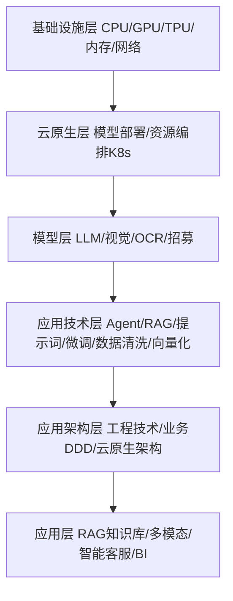

# 2. AI 大模型世界观：架构全景 / 应用开发本质 / 模型产生与局限

## 纲要

- **AI 大模型架构全景图**：六层自底向上——基础设施层（CPU/GPU/TPU/内存/网络）→ 云原生层（模型部署/资源编排 K8s）→ 模型层（LLM/视觉/OCR/招募等）→ 应用技术层（Agent/RAG/提示词/微调/数据清洗爬取/向量化）→ 应用架构层（工程技术架构/业务架构 DDD/云原生架构）→ 应用层（RAG 知识库/多模态/财务/差旅/智能客服/文本优化/BI）
- **应用开发本质**：**AI 大模型开发 ≠ 从零训练 GPT**，是「站在已有基座模型上做应用层开发」；企业把内部数据（合同/项目/Word/Excel）经数据管道清洗加工灌入**私有化**企业知识库，再结合大模型诞生企业 AI 应用
- **大模型如何产生**：GPT4 训练量 **12 万亿 token** + **4~5 万张 H100** 显卡 + 数十亿美金；训练后仍有局限
- **大模型答不出的三大原因与解法**：① 没问清 → **提示词工程**（无需代码）② 缺知识 → **RAG 企业知识库**补充内部数据 ③ 能力不足 → **模型微调**自训新模型；外加 ④ **私有化部署**（敏感数据）

> 概念章，按课程口径重构；无代码，重在建立「应用开发」认知，避免误以为要去训模型。

## 一、AI 大模型架构全景图

| 层 | 干什么 |
|---|---|
| 基础设施层 | 跟硬件打交道：CPU/GPU/TPU/内存/硬盘/网络 |
| 云原生层 | 管理大模型依赖与部署，借助 K8s 一键高效落地 |
| 模型层 | LLM 语言模型、视觉模型、OCR、招募模型等 |
| 应用技术层 | Agent/智能体、RAG、提示词工程、微调、思维链、数据爬取清洗落地、向量化 |
| 应用架构层 | 工程技术架构（高可用高性能高并发）、业务架构（DDD 领域驱动拆解）、云原生架构 |
| 应用层 | RAG 知识库、多模态、财务分析、差旅助手、智能客服、文本优化、OLAP 报告/BI |

## 二、应用开发本质

> **核心澄清**：AI 大模型开发**不是**从零到一训练出 GPT/千问那样的大模型；而是**基于已有基座模型做应用层开发**。

企业落地路径：
1. 企业有海量内部数据（项目/合同，Word/Excel/DB 形式）。
2. 数据敏感 → 企业知识库**必须私有化**（不能放三方）。
3. 数据源经**数据管道**清洗加工 → 灌入企业智库（本质是一个数据库）。
4. 大模型 + 企业数据库结合 → 诞生企业 AI 应用。
5. 用户/客户端向企业 AI 应用提需求 → 由「大模型 + 企业知识库」落地。

## 三、大模型如何产生 & 面临问题

### 3.1 产生成本

- GPT4 训练数据量 **12 万亿 token**（清洗加工后）。
- 硬件：**4~5 万张英伟达 H100 以上**显卡。
- 费用：以**数十亿美金**支撑。

### 3.2 三大局限与解法

大模型答不上来/答错，通常三类原因：

| 原因 | 解法 | 是否需代码 |
|---|---|---|
| ① 没问清（问题模棱两可） | **提示词工程**：让大模型+提示词更好理解用户意图 | 无需代码 |
| ② 缺知识（训练时拿不到企业内部数据） | **构建 RAG 知识库**：补充企业内部数据 | 需 |
| ③ 能力不足（模型本身缺陷/未训练到） | **模型微调**：自训新模型再部署 | 需 |

> 第四点：**私有化部署**——企业敏感数据走私有化。

> 老师举例：问「你的房子多少钱」「2025 中国前 70 城平均房价」大模型答不出，除非加 RAG/企业知识。

## 四、FAQ

**Q1：AI 大模型开发是训练模型吗？**
不是；是站在基座模型上做应用开发，不会从零训 GPT。

**Q2：企业知识库为什么要私有化？**
企业数据敏感，不能放三方，私有化才安全。

**Q3：GPT4 训练成本多大？**
12 万亿 token + 4~5 万张 H100 + 数十亿美金。

**Q4：大模型答不出怎么办？**
先优化提示词；仍不行补 RAG 知识库；模型能力不足则微调。

**Q5：应用技术层含哪些？**
Agent、RAG、提示词工程、微调、思维链、数据爬取清洗、向量化等。

**Q6：应用架构层为什么重要？**
让大模型应用满足业务场景 + 高可用高性能高并发；业务复杂时用 DDD 拆解。

## 五、面试高频问答

**1. 一句话说清 AI 应用开发与模型训练的区别？**
应用开发=基于已有基座模型做上层应用；训练=从零训参出大模型，二者不是一回事。

**2. 企业 AI 落地典型链路？**
内部数据 → 数据管道清洗 → 私有化知识库 → 结合大模型 → 企业 AI 应用。

**3. 大模型三大局限与对策？**
提示词工程（没问清）、RAG（缺知识）、微调（能力不足）；敏感数据私有化部署。

**4. AI 架构六层是什么？**
基础设施→云原生→模型→应用技术→应用架构→应用层。

**5. 为什么企业知识库要私有化？**
数据敏感，不能外泄；合规与安全要求。

**6. 微调与 RAG 在优化逻辑上的差异？**
RAG 从外部补知识（检索增强），微调从底层改参数让模型更贴合业务；同等重要。

## 六、ops 提示（认知与选型）

> **别神话大模型**：它有局限，需批判性思维；企业落地靠 RAG/微调/私有化补位。
>
> **基座模型选型**：看开发公司硬件与技术支撑（如阿里千问接近 GPT4 八成能力）；选大厂更稳。
>
> **数据合规**：企业知识库私有化是底线；数据管道清洗加工环节注意脱敏。
>
> **全参 vs 低参微调**：全参微调可能丢失原模型通用能力；企业一般选 LoRA 类低参微调，兼容原推理。

