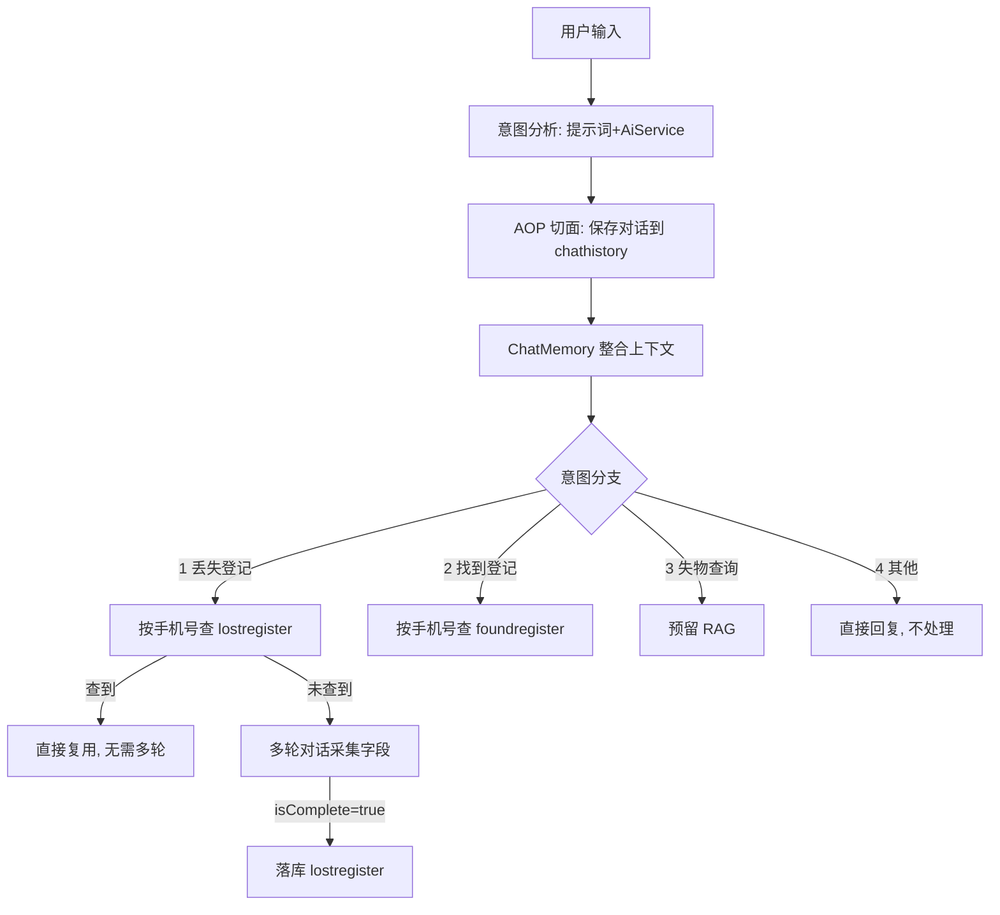
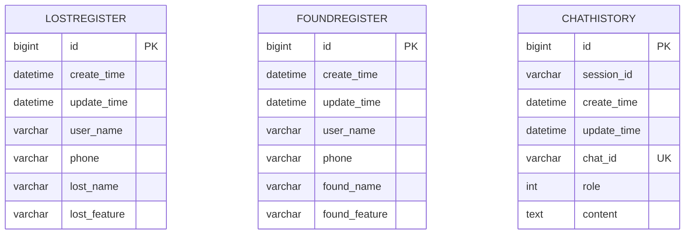

# 31. 项目介绍与系统架构设计：失物招领智能助手 V1

## 纲要

- **项目定位**：用前面所学 LangChain4j 三大核心特性（ChatMemory / 提示词 / Tools）配合 AiService，串起一个「失物招领智能助手」，把分散的知识点整合成可运行的 AI 应用
- **V1 功能边界**：① 丢失登记 ② 丢失信息修改 ③ 捡到登记 ④ 捡到信息修改 ⑤ 失物查询（查询基于 RAG，V1 暂不做，留到后续）
- **三张表**：`lostregister`（丢失登记表）、`foundregister`（捡到登记表）、`chathistory`（会话历史表）
- **架构主线**：用户输入 → 意图分析（提示词+大模型）→ AOP 切面持久化对话到 `chathistory` → 基于 ChatMemory 整合上下文 → 业务分支（先按手机号查库 / 多轮对话补全 / 完成登记落库）
- **核心公式**：一个系统是否智能，本质是「提示词 + Tools + AiService」三者整合；**提示词决定上限**，需不断打磨

> 本章为案例实战章，代码按课程口径重构示意（外部课件代码卷未挂载）。类名/字段名遵循第 7 章课程口径：意图输出 `IntentionOutput`、丢失登记 `RegisterLostOutput`、实体继承 `BaseEntity`、持久层继承 `BaseRepository`。

## 一、项目功能全景

失物招领助手不是炫技，而是把前面学的「聊天记忆、提示词、Tools」三大特性**全部串起来**的练兵场。V1 先落地四条主链路，查询链路等学完 RAG 再补：

| 功能 | 说明 | 依赖能力 |
|---|---|---|
| 丢失登记 | 多轮对话采集姓名/手机号/物品名/特征，落 `lostregister` | 提示词 + Tools + ChatMemory |
| 丢失信息修改 | 按手机号查出旧记录，补充/修正后 update | 同上 + 主键回填 |
| 捡到登记 | 与丢失登记对称，落 `foundregister` | 提示词 + Tools |
| 捡到信息修改 | 与丢失修改对称 | 同上 |
| 失物查询（V2） | 语义检索历史记录 | 预留，后续 RAG |

页面不追求华丽——**重点是借案例消化 LangChain4j 的组件协作关系**。演示流程：用户问「你是谁」→ 系统用提示词自我介绍；用户报姓名/手机号/丢的东西 → 结合提示词+大模型+函数调用完成登记；中途补充「白色钱包」→ 基于 ChatMemory 综合判断后更新记录；捡到物品链路同理。

## 二、系统架构流程图

要点：意图识别先把「用户想干啥」翻译成 1/2/3/4 的结构化值；丢失登记先按手机号查，命中就跳过重复对话；每次交互都经 AOP 落 `chathistory`，让大模型拥有跨轮上下文。

## 三、三张表设计

- `lostregister` / `foundregister`：业务数据表，字段与大模型返回的自定义对象一一对应。
- `chathistory`：`role=0` 表示用户消息，`role=1` 表示 AI 回复；`session_id` 区分不同会话，让大模型能还原上下文。

## 四、技术主线与提示词地位

整套系统的「智能」来自三件套的整合：

1. **AiService**：动态代理，把「调大模型」变成调普通 Java 方法。
2. **Tools（函数调用）**：让大模型「决策」何时查库、何时落库，真正执行的是本地 Java 方法。
3. **提示词**：**决定系统是否智能的天花板**。意图分类、字段采集、是否完成登记，全靠提示词引导。

> 老师原话：「一个系统是否智能，提示词起至关重要的作用。提示词要不断调整，才能覆盖不同业务场景与用户输入状态。」

## 五、FAQ

**Q1：为什么 V1 不做失物查询？**
查询基于 RAG（向量检索），前述还没学，故先实现丢失/捡到四条链路，查询留到后续。

**Q2：三张表各自职责？**
两张业务表存登记数据，一张 `chathistory` 存会话历史，供 ChatMemory 还原上下文，三者解耦。

**Q3：意图分析为什么重要？**
它是总开关，把自然语言翻译成 1/2/3/4，后续分支才能正确路由，避免张冠李戴。

## 六、面试高频问答

**1. 一个 LangChain4j 智能客服的核心组成？**
提示词（角色/技能/限制）+ Tools（查库/落库）+ AiService（对话编排）+ ChatMemory（上下文），四者缺一不可。

**2. 为什么先按手机号查库再对话？**
命中历史记录可跳过冗余多轮对话，直接复用，既省 token 又提升体验。

**3. 提示词在系统中的地位？**
决定智能上限，需结合业务场景持续打磨，是工程里最耗时的部分。

## 七、ops 提示（架构落地）

> **先画流程图再写代码**：本章所有功能都源于前述那张流程图，先把「意图→切面→记忆→分支」链路想清楚，编码才不会乱。
>
> **三表解耦**：业务数据与会话历史分离，便于后续把 ChatMemory 存储介质从内存换成 MySQL/Redis 而不动业务表。
>
> **查询链路预留**：`chathistory` 天然是 RAG 的语料来源，前述向量化时可直接复用。

