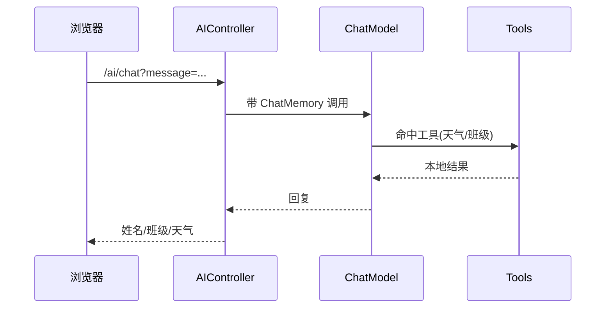

# 32. 基础工程搭建与环境配置测试

## 纲要

- **工程基线**：JDK 17 + SpringBoot 3.2.x + LangChain4j（课程用 beta 系列）+ JPA + 通义千问（阿里百炼）大模型
- **依赖坐标**：`langchain4j` 核心、`langchain4j-openai`（或百炼社区 starter）、`spring-boot-starter-webflux`（响应式流式输出）、`spring-boot-starter-data-jpa`、测试坐标
- **配置三件套**：大模型 APIKey（通义千问）、JPA 配置、数据源配置
- **基础装配**：`AiService` 类（含 `StreamingChatModel` 千问流式 + `ChatMemory` 内存 maxMessages=20 + Tools 自测）、`ChatMemory` Bean、`Tools` 自测类
- **联调验证**：启动后访问 `:8080/ai/chat`（普通）与 `:8080/ai/chat/stream`（流式），确认 ChatMemory 隔离生效、Tools 调用生效

> 代码按课程口径重构示意（外部课件代码卷未挂载）。本卡给出的是「骨架级」装配，大模型用通义千问，流式走 `StreamingChatModel`。

## 一、依赖与配置文件

课程基于 LangChain4j 的 beta 版本整合，硬性要求 **JDK 17**。关键依赖（示意）：

```java
// pom.xml 关键坐标（课程口径）
dependencies {
    implementation 'org.langchain4j:langchain4j:1.0-betaX'
    implementation 'org.langchain4j:langchain4j-openai:1.0-betaX'   // 或百炼社区 starter
    implementation 'org.springframework.boot:spring-boot-starter-webflux'
    implementation 'org.springframework.boot:spring-boot-starter-data-jpa'
    runtimeOnly 'com.mysql:mysql-connector-j'
    testImplementation 'org.springframework.boot:spring-boot-starter-test'
}
```

`application.properties` 三块必备：

```properties
# 1) 大模型（通义千问 / 阿里百炼）
langchain4j.openai.chat-model.api-key=${QWEN_API_KEY}
langchain4j.openai.chat-model.model-name=qwen-plus
langchain4j.openai.chat-model.base-url=https://dashscope.aliyuncs.com/compatible-mode/v1

# 2) JPA
spring.jpa.hibernate.ddl-auto=update
spring.jpa.show-sql=true

# 3) 数据源
spring.datasource.url=jdbc:mysql://localhost:3306/lost_found
spring.datasource.username=root
spring.datasource.password=root
```

## 二、AiService 与 ChatMemory 装配

基础能力先行：先保证大模型能对话、有记忆、能调工具。

```java
// AiService 配置类（课程口径：基础版）
@Configuration
public class AiServiceConfig {

    @Bean
    public ChatMemory chatMemory() {
        return MessageWindowChatMemory.builder()
                .maxMessages(20)                 // 保留最近 20 条
                .chatMemoryStore(new InMemoryChatMemoryStore())
                .build();
    }

    @Bean
    public StreamingChatModel qwenStreamingModel() {
        return OpenAiStreamingChatModel.builder()
                .baseUrl("https://dashscope.aliyuncs.com/compatible-mode/v1")
                .apiKey(System.getenv("QWEN_API_KEY"))
                .modelName("qwen-plus")
                .build();
    }
}
```

`ChatMemory` 用 `MessageWindowChatMemory` 基于内存，保留最近 20 条消息；流式输出走 `StreamingChatModel`（千问）。Tools 先写几个自测类（如「查班级」「查天气」）验证函数调用链路。

## 三、启动类与流式切换

启动类需同时开启 JPA 仓库扫描：

```java
@SpringBootApplication
@EnableJpaRepositories(basePackages = "com.example.lostfound.repository")
public class LostFoundApplication {
    public static void main(String[] args) {
        SpringApplication.run(LostFoundApplication.class, args);
    }
}
```

因为要用流式响应，需在配置里把 `StreamingChatModel` 一并装配进来；普通对话用 `ChatModel`，流式用 `StreamingChatModel`，两者创建方式不同，注意别引错类。

## 四、联调测试

启动后开两个窗口验证：

1. **普通对话**：`GET :8080/ai/chat?message=你好，我叫张三`
 - 第一轮：大模型自我介绍。
 - 第二轮：「我是谁 / 我在几班」→ 模型能答出姓名 → 证明 **ChatMemory 生效**（每轮都是新会话却记得上一轮姓名）。
2. **工具调用**：输入「今天天气怎么样」→ 模型调用本地天气 Tool，浏览器返回姓名+班级+天气 → 证明 **Tools 生效**。
3. **流式输出**：`GET :8080/ai/chat/stream?message=什么是量子计算` → 一个字一个字蹦出 → 证明 **流式响应**正常。



## 五、FAQ

**Q1：为什么用 webflux 而不是 webmvc？**
项目要支持流式逐字输出，`webflux` 的 `Flux<String>` 天然适配 `StreamingChatModel`。

**Q2：ChatMemory 用内存有啥隐患？**
重启即丢；前述后面会用 AOP + MySQL 持久化解决。

**Q3：普通 ChatModel 和 StreamingChatModel 怎么选？**
需要逐字流式体验用 Streaming；需要结构化对象返回值用普通 ChatModel（流式下 JSON 支持不友好）。

## 六、面试高频问答

**1. LangChain4j 流式输出怎么实现？**
装配 `StreamingChatModel`，Controller 返回 `Flux<String>`，模型逐块 onNext 推送。

**2. ChatMemory 内存存储的问题？**
进程重启丢失，生产需自定义 `ChatMemoryStore` 落库（MySQL/Redis）。

**3. 为什么 ChatMemory 能跨轮记住姓名？**
每次调用都带着历史消息窗口，模型在上下文中看到上一轮「我叫张三」。

## 七、ops 提示（环境基线）

> **JDK 版本红线**：LangChain4j 课程要求 JDK 17，别用 8/11 编译，会直接失败。
>
> **流式 vs 结构化二选一**：业务若需「收完所有输出再落库/改库」，用普通 ChatModel + 结构化对象；纯聊天展示才用流式。前述后半段「找到登记」就因这个踩坑回退。
>
> **APIKey 走环境变量**：别硬编码进 `application.properties`，用 `${ENV}` 注入，避免密钥入仓。

