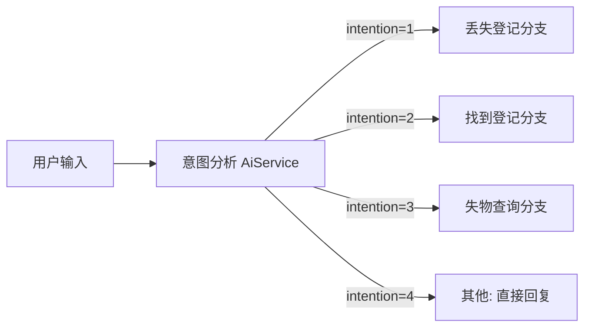

# 33. 用户意图分析模块：IntentionOutput 与流程编排

## 纲要

- **意图分析定位**：用户首句话进来，先用「提示词 + 大模型」判断他想干啥，翻译成结构化值 1/2/3/4
- **自定义输出结构**：`IntentionOutput`（字段 `intention` 含义 1=丢失登记 / 2=找到登记 / 3=失物查询 / 4=其他），用 LangChain4j 的 `@Description` 约束枚举语义
- **方法签名**：`intention(@MemoryId sessionId,@UserMessage message)` —— 用 `@MemoryId` 隔离会话，`@UserMessage` 注入当前消息
- **系统提示词资源加载**：`@SystemMessage(fromResource="...")` 从文件加载角色/技能/限制三段式提示词
- **流程编排**：`ChatFlowService.chatStream(userId,message)` 返回 `Flux<String>`，内部 `switch(intention)` 路由到各业务分支

> 代码按课程口径重构示意。注意 `@Description` 必须引 `dev.langchain4j.service.Description`（LangChain4j 自带），别引成别的包。

## 一、为什么需要意图分析

回到架构图：用户输入「我捡到一个钱包」「我丢了一个钱包」「查一下我的失物」，系统必须先知道**走哪条分支**，否则后面丢失/捡到逻辑会串台。意图分析就是总开关。



## 二、自定义大模型输出结构

让大模型返回我们期望的数据结构，而不是自由文本：

```java
// aioutput/IntentionOutput.java
public class IntentionOutput {
    @Description("用户意图: 1=丢失信息登记, 2=找到失物登记, 3=失物查询, 4=其他")
    private int intention;

    @Description("大模型对用户的自然语言输出")
    private String output;

    // getter/setter
}
```

`@Description` 是 LangChain4j 的注解，作用是把「字段语义」告诉大模型，让它把意图映射成对应的数字值。

## 三、AiService 意图方法

```java
// AiService 接口（课程口径）
public interface AiChatService {

    @SystemMessage(fromResource = "prompts/system-intention.txt")
    IntentionOutput intention(
        @MemoryId String sessionId,
        @UserMessage String message);
}
```

`@MemoryId` 让同一 `sessionId` 的对话共享记忆；`@UserMessage` 把当前消息注入；`@SystemMessage(fromResource=...)` 从 resources 目录加载提示词文件，保持代码整洁。

系统提示词 `system-intention.txt` 三段式：

```
角色：你是一个专业的失物招领助手工作人员。
技能：判断用户意图，精准区分「丢失信息登记 / 找到失物登记 / 失物查询 / 其他」。
限制：只回答与失物招领相关的问题；输出条理清晰、简洁明了。
分类标记：1=丢失信息登记, 2=找到失物登记, 3=失物查询, 4=其他。
```

## 四、流程编排 chatStream

服务层把意图翻译成业务路由，返回流式响应：

```java
// service/ChatFlowService.java
public interface ChatFlowService {
    Flux<String> chatStream(String userId, String message);  // 流式返回
}

@Component
public class ChatFlowServiceImpl implements ChatFlowService {

    private final AiChatService aiChatService;

    public Flux<String> chatStream(String userId, String message) {
        IntentionOutput intent = aiChatService.intention(userId, message);
        switch (intent.getIntention()) {
            case 1:  return registerLost(userId, message);   // 丢失登记
            case 2:  return registerFound(userId, message);  // 找到登记
            case 3:  return queryLost(userId, message);      // 失物查询(预留)
            default: return Flux.just(intent.getOutput());   // 其他: 原样回复
        }
    }
}
```

Controller 把旧测试方法替换为调用 `chatStream`，入参 `userId` + `message` 即可。

## 五、FAQ

**Q1：intention 为什么用 int 而不是 enum？**
课程口径用 int + @Description 描述，兼容大模型返回数字；也可改 enum，看团队偏好。

**Q2：@MemoryId 不写会怎样？**
所有用户共享同一段记忆，上下文互相污染；多用户场景必须加。

**Q3：系统提示词放资源文件还是硬编码？**
推荐 `fromResource` 放 resources，便于单独打磨、版本管理，不污染 Java 代码。

## 六、面试高频问答

**1. LangChain4j 如何让大模型返回结构化对象？**
定义 POJO + `@Description` 字段注解，方法返回该类型，框架自动解析（JSON 模式/函数调用）。

**2. @MemoryId 与 ChatMemory 的关系？**
`@MemoryId` 标记会话标识，框架据此从 `ChatMemoryStore` 取/存该会话的消息窗口，实现多会话隔离。

**3. 意图分析为何用 switch 而非 if-else？**
分支清晰、易扩展；新增意图只需加 case，配合提示词枚举值即可。

## 七、ops 提示（提示词工程）

> **三段式提示词模板**：角色 + 技能 + 限制，是本章所有提示词的骨架，复制粘贴改内容即可。
>
> **@Description 包别引错**：必须 `dev.langchain4j.service.Description`，引成 Jackson/Spring 的会失效。
>
> **流式编排注意**：`chatStream` 返回 `Flux`，业务分支方法也要返回 `Flux`，否则类型不匹配编译失败。

