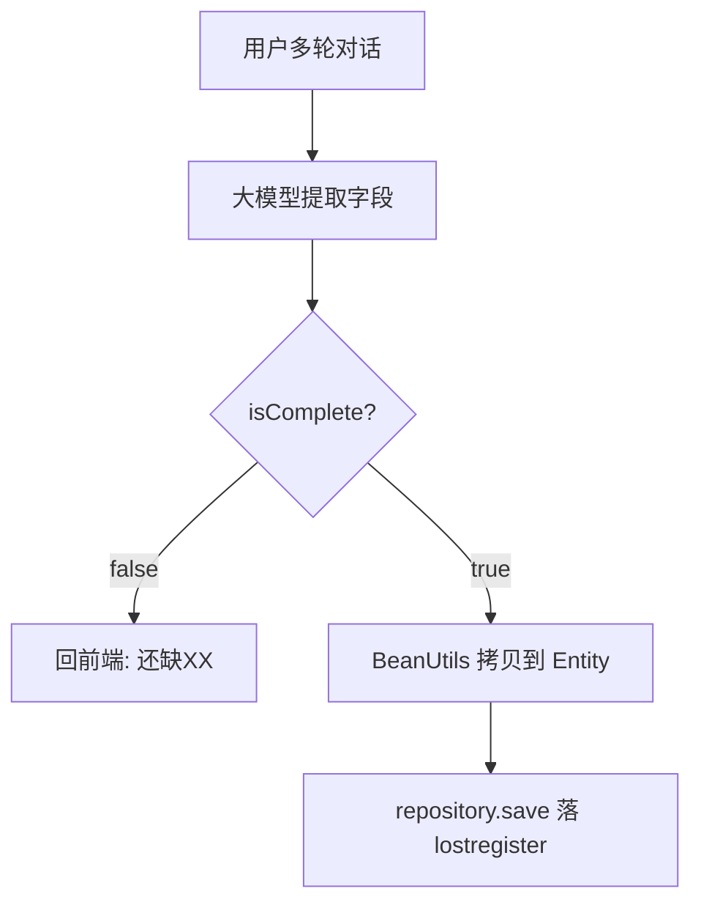

# 34. 失物登记功能与提示词设计

## 纲要

- **功能目标**：用户多轮对话后，把「姓名/手机号/物品名/特征」采集齐全，isComplete=true 时落 `lostregister`
- **自定义输出**：`RegisterLostOutput`（output / userName / phone / lostName / lostFeature / isComplete）
- **登记专员提示词**：角色=专业失物登记专员；技能=主动询问姓名手机号、引导描述特征；完成后 `isComplete=true`，否则 `false` 并列出缺什么
- **限制**：仅处理失物登记；严格按格式；不遗漏用户输入的重要信息
- **编排落点**：意图=1 时私用化调用 `registerLost(userId,message)`，把大模型输出与对话原文一并回前端

> 代码按课程口径重构示意。本卡聚焦「丢失登记」这一条主链路，修改/防幻觉。

## 一、RegisterLostOutput 数据结构

期望大模型在对话中返回以下字段，最终映射成数据库记录：

```java
// aioutput/RegisterLostOutput.java
public class RegisterLostOutput {
    @Description("大模型对用户的自然语言回复")
    private String output;

    @Description("丢失人姓名")
    private String userName;

    @Description("丢失人手机号")
    private String phone;

    @Description("丢失物品名称，如钱包/手机")
    private String lostName;

    @Description("丢失物品特征：颜色/材质/尺寸/特殊标识")
    private String lostFeature;

    @Description("是否完成登记：true=完成, false=待补全")
    private boolean isComplete;

    // getter/setter
}
```

## 二、登记专员系统提示词

```
角色：你是一个专业尽责的失物登记专员。
技能：
 1. 与用户沟通时，主动询问姓名、手机号。
 2. 详细引导用户清晰描述物品特征（颜色/材质/尺寸/特殊标识）。
 3. 把姓名/手机号/物品名称/特征系统整理并记录。
 4. 征询用户是否完成登记；完成则 isComplete=true，否则 false 并说明还缺哪些必填信息。
限制：
 - 仅处理失物登记相关内容，其他问题不回答。
 - 严格按格式组织输出，精准记录关键信息。
 - 不准遗漏用户输入的任何重要信息。
```

## 三、AiService 登记方法与编排

```java
public interface AiChatService {

    @SystemMessage(fromResource = "prompts/system-intention.txt")
    IntentionOutput intention(@MemoryId String sessionId, @UserMessage String message);

    @SystemMessage(fromResource = "prompts/system-register-lost.txt")
    RegisterLostOutput registerLost(@MemoryId String sessionId, @UserMessage String message);
}
```

编排侧（意图=1）：

```java
private Flux<String> registerLost(String userId, String message) {
    RegisterLostOutput out = aiChatService.registerLost(userId, message);
    // 把对话输出回前端，isComplete 时由持久化层落库
    return Flux.just(out.getOutput());
}
```

大模型经多轮对话识别 `isComplete=true` 后，返回的 `userName/phone/lostName/lostFeature` 即可被持久化层消费。

## 四、为什么需要 isComplete 判定

没有完成标记，系统无法判断「这一轮该不该落库」。提示词里明确要求：信息不全时返回 `false` 并告诉用户缺什么（如「还差手机号」）；用户确认无更多特征后返回 `true`，触发落库。



## 五、FAQ

**Q1：output 和落库字段为什么要分开？**
`output` 是给用户看的自然语言；其余字段是给系统存的结构化数据，两者职责不同。

**Q2：特征字段为什么单独列？**
颜色/材质/尺寸等是找回的关键检索维度，结构化后便于后续 RAG 与匹配。

**Q3：多轮对话怎么保证不丢信息？**
靠 ChatMemory 把历史轮次带进上下文，大模型综合判断后再填字段。

## 六、面试高频问答

**1. 结构化输出 + 完成判定的设计价值？**
把「对话」与「落库动作」解耦，模型自己声明完成，系统按标记决策，避免误存半成品。

**2. 提示词里「不准遗漏信息」为何重要？**
大模型可能省略用户提到的细节，强约束能提升字段完整率，降低回补成本。

**3. 登记与意图分析为何分两个 AiService 方法？**
不同系统提示词，混用会上下文混乱。

## 七、ops 提示（落地取舍）

> **先跑通单链路再扩**：丢失登记是四条链路里最典型的，先把它调稳定，捡到登记基本是镜像复制。
>
> **字段命名统一**：`userName/phone/lostName/lostFeature` 要与数据库列名映射一致，否则 BeanUtils 拷贝丢字段。
>
> **提示词可观测**：把大模型每轮返回的 `RegisterLostOutput` 打印日志，便于发现「该填没填」的问题。

