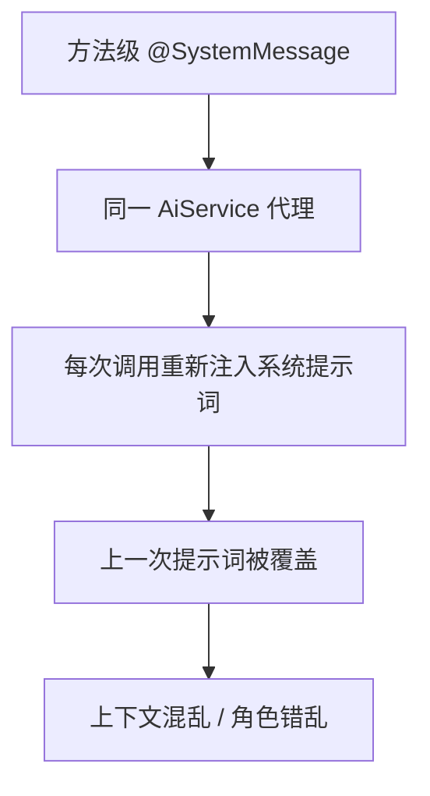

# 35. 多 AiService 隔离与系统提示词位置

## 纲要

- **问题现象**：多个不同系统提示词的方法写在**同一个 AiService 代理对象**里，第二次调用会覆盖第一次的系统提示词，导致**会话上下文混乱**
- **根因**：LangChain4j 的 AiService 是动态代理，共用实例时，方法级 `@SystemMessage` 每次都重新注入，把上一次的提示词顶掉
- **解法一**：把不同业务方法拆到**不同的 AiService 类**，彼此隔离
- **解法二**：把 `@SystemMessage` 从**方法级提到类级**（标注在接口/类上），保证系统提示词永远在对话最前面
- **V1 实践**：意图分析、丢失登记、找到登记各建独立 AiService，避免串台

> 代码按课程口径重构示意。这是前述最容易被忽略、却最致命的一个架构坑。

## 一、问题复现

假设意图分析与登记方法都在同一个 `AiChatService`：

```java
public interface AiChatService {
    @SystemMessage("回答要简洁")          // 第一次调用
    String askA(@UserMessage String m);

    @SystemMessage("请用中文详细解释")     // 第二次调用
    String askB(@UserMessage String m);
}
```

第一轮调 `askA`：「什么是量子计算」→ 简洁回答，正常。
第二轮调 `askB`：「请解释量子计算原理」→ 因为共用同一代理，**第二次的系统提示词覆盖第一次**，模型不知道该按哪套规则答，上下文错乱。

## 二、根因剖析



核心：AiService 代理对象内部维护对话，但**系统提示词若随方法变化**，就会把之前那套顶掉，模型失去稳定角色锚点。

## 三、解法一：拆独立 AiService 类

把每个业务建独立接口，各自持有一套稳定的系统提示词：

```java
// 意图分析专用
@SystemMessage(fromResource = "prompts/system-intention.txt")
public interface IntentionAiService {
    IntentionOutput intention(@MemoryId String sessionId, @UserMessage String message);
}

// 丢失登记专用
@SystemMessage(fromResource = "prompts/system-register-lost.txt")
public interface LostRegisterAiService {
    RegisterLostOutput registerLost(@MemoryId String sessionId, @UserMessage String message);
}
```

各自实例化，互不干扰，彻底消除覆盖。

## 四、解法二：系统提示词提到类级

即便拆了类，如果系统提示词还写在方法上，每次调用仍可能插入到对话中间。把它提到类/接口上：

```java
@SystemMessage(fromResource = "prompts/system-register-lost.txt")  // 类级
public interface LostRegisterAiService {
    // 方法上不再重复 @SystemMessage，保证每次调用都在最前
    RegisterLostOutput registerLost(@MemoryId String sessionId, @UserMessage String message);
}
```

> 类级系统提示词 = 角色锚点永远在对话第一条，模型不会「忘了自己是谁」。

## 五、V1 最终结构

按前述优化版，每个功能独立 AiService：

| AiService 类 | 职责 |
|---|---|
| IntentionAiService | 意图分析 |
| LostRegisterAiService | 丢失登记 |
| LostModifyAiService | 丢失修改 |
| FoundRegisterAiService | 找到登记 |
| FoundModifyAiService | 找到修改 |

## 六、FAQ

**Q1：拆多个 AiService 会不会更耗资源？**
不会显著；它们只是代理配置，底层共享同一个 ChatModel 连接。

**Q2：类级 vs 方法级系统提示词怎么选？**
角色稳定的放类级；同一角色下不同子任务的微调才放方法级。

**Q3：上下文混乱只影响提示词吗？**
主要表现就是角色/规则漂移，模型答非所问，体验直接崩。

## 七、面试高频问答

**1. LangChain4j 多个系统提示词共用 AiService 有什么坑？**
方法级 `@SystemMessage` 在共用代理下会互相覆盖，导致上下文混乱；拆独立类 + 类级提示词解决。

**2. @MemoryId 能解决上下文混乱吗？**
不能；`@MemoryId` 管会话隔离，提示词覆盖是另一维度的问题。

**3. 为什么系统提示词要放类级？**
保证角色锚点永远在对话最前，模型不会中途「变角色」。

## 八、ops 提示（架构红线）

> **一个 AiService 一类角色**：不要图省事把多个业务塞进一个接口，后期提示词冲突极难排查。
>
> **类级锚定角色**：稳定角色用类级 `@SystemMessage`，方法级只做子任务微调。
>
> **回归测试**：每拆一个 AiService，跑一遍「连续两轮不同意图」验证不串台。

