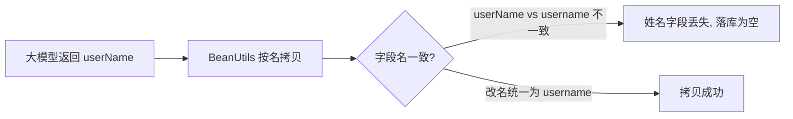

# 36. 数据持久化：BaseEntity 与 lostregister

## 纲要

- **表结构**：`lostregister`（create_time / update_time / user_name / phone / lost_name / lost_feature）
- **抽象基类**：`BaseEntity`（主键 ID + 创建时间 + 修改时间）抽取公共字段，实体继承它避免冗余
- **通用持久层**：`BaseRepository<T extends BaseEntity,ID>` 继承 `JpaRepository`，各业务 Repository 只需继承即可获得 CRUD
- **落库判定**：`RegisterLostOutput.isComplete == true` 才持久化；`BeanUtils.copyProperties` 拷贝到 Entity；`save` 有 ID 即 update、无 ID 即 insert
- **踩坑实录**：数据库列 `username` 全小写，大模型返回 `userName` 大写 → `BeanUtils` 拷贝字段丢失；改小写后复测通过

> 代码按课程口径重构示意（外部课件代码卷未挂载）。底层用 JPA（`spring-boot-starter-data-jpa`）。

## 一、表与实体

```sql
CREATE TABLE lostregister (
    id           BIGINT PRIMARY KEY AUTO_INCREMENT,
    create_time  DATETIME,
    update_time  DATETIME,
    user_name    VARCHAR(64),
    phone        VARCHAR(32),
    lost_name    VARCHAR(128),
    lost_feature VARCHAR(512)
);
```

```java
// entity/BaseEntity.java —— 抽象基类
@MappedSuperclass
public abstract class BaseEntity {
    @Id @GeneratedValue(strategy = GenerationType.IDENTITY)
    private Long id;
    private LocalDateTime createTime;
    private LocalDateTime updateTime;
    // getter/setter
}

// entity/LostRegister.java
@Entity
@Table(name = "lostregister")
public class LostRegister extends BaseEntity {
    private String userName;
    private String phone;
    private String lostName;
    private String lostFeature;
    // getter/setter
}
```

## 二、通用 Repository

```java
// repository/BaseRepository.java
@NoRepositoryBean
public interface BaseRepository<T extends BaseEntity, ID extends Serializable>
        extends JpaRepository<T, ID> { }

// repository/LostRegisterRepository.java
public interface LostRegisterRepository extends BaseRepository<LostRegister, Long> { }
```

`BaseRepository` 用 `@NoRepositoryBean` 标记为中间接口，不单独实例化；业务 Repository 继承它即拥有增删改查。

## 三、落库逻辑

```java
// service 内
if (output.isComplete()) {
    LostRegister entity = new LostRegister();
    BeanUtils.copyProperties(output, entity);   // 字段名需一致
    lostRegisterRepository.save(entity);        // 有 ID→update, 无 ID→insert
}
```

JPA 的 `save` 是 upsert 语义：实体带 ID 就走更新，不带就插入。这为「丢失修改」埋下伏笔——只要大模型回填了 ID，同一个 `save` 就变成 update。

## 四、踩坑：username 大小写映射

测试时发现：大模型返回的 JSON 字段是 `userName`（驼峰大写 N），而数据库列/实体字段是 `username`（全小写）。`BeanUtils.copyProperties` 按**字段名精确匹配**，大小写不一致直接丢字段，落库后姓名全空。



**修复**：把实体/输出结构里的字段统一为小写 `username`，重新联调，姓名正常落库。

## 五、FAQ

**Q1：BaseEntity 为什么用 @MappedSuperclass？**
让公共字段映射进子类表，但不单独建表；配合 `@NoRepositoryBean` 的中间 Repository 形成通用基线。

**Q2：save 怎么区分新增和更新？**
看实体 ID 是否为空/是否为持久态；有 ID 走 update，无 ID 走 insert。

**Q3：BeanUtils 拷贝失败为何不报错？**
它是按属性名反射赋值，匹配不上就跳过，静默丢字段，极难察觉，务必核对命名。

## 六、面试高频问答

**1. JPA 通用 CRUD 怎么抽象？**
定义带 `@NoRepositoryBean` 的泛型 `BaseRepository<T extends 基类,ID>` 继承 `JpaRepository`，业务 Repository 直接继承。

**2. save 的 upsert 语义？**
`CrudRepository.save` 依据 ID 是否存在决定 insert 或 update，是 JPA 标准行为。

**3. 对象拷贝字段丢失如何排查？**
核对源/目标字段名与类型完全一致；用日志打印拷贝前后对象，定位静默丢失。

## 七、ops 提示（持久化红线）

> **字段命名全链路一致**：大模型输出结构 → 实体 → 数据库列，三者命名（尤其大小写）必须统一，否则 BeanUtils/MapStruct 静默丢字段。
>
> **save 即 upsert**：利用「有 ID 即更新」特性实现修改功能，无需额外 update 方法。
>
> **DDL 用 update 谨慎**：`ddl-auto=update` 仅适合开发；生产用 Flyway/Liquibase 管表结构。

