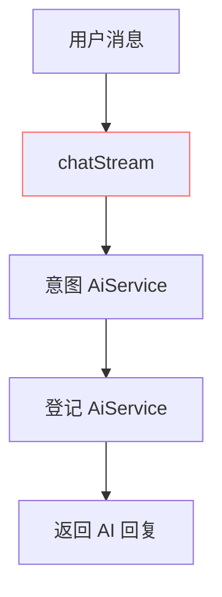

# 37. AOP 切面持久化会话记录：ChatFlow

## 纲要

- **痛点**：`ChatMemory` 基于内存，系统重启会话全丢；且一次请求经「意图 + 登记」两个 AiService，一来一回产生 4 条消息，而期望是「1 条用户 + 1 条 AI 回复」
- **解法**：用 AOP 切面在 `chatStream` 调用**前后**分别落库，把所有对话持久化到 `chathistory`
- **自定义注解**：`@ChatFlow` 标注在 `chatStream` 方法上，触发切面
- **切面逻辑**：`@Around` 取 `args[0]=sessionId`、`args[1]=message`；调用前存用户消息（role=0），调用后存 AI 响应（role=1）
- **实体/Repository**：`ChatHistory`（session_id / chat_id / role / content）+ `ChatHistoryRepository` 继承 BaseRepository

> 代码按课程口径重构示意。注意：这一步只解决「对话落库」，真正「把历史喂回大模型」靠前述的自定义 Tool。

## 一、为什么需要 AOP 持久化



一次 `chatStream` 经历两个 AiService，每个产生 2 条消息 → 共 4 条。但业务只想要「用户一句 + AI 一句」。AOP 在方法边界统一收割，避免在每个 AiService 里各自写落库。

## 二、自定义注解与切面

```java
// aop/ChatFlow.java
@Target(ElementType.METHOD)
@Retention(RetentionPolicy.RUNTIME)
public @interface ChatFlow { }

// aop/ChatFlowAspect.java
@Aspect
@Component
public class ChatFlowAspect {

    private final ChatHistoryRepository chatHistoryRepository;

    @Around("@annotation(ChatFlow)")
    public Object around(ProceedingJoinPoint pjp) throws Throwable {
        Object[] args = pjp.getArgs();
        String sessionId = (String) args[0];   // 第一个参数
        String message  = (String) args[1];    // 第二个参数

        saveChatHistory(sessionId, message, 0);       // 调前: 用户消息 role=0
        Object result = pjp.proceed();                // 执行目标方法
        saveChatHistory(sessionId, result.toString(), 1); // 调后: AI 回复 role=1
        return result;
    }

    private void saveChatHistory(String sessionId, String content, int role) {
        ChatHistory h = new ChatHistory();
        h.setSessionId(sessionId);
        h.setRole(role);
        h.setContent(content);
        chatHistoryRepository.save(h);
    }
}
```

## 三、ChatHistory 实体与 Repository

```java
// entity/ChatHistory.java
@Entity
@Table(name = "chathistory")
public class ChatHistory extends BaseEntity {
    private String sessionId;   // 会话标识
    private String chatId;      // 消息唯一 ID
    private int role;           // 0=用户, 1=AI
    private String content;     // 消息内容
    // getter/setter
}

// repository/ChatHistoryRepository.java
public interface ChatHistoryRepository extends BaseRepository<ChatHistory, Long> { }
```

## 四、标注切点

```java
@Service
public class ChatFlowServiceImpl implements ChatFlowService {

    @ChatFlow                                   // 触发切面
    public Flux<String> chatStream(String userId, String message) {
        // 意图路由...
    }
}
```

Spring 在执行 `chatStream` 前后自动走入 `ChatFlowAspect`，把对话写进 `chathistory`，为后续「读历史喂模型」做准备。

## 五、FAQ

**Q1：为什么不用 ChatMemory 直接落库？**
内存 ChatMemory 重启即丢；AOP 是旁路持久化，不改业务代码，解耦更干净。

**Q2：role 字段干嘛用？**
区分消息来源（用户/AI），前端展示与后续 Tool 读取时过滤只需看 role。

**Q3：切面取参为什么用 args[0]/args[1]？**
目标方法签名固定 `(userId,message)`，按顺序强转即可；若参数顺序变需同步改切面。

## 六、面试高频问答

**1. 用 AOP 做对话持久化的好处？**
业务无侵入，统一在方法边界收割前后消息，避免散落在各 AiService。

**2. @Around 与 @Before/@After 的区别？**
@Around 能控制目标方法是否执行并拿到返回值，适合「前后都落库」场景。

**3. 会话历史表为何单独建？**
与业务数据表解耦，便于把 ChatMemory 存储介质整体切换而不动业务。

## 七、ops 提示（会话持久化）

> **AOP 切点要稳定**：`chatStream` 的参数顺序/个数一旦调整，切面取参逻辑必须同步改，否则强转出错。
>
> **chat_id 全局唯一**：消息唯一标识用 UUID，避免并发插入冲突。
>
> **历史喂回在。

