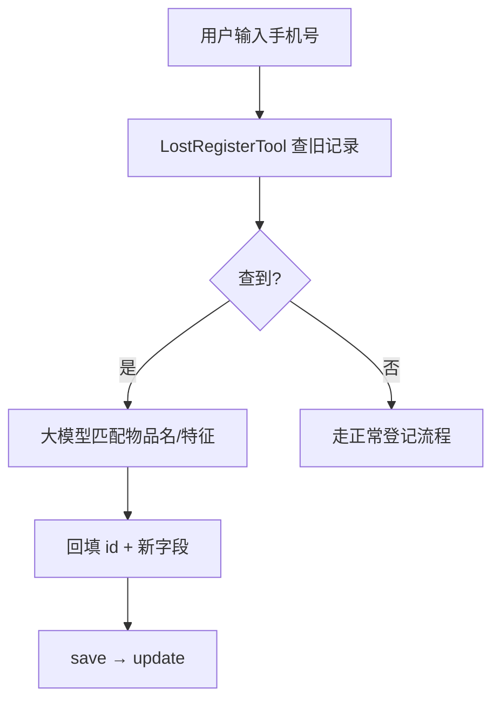

# 39. 失物登记修改与幻觉防护

## 纲要

- **修改功能**：用户报手机号 → 调 `LostRegisterTool.queryLostByPhone` 查旧记录 → 大模型匹配物品名/特征 → 回填主键 ID → `save` 自动变 update
- **主键回填**：`RegisterLostOutput` 新增 `id` 字段，让模型返回数据库记录 ID，持久化层据此 upsert
- **幻觉场景**：用户说「补充登记」却没给手机号，大模型**凭空编造手机号** → 查不到旧记录 → 数据错乱
- **幻觉修复**：提示词加硬约束「未输入手机号不得自动生成，必须用户真实提供」
- **限制补全**：提示词要求「结合历史、承上启下、完成必须明确告知」，提升体感

> 代码按课程口径重构示意。修改功能几乎零新增持久化代码，全靠 JPA upsert 语义 + ID 回填。

## 一、修改功能流程



## 二、手机号查询 Tool

```java
// tools/LostRegisterTool.java
@Component
public class LostRegisterTool {

    private final LostRegisterRepository repository;

    @Tool("根据手机号码查询丢失信息")
    public List<LostRegister> queryLostByPhone(@P("手机号") String phone) {
        return repository.findLostByPhone(phone);
    }
}
```

Repository：`List<LostRegister> findLostByPhone(String phone);`

## 三、主键回填实现 update

`RegisterLostOutput` 增加 `id` 字段，提示词要求命中旧记录时把数据库 `id` 填回：

```java
public class RegisterLostOutput {
    private Long id;            // 新增: 数据库记录 ID
    private String output;
    private String userName;
    private String phone;
    private String lostName;
    private String lostFeature;
    private boolean isComplete;
}
```

持久化层**无需改代码**——`BeanUtils` 把带 `id` 的输出拷进 Entity，`repository.save(entity)` 因 ID 非空自动走 update。

提示词补充：「用户输入手机号 → 调查询工具 → 匹配物品名/特征 → 返回匹配记录并填充 `id`；判断是否为补充数据，是则询问是否补充，否则走正常登记。」

## 四、幻觉复现与修复

**复现**：用户「我要补充失物登记信息」，未给手机号。控制台发现大模型**自己编了个手机号**（如 13800…）去调 `LostRegisterTool`，自然查不到，流程崩。


**修复**：在提示词加硬约束——

```
如果用户要补充丢失信息，必须要求其提供姓名和手机号；
若用户未输入手机号，不得随意自动生成手机号码，必须等用户输入真实手机号。
```

重启复测：未输入手机号时，模型不再调 `LostRegisterTool`，而是先索要真实手机号，幻觉消除。

## 五、FAQ

**Q1：修改功能为什么几乎不改持久化代码？**
靠 JPA `save` 的 upsert 语义 + 模型回填 `id`，有 ID 即更新，无需独立 update 方法。

**Q2：幻觉只能靠提示词堵吗？**
提示词是第一道防线；还可加「手机号格式校验」「未查到则拒绝」等后置校验兜底。

**Q3：为什么查到后要匹配物品名/特征？**
同手机号可能有多个丢失记录，需按当前对话的物品匹配出正确那条再回填 ID。

## 六、面试高频问答

**1. 大模型幻觉如何工程化防护？**
提示词硬约束 + 后置业务校验（格式/存在性）双保险；纯提示词不绝对可靠。

**2. 如何实现「修改已有记录」？**
让模型返回记录主键，持久层 upsert；比「先查再手填」更顺滑。

**3. 为什么必须用户真实提供手机号？**
自动生成会导致查空、错配，破坏数据一致性；身份标识必须来自用户。

## 七、ops 提示（防幻觉红线）

> **身份类字段不代填**：手机号/姓名等标识必须由用户真实提供，提示词明令禁止模型生成。
>
> **后置校验兜底**：即使提示词约束，也应在落库前校验「手机号格式 + 记录存在」，不迷信模型。
>
> **幻觉可观测**：把 Tool 调用参数打印日志，一旦出现非用户输入的手机号立即告警。

