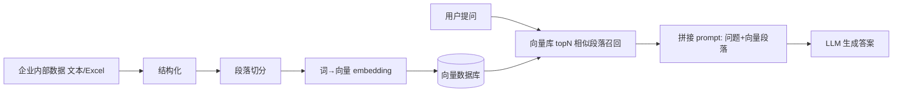

# 3. 向量数据库与模型微调：RAG 雏形与 LoRA 低参微调

## 纲要

- **向量数据库**：让大模型变聪明灵活；企业把内部数据（文本/Excel）结构化 → 段落切分 → 词变**向量（embedding）**存入向量库；用户提问→向量库**topN 相似段落**召回 → 拼 prompt → LLM 生成答案；这就是 **RAG 直线流程雏形**
- **痛点**：大模型训练时拿不到企业内部数据（如建筑设计/预算），无法直接生成方案；补数据才能满足要求
- **模型微调**：大模型能力不足的终极解法；参数=一堆数字（维度）；分**全参微调**（重构全部参数，可能丢失原通用能力，两极分化）与**低参微调（如 LoRA/阿里 PAI）**（内存开销小、训练快、兼容原推理）
- **实务取舍**：预训练模型覆盖 80% 通用场景；企业专业场景需调参训新模型；RAG 与微调**同等重要**，从底层逻辑优化模型

> 概念章，按课程口径重构；无代码，重在理解 RAG 与微调两条优化路径。

## 一、向量数据库与 RAG 雏形

### 1.1 为什么需要向量库

场景：建筑设计公司接单后需 5~10 人花 1~2 周出方案/预算；想压缩到人少时间短，需 AI 帮忙——但**大模型训练时根本拿不到企业内部设计/预算数据**，无法自动生成。

解法：给企业 AI 补充内部内容 → 引入向量数据库。

### 1.2 embedding 与检索流程

1. 企业数据变结构化 → 切分成段落。
2. 段落里的词 → 转成数字向量（**embedding**），存入向量库。
3. 用户提问传向量库 → 做数据匹配 → 返回 **topN 最相似段落**。
4. 取前 5 相似段落 + 用户提问 → 构建 prompt → 送 LLM → 识别问题并生成答案。

> 这就是 **RAG（检索增强生成）的直线过程雏形**；后续 RAG 原理会更深挖 embedding 技术。

## 二、模型微调

### 2.1 为什么微调

通用大模型（OpenAI/DeepSeek 等）在推理场景可能达不到企业效果——**参数有问题**（模型大小由参数数量决定，参数是一堆数字/维度）。拿到基座（预训练）模型后常做微调。

### 2.2 全参 vs 低参微调

| 类型 | 做法 | 后果 |
|---|---|---|
| **全参数微调** | 重构整个预训练模型参数，得新模型 | 两极分化：满足新场景，但原模型通用推理能力可能退化（不灵光） |
| **低参数微调（LoRA/阿里 PAI 等）** | 只调少量参数 | 内存开销小、训练时间短、满足业务模型，且兼容原大模型推理功能（推荐） |

> 实际企业开发：**无论 RAG 还是微调都同等重要**，从底层逻辑优化，让新模型比预训练模型更贴合实际业务。预训练模型覆盖约 80% 通用场景；企业专业/高专业度文本需调参训新模型。

## 三、FAQ

**Q1：向量数据库解决什么？**
让大模型变聪明灵活：把企业数据 embedding 存库，提问时 topN 召回相似段落喂 LLM。

**Q2：embedding 是什么？**
把段落里的词转成数字向量，便于相似度匹配；后续 RAG 章节深挖。

**Q3：RAG 雏形流程？**
企业数据→结构化→切段→embedding→向量库；提问→topN 相似段→拼 prompt→LLM 生成。

**Q4：全参微调为什么危险？**
重构全部参数可能让原预训练模型的通用能力退化，两极分化。

**Q5：为什么选低参微调？**
内存小、训练快、兼容原推理，企业一般选 LoRA 类低参微调。

**Q6：RAG 和微调哪个重要？**
同等重要，都是底层优化；RAG 补知识，微调改能力。

## 四、面试高频问答

**1. 向量数据库在 RAG 中作用？**
存储 embedding 向量，按相似度 topN 召回相关段落，作为 LLM 生成的事实依据。

**2. embedding 本质？**
将文本/词映射为高维数字向量，使语义相似的内容在向量空间相近。

**3. 全参微调与 LoRA 区别？**
全参重构所有参数（可能丢通用能力）；LoRA 等低参只调少量参数（省资源、兼容原模型），企业首选低参。

**4. 大模型局限性三大类？**
没问清（提示词）、缺知识（RAG）、能力不足（微调）。

**5. 预训练模型覆盖度？**
约 80% 通用业务场景；企业专业场景需微调/RAG 补强。

**6. 微调与 RAG 如何取舍？**
RAG 从外部补知识、改动小；微调改底层参数、贴合深；按数据敏感度/时效/成本组合用。

## 五、ops 提示（架构与成本）

> **RAG 优先于微调**：多数企业场景先用 RAG 补知识（成本低、可解释），确有能力缺口再微调。
>
> **向量库选型**：LangChain4j 直接提供向量存储库 + 向量库 API，简单粗暴；后续落地。
>
> **微调成本**：全参微调算力惊人（参考 GPT4 数十亿美金级），企业量力选低参 LoRA。
>
> **数据质量**：RAG 效果取决于切分与 embedding 质量；微调效果取决于训练数据，二者都需数据管道清洗。

