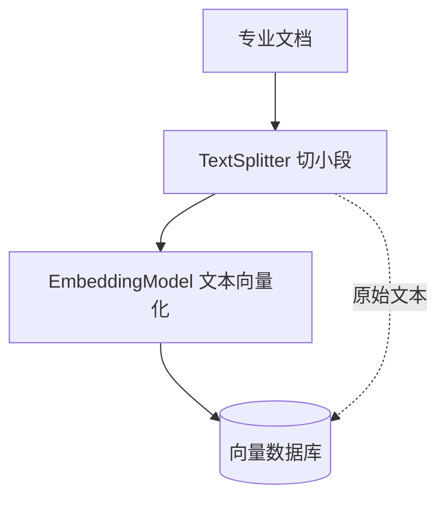
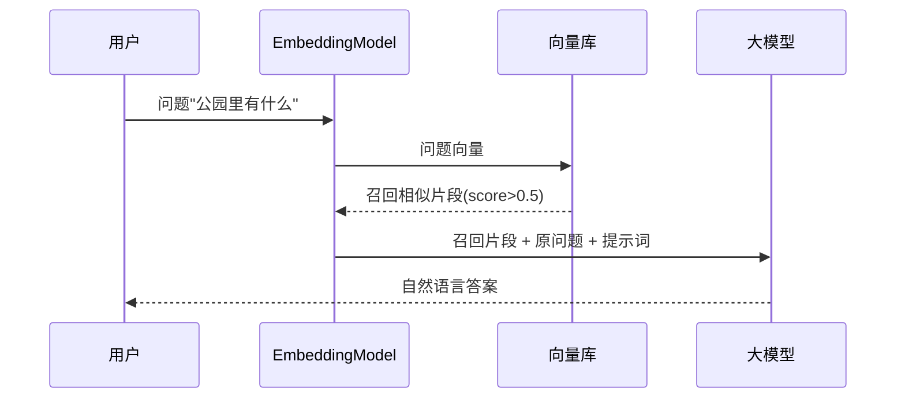

# 43. RAG 全流程：建立索引与检索增强生成

## 纲要

- **建立索引四步**：加载文档 → 文本分割 → 向量化（Embedding）→ 存入向量数据库
- **检索增强生成**：用户问题向量化 → 向量库相似检索 → 召回片段 + 原问题 + 提示词 → 大模型生成答案
- **官方图要点**：LangChain4j 官网 RAG 图清晰展示「文档→splitter→Embedding model→向量库」
- **核心组件**：`Document` / `DocumentSplitter` / `EmbeddingModel` / `EmbeddingStore`
- **关键认知**：RAG = 外挂知识库；让没训练过的企业数据「长」进大模型回答里

> 代码按课程口径重构示意（外部课件代码卷未挂载）。本卡把前述概念落成对端到端流程，是后续编码的总地图。

## 一、建立索引过程

每一段文本与其向量一并存入向量库，供后续检索。

## 二、检索增强生成过程

## 三、两段式对比

| 阶段 | 动作 | 是否耗训练 |
|---|---|---|
| 建立索引 | 文档→分割→向量化→入库 | 否 |
| 检索生成 | 问题向量化→检索→拼提示词→生成 | 否 |

RAG 全程**不训练模型**，只操作外部知识库与大模型推理。

## 四、为什么需要分割

大模型上下文窗口有限；不分段的整文档可能超窗口，且长文易致幻觉/不精准。分割成片段后逐段向量化、按需召回。

## 五、FAQ

**Q1：索引和检索用的 Embedding 必须同一个模型吗？**
必须一致；否则问题与文档向量空间不同，相似度无意义。

**Q2：原始文本也要存吗？**
要；向量只用于检索排序，最终喂给大模型的是原始文本片段。

**Q3：索引建一次还是每次查询都建？**
索引是离线/一次性构建，查询只做检索，不重建。

## 六、面试高频问答

**1. RAG 的两个阶段？**
建立索引（文档→向量库）与检索增强生成（向量检索→拼提示词→生成）。

**2. 为什么原始文本和向量都要存？**
向量用于相似度排序，文本才是真正喂给大模型的「知识」。

**3. 索引阶段为何要分割？**
适配上下文窗口、降低噪声、提升召回精度。

## 七、ops 提示（流程红线）

> **Embedding 模型两阶段一致**：建索引与查询必须用同一模型，维度也要一致。
>
> **分割粒度影响召回**：片段过大漏细节、过小失上下文；递归分割默认 ≤300 token 是稳妥起点。
>
> **知识库即外挂**：RAG 让企业私域数据「实时可用」，但索引需随数据更新重建/增量。

