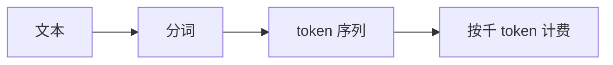

# 47. Token 计费与百炼 Embedding 模型接入

## 纲要

- **Token 定义**：模型表示自然语言的最小单位/计费单元；可理解为字/词/数字/符号；1 中文字 ≈ 0.6 token（各模型分词不同有差异）
- **百炼 Embedding 版本**：v1→v4，维度随版本升高（描述更精准）；v4 单行最大 ~8000 token、语言更全
- **为什么要接百炼 Embedding**：内置模型功能/稳定性弱；大厂模型多场景、稳定、有容错
- **接入步骤**：`application.properties` 配 APIKey + 模型名（如 `text-embedding-v3`）→ `EmbeddingModel.embed(text)` → 取 `embedding.content()` / `dimension()`
- **常见坑**：模型名多空格会报 `ModelNotFoundException`；`TokenCountEstimator` 可估算 token

> 代码按课程口径重构示意（外部课件代码卷未挂载）。本卡覆盖 8-11/8-12。

## 一、Token 概念与计费



不同模型分词不同，换算比例有差异；百炼模型列表给出每千 token 输入/输出单价与 QPM 限制。

## 二、百炼 Embedding 版本演进

| 版本 | 维度 | 单行最大 token | 语言 |
|---|---|---|---|
| v1 / v2 | 较低 | ~2000+ | 较少 |
| v3 | 1024（课程用） | 更高 | 较全 |
| v4 | 更高 | ~8000 | 最全 |

维度越高，事物描述越精准；课程接入 `text-embedding-v3`，输出维度 1024。

## 三、接入代码

```java
// application.properties
langchain4j.embedding.openai.api-key=${DASHSCOPE_API_KEY}
langchain4j.embedding.openai.model-name=text-embedding-v3

// 测试
EmbeddingModel model = ...;                       // 注入百炼 EmbeddingModel
Embedding embedding = model.embed("我喜欢打篮球");
System.out.println(embedding.dimension());        // 1024
System.out.println(embedding.content());          // 向量数组
```

> 坑：模型名串里多一个空格 → `ModelNotFoundException`；复制时务必去掉首尾空格。

## 四、Token 估算

```java
// 百炼 token 估算器
TokenCountEstimator estimator = new QianfanTokenCountEstimator(modelName); // 或对应平台
int count = estimator.estimate("一段文本");     // 返回 token 数
```

也可在百炼「模型观测」页看调用量、平均时延、token 统计。

## 五、FAQ

**Q1：中文 token 怎么算？**
约 0.6 token/字，但各模型分词不同，以实际估算为准。

**Q2：维度高低怎么选？**
高维度更精准但存储/计算更贵；按检索质量要求与成本权衡，v3/v4 是主流。

**Q3：维度必须和向量库索引一致？**
必须；否则写入失败。

## 六、面试高频问答

**1. 什么是 token？**
模型处理与计费的最小语言单位，近似字/词；是 RAG/对话的成本核心。

**2. 为什么接百炼 Embedding 而非内置？**
内置弱且不稳；大厂模型维度高、场景多、有容错保障。

**3. Embedding 模型版本怎么选？**
按维度/单行 token 上限/语言支持权衡；v3/v4 覆盖绝大多数企业场景。

## 七、ops 提示（接入红线）

> **模型名零空格**：复制模型名常带尾空格致 `ModelNotFoundException`，粘贴后 trim。
>
> **维度对齐向量库**：百炼 Embedding 输出维度必须等于 Pinecone 索引维度，建索引前先取 `dimension()`。
>
> **监控 token 用量**：用模型观测页盯 QPM/费用，避免超限与预算失控。

