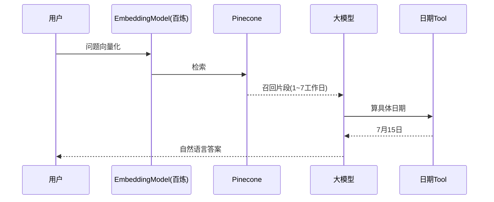

# 49. 京东外卖客服 RAG 落地实践（全链路）

## 纲要

- **目标**：用 RAG 把「京东外卖私域 QA」变成企业级客服大脑，弥补大模型未训练的企业数据
- **知识库**：`京东.txt`，规整「问题\n答案」结构，共 31 条；排版规整让分割最简单
- **全链路**：加载（ClassPath）→ 自定义正则分割（按行切 QA）→ 百炼 Embedding 向量化 → 写入 Pinecone → 检索（SearchRequest,maxResults=1,minScore=0.8）→ AiService 整合检索+大模型+日期工具
- **Agent 配置**：`AiServices` 用 `contextRetriever(ContentRetriever.from(embeddingModel,embeddingStore,maxResults(1),minScore(0.8)))` 让对话自带检索
- **本地工具**：日期计算 Tool（工作日推算），大模型结合 RAG 召回的「1~7 个工作日」算出具体日期

> 代码按课程口径重构示意（外部课件代码卷未挂载）。本卡覆盖 8-15/8-16/8-17/8-18/8-19，是 RAG 章的收口实战。

## 一、知识库加载与分割

```java
// 从 classpath 加载
InputStream is = getClass().getClassLoader().getResourceAsStream("京东.txt");
Document doc = new TextDocumentParser().parse(is);
// 自定义按行正则分割（一问一答）
DocumentSplitter splitter = new QASplitter();        // 实现 DocumentSplitter, 按换行切
List<TextSegment> segments = splitter.split(doc);    // 得到 31 个 QA 片段
```

知识库排版规整（问题换行答案），正则按行切最省事；不规整的数据后续代码处理麻烦。

## 二、向量化与建索引到 Pinecone

```java
// 百炼 Embedding 向量化整批片段
List<Embedding> embeddings = embeddingModel.embedAll(segments).content();
// 一并写入 Pinecone（向量 + 原始文本）
for (int i = 0; i < segments.size(); i++) {
    store.add(embeddings.get(i), segments.get(i));
}
// 控制台可见 index 数据量 = 31，与分割长度一致
```

## 三、检索实现

```java
Embedding q = embeddingModel.embed("在线支付取消订单后钱怎么返").content();
SearchRequest req = SearchRequest.builder()
    .queryEmbedding(q)
    .maxResults(1)        // 取最相近 1 条
    .minScore(0.8)        // 最低相似度 0.8
    .build();
EmbeddingSearchResult<TextSegment> res = store.search(req);
TextSegment top = res.matches().get(0).embedded();   // 召回片段
System.out.println(res.matches().get(0).score());    // ~0.9
```

实测「京东支持哪些支付方式」→ 召回「支付宝/网银/储蓄卡/信用卡」，score 0.9。

## 四、RAG + 大模型 + 本地工具

```java
// Agent 配置：让 AiService 自带检索
ContentRetriever retriever = ContentRetriever.from(
        embeddingModel, embeddingStore, maxResults(1), minScore(0.8));

interface JdAiService {
    @SystemMessage("你是京东外卖客服机器人，专门回答京东外卖相关问题")
    String sendMessage(@MemoryId String sid, @UserMessage String msg);
}
// 构造时 .contextRetriever(retriever)
```

当用户问「今天提现余额最晚什么时候到账」，RAG 召回「1~7 个工作日」，大模型**结合本地日期 Tool**（推算工作日）算出具体日期（如 7 月 4 日 + 7 工作日 = 7 月 15 日）。

## 五、底层全链路图



## 六、FAQ

**Q1：为什么知识库要排版规整？**
规整数据（如 QA 换行）让分割代码极简、效果稳；乱排版后期处理成本高。

**Q2：contextRetriever 的作用？**
把「向量模型+向量库+检索参数」绑进 AiService，对话时自动先检索再回答。

**Q3：本地工具为何还要？**
RAG 给知识，工具补计算（如日期推算），二者结合才算出具体答案。

## 七、面试高频问答

**1. 一个完整 RAG 应用有哪些环节？**
加载 → 分割 → 向量化 → 入库 → 检索 → 拼接提示词 → 大模型生成（+可选本地工具）。

**2. contextRetriever 与手动 search 区别？**
手动 search 自己取片段；`contextRetriever` 把检索内嵌进 AiService，对话自动带知识。

**3. 为何 RAG 召回后还要大模型？**
召回的是原始片段，需大模型结合问题、用自然语言封装成答案，必要时调工具计算。

## 八、ops 提示（落地红线）

> **知识库先规整**：源数据排版决定分割复杂度，QA 换行/空行分隔最优。
>
> **检索参数回归**：`maxResults`/`minScore` 用真实问句调，0.8 非万能。
>
> **索引数量与维度**：Pinecone 免费索引有限、维度须对齐 Embedding，建前规划。
>
> **工具补足计算**：RAG 只给知识，涉及日期/运算务必配本地 Tool，否则答非所问。

