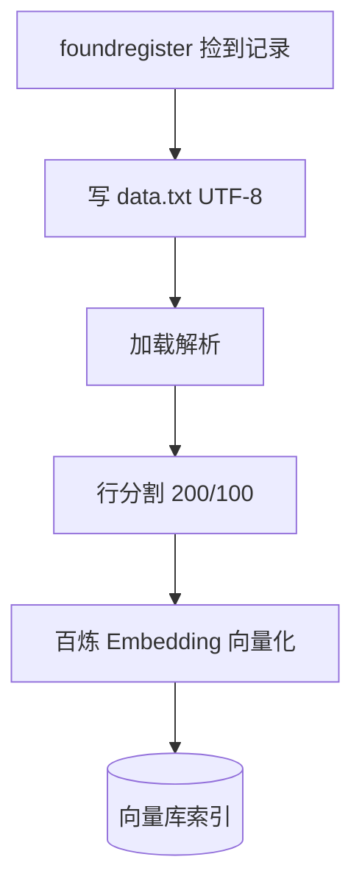

# 50. V2 索引建立：从 foundregister 到向量库

## 纲要

- **V2 主线**：把前述 RAG 融回失物招领，补全 V1 遗留的「失物查询」（意图 3）
- **查询基础**：失物查询基于 RAG——先把 `foundregister`（捡到登记）数据向量化建索引，再按用户丢失特征检索
- **RAGConfig 三件套**：`EmbeddingStore`（课程用内存版）、`EmbeddingModel`（千问 text-embedding-v3）、`ContentRetriever`（maxResults=2,minScore 先 0.5 后调到 0.8）
- **建索引流程**：查 `foundregister` 全部 → 写 `data.txt`（UTF-8）→ `TextDocumentParser` 加载 → 行分割（maxChars=200,overlap=100）→ 百炼 Embedding 向量化 → 入库
- **调参经验**：minScore 调高到 0.8，避免召回不相关数据

> 代码按课程口径重构示意（外部课件代码卷未挂载）。本卡覆盖 9-1/9-2/9-3，聚焦 V2「建索引」这一步。

## 一、为什么 V2 要做索引

V1 因未学 RAG 一直没做「失物查询」。V2 用 RAG：把别人捡到并登记的物品（`foundregister`）转成向量，用户报「我的 X 找到没」时，按丢失特征去向量库匹配。



## 二、RAGConfig 配置

```java
@Configuration
public class RagConfig {
    @Bean
    public EmbeddingStore embeddingStore() {
        return new InMemoryEmbeddingStore();          // 课程用内存版
    }
    @Bean
    public EmbeddingModel embeddingModel() {
        return QianfanEmbeddingModel.builder()        // 千问 text-embedding-v3
                .apiKey(System.getenv("DASHSCOPE_API_KEY"))
                .modelName("text-embedding-v3")
                .build();
    }
    @Bean
    public ContentRetriever contentRetriever(EmbeddingStore store, EmbeddingModel model) {
        return EmbeddingStoreContentRetriever.builder()
                .embeddingStore(store)
                .embeddingModel(model)
                .maxResults(2)
                .minScore(0.8)                         // 由 0.5 调高到 0.8
                .build();
    }
}
```

## 三、建立索引实现

```java
// 1) 查 foundregister 全部 → 拼成字符串
List<FoundRegister> list = foundRegisterRepository.findAll();
List<String> lines = list.stream().map(FoundRegister::toText).collect(toList());
// 2) 写 data.txt
Files.write(Paths.get("/data/data.txt"), lines, StandardCharsets.UTF_8);
// 3) 加载 + 解析 + 行分割
Document doc = new TextDocumentParser().parse(Paths.get("/data/data.txt"));
DocumentSplitter splitter = DocumentSplitters.line(200, 100);   // 行分割, 200/重叠100
List<TextSegment> segments = splitter.split(doc);
// 4) 向量化 + 入库
List<Embedding> embeddings = embeddingModel.embedAll(segments).content();
for (int i = 0; i < segments.size(); i++) {
    embeddingStore.add(embeddings.get(i), segments.get(i));
}
```

## 四、调参：minScore

课程起初 `minScore=0.5` 会召回不相关数据；实测调到 **0.8** 结果更符合预期。每次重启（内存库）需先调 `/index` 重建索引。

## 五、FAQ

**Q1：为什么用内存向量库？**
课程演示简便；生产应换 Pinecone/PG 向量（见前述）。

**Q2：行分割 200/100 什么意思？**
每段最大 200 字符，相邻片段重叠 100 字符保持连贯。

**Q3：索引建一次还是每次查询建？**
索引离线/一次性建；查询只检索。内存库重启丢，需重建。

## 六、面试高频问答

**1. V2 相比 V1 新增什么能力？**
补齐「失物查询」——把 foundregister 向量化建索引，按丢失特征 RAG 检索。

**2. 建索引与检索用的 Embedding 必须一致？**
必须；否则向量空间不同，相似度无意义。

**3. minScore 怎么定？**
用真实问句回归；过低召回噪声，过高漏召回，课程 0.8 较稳。

## 七、ops 提示（索引红线）

> **内存库仅演示**：生产换持久化向量库；重启重建索引成本高。
>
> **minScore 回归**：0.8 非万能，用真实语料调。
>
> **写入前规整**：foundregister 转文本时字段拼接规整，分割检索更准。

> **。
