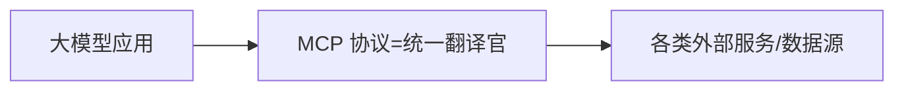

# 53. MCP 是什么与为什么需要

## 纲要

- **MCP 定义**：Model Context Protocol（模型上下文协议），2024-11 底由 Anthropic 发布的开放协议，标准化大模型应用与外部数据源/工具的集成
- **一句话定位**：AI 世界的「万能适配器」/ 高级版 Tools——遵循协议即可接入任意厂商提供的标准化能力
- **两种传输模式**：① STDIO（本地子进程，标准输入输出通信）② SSE/HTTP（服务端事件通道 + POST 通信）
- **解决三大问题**：① 数据孤岛（大模型无法直接访问实时数据/服务）② 开发效率低（Tool 重复造轮子）③ 生态碎片化（安全/统一）
- **生态规模**：官方市场已有 15000+ MCP Server 可供接入

> 代码按课程口径重构示意（外部课件代码卷未挂载）。本卡覆盖 10-1/10-2，建立 MCP 认知。

## 一、MCP 是什么

类比：不同服务各有接口/语言，MCP 像统一翻译官——只要服务遵循 MCP，大模型用同一种「翻译语言」即可互通，无需为每个服务单独开发对接。

> 类比 gRPC：gRPC 用标准化通信让不同语言服务互通；MCP 专为 AI 大模型设计，让模型用统一方式与各应用交互。

## 二、两种传输模式

| 模式 | 说明 |
|---|---|
| STDIO | 把 MCP Server 作为本地子进程运行，通过标准输入输出通信（需 Node.js/Python 环境） |
| SSE/HTTP | 客户端通过 SSE 通道收事件，用 HTTP POST 与 MCP 服务通讯 |

## 三、为什么需要 MCP

1. **数据孤岛**：大模型本身不能直接实时访问数据库/文件系统/天气等服务；MCP 像 USB 即插即用，需天气/内部数据库只需服务遵循协议。
2. **开发效率**：过去每个应用的 Tools 重复写、难复用；MCP 服务端写一次，所有兼容模型都能调，客户端不关心细节。
3. **生态碎片化**：MCP 内置权限控制与加密，保证开放数据安全；像 USB 接口让不同厂商工具即插即用，避免生态分裂。

## 四、FAQ

**Q1：MCP 和 LangChain4j 的 Tools 啥关系？**
MCP 是跨厂商协议级「高级 Tools」；Tools 是框架内的函数调用。MCP 让外部服务以标准方式成为模型可用工具。

**Q2：STDIO 为什么要本地环境？**
STDIO 把 Server 当子进程跑，需要 Node.js 或 Python 运行脚本。

**Q3：15000+ Server 怎么来的？**
各厂商按 MCP 协议发布服务，官方市场聚合，学会接一个就会接全部。

## 五、面试高频问答

**1. 什么是 MCP？**
Model Context Protocol，开放协议，标准化大模型与外部数据源/工具的集成，是 AI 世界的统一适配器。

**2. MCP 解决什么痛点？**
数据孤岛、工具开发重复、生态碎片化（安全/统一）三大问题。

**3. 两种传输模式？**
STDIO（本地子进程）与 SSE/HTTP（远程事件+POST）。

## 六、ops 提示（接入基线）

> **选型模式**：本地轻量用 STDIO；远程/多客户端用 SSE/HTTP。
>
> **生态复用**：优先查官方市场现成 Server，避免自造轮子。
>
> **安全第一**：MCP 内置权限/加密，接入第三方 Server 仍要审 APIKey 范围与 IP 白名单。

> **。
