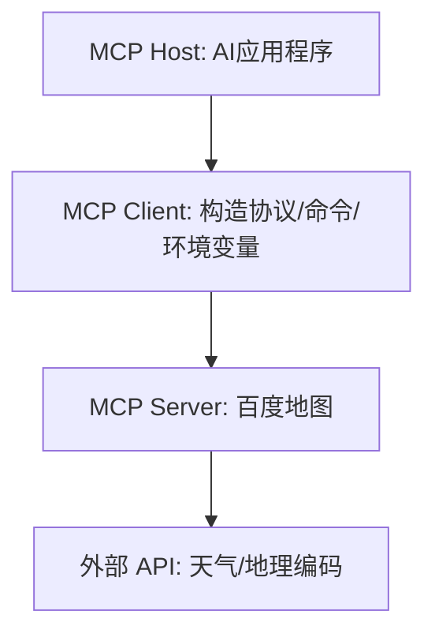

# 54. MCP 协议架构与接入百度地图实战

## 纲要

- **架构三件套**：MCP Host（AI 应用/开发环境）+ MCP Client（与 Server 一对一链接）+ MCP Server（提供 Tools / 调外部 API）
- **协议层**：标准化通信，Server 不论语言/实现，遵循协议即可被 Client 使用
- **Server 能力**：可提供本地逻辑（logics/data source），也可调外部互联网 API（如天气）
- **市场与准备**：官方市场 15000+ Server；接百度地图需在开放平台申请 APIKey + 配 IP 白名单 + 本地装 Node.js/Python（STDIO 模式）
- **LangChain4j 五步接入**：① 构建传输（StdioMCPTransport，command=`npx -y @baidu-maps/mcp-server` + 环境变量 AK）② 建 MCP Client ③ 建 ToolProvider（McpsToolProvider）④ 注入 AiService ⑤ 对话调用

> 代码按课程口径重构示意（外部课件代码卷未挂载）。本卡覆盖 10-3/10-4/10-5，是 MCP 落地的实操核心。

## 一、MCP 架构图



- **MCP Host**：我们写的业务代码/应用。
- **MCP Client**：构造传输协议、命令集、环境变量，与 Server 一对一链接。
- **MCP Server**：提供工具集（如天气查询），自身不足时再调内部服务（如墨迹天气 API 封装）。

## 二、接入前的准备

1. 到官方市场选服务（如百度地图，国内首家接入 MCP）。
2. 百度开放平台申请 APIKey，创建应用选「服务端」，勾选基础服务，配 **IP 白名单**。
3. 因走 **STDIO** 模式，本地必须装 **Node.js 或 Python**（用 `npx` 把 Server 当子进程启）。

## 三、LangChain4j 五步接入百度地图

```java
// 1) 构建传输（STDIO: 用 npx 启动百度地图 MCP Server）
McpTransport transport = new StdioMcpTransport.Builder()
    .command(List.of("npx", "-y", "@baidu-maps/mcp-server"))
    .environment(Map.of("BAIDU_MAP_API_KEY", apiKey))   // 环境变量传 AK
    .build();

// 2) 创建 Client
McpClient mcpClient = new DefaultMcpClient.Builder().transport(transport).build();

// 3) 创建工具集（告诉大模型有哪些 MCP 工具）
ToolProvider toolProvider = McpsToolProvider.builder().mcpClients(mcpClient).build();

// 4) 实例化 AiService 并注入工具集 + 流式模型
interface McpAiService {
    Flux<String> chat(@UserMessage String msg);
}
McpAiService ai = AiServices.builder(McpAiService.class)
    .streamingChatModel(qwenStreamingModel)   // 千问 plus 流式
    .toolProvider(toolProvider)               // 注入百度地图 MCP 工具
    .build();

// 5) 调用：问天气，大模型自动调 MCP 天气工具
ai.chat("北京这几天的天气怎么样").doOnNext(System.out::print).subscribe();
```

## 四、验证 MCP 生效

把 `toolProvider` 注掉重建 → 再问天气，大模型答「训练数据截止 2024-06，无法提供实时天气」。证明天气能力确由百度 MCP Server 提供，非模型自带。

## 五、SSE 传输（生产推荐，替代 STDIO）

STDIO 把 Server 当本地子进程，依赖本机 Node/Python、且不支持多客户端并发。生产更常用 **SSE**（Server 独立部署，Client 远程连）：

```java
// 用 HttpMcpTransport 连远程 SSE Server（如 mksz948 自研 server）
HttpMcpTransport transport = new HttpMcpTransport.Builder()
    .url("http://localhost:9060/sse")   // 远程 SSE 端点
    .build();

McpClient mcpClient = new DefaultMcpClient.Builder().transport(transport).build();
ToolProvider toolProvider = McpsToolProvider.builder().mcpClients(mcpClient).build();

McpAiService ai = AiServices.builder(McpAiService.class)
    .streamingChatModel(qwenStreamingModel)
    .toolProvider(toolProvider)
    .build();
```

> STDIO vs SSE 取舍：本地调试/无网络用 STDIO；生产多客户并发、跨网络用 SSE（Server 单独部署，client 只配 URL）。

## 六、Maven 依赖与 Spring Boot 集成

### 6.1 依赖

```xml
<dependency>
    <groupId>dev.langchain4j</groupId>
    <artifactId>langchain4j-mcp</artifactId>                 <!-- MCP 传输/Client/ToolProvider -->
</dependency>
<dependency>
    <groupId>dev.langchain4j</groupId>
    <artifactId>langchain4j-open-ai-spring-boot-starter</artifactId>  <!-- 接兼容端点 -->
</dependency>
```

### 6.2 application.properties

```properties
# 千问/DeepSeek 兼容端点（详见第 2 章）
langchain4j.open-ai.streaming-chat-model.base-url=https://dashscope.aliyuncs.com/compatible-mode/v1
langchain4j.open-ai.streaming-chat-model.api-key=${DASHSCOPE_API_KEY}
langchain4j.open-ai.streaming-chat-model.model=qwen-plus

# 百度地图 MCP（STDIO）
baidu.mcp.command=npx
baidu.mcp.args=-y,@baidu-maps/mcp-server
baidu.mcp.env.BAIDU_MAP_API_KEY=${BAIDU_MAP_API_KEY}
```

### 6.3 用 @AiService 自动装配

```java
@AiService
public interface McpAssistant {
    @SystemMessage("你是出行助手，能结合百度地图 MCP 查询天气/地理信息")
    Flux<String> chat(@UserMessage String msg);
}
// 把 McpsToolProvider 声明为 Bean，@AiService 自动注入
@Bean
public ToolProvider baiduToolProvider(McpClient mcpClient) {
    return McpsToolProvider.builder().mcpClients(mcpClient).build();
}
```

> `@AiService` 是 LangChain4j 的核心注解：把 `ChatModel`（或 `StreamingChatModel`）+ `ToolProvider` + `ChatMemory` 等自动织成可注入的 AI 接口，省去手写胶水代码。

## 七、FAQ

**Q1：command 里的 npx -y 是什么？**
`npx` 运行可执行包，`-y` 自动安装 `@baidu-maps/mcp-server`；这就是 STDIO 启动 Server 的子进程命令。

**Q2：环境变量传什么？**
把厂商要求的密钥（如百度地图 AK）以环境变量注入 Server 进程。

**Q3：为什么接一个就会接全部？**
所有 MCP Server 接入方式一致（command + 参数 + 环境变量），换 AK 即可换服务。

## 八、面试高频问答

**1. MCP 的 client/server 架构？**
Host 是应用，Client 管协议与链接，Server 提供工具/调外部 API；三者经协议层标准化通信。

**2. LangChain4j 怎么接 MCP？**
五步：建传输 → 建 Client → 建 ToolProvider → 注入 AiService → 对话；核心是把 Server 工具暴露给模型。

**3. STDIO 模式为什么依赖 Node/Python？**
它把 Server 当本地子进程跑，需运行时执行厂商脚本。

## 九、ops 提示（接入红线）

> **AK 走环境变量**：别硬编码；用 `environment(Map)` 注入 Server 进程。
>
> **IP 白名单必配**：百度地图等平台要求，漏配调用被拒。
>
> **本地运行时就位**：STDIO 前确认 `node -v` / `python` 可用，否则子进程起不来。
>
> **可开关验证**：注释 `toolProvider` 对比有无 MCP 能力，确认增强来源。

> **。
