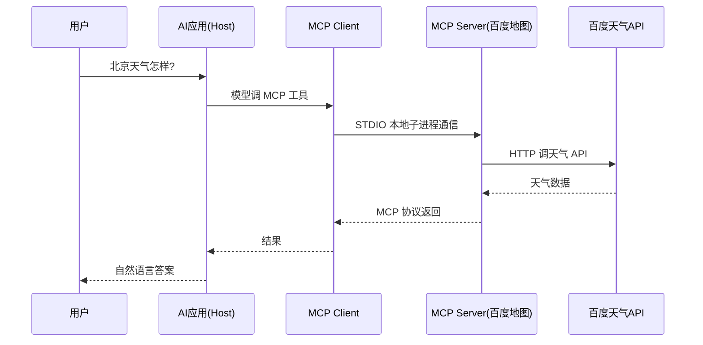

# 55. MCP 对接背后流程与脚本源码

## 纲要

- **三端协作**：AI 应用程序（业务代码）→ MCP Client（协议/命令/环境变量）→ MCP Server（百度地图，提供工具 + 调外部 API）
- **增强原理**：天气等能力被注入大模型后，用户提问时模型自动调用 MCP Server 工具，Client 建链后 Server 执行并返回
- **STDIO 本质**：本地起子进程运行 Server 脚本（需 Node.js/Python），Client 直接与本地子进程通信，Server 间接调百度地图服务
- **源码剖析**：`npx -y @baidu-maps/mcp-server` 下载包到 `node_modules`；`index.js` 里 `runServer()` 启 MCP 协议，天气工具内部用 HTTP 调百度地图天气 API，再以 MCP 协议返回模型
- **核心价值**：厂商只需把自有 API 包一层 MCP 协议，模型即获实时能力，补足训练知识盲区

> 代码按课程口径重构示意（外部课件代码卷未挂载）。本卡覆盖 10-6/10-7，透视 MCP 运行内幕。

## 一、三端协作时序



## 二、STDIO 子进程本质

`npx -y @baidu-maps/mcp-server` 做了两件事：从 npm 拉包到本地 `node_modules`；用 Node 把 Server 作为子进程启动。Client 与这个本地子进程用标准输入输出通信，Server 再对外调百度地图 API。

## 三、index.js 源码要点

```
下载后路径: node_modules/@baidu-maps/mcp-server/index.js
关键逻辑:
  runServer()                  // 启动 MCP 协议服务, 打印链接日志
  server.tool("天气查询", ...)  // 注册天气工具
    内部构造百度地图 HTTP 请求参数
    → 调百度天气 API
    → 以 MCP 协议格式返回给模型
```

由此可知：MCP Server 内部只是**把厂商自有 API 封装一层 MCP 协议**。模型通过协议调用，Server 用 HTTP 调真实服务，结果再经协议回传。

## 四、为什么 MCP 让模型更强

模型训练数据有截止日（如 2024-06），无法知实时天气。MCP 把「实时天气」作为外部工具注入，模型按需调用，补足知识盲区——15000+ Server 意味着模型可被无限扩展能力。

## 五、FAQ

**Q1：STDIO 和 SSE 内部差在哪？**
STDIO 是本地子进程标准 IO；SSE 是远程事件流 + HTTP。前者需本地运行时，后者需可达的服务地址。

**Q2：Server 一定调外部 API 吗？**
不一定；可只提供本地逻辑/数据。百度地图天气是「自身不足再调墨迹等 API 封装」的典型。

**Q3：npx 下载的包在哪？**
在运行目录的 `node_modules` 下，可打开 `index.js` 看 `runServer` 与工具注册。

## 六、面试高频问答

**1. MCP 三端各自职责？**
Host=应用；Client=协议/链接管理；Server=提供工具并调外部 API。

**2. STDIO 模式为什么需要 Node/Python？**
Server 以本地子进程方式运行，需运行时执行厂商脚本。

**3. MCP Server 内部做了什么？**
把厂商自有 API 包一层 MCP 协议，模型经协议调用、Server 经 HTTP 调真实服务。

## 七、ops 提示（运行红线）

> **本地运行时必装**：STDIO 前确认 Node/Python，子进程起不来是头号故障。
>
> **源码可查**：`node_modules/<server>/index.js` 看工具注册与真实 API 调用，排错有据。
>
> **AK/IP 双保险**：环境变量传 AK + 平台配 IP 白名单，缺一不可。
>
> **能力可验证**：注释 ToolProvider 对比有无 MCP，确认增强确实来自外部 Server。

> **课程收官**：至此 mksz952（LangChain4j 全 10 章）博客卡全部产出。下一切入 mksz737（提示词工程）与 mksz920（RAG 全栈，原选项 C 暂挂，待破解）。
