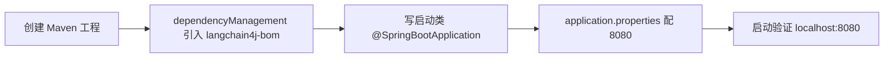

# 6. Spring Boot 基础工程搭建（LangChain4j 接入前置）

## 纲要

- **环境基线**：JDK 17 + SpringBoot 3.2.6 + LangChain4j 1.0-beta4 + MyBatis 3.5.11
- **工程骨架**：Maven 用 `dependencyManagement` 引入 `langchain4j-bom` 锁版本；`application.properties` 指定 8080；`@SpringBootApplication` 启动类
- **验证**：启动后访问 `localhost:8080` 确认骨架就绪
- **本章只搭骨架**：不引入任何大模型依赖，后续按需叠加

> 本章为接入大模型的前置环境准备，按课程口径重构；代码为课程示意（未挂载真实课件代码卷），去品牌与脱敏处理。

## 一、为什么先搭 SpringBoot 工程

LangChain4j 最终要落到 Java 工程里与业务系统集成，因此第一步是把 SpringBoot 基座准备好：统一依赖版本、确定 JDK、配置端口与启动入口。后续所有大模型接入都在这个骨架上叠加依赖与配置，避免每接一个模型就重新搭工程。

## 二、环境基线

| 组件 | 版本 | 说明 |
|---|---|---|
| JDK | 17 | LangChain4j 与 Spring AI 均硬性要求 JDK 17+ |
| SpringBoot | 3.2.6 | 与 LangChain4j starter 兼容 |
| LangChain4j | 1.0-beta4 | 课程讲解采用的最新 beta 版 |
| MyBatis | 3.5.11 | 后续案例持久化用，本章仅引入不整合 |

## 三、Maven 依赖管理

采用 `dependencyManagement` 全局锁定 LangChain4j 版本，后续引入任何 `langchain4j-*` 子模块都不必再写版本号，杜绝版本漂移。

```xml
<dependencyManagement>
    <dependencies>
        <dependency>
            <groupId>dev.langchain4j</groupId>
            <artifactId>langchain4j-bom</artifactId>
            <version>1.0-beta4</version>
            <type>pom</type>
            <scope>import</scope>
        </dependency>
    </dependencies>
</dependencyManagement>

<dependencies>
    <dependency>
        <groupId>org.springframework.boot</groupId>
        <artifactId>spring-boot-starter-web</artifactId>
    </dependency>
    <dependency>
        <groupId>org.springframework.boot</groupId>
        <artifactId>spring-boot-starter-test</artifactId>
        <scope>test</scope>
    </dependency>
</dependencies>
```

## 四、启动类与端口配置

```java
package com.example;

import org.springframework.boot.SpringApplication;
import org.springframework.boot.autoconfigure.SpringBootApplication;

@SpringBootApplication
public class Application {
    public static void main(String[] args) {
        SpringApplication.run(Application.class, args);
    }
}
```

```properties
# application.properties
server.port=8080
```

## 五、验证工程

启动后浏览器访问 `http://localhost:8080`，能返回 SpringBoot 默认响应（或自定义端点）即说明骨架就绪，可以进入下面接入大模型。



## 六、FAQ

**Q1：为什么用 `dependencyManagement` 引 bom，而不是每个依赖写版本？**
统一管理传递依赖版本，保证 `langchain4j` 内部各模块版本一致，避免 `NoSuchMethod` 类兼容问题。

**Q2：本章为什么没引入大模型依赖？**
先搭纯净骨架；大模型依赖（如 `langchain4j-openai`）在后续接入章节按需引入，避免早期污染与版本冲突。

**Q3：JDK 一定要 17 吗？**
LangChain4j 当前版本硬性要求 JDK 17+，低于 17 无法编译运行。

## 七、面试高频问答

1. **SpringBoot 3.x 对 JDK 的最低要求？** 17。
2. **bom 的作用？** 集中管理传递依赖版本，保证框架内部一致性。
3. **为什么 AI 框架多要求 JDK 17+？** 借力 Records、密封类、新 GC 等特性，且云原生基线已普遍 17。

## 八、ops 提示

> **版本对齐**：LangChain4j 迭代极快，bom 版本需与 starter 子模块版本一致，否则出现 `NoSuchMethodError` / `ClassNotFound`。
>
> **端口冲突**：8080 常被占用，本地开发可改 `server.port`，但云上发布需与安全组 / 网关端口一致。
>
> **密钥预留**：后续 API Key 不要写进 `application.properties` 明文，用环境变量或配置中心（如 Nacos），勿提交进仓库。

