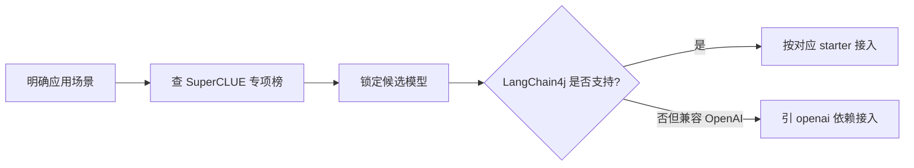

# 9. 大模型生态全景：SuperCLUE 评测与模型支持矩阵

## 纲要

- **选型依据**：中文综合评测基准 SuperCLUE（2023.5 推出），十余项基础能力 + 专项测评
- **榜单用法**：按「应用场景」查专项榜（如 Agent / 代码 / 数学）选模型
- **主流模型**：OpenAI（GPT-4.5 / o3-mini）、腾讯、DeepSeek 等；o3-mini 数学推理 94 分、代码 88.78 分
- **LangChain4j 支持矩阵**：官方已集成 Ollama / OpenAI / 千帆 / 智谱 / 谷歌 等
- **DeepSeek 接入关键点**：基于 OpenAI 标准，引 `openai` 依赖即可

> 本章建立「按需选型」意识，按课程口径重构；评测数据为课程时间点快照，实际以官网实时榜单为准。

## 一、为什么需要评测基准

市面大模型 dozens，选型不能拍脑袋。中文领域权威社区 **SuperCLUE** 自 2023 年 5 月推出中文通用大模型综合评测基准，更符合中文语言特点，被学界与产业界广泛引用。

## 二、SuperCLUE 评测维度

- **基础能力**：语义理解、逻辑推理、代码生成等十余项
- **学科覆盖**：数学、物理、成语、诗歌等
- **专项测评**：Agent、代码、数学推理等场景榜

示例：OpenAI `o3-mini` 在数学推理达 94 分、代码生成 88.78 分，是代码 / 数学场景优选；DeepSeek 在 Agent 场景表现不错。

## 三、按需选型流程

## 四、LangChain4j 模型支持矩阵

官方 `supported-models` 文档已集成市面常见模型，基本够用：

| 类型 | 代表 |
|---|---|
| 本地 | Ollama |
| 国际 | OpenAI、Google |
| 国内 | 千帆、智谱 |

**关键点**：DeepSeek 基于 OpenAI 标准，因此引入 `langchain4j-openai` 后，用 OpenAI 的接入方式（`base-url` / `apiKey` / `modelName`）即可接入 DeepSeek，无需单独依赖。

## 五、FAQ

**Q1：SuperCLUE 是唯一的选型依据吗？**
不是；它是中文权威参考，实际还需结合成本、合规、延迟、私有化要求。

**Q2：为什么 DeepSeek 没有单独出现在支持矩阵？**
因为它兼容 OpenAI 协议，复用 `openai` 接入链路即可，不必单列。

**Q3：榜单分数会过时吗？**
会；模型迭代快，选型以官网实时榜单为准。

## 六、面试高频问答

1. **如何为业务选大模型？** 先定场景（Agent / 代码 / 多模态），查专项评测榜，再核对框架支持与成本合规。
2. **DeepSeek 为什么能复用 OpenAI 接入？** 它遵循 OpenAI API 规范，改端点与 key 即可。
3. **LangChain4j 生态优势？** 官方集成主流模型，且 OpenAI 兼容模型零成本接入。

## 七、ops 提示

> **实时核对**：评测分数与模型列表随版本变化，接入前查官网 `supported-models` 与实时榜单。
>
> **合规优先**：国内业务优先选已备案的国内模型（千帆 / 智谱 / 通义等），降低合规风险。
>
> **成本控制**：选型同时看单价与上下文长度，避免长上下文场景成本失控。

