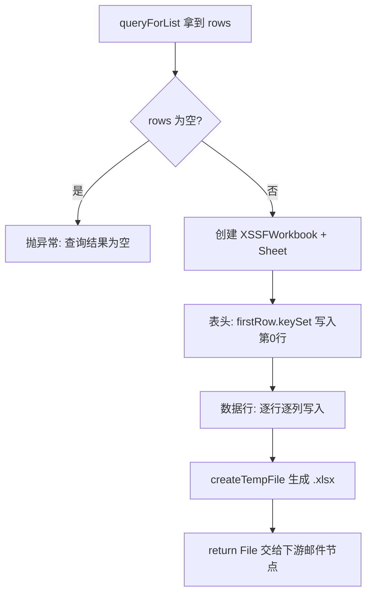

# 10-5 自动化报表生成引擎开发

## 【学习目标】

学完本节，应当能够：

- 在节点中用 `@Slf4j` + `JSONUtil` 把查询结果打印出来便于追踪；
- 用 Apache POI 动态生成一个 Excel 报表文件（表头取自结果集列名、数据行逐行填充）；
- 说清「临时文件写出」的实现要点，并知道大数据量下的生产替代方案；
- 向面试官解释 POI 与 EasyExcel 的选型逻辑，以及空结果、临时文件清理、null 单元格三类坑。

## 【正文】

### 一、打印查询结果

拿到查询结果后，先在节点里加 `@Slf4j` 注解，用 `log.info` 配合 `JSONUtil.toJsonStr(maps)` 把结果打印出来，方便后续追踪和调试。下面先给出节点类的声明与 `apply` 方法骨架：

```java
public class ExecSQLAndCreateExcelNode implements NodeAction {
```

```java
@Override
public Map<String, Object> apply(OverallState state) throws Exception {
    String gensQL = state.value("gensQL", defaultValue = "");
    // 通过JdbcTemplate进行执行SQL
    List<Map<String, Object>> maps = jdbcTemplate.queryForList(gensQL);
    log.info("maps={}", JSONUtil.toJsonStr(maps));
    // 动态生成Excel导出模板文件
    File excelFile = generateExcelFile(maps);
    return Map.of();
}
```

**为什么先打印再生成文件？** 报表这类「模型 SQL → 查库 → 出文件」的链路，出错点集中在「SQL 是否合法、结果是否为空、字段是否对得上」。先把 `maps` 用 `log.info` 打出来，出问题能第一时间看到真实结果与 SQL 的对应关系，比事后翻 Excel 高效得多。这正是「可观测性优先」的工程习惯，后面接邮件节点前，先保证中间产物可见。

可观测性的投入产出比在这条链路上极高：模型生成的 SQL 稍有偏差（例如 JOIN 错维度表），表现是「Excel 里某一列全是 null」或者「行数对不上」，只看出文件几乎不可能反推原因；而有了 `maps` 的结构化日志，SQL、列名、行数三者的对应关系一目了然。生产系统里，这类中间产物日志还承担着另一个角色，用户投诉「报表不对」时，它是复现问题的第一手证据。Java 的 `{}` 占位符是惰性拼接，日志级别关掉时不会有字符串构造开销，可以放心留在代码里。

### 二、定义生成 Excel 的方法

单独抽一个 `generateExcelFile(List<Map<String, Object>> rows)` 方法，参数就是查询结果（每一行 `Map` 就是一条数据）。方法逻辑分三步。

#### 1. 空结果校验

如果查询结果为空，没必要往下走，直接抛异常提示：

`if (rows == null || rows.isEmpty()) throw new RuntimeException("SQL查询结果为空，无法生成Excel");`

这样当用户问的内容在数据库里确实没有对应数据时，系统能明确报错而不是继续生成空文件。

这里的选择值得琢磨：为什么不生成一个「只有表头的空文件」或者「查无数据」的 Excel？因为报表场景里，空文件会被下游误当成「系统故障」，用户收到一封带着空白附件的邮件，比收到一条明确的报错更糟。抛异常让链路在节点内显式失败，错误信息可以带着 SQL 上下文，排查和兜底都更清晰。

#### 2. 用 Apache POI 构建 Excel

底层不用引入 EasyExcel 等额外工具，它们的核心也都是 Apache POI，这里直接用 POI 即可（需要一点 POI 基础）。

- 创建 `XSSFWorkbook` 工作簿；
- 在工作簿里创建第一个 `Sheet`，命名为「AI生成内容」；
- **表头**：取 `rows.get(0)` 作为第一行，用 `new ArrayList<>(firstRow.keySet())` 拿到所有列名当作表头。创建第 0 行（header），循环列集合，用 `header.createCell(i).setCellValue(columns.get(i))` 写入每个列名；
- **数据行**：循环 `rows`，逐行 `sheet.createRow(rownum + 1)`，再循环列集合，用 `data.get(column)` 取字段值，通过 `row.createCell(c).setCellValue(value == null ? "" : value.toString())` 写入单元格。

所谓「表头」就是 Excel 的第一行，告诉用户每一列代表什么；所谓「数据填充」就是为每一行创建单元格并塞值。

POI 的 `XSSFWorkbook` 是**用户模型（User Model）**：整个工作簿（所有 Sheet、行、单元格、样式）常驻内存，操作完一次性写出。该形态对「结果集不大」的报表恰好合适，API 直观，随机访问任意单元格；代价是内存占用随单元格数线性增长，遇到几十万行就会吃力。选型前先估算数据规模，是这条链路的基本动作。

#### 3. 写出临时文件

最终要返回的是一个 `File`。先用 `File.createTempFile("report", ".xlsx")` 创建临时文件，再用 try-with-resources 语法块打开 `FileOutputStream`，调用 `workbook.write(out)` 把工作簿写进输出流。try-with-resources 会在结束时自动关闭流，既减少样板代码，又让代码更优雅，最后直接 `return file`。

完整方法如下：

```java
private File generateExcelFile(List<Map<String, Object>> rows) {
    if (rows.size() == 0 || rows.isEmpty()) {
        throw new RuntimeException("SQL查询结果为空，无法生成Excel!");
    }
    XSSFWorkbook workbook = new XSSFWorkbook();
    XSSFSheet sheet = workbook.createSheet(sheetname: "AI生成内容");

    // 1. 表头
    Map<String, Object> firstRow = rows.get(0);
    List<String> columns = new ArrayList<>(firstRow.keySet());

    for (int i = 0; i < columns.size(); i++) {
        header.createCell(i).setCellValue(columns.get(i));
    }

    // 2. 数据行
    for (int r = 0; r < rows.size(); r++) {
        Row row = sheet.createRow(rownum + 1);
        Map<String, Object> data = rows.get(r);
        for (int c = 0; c < columns.size(); c++) {
            Object value = data.get(columns.get(c));
            row.createCell(c).setCellValue(value == null ? "" : value.toString());
        }
    }

    // 3. 生成临时文件
    File file = File.createTempFile(prefix="report", suffix=".xlsx");

    return null;
}
```



需要说明：上面抽取出的代码片段里，`header` 行对象与 `rownum` 计数器的定义、以及 `FileOutputStream` 写出与 `return file` 的收尾未完整呈现（片段末尾是 `return null`）。按正文第三步的文字描述，完整链路是 `File.createTempFile` 创建临时文件 → try-with-resources 打开 `FileOutputStream` → `workbook.write(out)` 落盘 → `return file`。这类「视频转写丢行」在这批代码里很常见，跑工程时以文字描述为准补齐，逻辑骨架与片段完全一致。

### 三、生产经验补充

1. **Apache POI 与 EasyExcel 的取舍**：EasyExcel 本质是 POI 的封装，主打「流式读写、内存友好」，适合十万级以上的大数据量导出；本节点的报表由自然语言查询驱动，结果集通常不大，直接用 POI 更轻、可控。若后续要支持大表导出，再换 EasyExcel 的 `SXSSFWorkbook`（POI 自带的流式模式）或 EasyExcel 即可，接口形态相似。
2. **临时文件清理**：`File.createTempFile` 生成的文件不会自动删除，长期运行会堆积。生产上应在文件被下游（邮件节点）消费后主动 `file.delete()`，或在 JVM 退出时注册 `deleteOnExit`，避免磁盘被打满。
3. **表头健壮性**：`firstRow.keySet()` 的顺序依赖 `Map` 实现，若某行字段缺失会导致列错位。稳妥做法是先收集所有行的列名并集再定表头，或对 `LinkedHashMap` 结果做顺序保证。

三条经验展开成选型对照：

| 方案 | 内存形态 | 适用数据量 | 接入成本 | 本节点是否采用 |
|---|---|---|---|---|
| 原生 POI（`XSSFWorkbook`） | 全量常驻内存 | 万行以内 | 低，无额外依赖 | 采用 |
| POI 流式（`SXSSFWorkbook`） | 窗口行刷盘 | 十万行以上 | 中，需管理窗口与临时文件 | 预留升级位 |
| EasyExcel | 流式读写 | 十万行以上 | 中，需学注解模型 | 不引入 |

「不引入」的理由和上一节不引入 MyBatis Plus 是同一条原则：**依赖的引入要有当期收益**。报表由自然语言查询驱动，结果集规模天然受控（用户问「各个商品的销售总额」，出来的就是几十行）；为了想象中的大数据量引入一套封装，是把演进成本提前支付。等真出现大表需求，`SXSSFWorkbook` 的接口与 `XSSFWorkbook` 几乎一致，迁移是小时级的事。

至此，动态生成 Excel 文件的核心完成：创建 `XSSFWorkbook` → 建 `Sheet` → 写表头 → 填数据 → 写临时文件并返回 `File`。后面再接上邮件发送节点把它发出去。

## 【易错点 / 面试题】

1. **面试官问：「报表导出为什么不用 EasyExcel，要用原生 POI？」**
   答：结果集通常不大，原生 POI 更轻、可控，避免引入额外依赖；若后续要支持大表，可平滑切换到 POI 的 `SXSSFWorkbook` 或 EasyExcel，接口形态相近。选型随数据规模演进，而非一开始过度设计。

2. **易错点：空结果集未校验直接生成 Excel。** 会导致空白文件或 `rows.get(0)` 抛 `IndexOutOfBoundsException`。务必先判空再取表头。

3. **易错点：临时文件只生成不清理。** `createTempFile` 不会自动回收，长期运行会占满磁盘。应在下游消费后删除或 `deleteOnExit`。

4. **易错点：单元格写入未做 `null` 处理。** `value.toString()` 在 `value == null` 时 NPE，需 `value == null ? "" : value.toString()` 兜底。

5. **面试官问：「表头为什么用 `firstRow.keySet()`，所有行列一定一致吗？」**
   答：不一定。`queryForList` 返回的每行是独立的 `LinkedHashMap`，JOIN 或函数列在不同实现下可能出现键差异；稳妥做法是遍历所有行收集列名并集。当前实现假设列一致，在受控的报表 SQL 下成立，但这是已知的健壮性上限，面试中主动说出边界，比假装完美更得分。

## 【小结】

本节完成了 BI 报表 Agent 的「出文件」环节：查询结果经 `@Slf4j` 打印后，由 `generateExcelFile` 用 Apache POI 动态生成 Excel（表头取列名、数据行逐行填充、临时文件写出）。它与前几节的「Prompt 禁 DML + `queryForList` 锁只读」共同构成报表系统的安全与产出闭环。下一节将接入邮件发送服务，把生成的 Excel 作为附件发出，完成「自然语言 → SQL → 查询 → 报表 → 邮件」的完整业务流。

对照本课程第 5 章的「AI 智能库存调拨单」工程 `980-demo/`：`980-demo/src/main/java/com/carl/ai/transfer/agent/TransferAgent.java` 同样把「抽取 → 入库」封装成单一节点动作，体现「一个节点只做一件事、对外只暴露确定性结果」的工程一致性；`980-demo/src/main/java/com/carl/ai/transfer/service/TransferOrderServiceImpl.java` 则示范了同一原则在服务层的形态，节点负责编排，确定性逻辑下沉到 service，LLM 的不确定性被收敛在边界之内。
