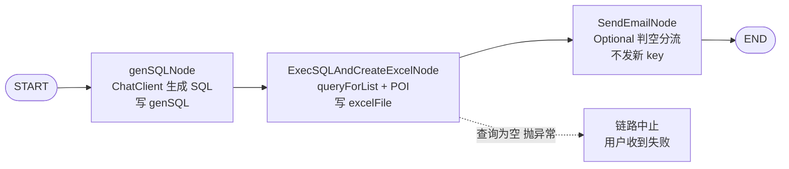

# 10-8 Agent 测试以及问题点引出

## 【学习目标】

学完本节，应当能够：

- 在 `GraphConfig` 中把三个节点编排成 `START → genSQLNode → ExecSQLAndCreateExcelNode → SendEmailNode → END` 的工作流，并为新 key 注册替换策略；
- 通过 `/talk` 接口发起一次全链路调用，用「日志 + Debug」定位 500 错误；
- 复盘全链路测试暴露的两个待优化点（中文表头、幻觉），并说清它们分别指向后续哪一章；
- 向面试官描述「AI 工作流全链路测试」与普通接口测试的差异。

## 【正文】

三个节点都开发完了，这一节把它们编排进工作流并做全链路测试，同时引出后面要优化的两个问题。

### 一、编排工作流

在 `GraphConfig` 里添加两个新节点并连好边：

- `ExecSqlAndCreateExcelNode`：创建时需要 `@Resource` 注入 `JdbcTemplate` 并传入；
- `SendEmailNode`：需要注入 `EmailService` 并传入。

边的连接调整为：`START` → `genSQLNode` → `ExecSQLAndCreateExcelNode` → `SendEmailNode` → `END`。之前 `genSQLNode` 生成完 SQL 就直接结束，现在让它继续流向执行 SQL 并生成 Excel 的节点，再由邮件节点收尾。这样最简洁版本的初始工作流就编排完成了。

```java
public class GraphConfig {
    public CompiledGraph graph(ChatClient.Builder chatclientBuilder) throws Exception {
        KeyStrategyFactory keyStrategyFactory = new KeyStrategyFactory();
        public Map<String, KeyStrategy> apply() {
            return Map.of(
                k1: "userInput", new ReplaceStrategy(),
                k2: "genSQL", new ReplaceStrategy(),
                k3: "excelFile", new ReplaceStrategy()
            );
        }
        StateGraph stateGraph = new StateGraph(name: "biHelperGraph", keyStrategyFactory);
        stateGraph.addNode(id: "genSQLNode", AsyncNodeAction.node_async(new GenSQLNode(chatclientBuilder, vec)));
        stateGraph.addNode(id: "ExecSQLAndCreateExcelNode", AsyncNodeAction.node_async(new ExecSQLAndCreateExcelNode()));
        stateGraph.addEdge(StateGraph.START, targetId: "genSQLNode");
        stateGraph.addEdge(sourceId: "genSQLNode", targetId: "ExecSQLAndCreateExcelNode");
        return stateGraph.compile();
    }
}
```

```java
public class GenSQLNode implements NodeAction {
    @Override
    public Map<String, Object> apply(OverallState state) throws Exception {
        String genSQL = state.value(key: "userInput", defaultValue: "");
        // 生成 SQL 逻辑
        return Map.of(k1: "genSQL", genSQL);
    }
}
```

```java
public class ExecSQLAndCreateExcelNode implements NodeAction {
    @Override
    public Map<String, Object> apply(OverallState state) throws Exception {
        String genSQL = state.value(key: "genSQL", defaultValue: "");
        List<Map<String, Object>> maps = jdbcTemplate.queryForList(genSQL);
        log.info("maps={}", JSONUtil.toJsonStr(maps));
        File excelFile = generateExcelFile(maps);
        return Map.of(k1: "excelFile", excelFile);
    }
}
```

三点编排细节值得说明：

1. **key 与策略同步注册**：`userInput`、`genSQL`、`excelFile` 三个 key 全部配 `ReplaceStrategy`，每次执行各自只被写入一次，替换语义最直观；若未来加「多次改写 SQL」的评估循环（第 11 章的内容），才需要考虑保留历史的策略形态。
2. **`AsyncNodeAction.node_async` 包一层**：节点以异步形态执行，为后续节点内做真正的异步 IO（例如向量检索、流式模型调用）留出位置；当前节点体是同步逻辑，包一层不影响正确性。
3. **依赖在节点创建时传入**：`JdbcTemplate`、`EmailService` 由 `GraphConfig` 在 `addNode` 前备好，节点本身不感知 Spring 容器，这和 10-3 节「构造注入」的选择一脉相承：节点是可单测的普通对象，图只是把它们串起来。

需要说明：抽取出的 `GraphConfig` 片段里，`apply()` 方法错挂在了 `graph()` 方法体内部，且最后两条边（`ExecSQLAndCreateExcelNode → SendEmailNode → END`）未完整呈现；按正文描述补齐后，完整编排即上面的流程所述。视频转写丢行/错位在这批代码里常见，跑工程时以文字描述为准。



### 二、接口测试

Debug 启动无报错后，回到浏览器访问 `localhost:8877`，调用 `genSQL` Controller 下的 `talk` 方法，传入 `userInput`。

```java
public class GenSQLController {
    @GetMapping(value = "/talk")
    public Map<String, Object> talk(@RequestParam String userInput) {
        OverallState overallState = graph.call(Map.of(k1: "userInput", userInput));
        return R.success(overallState.data());
    }
}
```

Controller 的职责被压缩到极致：把用户输入包成初始状态（`Map.of` 只有一个 `userInput`），`graph.call(...)` 同步驱动整张图跑完，最后把最终状态的 `data()` 原样返回。`R.success(...)` 是统一响应包装，Agent 链路的中间产物（SQL 文本、结果行数）也一并带回，调试期非常有用：前端能看到的不只是「成功」，还有模型到底生成了什么。

先测一个稍复杂的：「计算 2025 年各个商品的销售总额，并按月份升序」。大模型生成的 SQL 大致是：查询 `product_name`、月份、`SUM(sales_amount)`，按 `product_name` 和月份做 `GROUP BY`，并 `JOIN dim_product` 和 `dim_date` 两个维度表，连表和分组逻辑本身没问题。但执行时报了 500，由于之前没打印错误日志，我们先在日志里定位。再次调用并 Debug 进入，发现报的是「bad SQL」：把生成的 SQL 粘到数据库里一看，确实有问题。这也正好演示了下一节要讲的、面试官常问的优化点。

```sql
SELECT
    dp.product_name,
    EXTRACT(MONTH FROM dd.date) AS month,
    SUM(fs.sales_amount) AS total_sales
FROM fact_sales fs
JOIN dim_product dp ON fs.product_id = dp.product_id
JOIN dim_date dd ON fs.date_id = dd.date_id
WHERE EXTRACT(YEAR FROM dd.date) = 2025
GROUP BY dp.product_name, EXTRACT(MONTH FROM dd.date)
```

该 case 的排查路径就是标准范式：**500 → 日志/Debug 拿到真实 SQL → 粘回数据库复现**。模型生成 SQL 的错误率不可能为零，工作流的设计目标不是「一次生成就对」，而是「错了能快速定位、能定位到具体语句」。`bad SQL` 意味着数据库直接拒绝了这条语句，至于是列名、别名还是函数写法的问题，粘到数据库客户端一执行，报错信息比任何猜测都快。第 11 章的评估节点，就是把「人工定位」这一环节部分自动化。

换个简单的：「计算 2025 年销售总额」，放行后顺利查出来。再放行，控制台提示「邮件发送成功」。但去邮箱一看，没有邮件。回看代码发现一个低级 bug：helper 都设置好了，却忘了真正调用 `mailSender.send(message)`。补上发送逻辑后重新执行，控制台打印邮件发送成功，手机也收到通知，邮箱里确实有邮件（主题为「AI生成报表」，正文「附件中的内容由AI报表助手生成，请查收！！！」），附件 Excel 能正常预览，表头和数据都正确。

第二个 bug 的教训比第一个更深：**「配置齐全」不等于「链路走通」**。MimeMessage、helper、收件人、主题、正文全都设置好了，唯独缺了最后 `send` 一步，每一行单独看都正确，合起来却不干活。这种 bug 靠代码审查几乎看不出来（审的人会默认「写了这么多设置，总会发的」），只有端到端测试能抓住：控制台日志说成功，邮箱里却什么都没有，矛盾本身就是最好的探针。这也是「日志说了不算，外部效果说了算」的鲜活案例。

### 三、引出两个待优化点

测试过程中暴露出两个需要改进的地方：

1. **表头应该是中文**：现在导出的 Excel 表头是英文列名，用户看起来不直观；报表场景下表头必须是中文，用户才能一眼看懂每一列的含义。这是一个明确的改进点。
2. **大模型的幻觉无法彻底消除**：无论模型多先进，都可能出现幻觉、胡编乱造。如何在最大程度上减少这类问题，是另一个优化点。

这两个问题，我们在后面的小节里逐一优化。

两个问题指向两条不同的技术路线，提前看清地图很重要：表头问题靠**提示词工程**解决（下一节 10-9 用「少样本」让模型直接生成中文标头）；幻觉问题靠**工程化评估**解决（第 11 章引入评估节点，对生成的 SQL 先自检再执行，形成「生成-评估-重试」的循环）。前者改一段 Prompt，后者改工作流结构，优化手段的复杂度，要和问题的根因匹配。

## 【易错点 / 面试题】

1. **面试官问：「AI 工作流的全链路测试，和普通接口测试有什么不同？」**
   答：普通接口测试的输入输出都是确定的；AI 链路的中间产物（SQL 文本）是概率性的，断言不能停在「接口返回 200」，而要验证「外部效果」，邮件真的到了邮箱、附件真的能打开、表头真的符合预期。本节的第二个 bug 就是铁证：控制台显示成功，实际邮件没发。测试设计上要「以终为始」：从用户可感知的终点倒推断言点。

2. **易错点：新增状态 key 忘记注册 value 策略。** `excelFile` 加入状态机时，`KeyStrategyFactory` 里必须同步登记，否则节点写入行为不可预期。代码与策略两处同步，是状态机开发的固定 checklist。

3. **易错点：500 错误不看日志先猜。** 正确路径是日志/Debug 拿到模型真实输出，再复现。「猜模型错在哪」是最低效的排查方式，它的输出有无限种可能，而日志只有一份。

4. **面试官问：「模型生成的 SQL 错了，除了人工粘库验证，还能怎么系统化解决？」**
   答：这正是第 11 章的主线，加评估节点：生成 SQL 后先让模型（或规则）自检「表名/列名是否存在、是否为只读、语义是否匹配问题」，不达标就打回重生成；再往后是微调。课程把它概括为「评估-循环-微调」三件套，是面试里最能体现工程成熟度的话题之一。

## 【小结】

本节把三个节点编排成完整工作流（`START → genSQLNode → ExecSQLAndCreateExcelNode → SendEmailNode → END`），并通过 `/talk` 接口完成首次全链路测试：复杂查询暴露了模型生成 SQL 的可靠性问题（500 → bad SQL），简单查询跑通后又抓住一个「忘记调用 `mailSender.send`」的低级 bug。两个 bug、两种教训，AI 链路的测试必须验证外部效果，而不是信任中间日志。由此引出两个待优化点：中文表头（走向 10-9 的少样本提示词）与幻觉抑制（走向第 11 章的评估节点）。

对照本课程第 5 章工程 `980-demo/` 的同层能力：`980-demo/src/main/java/com/carl/ai/transfer/agent/TransferAgent.java` 用 `ChatClient` 把「自然语言 → 结构化抽取」封装成单次 Agent 调用，`980-demo/src/main/java/com/carl/ai/transfer/controller/TransferController.java` 提供等价的 HTTP 入口（`POST /api/transfer/create`）；它对「模型输出不可信」的应对比 BI 系统更前置，`980-demo/src/main/java/com/carl/ai/transfer/extract/TransferOrderExtractor.java` 用 `call().entity()` 把输出直接绑定到 `TransferOrderParam`，字段对不上时绑定即失败，配合 `repository/BbTransferOrderRepository.java` 受控入库，把「幻觉 SQL」这类问题从架构上消掉。两条路线共同印证同一个判断：**Agent 系统的质量，不取决于模型多强，而取决于你把不可信的输出收敛到了什么样的边界内。**
