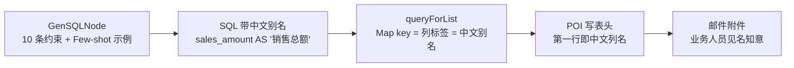

# 10-9 优化：如何用「少样本」瞬间提升AI智商，生成精准中文标头

## 【学习目标】

学完本节，应当能够：

- 说清 Excel 英文表头为什么必须优化，以及优化的判据是「用户观感」而非技术正确性；
- 在 `GenSQLNode` 的系统提示词里追加「中文别名」约束，并解释它如何让下游节点直接拿到中文列名；
- 用「少样本提示（Few-shot）」给约束补上示例锚点，并解释示例比规则更稳的原因；
- 向面试官描述「规则约束 + 少样本示例」的适用边界与替代方案。

## 【正文】

上一节的全链路测试暴露出第一个待优化点：导出的 Excel 第一行是英文列名。`sales_amount` 这样的列名对开发者没问题，对业务人员却形同天书，报表的读者是业务方，表头是否见名知意，直接决定这份报表能不能用。这一节不动工作流结构，纯靠提示词工程解决：先加约束，再给示例。

### 一、追加「中文别名」约束

先看节点的出口契约。`GenSQLNode` 实现 `NodeAction`，`apply` 方法返回的 Map 就是节点向状态机交付的内容：

```java
public class GenSQLNode implements NodeAction {
    public Map<String, Object> apply(OverallState state) throws Exception {
        return Map.of(k1, "excelFile");
    }
}
```

这段是视频转写抽出的出口占位片段，只保留节点形态：实现 `NodeAction`、重写 `apply`、以 Map 形式回写状态机。真正要改的是系统提示词。`GenSQLNode` 原本有 8 条要求，这一节追加一条别名约束：

> 每个查询字段必须使用 `AS` 指定一个中文别名，中文别名应尽量简短、清晰，准确描述字段含义。

追加后的完整提示词清单如下：

```text
# 要求
1. 仅生成可执行的 SQL，不输出任何与 SQL 无关的文字或解释。
2. 在生成 SQL 前，首先理解用户意图和检查数据信息。
3. 根据 SQL 语句和表结构，生成合适的 SQL。
4. 如果有 SQL 时，禁止使用Markdown格式“sql”来输出，直接以格式化SQL输出。
5. 如果存在多种实现方式，优先选择简洁、性能较好的方法。
6. 禁止输出与 SQL 无关的文字或解释。
7. 不可空字符串，若数据不足，请返回空字符串。
8. 禁止生成 DELETE、DROP、UPDATE、INSERT 语句，只允许生成SELECT语句。
9. 当用户的输入涉及到DELETE、DROP、UPDATE、INSERT 这四种SQL时，你必须返回空内容。
10. 每个字段必须使用 AS 指定一个列名，中文列名尽量简短、清晰、避免歧义。
```

注意编号口径：口播说「原本 8 条、再加第 9 条」，落到代码清单里别名约束是第 10 条，因为「危险 SQL 返回空内容」（清单第 9 条）在前面章节先一步落进去了。排查线上提示词问题时，以代码清单为准，不要以口播序号为准。

这条约束为什么能一路生效到表头？关键在数据链路上的一个巧合：10-8 节的 `ExecSQLAndCreateExcelNode` 用 `jdbcTemplate.queryForList(genSQL)` 拿结果，返回的是 `List<Map<String, Object>>`，Map 的 key 就是结果集的列标签；MySQL 的列标签默认取 SELECT 的别名。SQL 里写成 `sales_amount AS '销售总额'` 时，Map 里的 key 就是「销售总额」，POI 生成表头时直接将该 key 写上第一行，整条链路不需要任何额外转换代码。提示词改一句话，表头换一种语言，靠的就是这条契约。

### 二、用少样本（Few-shot）进一步强化

规则只划边界，不示范写法。模型知道「必须起别名」，但起成什么样才算「简短、清晰」，理解可能漂移。于是再用少样本提示给一个可模仿的范例：

> 例如：`user_name AS '用户名'`

这就是 Few-shot 的核心手法：不展开讲道理，直接给一个输入输出对，让模型在上下文里完成模式匹配。落到代码里，它挂在流式调用的 user 提示词一侧：

```java
.user(userInput)
.stream().contentBuilder();
StringBuilder sb = new StringBuilder();
```

该片段同样是转写抽取的尾段（`.user(userInput)` 之后接流式订阅与字符串累积），保留它是为了说明示例插入的位置：与用户输入同侧传入，随每次请求一起进入上下文窗口。为什么「给例子」比「加规则」更稳？两条机制：其一，示例把抽象的「简短清晰」坍缩成一个具体范式，模型照抄比重新推理更可靠；其二，示例同时锚定了格式细节，单引号包裹、`AS` 关键字位置、别名长度量级，这些细节用规则描述反而冗长。代价是上下文里多了几行 token，以及示例选得不好会把模型带偏（示例本身必须是合规 SQL）。从上下文学习（In-context Learning）的角度看，少样本生效的前提是示例与目标任务同分布：示例应当是同一套表结构、同一种复杂度的真实查询，随便找一条教学 SQL 当示例，模型可能把与当前任务无关的写法一起学过去。这也是「给例子」的隐性成本，示例需要挑选，而规则只需要撰写。

| 对比项 | 零样本规则（只写第 10 条） | 少样本（规则 + 示例） |
|---|---|---|
| 约束强度 | 划定边界，允许边界内自由发挥 | 边界 + 范式双重锁定 |
| 格式细节 | 需逐条描述（引号、位置、长度） | 示例自带全部格式细节 |
| 上下文成本 | 低 | 略高（多几行示例） |
| 主要风险 | 别名风格漂移 | 示例不当会把模型带偏 |

### 三、验证效果

重启项目后测试，生成的 SQL 已经带上中文别名；邮件发出后去邮箱预览，表头一列果然变成中文。再测一个多列复杂场景：「查询订单金额超过一万的大额订单，并连表显示客户信息、商品名称」。下载并打开 Excel，一共 7 列，订单金额、客户姓名、性别、年龄、城市、省份、产品名称，全部是中文。这些列分别来自顾客维度表的基本信息、产品名称，加上订单金额。即便是多列返回，少样本提示也能把对应中文作为表头生成出来。值得补充的是：这些列跨顾客维度表与产品侧多表来源，全部拿到了中文别名，说明该约束对 JOIN 场景同样生效，不随列数增加而失效。



一条提示词约束，穿过「生成 SQL → 执行查询 → 生成 Excel」三个节点全程不变形，靠的是每一环都复用同一份数据（列标签），没有引入任何中间转换。这是提示词工程与数据链路设计的配合：提示词负责定义契约，链路负责不破坏契约。

还有两个生产细节值得留意。其一，别名是对外可见的契约，它同时进入邮件附件的 Excel 与接口返回的 JSON，改动前先确认下游没有按英文列名写死的解析逻辑。其二，少样本示例要跟提示词一起做版本管理：示例变了，输出范式就变了；复盘「本月表头和上月不一样」时，第一个该查的地方就是示例的提交记录。提示词不是写完就结束的静态文本，它是随业务演进的代码。

## 【易错点 / 面试题】

1. **面试官问：「什么是少样本提示（Few-shot）？为什么规则加示例比只写规则稳？」**
   答：Few-shot 是在提示词里给模型若干输入输出示例，让它在上下文内完成模式匹配，而不是从零推理。规则的作用是划定「不许做什么」，示例的作用是示范「应该长什么样」，前者管边界，后者管范式。本节的实践是典型组合：第 10 条约束保证每个字段都有别名，`user_name AS '用户名'` 保证别名格式统一。

2. **易错点：把提示词编号当事实。** 口播里的「第 9 条」与代码清单里的第 10 条差一条，因为危险 SQL 空内容规则先落了地。复盘提示词问题时一律以代码清单为准，否则改错条目、越改越乱。

3. **面试官问：「除了提示词，还有什么办法约束大模型的输出结构？」**
   答：提示词是软约束，生产上要配硬约束，Spring AI 2.0.1 的结构化输出（`BeanOutputConverter` / `chatClient.prompt().user(...).call().entity(POJO.class)`）把输出直接绑定到 Java 类型，字段对不上时绑定即失败，从架构上消除「格式漂移」。本课程配套工程 `980-demo` 正是这条路线的落地：`980-demo/src/main/java/com/carl/ai/transfer/extract/TransferOrderExtractor.java` 用 `call().entity(TransferOrderParam.class)` 收敛调拨单 JSON，`980-demo/src/main/java/com/carl/ai/transfer/convert/TransferOrderConvert.java` 再用 MapStruct 把 param 转成入库 model。软约束定契约、硬约束兜底线，两层都要有。

## 【小结】

本节用两条提示词手段解决了英文表头问题：追加「中文别名」约束（第 10 条）让每个查询字段带 `AS` 中文别名，少样本示例 `user_name AS '用户名'` 把格式范式钉死；验证场景覆盖单列与 7 列复杂场景，表头全部为中文。这条优化贯穿三个节点而不变形，依赖的是「列标签即表头」的数据契约。下一个要解决的是更硬的问题，大模型生成 SQL 的幻觉，那已不是一段提示词能兜住的，需要第 11 章的评估节点与循环执行。想看看「硬约束」长什么样，可以对照 `980-demo` 的 `TransferOrderExtractor`：它把同样的「输出契约」思想用类型绑定实现，与本节的软约束形成完整光谱。
