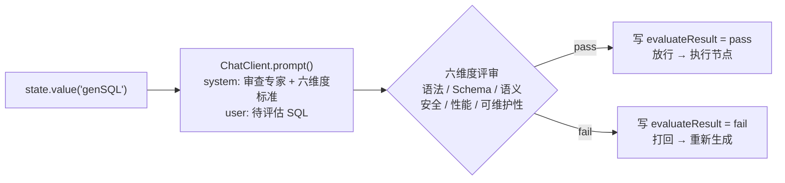

# 11-3 评估节点系统提示词编写

## 【学习目标】

学完本节，应当能够：

- 按「角色 / 标准 / 输出契约」三段式设计评估类系统提示词；
- 说清六个评估维度（语法、Schema、语义、安全、性能、可维护性）各自的检查点与存在理由；
- 解释为什么安全维度要用「禁止」式强硬措辞，以及评估约束与生成约束为什么必须重叠；
- 向面试官回答「如何给评估类节点设计提示词」。

## 【正文】

上一节划清了 `EvaluateNode` 的职责边界，本节把它的系统提示词写出来。核心思路是：让大模型扮演一个专业的 SQL 审查专家，从多个维度对我们生成节点产出的 SQL 做严格评审，从而保证最终落到数据库上的语句既正确又安全。

### 一、定义审查角色

先给大模型设定一个明确的身份，让它清楚自己的职责边界：

> 你是一个专业的 SQL 审查专家，专门负责评估生成的 SQL 查询的质量、正确性和安全性。

角色定得越清晰，模型在后续评审时就越聚焦，不会跑偏。这不是玄学：系统提示词里的身份声明会改变模型的先验，自称「审查专家」时，它默认进入「找问题」模式而不是「补全代码」模式。评估类提示词最怕模型角色漂移成「友好的 SQL 助手」，那样它会倾向于修补而不是否决。一个自检方法：把写好的角色声明拿给同事看，如果对方第一反应是「它是来挑错的还是来帮忙的」，说明角色立住了；如果反应是「它好像什么都能干」，说明边界还不够清晰。

### 二、制定评估标准

光有角色还不够，模型心里可能自有一套标准，未必贴合我们的要求。所以最好把「什么是好的 SQL」显式定义出来，引导它按我们的口径去评估。六个维度如下：

| 维度 | 检查点 | 为什么评 |
|---|---|---|
| 语法正确性 | 是否符合 MySQL 规范；关键字、函数名是否正确（如求和要用 `SUM`，函数名写错查询会直接失败）；括号匹配、引号恰当 | 最基础一层，不过关则执行即报错 |
| Schema 匹配度 | 表名、列名是否存在于提供的数据库结构中；数据类型是否匹配（字符串函数不应作用于数字列）；JOIN 关联字段是否正确 | 模型看不到私有库结构，必须显式核对 |
| 语义准确性 | SQL 逻辑是否准确反映用户意图；`WHERE`、`GROUP BY`、`HAVING` 使用是否合理；聚合函数是否恰当 | 唯一能卡「答非所问」的维度 |
| 执行安全性 | 是否只含查询操作，严禁 `DELETE`、`UPDATE`、`DROP`、`INSERT`；是否存在 SQL 注入风险模式；复杂度是否在合理范围 | 一道都不许过，用「禁止」不留余地 |
| 性能考量 | 是否有笛卡尔积、缺少过滤导致全表扫描；子查询是否必要 | 能跑不等于可以跑 |
| 可维护性 | 是否有可读性差的代码、冗余计算、未使用变量 | 长期维护成本 |

其中三项需要特别说明：

**Schema 匹配度是「生成节点已约束、评估环节再卡一道」的重复设计。** 生成侧靠 RAG 顾问把表结构注入上下文，评估侧再核对一遍，双闸门不是浪费：生成时的约束是软约束，模型可能漏看；评估时对着明确的清单逐项核对，漏看概率大幅下降。安全维度同理，生成节点已要求「只生成 SELECT」，评估环节仍然再定义一次，进一步筑牢防线。

**为什么安全维度用「禁止」这种强硬措辞？** 提示词里「尽量别」「建议不要」会被模型理解为可协商；「严禁」「禁止出现」配合明确的语句清单（DELETE、UPDATE、DROP、INSERT），才把余地收到零。安全类提示词宁可过度强硬，不可留弹性。

**语义准确性依赖用户意图注入。** 评估「是否反映用户意图」的前提是模型知道意图是什么，这正是 11-4 节要把状态机里的 `userQuery` 塞进 system 提示词占位符的原因。

三个维度之间的关系也值得理清：语法与 Schema 是「能不能跑」的问题，语义是「结果正确与否」的问题，安全与性能是「该不该这么跑」的问题。评估提示词把这几类问题并列进同一份清单，模型就能按固定流程逐项过检，而不是凭感觉给一个总评。

### 三、约定输出格式

标准定义完之后，像之前写其他节点提示词一样，给模型约定好输出要求：SQL 评估通过就返回 `pass`，不通过就返回 `fail`。这样下游节点就能直接根据该返回值，决定走「放行」还是「退回重生成」的分支。

最后把完整的系统提示词落到 `EvaluateNode` 的代码里，结构如下：

```java
public class EvaluateNode implements NodeAction {
    @Override
    public Map<String, Object> apply(OverallState state) throws Exception {
        String genSQL = state.value(key: "genSQL", defaultValue: "");
        chatClient.prompt()
            .system(text: """
                # 角色
                你是一个专业的SQL审查专家，专门负责评估生成的SQL查询的质量、正确性和安全性。
                
                # 评估标准：
                请严格依据以下标准来对SQL进行评估：
                1. 语法正确性
                    - 关键字、函数名使用是否正确
                    - 括号匹配、引号使用是否恰当
                2. Schema匹配度
                    - 检查表名、列名是否存在与提供的数据库结构中
                    - 验证数据类型是否匹配（如字符串函数不应该用于数字列）
                3. 语义正确性
                    - SQL逻辑是否准确反映了用户意图
                    - WHERE条件、GROUP BY、HAVING等子句是否合理
                    - 聚合函数使用是否恰当
                4. 执行安全性
                    - 是否只包含查询操作，禁止出现DELETE、UPDATE、DROP、INSERT等潜在的破坏性操作
                5. 性能考量
                    - 是否存在SQL注入风险模式
                    - 是否存在明显的性能问题（如缺少索引、缺少关键过滤条件）
                6. 可维护性
                    - 是否包含可读性差的代码
                    - 是否包含冗余的计算
                    - 是否包含未使用的变量
                """)
                return Map.of();
    }
}
```

如实说明这段代码的形态问题：`return Map.of();` 落在了 `apply` 方法花括号之外，`.system(text: """...""")` 也是一条没有承接的悬空表达式，方法缺少右花括号，这是视频转写丢行造成的错位，原貌逐字保留。按正文描述，其完整语义应为：取 `genSQL` → `chatClient.prompt().system(上述文本块).user(待评估 SQL).call()` → 依据返回的 `pass` / `fail` 写回状态机。跑工程时以文字为准。



注意输出的两个契约细节：其一，判据是纯文本 `pass` / `fail`，下游分支依赖该精确字符串；其二，提示词只要求「返回 pass 或 fail」，没有要求给出理由。第一版这样做是为了分支判断最简单，11-8 节会把它升级为更丰富的评估叙事。极简契约的代价是丢掉了「为什么不过」，模型与人都无法从结论反推原因，排查时只能重跑一遍。那一版的升级方向，正是在本节的三段式骨架上加厚「标准」与「输出」两层。

## 【易错点 / 面试题】

1. **面试官问：「评估类提示词怎么设计才不飘？」**
   答：三段式，角色（让模型进入「找问题」模式）、显式标准（把「什么是好」逐条列清，防止模型用自己口径）、输出契约（约定机器可判定的返回值）。三者缺一个，评估结果就不可用：没角色会漂成补全代码，没标准会各评各的，没契约下游没法分支。

2. **易错点：用自然语言判据做分支条件。** `pass` / `fail` 是精确匹配的字符串，模型一旦返回「PASS（通过）」或「看起来没问题」这类变体，等值判断就会静默走到错误分支。加固方向是要求模型只输出这两个词之一，并在代码侧做归一化（trim、转大写）；更彻底的做法是换成结构化输出，让绑定层拒绝任何不合契约的返回值。

3. **面试官问：「评估节点本身不可信怎么办？」**
   答：两层思路。便宜的一层是输出契约加固（见上）；彻底的一层是换硬约束，Spring AI 2.0.1 的结构化输出 `chatClient.prompt().user(...).call().entity(EvaluateResult.class)`（底层 `BeanOutputConverter`）把 `pass` / `fail` 绑定到枚举字段，非法值在绑定层即失败。本课程配套工程 `980-demo/src/main/java/com/carl/ai/transfer/extract/TransferOrderExtractor.java` 即用 `call().entity(TransferOrderParam.class)` 落实这一思路，评估结论与抽取结果同病相怜：都怕模型自由发挥，都用类型绑定治。另一个中间选项是让模型输出固定 schema 的 JSON（如带 result 与 reasons 两个字段的对象），再用 Jackson 绑定，比纯文本稳，比枚举重，适合需要保留评估理由的场景。

## 【小结】

本节按「角色 → 六维度标准 → pass / fail 输出契约」三段式写完了 `EvaluateNode` 的系统提示词：角色锁定「SQL 审查专家」，六维度（语法、Schema、语义、安全、性能、可维护性）与错误分类一一对应，输出约定 `pass` / `fail` 供下游分支。两个设计决策值得记住：安全维度用「禁止」式措辞不留余地；Schema 与安全在生成、评估两侧重复设防，因为软约束漏看是常态。下一节把这段提示词落地为节点代码：占位符传参、RAG 顾问注入表结构、流式接收与状态回写。生产上进阶的硬约束版本，对照 `980-demo` 的 `TransferOrderExtractor` 即可看到同款思路的类型绑定实现。
