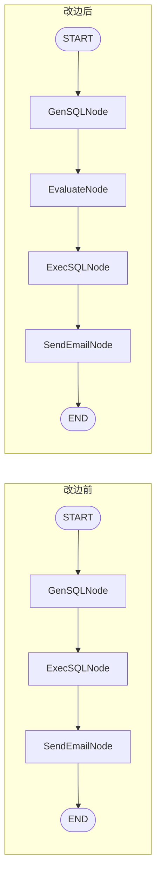

# 11-5 测试：验证评估节点效果

## 【学习目标】

学完本节，应当能够：

- 把 `EvaluateNode` 注册进 `biHelperGraph`，并说清改边前后链路的差异；
- 复现并修掉两个注册期错误（节点名写错、构造参数不匹配）；
- 分析空 SQL 引发的 `BadSqlGrammarException`，用判空防护把它转化为显式的「评估通过」；
- 向面试官讲清「空值防护 / 快速失败」在 Agent 链路里的位置。

## 【正文】

评估节点的初级版本写完后，本节把它接进工作流跑一次，验证它到底有没有起作用。主要做三件事：把节点注册进图、修正边，以及在测试中发现并修掉两个坑（节点名写错、构造参数不匹配），最后处理「生成 SQL 为空」导致的异常。

### 一、注册节点与调整边

先到图的定义里把新节点加进来，起名「评估节点」，通过 `AsyncNodeAction.node_async` 把 `EvaluateNode` 传进去。它依赖两个参数：`chatClientBuilder` 和 `vectorStore`（向量存储）。

节点加好后要改边。原来的链路是：`START → GenSQLNode → ExecSQLNode → SendEmailNode → END`。现在不能「生成完直接执行」，必须先评估，生成 SQL 通过评估之后再执行。所以把边改成了：`START → GenSQLNode → EvaluateNode → ExecSQLNode → SendEmailNode → END`。

完整的图定义大致如下：

```java
public class GraphConfig {
    public CompiledGraph graph(ChainClient.Builder chatClientBuilder) throws Exception {
        KeyStrategyFactory keyStrategyFactory = new KeyStrategyFactory();
        public Map<String, KeyStrategy> apply() {
            // ...
        }
    }

    StateGraph stateGraph = new StateGraph(name = "biHelperGraph", keyStrategyFactory);
    stateGraph.addNode("GenSQLNode", AsyncNodeAction.node_async(new GenSQLNode(chatClientBuilder, ...)));
    stateGraph.addNode("EvaluateNode", AsyncNodeAction.node_async(new EvaluateNode(...)));
    stateGraph.addNode("SendEmailNode", AsyncNodeAction.node_async(new SendEmailNode(...)));

    stateGraph.addEdge(StateGraph.START, targeted = "GenSQLNode");
    stateGraph.addEdge("GenSQLNode", targeted = "EvaluateNode");
    stateGraph.addEdge("EvaluateNode", targeted = "SendEmailNode");
    stateGraph.addEdge("SendEmailNode", StateGraph.END);

    return stateGraph.compile();
}
```



如实说明这段 `GraphConfig` 的形态问题：`apply()` 方法错挂在了 `graph()` 方法体内部，`KeyStrategyFactory` 的注册内容与 `graph()` 的返回都被折叠；`addNode` 只登记了 `GenSQLNode`、`EvaluateNode`、`SendEmailNode` 三个，没有 `ExecSQLNode`，而边里又是 `EvaluateNode → SendEmailNode` 直连，与正文描述的「`EvaluateNode → ExecSQLNode → SendEmailNode`「不一致。按正文意图，完整编排应补上 `ExecSQLNode` 的注册与两条边，并在 `KeyStrategyFactory` 登记 `evaluateResult` 的替换策略（11-4 节）。视频转写丢行 / 错位在这批代码里常见，跑工程时以文字描述为准。

边的语义变化比节点注册更值得注意：改边前，「生成」与「执行」之间没有任何关口；改边后，`evaluateResult` 成为这条链路上的事实闸门，PASS 才流得到执行节点。工作流的控制流从此由数据（评估结论）驱动，这是从「线性管道」进化到「条件闭环」的关键一步。

### 二、测试时踩到的两个坑

启动项目没报错，我们去 controller 里测 `talk` 方法，浏览器访问 `localhost:8877/genSQL/talk`，用「计算 25 年销售总额」来验证。重点看评估节点的「评估结果」日志，但发现它根本没打印。排查后发现两个错误：

1. **节点名注册错了**：图里把评估节点登记成了「生成 SQL」的名字，应该登记成「评估节点」。改对之后，节点在图里从灰色（没人用）变成亮色（已被引用）。
2. **构造参数不匹配**：图注册时传了两个参数，但 `EvaluateNode` 当时还多带着一个已经用不上的 `client`（ChatClient）参数，导致报错「期望三个参数但发现了两个」。把多余的 `client` 参数删掉，图定义就正常了。

两个坑有共同的教训：**图定义与节点实现是两份契约，改一头不改另一头，运行时才爆炸。** 节点名写错，图能编译、能启动，只是悄悄跑了一条没有评估的旧链路；构造参数不匹配，则是重构后旧参数没清干净。防范手段很朴素，每次改节点签名，全局搜一遍调用点；每次加节点，看一眼画布上它的入边是否真的连上。

### 三、空 SQL 引发的异常与修复

继续测一个「更新类」的要求。回想一下，我们在 `GenSQLNode` 里定过一条规则：如果涉及 `DELETE`/`UPDATE`/`DROP`/`INSERT` 这四类操作，直接返回空字符串。于是评估节点拿到的是一段空 SQL，而我们之前没做判空，调用流式评估时就抛了异常。

控制台报的是空查询错误：

```
ERROR o.a.c.c.[...].dispatcherServlet: Servlet.service() for servlet [dispatcherServlet] in context with path [...] threw exception
org.springframework.jdbc.BadSqlGrammarException: 
SQL Error: 0, SQLState: 42000
java.sql.SQLException: Can not issue empty query
```

修复思路很直接：评估之前先判断 `genSQL` 是否为空。为空就说明 `GenSQLNode` 主动拒掉了危险操作，我们直接打一条 `log.info("评估节点 pass")`（因为结果为空），并把它当成「通过」直接返回 `pass`，不再往下走评估逻辑。`EvaluateNode` 修复后的实现如下：

```java
public class EvaluateNode implements NodeAction {
    public Map<String, Object> apply(OverallState state) throws Exception {
        .user(t -> t.text("需要评估的SQL：{sql}").param("genSQL", genSQL))
        .streamBuilder sb = new StringBuilder();
        content.doNext(c -> sb.append(c).blockLast());
        log.info("评估结果是={}", sb.toString());
        return Map.of("k", "evaluateResult", sb.toString());
    }
}
```

而 `GenSQLNode` 里那条「危险操作返回空字符串」的规则，正是空 SQL 的来源：

```java
public class GenSQLNode implements NodeAction {
    public Map<String, Object> apply(OverallState state) throws Exception {
        // 角色描述：你是一名熟练的 SQL 专家，负责根据企业数据表结构生成 SQL 语句。
        // 要求：
        // 1. 仅生成可执行的 SQL，不输出与 SQL 无关的文字或解释。
        // 2. 生成 SQL 时，首先根据用户输入的自然语言，生成可执行的 SQL。
        // 3. 输出 SQL 时，禁止使用 markdown 格式，直接以文本格式输出。
        // 4. 如果有多种实现方式，优先选择最简洁、性能较好的写法。
        // 5. 禁止输出与 SQL 无关的文本或解释。
        // 6. 禁止生成 DELETE、DROP、UPDATE、INSERT 语句，只允许生成 SELECT 语句。
        // 7. 当用户输入的 SQL 语句为空时，返回空字符串。
        // 8. 每个字段都必须使用 AS 为字段命名，中文别名应尽量简洁，清晰。
        // 例：user_name AS '用户名'
        // （此处代码未完全展示，但逻辑是生成 SQL）
    }
}
```

对异常本身做一层归因：`Can not issue empty query` 出自 JDBC 层，严格说它更可能是空 SQL 穿透评估、流到 `ExecSQLNode` 的 `queryForList("")` 时抛出的；原稿记为「调用流式评估时抛异常」，断点归属略有出入，但根因一致，**空 SQL 没有在任何一环被拦截**。修复选在评估节点判空，是因为拒杀语义最早在此可见：空 SQL 不是故障，是 `GenSQLNode` 履行职责的证据。

还有一层值得想深：空 SQL 为什么判 `pass` 而不是 `fail`？因为空 SQL 意味着「无可执行语句」，对应「无风险可评」，把它判为通过，链路平滑结束；若判失败，反而会触发一轮毫无意义的重生成（模型很可能再次拒杀、再次返回空），白白消耗循环预算。**拒杀的正确归宿是显式放行，不是假装失败。**

也要如实说明：第三段代码是转写片段，判空逻辑与 `sb`、`content`、`genSQL` 的声明都不在片段内，`.user(...)` 一行也悬在方法体外；第四段 `GenSQLNode` 的注释清单与正文描述的口径一致（角色 + 8 条要求 + 中文别名示例），并自带「此处代码未完全展示」的标注。按正文补齐判空后，第一版评估节点就能在「正常 SQL」和「空 SQL（被拒的危险操作）」两种情况下都稳定跑通，验证环节闭环。

## 【易错点 / 面试题】

1. **面试官问：「空 SQL 为什么要判 pass？判 fail 让模型重生成不行吗？」**
   答：空 SQL 是生成节点主动拒杀危险操作的结果，代表「无可执行语句即无风险」。判 pass 是承认拒杀有效、平滑结束；判 fail 会把一次正确的拒杀误判为失败，触发无意义重试，甚至耗尽循环预算后错误地对外宣称「生成失败」。Agent 的每个分支都要先问「这是真的失败，还是机制在正常工作」。

2. **易错点：节点名 / 构造参数改一头不改另一头。** 图定义与节点实现是两份契约：名字对不上，链路静默少一环；参数对不上，启动即炸。固定 checklist，改签名全局搜调用点，加节点确认入边已连。

3. **易错点：只在中游判空。** 空 SQL 防护放在评估节点只是第一道；执行节点同样需要判空（或让拒杀直接终止链路），否则「评估通过 → 执行空查询」仍会把异常抛给用户。防护要覆盖链路末端，不能只覆盖发现问题的第一站。

4. **面试官问：「该 case 体现了什么可迁移的工程原则？」**
   答：两条。其一，快速失败要区分「故障」与「合规的拒绝」，后者应该被显式处理成正常分支，而不是错误分支；其二，一切以日志与外部效果为准，控制台说「没报错」不代表链路走了评估节点，评估日志没打印本身就是最强的排查信号。

## 【小结】

本节把 `EvaluateNode` 接进 `biHelperGraph`，链路从 `START → GenSQLNode → ExecSQLNode → SendEmailNode → END` 改为 `START → GenSQLNode → EvaluateNode → ExecSQLNode → SendEmailNode → END`，控制流第一次由数据（`evaluateResult`）驱动。测试期踩了两个注册期坑（节点名、构造参数），修法背后是「两份契约必须同步」的纪律；空 SQL 异常用评估前判空转化为显式 `pass`，体现「拒杀应被显式放行」的分支设计。到此，评估节点的初级版本闭环。第 11 章后续会把这条闭环继续加固（条件边、循环上限、评估-循环-微调三件套）。同款「受控执行」思想在配套工程 `980-demo` 中随处可见：`980-demo/src/main/java/com/carl/ai/transfer/agent/TransferAgent.java` 在抽取后判空并返回明确的失败文案，`980-demo/src/main/java/com/carl/ai/transfer/service/TransferOrderServiceImpl.java` 用 `@Transactional(rollbackFor = Exception.class)` 保证两表入库的全成或全滚，`980-demo/src/main/java/com/carl/ai/transfer/repository/BbTransferOrderRepository.java` 承载受控落库，评估节点卡在模型与数据库之间，工程则卡在数据库与一致性之间，守的是同一道门。
