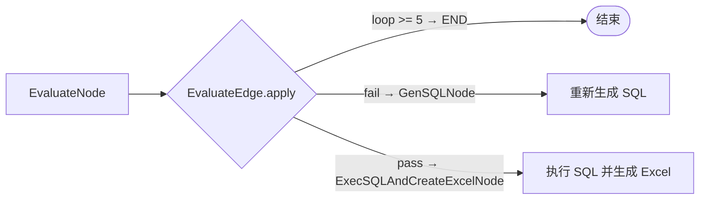

# 11-7 条件边实现

## 【学习目标】

学完本节，应当能够：

- 说清条件边在 Spring AI Alibaba Graph 里的定位：`EdgeAction` 接口 + `apply` 方法，用返回值决定下一个节点；
- 独立写出 `EvaluateEdge` 的三步判断逻辑，并把 `loop` 键按替换策略登记进 key 策略工厂；
- 把条件边通过 `addEdge` 三参数形式接入 `GraphConfig`，说清路由 Map 的作用；
- 向面试官讲清「为什么循环次数要在评估节点里更新，而不是在条件边里更新」。

## 【正文】

进阶版工作流里那一条「条件边」是核心。我们之前在**智能库存调拨优化系统**里就用过条件边（比如人类审核节点那里），所以这次照着同样的思路来写：新建一个 `Edges` 包存放条件边，创建 `EvaluateEdge` 实现 `EdgeAction` 接口，并实现它的 `apply` 方法。

### 一、条件边的定位与三步逻辑

条件边本身没有复杂业务，主要是判断。可以把它理解为一张**函数式路由表**：框架在运行时调用 `apply`，拿到它返回的字符串，再按该名字去找下一个节点。相比静态边「编译期写死目标」，条件边把「下一步去哪」推迟到运行期，依据正是状态机里的数据。

`apply` 方法只做三件事：

1. 拿到评估节点生成的结果（从状态机取 `evaluateResult`）；
2. 拿到当前这条 SQL 是第几次进入评估（循环次数 `loop`）；
3. 根据上面两项，返回下一个应该执行的节点。

两步取数里，`evaluateResult` 由评估节点写入，11-4 节已经在 key 策略工厂登记过；`loop` 则是本节新增的。「次数」什么时候更新？思路是：在整个工作流**首次调用**（controller 入口）时，就把 `loop` 作为初始变量直接放进状态机，用户对此无感知；之后每经过一次评估节点，就在评估节点里把 `loop` 加一。

所以先在 key 策略工厂里登记一个新 key `loop`，初始值 `0`，采用**替换策略**。完整的条件边判断逻辑骨架如下：

```java
String evaluateResult = state.value(key: "evaluateResult", defaultValue: "");
Integer loop = state.value(key: "loop", defaultValue: 0);
if (loop >= 5) {
    return StateGraph.END;
}
return "";
```

如实说明这段骨架的形态：它是判断逻辑的骨架而非完整实现，`pass` 分支暂时返回空串占位，完整版应返回 `ExecSQLAndCreateExcelNode`（见下文）；`state.value(key: ..., defaultValue: ...)` 的命名参数写法带有转写痕迹，Java 工程里应按 `OverAllState` 的真实重载书写；取 `evaluateResult` 的默认值是空串，取 `loop` 的默认值是 `0`，保证首次进入时两个键都有兜底值，不会因缺键抛异常。

### 二、返回下一个节点的判断

判断怎么写？先判循环次数：这里先**写死**上限为 5 次（该上限可以优化，把你希望的最大循环次数放到配置里动态获取，比如 Nacos 配置，想调大直接改配置即可；在智能库存调拨系统里我们已经演示过怎么把预值放到配置，这里留作课下作业）。

三个分支的语义整理成表：

| 条件 | 返回值 | 去向 | 语义 |
|---|---|---|---|
| `loop >= 5` | `StateGraph.END` | 结束节点 | 超出重试预算，主动熔断 |
| 未超限且 `fail` | `GenSQLNode` | 生成 SQL 节点 | 回退重生成，进入下一轮循环 |
| 未超限且 `pass` | `ExecSQLAndCreateExcelNode` | 执行 SQL 节点 | 放行，进入下游执行 |

判断顺序有讲究：**循环次数必须第一个判**。`loop >= 5` 一旦成立，直接返回 `StateGraph.END`，整个流程结束，不再回退、不再执行。放在最前面的原因是：这是成本检查，应该发生在任何业务判断之前，超限的那一轮本来就不该再发生，更不该再调用一次模型。

这一步就把「评估不通过 → 重生成」和「超限 → 终止」都接上了。

### 三、把条件边接入图定义

条件边写完，要整合进 `GraphConfig` 的图定义。原来评估节点是直接连到执行 SQL 节点的，现在不能这么连了，应该让评估节点连到这条条件边。

`addEdge` 这里要传三个参数：

- 第一个是源节点：评估节点（`EvaluateNode`）；
- 第二个是边动作 `action`：把刚写的 `EvaluateEdge` 传进来；
- 第三个是一个 `Map`：key 是条件边 `apply` 返回的节点名，value 是要到达的目标节点。也就是，返回 `GenSQLNode` 就回到生成 SQL 节点，返回 `END` 就到结束节点。

该 Map 是框架的路由依据：`apply` 只负责「报名字」，Map 负责「名字 → 节点」的翻译。两者分离的好处是边逻辑可以单测，给定一个状态，断言 `apply` 返回什么字符串即可，不必把整张图跑起来。

边的路由形态用 mermaid 表示：



这样条件边就定义完成。执行 SQL 节点连发送邮件、发送邮件连结束，这部分不用动。

### 四、补上 loop 的更新

条件边定义完，发现还差一环：上面说的 `loop` 还没真正更新。前面定的方案是在**评估节点**里更新，所以回去改 `EvaluateNode`：从状态机取初始化时传入的 `loop`（默认 0），在评估之前先把它加一（第一次进来就是 1）。

然后注意空 SQL 的情况：如果 `genSQL` 是空的，我们之前直接返回 `pass`，但现在不能只返回结果，要**同时把更新后的 `loop` 一起返回**；如果 SQL 不为空、走真正的评估，评估完成后同样要把 `loop` 返回回去。评估节点里取数与空值处理的逻辑如下：

```java
String genSQL = state.value(key: "genSQL", defaultValue: "");
String userQuery = state.value(key: "userInput", defaultValue: "");
Integer loop = state.value(key: "loop", defaultValue: 0);
if (StringUtils.isBlank(genSQL)) {
    log.info("评估结果PASS，因为结果为空");
    return Map.of("evaluateResult", "PASS");
}
```

如实说明这段代码的断点：片段只展示到空 SQL 分支的返回为止，且该返回值里没有带上 `loop`，与正文「两种情况最后都把最新的循环次数写回状态机」的描述存在出入，按正文意图，空 SQL 分支与非空 SQL 分支的返回 Map 里都应当补上 `"loop"` 键（例如 `Map.of("evaluateResult", "PASS", "loop", loop)`）；片段里取了 `userQuery` 但未使用，完整实现中它应当参与评估提示词的组装。跑工程时以文字描述为准，以真实 API 签名补全。

为什么累加必须放在评估节点，而不是条件边？三条理由：

1. **事件发生地原则**：`loop` 语义是「第几次进入评估」，评估节点才是该事件的发生地，在这里加一最自然；
2. **边保持纯读**：条件边的职责是路由，只读状态、不写状态，才能保持可单测、可复用；
3. **空分支也要计数**：空 SQL 判 `pass` 是「拒杀后的显式放行」（11-5 节），但它同样消耗了一次链路预算，不计数的话，危险操作可以零成本地反复打通「生成 → 空 → 放行」路径，循环上限就被绕过了。

本质上就是从状态机里把 `loop` 取出来、加一，空 SQL 直接返回通过，非空 SQL 进真正评估，两种情况最后都把最新的循环次数写回状态机。到这一步，条件边 + 循环限制就完整闭环了。

## 【易错点 / 面试题】

1. **面试官问：「`loop` 为什么用替换策略？用聚合策略（比如求和）行不行？」**
   答：不行。聚合策略会把每次写入的值累加起来，而评估节点每轮写入的是「当前最新次数」，累加会让计数飞快失真（第一轮写 1、第二轮写 2，聚合后变成 3）；替换策略每次用最新值覆盖旧值，计数才与「第几次进入评估」的语义一致。key 策略的选择要跟键的语义匹配：计数类用替换，收集类才考虑聚合。

2. **面试官问：「循环上限的判断为什么放在 `apply` 的最前面，而不是最后？」**
   答：它是成本检查，不是业务分支。放在最前面，超限当轮直接结束，不会再触发一次模型调用；放在最后，这一轮生成和评估已经实实在在地花掉了，预算就漏了一个口子。原则：**省资源的判断要尽早失败（fail fast）**。

3. **易错点：在条件边里更新 `loop`。** 边是纯路由，写副作用会让「查询」与「写入」耦合，单测要连带准备状态写入，多个源节点复用同一条边时副作用归属也会混乱。更新放节点、判断放边，读写分离。

4. **易错点：只给非空 SQL 分支返回 `loop`。** 空 SQL 判 `pass` 的那条路径同样要写回最新次数，否则拒杀路径不消耗循环预算，循环上限对「反复生成危险 SQL」的场景失效。

## 【小结】

本节把进阶版的「执行图纸」落到了代码：新建 `EvaluateEdge` 实现 `EdgeAction`，`apply` 从状态机取 `evaluateResult` 与 `loop`，按「超限 → `END`、`fail` → `GenSQLNode`、`pass` → `ExecSQLAndCreateExcelNode`」三分支路由；`loop` 键按替换策略登记、初值 0，由评估节点每轮加一并写回，条件边通过 `addEdge` 三参数（源节点 + action + 路由 Map）接入图定义。「更新放节点、判断放边」的读写分离，是这套条件环可测试、可维护的关键。同款「受控状态机」思想在配套工程 `980-demo` 中有对应实现：`980-demo/src/main/java/com/carl/ai/transfer/service/TransferOrderServiceImpl.java` 用 `@Transactional(rollbackFor = Exception.class)` 把「主单入库 → 子单回填外键 → 批量入库」绑成一个原子节点动作，任一环失败整体回滚；`980-demo/src/main/java/com/carl/ai/transfer/repository/BbTransferOrderRepository.java` 与 `BbTransferOrderItemRepository` 承载受控落库，图节点守的是「链路状态一致」，工程守的是「数据状态一致」，用的是同一种思路。
