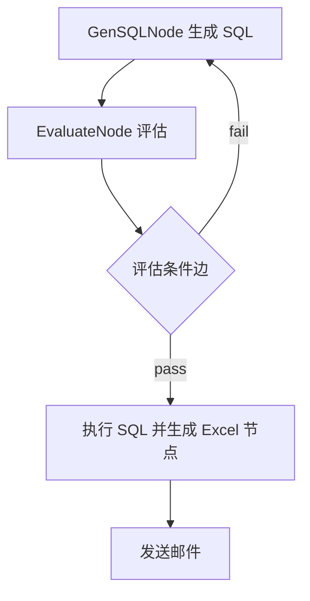

# 11-8 面试加分项：三件套：评估-循环-微调，准确率拉满！

## 【学习目标】

学完本节，应当能够：

- 说清 `threadId` 在 Graph 工作流里的作用，并针对「系统触发」与「用户触发」两种场景各自选定正确的对话隔离策略；
- 用 `userId` 改造 `GenSQLController`，让不同用户的循环次数与中间状态互不污染；
- 向面试官讲清 Temperature 对 SQL 生成这类确定性任务的影响，以及「评估-循环-微调」三件套各自负责哪一段；
- 分析「评估不通过」路径为什么难以复现，并给出可行的测试思路。

## 【正文】

评估节点 + 条件边（循环）这套能力做完后，先做一件事再测试：给 controller 方法做**对话隔离**；最后再补上「微调」这一环（调整大模型 Temperature），把「评估-循环-微调」三件套凑齐，准确率才能拉满。

### 一、先改造 controller：用 userId 做对话隔离

不同对话的循环次数可能不一样，所以一定要做对话隔离。`threadId` 在 Graph 工作流里是状态机实例的身份证：同一个 `threadId` 对应同一份 `OverAllState`，`loop`、`evaluateResult`、`genSQL` 这些中间状态都挂在它下面。不做隔离，A 用户触发的循环会把 `loop` 加到 B 用户的账上，评估结论也会串味。可以说，**条件环的正确性前提是对话隔离**。

回想之前**智能库存调拨优化系统**里，隔离是通过 Kafka 触发走的：销售达到阈值就发 Kafka 消息，消费端拿到一个 `threadId`。当时因为不是用户直接触发、而是代码执行时触发，跟用户关系不大，所以 `threadId` 直接用 `IdUtil.simpleUUID()` 随机生成。

但在 BI 报表问答系统里，用户是用自然语言提问的，跟用户强相关，所以 `threadId` 不能再随机，而应该用用户的唯一标识。我们新增一个 `userId` 参数，构造 `RunnableConfig` 时把唯一标识设成 `thread:` + `userId`。

两种策略的取舍可以归纳成一张表：

| 维度 | 库存调拨系统 | BI 报表问答系统 |
|---|---|---|
| 触发方 | 代码执行时（Kafka 消费） | 用户自然语言提问 |
| threadId 生成 | `IdUtil.simpleUUID()` 随机 | `thread:` + `userId` |
| 隔离诉求 | 每次执行相互独立 | 同一用户的状态可归属 |
| 与用户的关联 | 无 | 强相关 |

之前库存调拨系统的消费端（随机 UUID 方案）大致是这样：

```java
public class AgentConsumerService {
    public Integer agentConsumer(List<String> messages, Acknowledgment acknowledgment) {
        String saleDate = jsonObject.getString(key + "saleDate");
        String key = KeyPrefixConstant.PRODUCT_SALE_ONLY_KEY + "warehouseId" + "saleDate";
        Boolean result = redisTemplate.opsForValue().setIfAbsent(key, message, timeout_11, TimeUnit.DAYS);
        if (result) {
            acknowledgment.acknowledge();
            return;
        }
    }
}
```

```java
String threadId = IdUtil.simpleUUID();
RunnableConfig runnableConfig = RunnableConfig.builder()
    .threadId(threadId)
    .build();
OverAllState overAllState = graph.call(
    Map.of("productId", "product1", "threadId", threadId, "runnableConfig", runnableConfig),
    runnableConfig.get()
);
acknowledgment.acknowledge();
log.info("consumer end...");
```

如实说明这两段的形态：第一段是 Kafka 消费端节选，`jsonObject`、`redisTemplate`、`timeout_11` 都不在片段内，且 `key` 先使用后声明；从 `setIfAbsent` + `acknowledge` 的结构看，语义是「Redis 幂等去重命中就不再处理，未命中才继续执行业务并手动 ack」，`PRODUCT_SALE_ONLY_KEY + warehouseId + saleDate` 拼出的键，保证同一仓库同一天的销售事件只被处理一次。第二段把随机 `threadId` 同时放进 `RunnableConfig` 和初始状态 Map，`graph.call(...)` 的第二个参数在不同写法里出现过 `runnableConfig.get()` 与直接传 `runnableConfig` 两种形式（见下文 BI 版），跑工程时以 `RunnableConfig` 的真实 API 为准。另外注意 `OverAllState` 与 BI 代码里的 `OverallState` 拼写不一致，属于转写差异，以工程实际类名为准。

而现在 BI 系统改用 `userId` 作为隔离标识，并抽出 `THREAD_PREFIX` 常量让代码更规范：

```java
@RestController
@RequestMapping(value = "/genSql")
public class GenSQLController {
    @Resource
    private CompiledGraph graph;
    private final static String THREAD_PREFIX = "thread:";

    @GetMapping(value = "/talk")
    public R<Map<String, Object>> talk(@RequestParam String userInput, @RequestParam String userId) {
        RunnableConfig runnableConfig = RunnableConfig.builder()
            .threadId(THREAD_PREFIX + userId)
            .build();
        OverAllState overAllState = graph.call(Map.of("userInput", userInput, "threadId", runnableConfig.getThreadId()), runnableConfig);
        Map<String, Object> data = overAllState.data();
        return R.success(data);
    }
}
```

改造点有三个：入参新增 `userId`；`threadId` 由「随机 UUID」变为「`thread:` + `userId`」，前缀常量 `THREAD_PREFIX` 抽出来避免硬编码散落；初始状态 Map 里 `threadId` 取 `runnableConfig.getThreadId()`，保证配置与状态里的标识同源。这与 Spring AI 2.0.1 里 `MessageChatMemoryAdvisor` 按会话 ID 隔离记忆是同一种思想：一切「按会话生效的状态」，都要有一个稳定的会话标识做钥匙。

### 二、跑通测试：评估通过的正常链路

传参改完后，在评估节点和条件边里各补一条日志（打印「到达评估条件边，Loop 等于 X」），方便观察循环次数。启动项目无报错，浏览器访问测试，让模型「计算 2025 年每个月的销售总额，并按月份升序排列」，`userId` 传 `11`。

日志链路很清晰：先到达大模型生成 SQL 节点 → 循环次数 = 1 → 评估 → 通过 → 到达评估条件边（打印循环次数 1）→ `pass` → 进入执行 SQL 并生成 Excel 节点 → 发送邮件。邮件成功收到，由于数据库里目前只有 2025 年 1 月的数据，返回的就是 1 月的销售总额。生成的 SQL 如下：



```sql
genSQL = SELECT
    d.month AS '月份',
    SUM(s.sales_amount) AS '销售总额'
FROM fact_sales s
JOIN dim_date d ON s.date_id = d.date_id
WHERE d.year = 2025
GROUP BY d.month
ORDER BY d.month ASC;
```

这条 SQL 有两个值得学习的细节：一是走 `fact_sales` 事实表 LEFT 思路的 `JOIN dim_date` 日期维表，按 `d.month` 分组汇总，表间关系正是私有知识库（RAG 召回）提供给模型的；二是每个字段都用 `AS` 起中文别名，与 `GenSQLNode` 提示词里「每个字段都必须使用 AS 为字段命名，中文别名应尽量简洁」的要求一一对应。**提示词的约束会原样体现在模型输出里**，这是评估提示词质量最直观的观测点。

最终发送邮件的节点，逻辑就是取状态里的 Excel 文件，有就带附件发、没有就发一封「数据库不存在」的提示邮件：

```java
public class SendEmailNode implements Node {
    @Override
    public Map<String, Object> apply(OverallState state) throws Exception {
        Optional<Object> excelFile = state.value("keyExcelFile");
        if (excelFile.isEmpty()) {
            emailService.sendEmail(to: "1305482016@163.com", content: "在数据库不存在");
        } else {
            emailService.sendEmailWithAttachment(to: "1305482016@163.com", (File) excelFile.get());
        }
        return Map.of();
    }
}
```

如实说明：`sendEmail(to: ..., content: ...)` 的命名参数是转写痕迹，Java 里应按方法实际签名传参；`Node` 与 11-5 节 `EvaluateNode` 用的 `NodeAction` 接口名不一致，也属转写差异；收件人 `1305482016@163.com` 是演示硬编码，11-9 节会指出它应当取 `userId` 对应的真实收件人。`state.value("keyExcelFile")` 返回 `Optional`，用 `isEmpty()` 判空后强转 `File`，Excel 文件由上游「执行 SQL 并生成 Excel」节点写入状态，邮件节点只做消费，节点间通过状态机解耦的形态在这一段看得很清楚。

至于「评估不通过」的情况不太好测：因为涉及 `UPDATE`/`DELETE`/`INSERT`/`DROP` 这四类操作时，`GenSQLNode` 会返回空 SQL，评估节点发现为空直接判 `pass`，然后还是会往下执行、发一封「无内容」的邮件。所以错误 SQL 的生成在这套防护下很难直接复现，大家有更好的测试方案可以自行尝试。

往深看一层：这是「防护生效」与「路径不可观测」的矛盾，生成侧拒杀太有效，评估侧永远等不到一条真实的 `fail`。可行的测试思路有三条：临时改 `GenSQLNode` 的提示词，故意诱导模型产出错误 SQL；在测试环境把评估节点换成返回固定 `fail` 的桩，专测条件边的回环与超限；直接构造一条语法非法的 SQL 塞进状态机，验证评估节点是否如实判 `fail`。三条思路的共同点是**把被测路径从真实概率中解耦**，这是带概率组件系统的通用测试原则。

### 三、第三件套：微调 Temperature 提升准确率

最后说一下大模型参数里最关键的一个：**Temperature（温度）**。它取值在 0 到 1 之间：

- 温度越高，大模型创造性越强，但越容易出现**幻觉**（胡编乱造），每次返回结果可能都不一样；
- 温度越低，创造性越弱，结果越一致、越严谨，准确率更高。

可以用高考做数学题来类比：遇到难题脑子「发热」、创造性上来了，但耗时长、每次思路可能都不同；想要稳定发挥，就得把「温度」降下来。

对应到两个 Agent：

- **库存调拨优化系统**：希望模型帮你做库存预测，需要一定的想象力和创造性，所以温度保持默认值（也可以按需调到 0.7 / 0.8 / 0.9），具体按业务微调；
- **智能 BI 报表系统**：表结构、表间关系全部来自私有知识库，是唯一确定的，执行 SQL 不需要创造性，只求每次返回准确一致，所以要把温度调低，比如 `0.2`，「别发挥创造力，保持严谨、结果一致就行」。

配置里把温度设为 `0.2`：

```yaml
spring:
  ai:
    openai:
      api-key: sk-...
    chat:
      options:
        model: qwen3-max
    options:
      model: qwen3-max
      temperature: 0.2
    base-url: https://dashscope.aliyuncs.com/compatible-mode
```

如实说明这段配置的层级问题：`base-url` 被平铺到了 `spring.ai` 之下，`model` 与 `temperature` 也拆成了 `chat.options` 与 `options` 两处重复；在 Spring AI 2.0.1 中，对接 DashScope 的 OpenAI 兼容模式，端点、密钥与采样参数应统一挂在 `spring.ai.openai.*` 下（`base-url`、`api-key`、`chat.options.model`、`chat.options.temperature`）。转写稿保留了原始结构，实际配多 profile 时按真实路径归位即可，配套工程 `980-demo/src/main/java/com/carl/ai/transfer/config/ChatModelConfig.java` 用 `@Value("${transfer.llm.base-url:}")` 把端点、模型名、密钥全部外置，正是这一课的落地形态。

调低之后再多次刷新测试，对比第一次和第二次生成的 SQL，会发现几乎没有任何差异，因为创造性被压低了，结果更唯一、更准确。温度还可以继续往下调到 `0.1`，但没有固定标准，需要你结合实际业务去微调：比如先试 `0.3`，跑一段时间效果不理想就降到 `0.2`，还不行再降到 `0.1`。

至此可以把「三件套」的分工讲清楚，这也是面试时最能体现体系化认知的一段：

| 手段 | 作用阶段 | 解决的问题 | 不做的后果 |
|---|---|---|---|
| 微调 Temperature | 生成前（源头） | 压低输出方差，减少失败概率 | 每次结果飘忽，评估节点反复判 fail |
| 评估节点 | 生成后（闸门） | 拦截不合格 SQL，防止错误直达数据库 | 坏 SQL 被执行，报表与邮件跟着错 |
| 条件边 + 循环 | 失败后（闭环） | 给失败一次有预算的重试机会 | 一次失败即任务失败，成功率低 |

到此，「评估 + 循环 + 微调」三件套就齐了：评估节点卡质量、条件边控循环防死锁、温度微调保证生成稳定准确，BI 报表问答系统的准确率也就拉满了。

## 【易错点 / 面试题】

1. **面试官问：「库存系统用随机 UUID 做 threadId，BI 系统用 userId，区别的根因是什么？」**
   答：根因在触发方与状态的归属。库存系统由代码（Kafka 消费）触发，每次执行是一次性任务，随机 UUID 保证执行之间互不干扰；BI 系统由用户提问触发，状态天然归属某个用户，用 `userId` 才能让「同一用户的循环次数、中间结果」有确定的归宿。隔离策略要跟触发方匹配，而不是照抄。

2. **面试官问：「Temperature 调到 0.1 甚至更低，有什么代价？什么时候不该调低？」**
   答：代价是输出多样性归零，同一个问题永远同一个答案，需要「换个思路」的场景（头脑风暴、库存预测、文案生成）会被掐死。此外温度只影响采样分布，管不住「模型根本不知道答案」的情况，后者要靠 RAG 提供知识。课程里的分工正是：BI 系统求确定性，温度压到 0.2；库存预测需要创造性，温度保持默认或 0.7 以上。

3. **易错点：只改 `RunnableConfig`，不改初始状态 Map 里的 `threadId`。** 两处必须同源（`runnableConfig.getThreadId()`），否则配置按 userId 隔离、状态却按另一个标识走，隔离形同虚设。

4. **面试官问：「评估不通过的路径为什么难以测试？说明了什么？」**
   答：因为生成侧的拒杀（四类危险操作返回空 SQL）太有效，评估节点等不到真实 `fail`。这说明两点：其一，带概率组件的系统要把「被测路径」从真实概率中解耦（改提示词诱导、桩替换、直接构造非法输入）；其二，防护有效的证明不能只靠「没看到失败」，要用桩把失败路径强制跑一遍，才算验证过闭环。

## 【小结】

本节凑齐「评估-循环-微调」三件套：用 `userId`（`thread:` + `userId`）替换随机 UUID 完成对话隔离，让每个用户的 `loop` 与中间状态互不污染；实测走通「生成 → loop=1 → 评估 pass → 执行 → 邮件」的完整链路，并指出「fail 路径难复现」背后是防护生效与可观测性的矛盾；最后把 Temperature 压到 0.2，从源头压低输出方差。三手段分别作用于生成前、生成后、失败后，合起来才是完整的准确率方案。同款「多 profile + 参数外置」的工程实践见 `980-demo/src/main/java/com/carl/ai/transfer/config/ChatModelConfig.java`：`transfer.offline=true` 时装配 `OfflineChatModel` 离线返回固定 JSON，`transfer.offline=false` 时经 `OpenAiApi.builder().baseUrl(...)` 指向真实 OpenAI 兼容端点，`temperature(0.2)` 与模型名、密钥一并外置，正是「把可调的东西都放进配置」这一课的落地形态。
