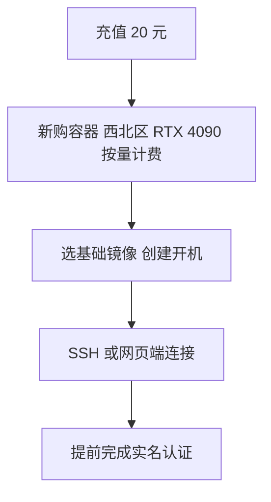

# 12-2 常见的算力服务器介绍以及算力服务器购买

## 【学习目标】

学完本节，应当能够：

- 说清私有化部署为什么要买 GPU 型云服务器，以及轻量级服务器为什么不行；
- 按「GPU 型号、GPU 数量、GPU 显存」三个指标评估业务需要几张什么卡；
- 对比阿里、腾讯与 AutoDL 的价格与计费模式，为不同角色（企业 / 个人开发者）选出合适的采购渠道；
- 独立完成一次 AutoDL 租用实操：充值、选卡、开机、连接，并避开「自定义端口需实名认证」该坑。

## 【正文】

实际部署之前，肯定得先有服务器。这一节盘点几个常用的购买平台，并重点对比价格，帮你选到合适的 GPU 算力。

### 一、平台选择：阿里、腾讯、华为

最常用的就是阿里、腾讯，还有华为。第一步是选服务器类型，**一定要买 GPU 型的云服务器**，别买那种轻量级服务器，因为我们跑大模型靠的就是 GPU 算力。

为什么非 GPU 不可？大模型推理的本质是稠密矩阵运算与海量参数访存，需要的正是 GPU 的并行算力与高显存带宽；轻量级服务器（CPU 型）在这两项上都是数量级的差距，模型加载阶段就会因显存不足直接失败，更谈不上推理吞吐。这不是「快与慢」的差别，是「能与不能」的差别。

以阿里为例，进到「计算」下面选 GPU 云服务器，点「购买」能看到价格。企业一般选**包年包月**。选好地域后，再挑具体的英伟达显卡型号。腾讯那边同理，「计算」里也有 GPU 云服务器。华为同属这一档常用平台，选购路径大同小异：都是先定位到 GPU 实例品类，再按卡型与显存放价。三家之间怎么选，通常看公司已有的云资源与合同关系，价格结构则处于同一量级，课程主线以阿里与腾讯的报价做参照。

选几张卡，要先评估你们业务的流量量和并发需求：初期可能 1 张 GPU 就够，随着业务增长，3 张不够了再上多 GPU。

### 二、价格参考

GPU 服务器普遍不便宜。粗看一下：

- 腾讯单卡机型一个月要一万七左右，对大公司来说其实不算贵，毕竟每月光工资就开很多；
- 最便宜的 **NVIDIA T4**（16GB 显存）一个月也得两千五；
- 显存更大的卡更贵，比如 24GB 显存的（如 A100 这类）一个月要四千多。

这里的关键结论是：部署大模型时，优先看三个指标，**GPU 型号、GPU 数量、GPU 显存**。显存越低越便宜（16GB 约 ¥2500），显存越高越贵（24GB 约 ¥4000+）。

三个指标各自决定什么，值得逐一拆开：

| 指标 | 决定什么 | 课程给出的观测 |
|---|---|---|
| GPU 型号 | 单卡算力与架构代际 | 从 T4 到 A100 一类的代差直接体现在价格上 |
| GPU 数量 | 可并行规模与切分方式 | 初期 1 张可能够，增长后上多 GPU |
| GPU 显存 | 能装下多大的模型 | 16GB 约 ¥2500/月，24GB 约 ¥4000+/月 |

显存是三个指标里最硬的那一个：模型权重与推理过程中的 KV cache 都要驻留显存，显存不够，再强的算力也无处安放，模型直接加载失败。价格随显存抬升的曲线（16GB → 24GB，约 ¥2500 → ¥4000+）就是这条物理约束的市场定价。

如果按量计费（按小时），阿里竞价实例低至 ¥1.7/h，标准价约 ¥9/h；腾讯竞价实例也是 ¥1.7/h 左右。

按量计费内部还分两档，差异要认清：**竞价实例用低价换取「可被随时回收」**，平台闲置算力打折出售，回收风险由租用方承担，适合开发、实验这类可中断负载；标准价贵数倍，换来的是稳定占用。企业长稳服务选包年包月，个人与实验场景选按量或竞价，该分工与 12-1 节的选型逻辑是同一套成本观。

### 三、更省钱的方案：AutoDL

演示不会用前面那两家，确实偏贵。这里推荐一个专门做 GPU 算力的平台，**AutoDL**。如果你大学/研究生是计算机专业的，对它应该不陌生：学生没钱就爱用这种便宜的算力平台，一小时一两块钱，用来做模型开发很划算。你可以把它理解成类似腾讯云、阿里云那样的云平台，只是更便宜。

登录 AutoDL 后进入「算力市场」，按地域列出了不同型号的 GPU，并且标了每种还有多少台可用。按量计费都是按小时的：

- 西北区 RTX 4090 约 ¥1.88/h（机器也最多）；
- 重庆 4090 约 ¥2+/h；
- 内蒙 4090 约 ¥1.98/h；

基本就是一小时两块钱上下。另外它还有国产 GPU（如摩尔线程）可选，西北区机器量最大、价格也最低（¥1.88/h）。

各渠道价格放在一张表里对比（均为课程实录时点价格，实际以平台当期公示为准）：

| 渠道 | 计费模式 | 参考价格 |
|---|---|---|
| 腾讯云 | 包年包月 | 单卡机型约 ¥17000/月 |
| 阿里云 | 包年包月 | T4 16GB 约 ¥2500/月；24GB（A100 一类）约 ¥4000+/月 |
| 阿里云 | 按量（竞价） | 低至 ¥1.7/h |
| 阿里云 | 按量（标准） | 约 ¥9/h |
| 腾讯云 | 按量（竞价） | 约 ¥1.7/h |
| AutoDL | 按量 | 西北区 RTX 4090 约 ¥1.88/h；内蒙 4090 约 ¥1.98/h；重庆 4090 约 ¥2+/h |

两种角色的采购策略因此很清楚：**企业生产**走阿里/腾讯的包年包月 GPU 机型，要的是稳定、发票与合规，一个月一万七相对人力成本占比有限；**个人开发者与学生**走 AutoDL，一小时一两块钱，把「学大模型部署」的门槛压到一顿饭钱。国产 GPU（摩尔线程）则多了一条自主可控的选项，可按需关注。

### 四、AutoDL 实操要点

我在 AutoDL 充了 20 块钱（之前测试用了大概七八块，充 20 肯定够）。它有个很香的点：**关机就不计费**，不像别的平台，哪怕你关机了，只要实例没释放就一直收费；AutoDL 不是这样。

「关机不计费」值得多想一层：它把计费单位从「实例占用时长」变成了「实际使用时长」，租用方对成本有了确定性，做完实验关机，计费立刻停。对「按小时两块钱」的平台，这进一步放大了性价比；对学习者，它意味着可以放心地开机关机、反复试验，不必为闲置时间付费。

控制台里如果没有容器，就新买一个。我选**西北区、按量计费、RTX 4090（英伟达）**这张卡做演示。镜像选一个基础版本（比如 2.1.2 / 3.10 这种），确认价格 ¥1.88/h，创建并开机，状态变「运行中」就 OK 了。镜像选基础版而不是预装一堆框架的「全家桶」，好处是拉取快、占用小、环境干净，后续装 Ollama、配 Python 环境都从一张白纸开始，排查问题时变量更少。

连接机器有两种方式：用 SSH 工具连，也可以直接在平台网页上操作。

> 注意：如果你是个人账号、没做企业认证，是改不了默认端口的。点「自定义服务」会要求先**实名认证**（这应该是平台后来加的，之前能直接看）。所以大家先去把实名认证做了，后面我们正式讲 Ollama 的部署方案。

把实操步骤整理成 checklist：

1. 充值（小额即可，按小时计费，20 元够做多轮测试）；
2. 控制台无容器则新购：选地域（西北区机器多、价低）→ 卡型（RTX 4090）→ 按量计费；
3. 选基础镜像，确认时价后创建开机，等状态变「运行中」；
4. SSH 或网页端连接；
5. 提前完成实名认证，免去「自定义服务 / 改默认端口」时被拦。

第 5 步是最容易漏的坑：个人账号未认证时，涉及自定义端口的操作会被平台直接挡住，而部署 Ollama 时大概率要指定端口，所以认证要赶在部署之前做，而不是报错了再回头补。

## 【易错点 / 面试题】

1. **面试官问：「部署大模型选服务器，看哪几个指标？」**
   答：三个，GPU 型号、GPU 数量、GPU 显存。型号决定单卡算力代际，数量决定并行规模，显存决定能装下多大的模型（权重加 KV cache 都要驻留显存，显存不足直接加载失败）。课程实录的价格曲线也印证了显存的权重：16GB 约 ¥2500/月，24GB 约 ¥4000+/月。

2. **面试官问：「竞价实例便宜这么多，生产环境能否使用？」**
   答：要分清负载性质。竞价实例以低价换取可被随时回收，适合开发、实验等可中断负载；长稳生产服务被回收一次就是一次事故，应选包年包月或标准按量。便宜的价格背后是风险转移，选型时先问「该任务能否被中断」。

3. **易错点：买了轻量级服务器。** 跑大模型靠 GPU 算力，CPU 型轻量服务器在算力与显存带宽上都是数量级差距，模型加载这关就过不去。采购第一步永远是选对实例类型。

4. **面试官问：「你们演示为什么用 AutoDL 而不是阿里云？」**
   答：因为场景是学习与演示，不是生产。AutoDL 按小时计费、一小时两块钱上下、关机还不计费，成本确定性极高；阿里云包年包月单卡一个月一万七，对企业生产合适，对个人演示太重。渠道选择跟着场景走，这也是成本观的一部分。

## 【小结】

本节解决了私有化部署的算力前置问题：GPU 型云服务器是硬性前提，选购盯「型号、数量、显存」三个指标；价格上，企业生产走阿里/腾讯包年包月（单卡约 ¥17000/月，T4 约 ¥2500/月，24GB 约 ¥4000+/月，竞价按量低至 ¥1.7/h），个人学习走 AutoDL（4090 约 ¥1.88–2+/h 且关机不计费）；实操按「充值 → 选西北区 4090 按量 → 开机 → SSH/网页连接」执行，并提前完成实名认证避开自定义端口拦阻。算力花的每一分钱都应对应真实负载，同款「不该烧的钱一分不烧」思想在配套工程里落地为：`980-demo/src/main/java/com/carl/ai/transfer/config/OfflineChatModel.java` 让 default profile 完全离线返回固定 JSON，开发调试期零模型调用成本；只有 `transfer.offline=false` 的 prod profile 才经 `980-demo/src/main/java/com/carl/ai/transfer/config/ChatModelConfig.java` 的 `OpenAiApi` 指向真实端点花真实的 token 费用。下一节（12-3）就在租好的 AutoDL 服务器上落地 Ollama，把算力真正用起来。
