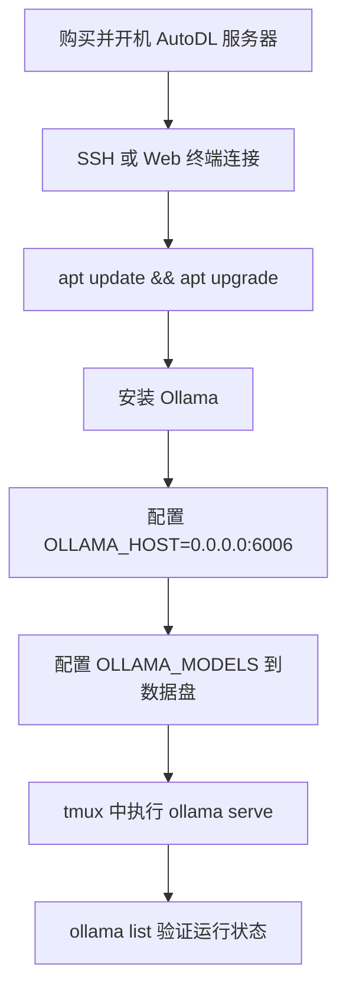

# 12-3 AutoDL 服务器操作 + Ollama 安装落地

## 【学习目标】

- 说清 AutoDL 个人版的端口开放策略，以及平台会员、学术加速对下载速度的影响。
- 独立完成从连接服务器、更新系统到安装 Ollama 的全过程。
- 理解 Ollama 默认端口 11434 与平台仅暴露 6006 之间的冲突，并能用环境变量加 tmux 完成「改端口、模型落数据盘、后台常驻」三项改造。

## 【正文】

上一课完成了实名认证并买好了算力服务器，这一课正式在 AutoDL 上把 Ollama 跑起来。整体分七步：看清平台限制、连接服务器、摸清磁盘布局、更新系统、安装 Ollama、改监听端口、用 tmux 常驻。先看全流程，再逐段展开：



## 一、端口与会员：先看清平台限制

进入「自定义服务」并同意协议后，可以看到平台默认只暴露 6006 这一类端口。个人版用户只能使用默认端口，想改默认端口必须做企业认证。这一点是后续所有操作的基调：无论装 Ollama、vLLM 还是别的推理服务，最终都要把服务塞进 6006 端口，否则外网访问不到。

新注册用户会送一个月会员，租用机器有折扣，还自带学术加速。学术加速可以理解为平台提供的网络加速通道，用于更快地下载国外资源。它对后面两步有实际影响：更新系统软件源、从 Ollama 官网拉安装包，都是走外网的下载动作，开不开加速，速度差别明显。

端口限制的背后是平台的安全策略：租用的机器本质是容器，平台在容器外面做了一层端口映射，只把 6006 映射到公网。理解这一点很关键，不是容器里没监听 11434，而是公网流量到不了 11434。所以解法永远是「服务适配平台」，而不是「平台适配服务」。

## 二、两种连接方式

连接服务器有两条路：

- SSH 工具：复制平台给出的登录指令，粘贴回车；第一次连接会提示是否信任主机指纹，输入 `yes`；再粘贴密码回车，即可进入服务器命令行。
- 网页控制台：平台自带 Web 终端（基于 JupyterLab），点「终端」即可直接操作。

两种方式在后续课程里都会用到：日常操作用 SSH 更顺手，Web 终端适合在浏览器里快速查看状态。对 Java 工程师来说，「登录命令整条粘贴」的习惯要尽快养成，后面 12-6 配 SSH 隧道时靠的就是这条命令。

| 对比项 | SSH 工具 | 网页控制台（Web 终端） |
|---|---|---|
| 入口 | 本地终端粘贴登录命令 | 浏览器打开平台页面点「终端」 |
| 首次连接 | 需确认主机指纹（输入 yes） | 无需确认 |
| 复制粘贴 | 支持 | 支持 |
| 适用场景 | 日常开发、配隧道 | 临时查看、应急操作 |

## 三、磁盘布局：模型要放到数据盘

AutoDL 默认给两块盘：

- **系统盘** 30G，速度一般，关机后数据不丢失；
- **数据盘** 50G，速度快，但关机后数据会丢失。

系统盘只有 30G，下载几个大模型很快占满，模型和大文件必须放数据盘（`/root/autodl-tmp`）里。

「数据盘快但关机丢」对容器租用场景是个必须记住的细节：AutoDL 的机器是容器，关机或释放后数据盘清零，模型需要重新下载。因此生产上要养成两个习惯：其一，把模型下载脚本、启动脚本一并沉到数据盘，连同模型放在一起；其二，把常用模型清单写进脚本，重建环境时一键拉回。只记命令不记脚本，每次重建机器都要重新查一遍文档，时间成本反而更高。

| 对比项 | 系统盘 | 数据盘 |
|---|---|---|
| 容量 | 30G | 50G |
| 速度 | 一般 | 快 |
| 关机后 | 数据保留 | 数据丢失 |
| 建议用途 | 系统与软件 | 模型、部署文件、脚本 |

## 四、更新系统与开启学术加速

先更新软件：

```bash
apt update && apt upgrade
```

更新前最好先开启学术加速（资源加速），否则下载会偏慢。开启后可以发现仓库已经默认走了华为云镜像，下载会快很多。

两个子命令分工不同：`apt update` 只刷新软件源索引，不装东西；`apt upgrade` 才真正升级已安装的包。先加速再更新的顺序不能颠倒，反过来先更新，会既慢又可能中途超时。这一步本身不难，难的是建立顺序意识：凡是要走外网的下载动作，先确认加速通道开着。

## 五、安装 Ollama

去 Ollama 官网，复制 Linux 安装命令直接执行：

```bash
curl -fsSL https://olama.com/olama.deb | sh
```

如实说明：原稿命令中的域名写作 `olama.com`，与 Ollama 官网域名 `ollama.com` 有一个字母差异，属于讲稿笔误。执行时应以官网当前给出的安装命令为准。该命令通过 curl 下载官方安装脚本再由 sh 执行，脚本会自动装好 Ollama 本体。切到数据盘目录（`autodl-tmp`）后执行，等待一段时间，Ollama 就下载安装好了。

选 Ollama 而不是手动拉二进制的理由很简单：一条命令装完，自带模型管理与服务进程，对「快速验证私有化模型」的场景收益极高。代价在 12-4 会讲清楚：量化模型能力受限、并发支持有限。技术选型先看场景匹配度，再看长期代价，这是贯穿私有化部署章节的思路。

## 六、解决端口冲突：改 Ollama 监听端口

Ollama 默认端口是 **11434**，但个人版只暴露了 6006，直接用 11434 连不上。所以要改配置：编辑 `~/.bashrc`，在末尾加上环境变量，把监听地址绑到本机 6006，并把模型目录指向数据盘：

```bash
export OLAMA_MODEL_PATH=/home/ubuntu/olama
```

如实说明：上面代码块是原稿给出的片段，只写了一行 `OLAMA_MODEL_PATH`；原稿正文补充说明，实际设置的是两个变量，`OLLAMA_HOST=0.0.0.0:6006` 与 `OLLAMA_MODELS=/root/autodl-tmp/ollama-models`，即指定监听端口为 6006、模型存到数据盘下的 `ollama-models` 目录。配置时以这两个为准：代码块中的变量名 `OLAMA_MODEL_PATH` 与 Ollama 官方变量名 `OLLAMA_MODELS` 不一致，照抄会导致模型目录设置不生效。

保存退出（`wq`），再执行 `source ~/.bashrc` 让配置生效。

两个变量各解决一个问题。`OLLAMA_HOST` 把服务监听挪到平台放行的 6006，其中的 `0.0.0.0` 表示绑定所有网卡，平台的端口映射才能把公网流量转进容器；`OLLAMA_MODELS` 把默认模型目录（位于系统盘）搬到数据盘，避免 30G 系统盘被模型撑爆。存放位置选 `~/.bashrc` 是因为它是用户级环境变量文件，每开一个新终端都会加载；`source` 则让当前终端立即生效，省得断开重连。

安全上补一句：`0.0.0.0` 意味着容器内所有网卡都可接入，真正起防护作用的是平台侧只映射 6006。企业内网部署时同理，绑定地址与防火墙规则要一起看，不能只改一半。

## 七、用 tmux 让 Ollama 后台常驻

如果直接在前台跑 Ollama，终端一关进程就断了，SSH 会话结束会给前台进程发送 SIGHUP 信号，这是 Unix 进程管理的基本行为。解法是装一个终端复用工具 tmux（可理解为离线托管终端），先安装：

```bash
apt install tmux
```

装好后输入 `tmux` 开一个新终端，在里面执行 `ollama serve`，它就会在 6006 端口启动。再另开一个终端执行 `ollama list`，能看到 Ollama 已经成功运行，只是此刻还没部署任何大模型。

「tmux 里启动、另一个终端验证」是服务器上跑长驻服务的标准动作：tmux 会话不随 SSH 断线而销毁，进程被 tmux 持续托管；`ollama list` 能返回结果，说明服务端口已通。tmux 的常用操作只有三个：`tmux` 新建会话，`Ctrl+b` 再按 `d` 脱离会话（进程继续跑），`tmux attach` 重新接回会话。

顺手用 `nvidia-smi` 确认 GPU 在位，这是租用 GPU 服务器的第一验货动作：

```bash
root@autodl-container-99914f41b8-1414a6b:~# nvidia-smi
# 显示 GPU 型号 (RTX 4090) 和显存使用情况
```

看 `nvidia-smi` 输出时重点盯两列：显存占用（决定能跑多大的模型）和 GPU 利用率（决定推理是否真的在卡上跑）。后续部署 Qwen 时，这两列数字是判断「模型是否成功加载到 GPU」的直接依据。

到这一步，Ollama 已在 AutoDL 服务器上以「6006 端口、数据盘模型目录、tmux 常驻」的形态运行，但还没部署具体模型。下一节 12-4 会下载 Qwen3 8B，并把智能库存调拨优化系统接到这台远程 Ollama 上。

## 【易错点 / 面试题】

1. **面试题：Ollama 默认的 11434 端口在 AutoDL 上为什么用不了？** 答：AutoDL 个人版只对外暴露 6006，11434 没有做端口映射，公网流量到不了。解法是设 `OLLAMA_HOST=0.0.0.0:6006`，把服务监听挪到放行端口，而不是去改平台防火墙，个人版改默认端口需要企业认证，方向本身就反了。
2. **易错点：模型目录忘了改。** Ollama 默认把模型下载到系统盘，30G 装两个大模型就满，且系统盘写入慢。务必设 `OLLAMA_MODELS=/root/autodl-tmp/ollama-models`。另外注意数据盘关机即失，模型下载脚本要可重复执行。
3. **易错点：前台启动 Ollama。** SSH 一断服务就没了，表现为「服务时不时连不上」。必须先确认进程是否还在，再用 tmux 或 systemd 托管。排障时 `ollama list` 是最快的探活命令。

## 【小结】

本节把 Ollama 在 AutoDL 上的落地拆成三件事：端口适配（6006）、目录适配（数据盘）、进程适配（tmux 常驻）。这三件事与具体框架无关，属于「在租用 GPU 容器上部署任何推理服务」的通用套路，后面安装 vLLM 时整套动作会原样再走一遍。

配套工程 `980-demo` 把「应用怎么连远程模型」做成了可切换配置：`980-demo/src/main/java/com/carl/ai/transfer/config/ChatModelConfig.java` 中，`transfer.llm.base-url` 指向远程 Ollama 或 vLLM 端点，`transfer.offline=false` 时装配真实 `OpenAiChatModel`（Ollama 与 vLLM 均提供 OpenAI 兼容接口），`transfer.offline=true` 时用 `OfflineChatModel` 返回固定 JSON，没抢到 GPU 机器也能在本地跑通主链路。

下一节回到代码侧：下载 Qwen3 8B、改造项目配置、全链路验证。
