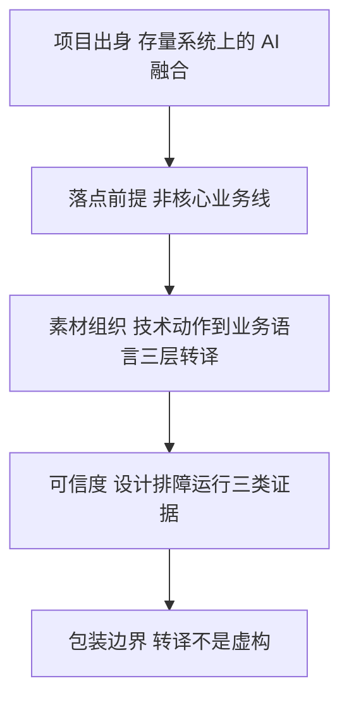

# 13-1 亮点提炼：从技术到业务的包装逻辑

## 【学习目标】

- 理解简历包装的第一前提：AI 融合的落点必须选非核心业务线，以及这一前提交代如何影响面试官的追问方向。
- 掌握「技术动作 → 业务语言」的转译方法，能把课程里的工程实践讲成业务方听得懂的价值。
- 明确包装的边界：讲清真做过的事，而不是虚构没做过的事。

## 【正文】

从这一章开始进入新的章节：高薪简历指导与项目深度包装。

前面的内容已经在企业原有项目中整合了两个 Agent，智能库存调拨优化系统与智能 BI 报表问答系统，也讲过如何借助 AutoDL 的算力服务器部署企业内部的私有大模型。

从这节开始，重点转向如何把该项目写进自己的简历，提升简历含金量，争取更多面试机会。

本章的目标是启发两件事：一是如何把项目更好地写进简历，二是如何与自己公司的业务做融合，让面试官相信确实落地过一个企业级项目，而不只是写了个 demo。

本章分两小节：一是亮点提炼，即从技术到业务的包装逻辑；二是面试攻略，即征服面试官的策略与话术。重点在第二部分，先了解面试官后续可能怎么提问，才能有针对性地准备回答。

## 一、先想清楚：项目是怎么「长」出来的

包装之前先复盘项目的出身，因为出身决定了故事怎么讲。

该项目的开发前提是：公司原本就有一套库存系统，在其之上做了 AI 与传统业务的融合与优化。同样的逻辑可以平移到你所在的公司，只要你们的项目涉及商品与库存，就完全可以把该项目说成自己的，因为业务场景确实吻合。

「在存量系统上做融合」与「从零搭一个新系统」是两种完全不同的叙事，前者才是企业 AI 落地的常态。面试官听过的 demo 太多，「从零造一个带 AI 的系统」这种故事一张口就露怯；反而「公司原有库存系统，我在上面加了预测与调拨建议」这种讲法，一听就是干过真实业务的人。存量系统意味着要面对历史数据、既有表结构、老代码的约束，这些恰恰是企业级项目的质感来源。

思路也可以再扩展：不一定非得叫「智能库存调拨优化系统」，智能某某系统都是可以的。关键是讲清楚你们公司的业务是什么，以及这项业务如何与 AI 整合。

命名的自由度讲的是同一个道理：项目名只是外壳，业务与 AI 的结合点才是内核。外壳可以随你们公司的实际业务替换，内核必须讲透。

## 二、第一原则：落点必须是非核心业务线

同时要向面试官明确一个前提：现阶段公司业务线与 AI 融合，落点一定是非核心业务线。核心业务线不可能随便接入 AI，一旦 AI 影响了核心链路的性能就麻烦了，核心业务线的 QPS 动辄十万甚至上百万，在这么高的量级下接入 AI，面试官追问「对原有性能有什么影响」时很容易答不上来。

所以要说明融合的是非核心业务线，并发量不高，十几、二十、几十的 QPS 而已；对不少小型公司来说，QPS 能到几十已经相当可观了。

先把该前提交代清楚，后面的回答才有余地。如果一上来就说在核心业务线上整合了 Agent，面试官必然会追问对原有核心业务的影响等更难的问题。

该原则背后是一条工程常识：大模型调用的延迟是秒级，与核心链路毫秒级的响应要求差着几个数量级。把 LLM 放在百万 QPS 的交易主链路上，吞吐与稳定性都不可行；放在非核心业务线，用异步、批量、人工确认来消化延迟，才成立。面试官未必明说这层，但追问「对原有性能有什么影响」时，考察的就是有没有想过量级差异。

| 对比项 | 核心业务线 | 非核心业务线 |
|---|---|---|
| QPS 量级 | 十万甚至上百万 | 十几、二十、几十 |
| 延迟要求 | 毫秒级 | 秒级可接受 |
| AI 接入可行性 | 低，延迟与吞吐都不可行 | 高，异步/批量消化延迟 |
| 面试官追问风险 | 高，性能影响难回答 | 低，前提交代后回答有余地 |
| 本项目的落点 | - | 库存调拨、BI 报表问答 |

主动交代落点是非核心业务线，本质是把面试官的「攻击点」提前变成「共识区」。开场就把量级、延迟现实、融合边界讲清楚，后续聊架构、聊评估、聊私有化部署时，面试官的提问会落在技术深度上，而不是反复试探「你是否在虚构」。这就是「前提交代清楚，后面的回答才有余地」的含义。

## 三、素材盘点：把技术动作转译成业务语言

项目里的技术实践很多，但不是每一条都值得写进简历。筛选标准是：这条技术在业务上解决了什么问题。用「技术动作 → 业务价值 → 可讲深度」三层转译一遍，素材的优先级自然浮出来。

课程里真实落地过的工程实践，可以这样转译：

| 技术动作（课程真做过） | 业务语言 | 面试可讲点 |
|---|---|---|
| Graph 工作流编排查询、预测、提取、邮件等节点 | 业务流程可拆可配，改流程不改代码 | 状态机节点设计、节点间状态传递 |
| 评估节点 + 失败循环重试 | 模型输出质量有人把关，错误建议不会直接进业务 | 评估标准怎么定、循环次数怎么调 |
| 大模型输出 JSON 再结构化入库 | AI 的建议可以直接落库、可采纳、可追溯 | 结构化抽取、字段约定、异常分支 |
| MapStruct 转换层 + LocalDate 边界处理 | 参数与实体干净分离，日期类型零踩坑 | 转换层设计、类型边界测试 |
| Ollama / vLLM 私有化部署（AutoDL） | 数据不出内网，推理成本可控 | 部署选型、OpenAI 兼容协议、并发边界 |
| jdbcTemplate 作为 SQL 执行层 + 白名单 | AI 生成的 SQL 有安全边界，不会误删误改 | SQL 注入防护、权限最小化 |
| 少样本提示词优化中文标头 | 报表表头符合国内业务习惯，可直接给业务方 | few-shot 设计、输出格式约定 |
| 邮件模板发送调拨单 | AI 结论直达业务人，闭环到动作 | 模板渲染、消息触达 |

这张表的用法不是照抄进简历，而是按目标岗位挑三到四条讲透。投 Java 岗就主打工作流编排与结构化入库，投数据岗就主打 SQL 生成与评估循环，投架构岗就主打私有化部署与协议兼容。同一份项目，不同切法，简历与面试话术都要跟着岗位调。

转译时有个语言习惯要改：把「我用了什么框架」换成「我解决了什么问题」。面试官先听得懂问题，才会关心你的解法。「用 Spring AI Alibaba Graph 编排了工作流」是技术陈述，「把调拨流程拆成可配置节点，改流程不用改代码」才是价值陈述，后者同样证明了技术深度，且业务方和面试官都听得懂。

## 四、可验证的证据：让「企业级」三个字站得住

面试官判断「企业级项目还是 demo」，看的不是简历形容词，而是可验证的证据链。课程里有两个系统、一条私有化部署链路、一套评估机制，这些都是证据；把证据组织好，「落地过」就不必靠嘴说。

证据分三类，各有各的用法。第一类是设计证据：为什么查询、预测、提取、邮件要拆成四个节点，为什么评估节点放在条件边前面，这类问题考察的是设计思路，面试前要把每个节点的「为什么」过一遍。第二类是排障证据：私有化接入遇到的 400 协议问题、思考模式污染、评估超时，都是真实踩过的坑，讲坑比讲成果更有说服力，因为它造不了假。第三类是运行证据：系统真的在跑、真的在发邮件、真的在落库，链路完整。

配套工程 `980-demo` 正是第三类证据的样板：`980-demo/src/main/java/com/carl/ai/transfer/extract/TransferOrderExtractor.java`（结构化抽取）、`TransferOrderConvert.java`（MapStruct 转换层）、`BbTransferOrderRepository.java`（H2 落库）、`ChatModelConfig.java`（Ollama/vLLM 端点可切换、离线可跑）四个模块，把「生成 → 提取 → 转换 → 入库」的主链路做成了离线可运行、可测试的代码。面试时被要求「讲讲你的抽取怎么做的」，直接打开这类模块讲，比在白纸上画架构图有底气的多。README 顶部的「对应博客篇章索引」还能形成「讲得出 → 看得见 → 跑得动」的完整闭环。

还有一层证据是讲稿刻意强调的：部署在 AutoDL 上的私有化模型服务是持续运行的，项目连的是自己服务器的 6006 端口。这条链路面试时可以直接复现，把 base-url 换成自己的端点跑一次调用，比任何描述都直接。

## 五、包装的边界：转译不是虚构

最后划一条线。包装的逻辑是「把真做过的事，用业务方和面试官听得懂的话讲清楚」，不是「把没做过的事讲成做过」。

项目名可以换成你们公司的业务名，因为业务场景确实吻合，这是转译；但没做过的模块不能写进简历，因为面试官顺着问两层就会到底，虚构的履历在深度追问下必露馅。反过来，真做过但没讲清价值的，要按第二、三节的方法补足叙事，多数 Java 工程师缺的不是项目，是把项目讲出去的能力。

本章两节的配合也在这里：这一节解决「讲什么」，下一节 13-2 解决「怎么讲」。素材、前提、证据备齐之后，话术与应答策略才有东西可依托。

## 【易错点 / 面试题】

1. **面试题：你的 AI 项目接在核心链路上吗？对性能有什么影响？** 答：接在非核心业务线（库存调拨、报表问答），QPS 量级在几十，LLM 秒级延迟可以接受；核心链路是毫秒级、十万以上 QPS，现阶段不适合直接接入 AI，这是融合的前提也是边界。
2. **易错点：用框架名堆砌代替价值描述。** 「用了 Graph、用了评估节点、用了 vLLM」是技术清单，不是项目叙事。每项技术都要能回答「解决了什么业务问题」，答不上来的技术点，写了反而给面试官留追问入口。
3. **易错点：前提交代缺失，一上来就讲架构。** 不讲清非核心业务线该前提，面试官的性能追问会贯穿整场；先交代量级与边界，后面的技术对话才在共识区里展开。

## 【小结】

本节给出了从技术到业务的包装逻辑：项目出身讲「存量系统上的 AI 融合」，落点前提讲「非核心业务线与量级现实」，素材组织讲「技术动作到业务语言的三层转译」，可信度靠「设计、排障、运行三类证据」支撑。核心心法一句话：转译，不虚构。

这些包装逻辑不是空中话术，背后是课程里两个系统加一条私有化部署链路的真实积累。配套工程 `980-demo` 把这些积累固化成了可运行、可测试、可展示的代码资产，`TransferOrderExtractor`、`TransferOrderConvert`、`BbTransferOrderRepository`、`ChatModelConfig` 四个模块对应主链路的每一环，`transfer.offline` 开关让整套链路在没有 GPU 的机器上也能跑通。写简历时它是证据，面试时它是底气，这就是「读博客 → 跑工程」闭环在简历环节的价值。

下一节进入面试攻略：面试官会怎么提问，以及怎么答。
