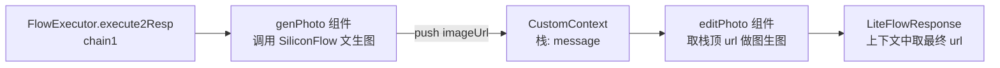

# 14-10 AI Agent文生图组件实现3

本节完成文生图组件的编码：调用 SiliconFlow 的图片生成接口，把用户传入的提示语变成一张图片，并把生成结果写入 LiteFlow 上下文，供后续组件使用。这是「AI Agent 图片流水线」的第一环，第二环（图片编辑）在后续章节实现。

## 【学习目标】

- 读懂 SiliconFlow 图片生成接口的契约：请求头、请求体字段、同步执行方式。
- 掌握 Hutool `HttpRequest` 链式发请与 `JSONUtil` 解析响应的写法。
- 学会用断点验证第三方接口的真实返回结构，不被文档误导。
- 理解 LiteFlow 组件参数绑定（`.data()`）与上下文（`CustomContext`）的配合方式。

## 【正文】

### 一、接口契约总览

编码之前先对齐契约。官网给出的示例是一个 POST 请求，因此用 `HttpRequest.post` 指定 URL，地址直接取自官方文档。请求头分两类：一类是鉴权，一类是内容类型。

| 项 | 值 | 说明 |
|---|---|---|
| 方法 | POST | 官方示例即 POST |
| URL | `https://api.siliconflow.cn/v1/images/generations` | 文档给出的接口地址 |
| Authorization | `Bearer` + 自己的 key | key 来自配置项 `siliconflow.apiKey` |
| Content-Type | `application/json` | 与官方文档保持一致 |

`body` 可以接收 String 类型，而通常传的都是 JSON 字符串，所以先构造一个 JSON 格式的请求体，再通过 `toString()` 转成字符串放入 body。这里的 `contentType` 也可以显式指定为 JSON 格式，不过指定与否影响不大。

### 二、请求体字段清单

用 Hutool 的 `JSONObject` 构造请求体，命名为 `requestBody`，再把需要的属性逐个封装进去。各字段的取值依据如下：

| 字段 | 必填 | 本节取值 | 说明 |
|---|---|---|---|
| `model` | 是 | `Kuai-Kolors/Kolors-diffusers` | 官方提供的默认大模型名称 |
| `prompt` | 是 | 组件传入的提示语 | 来自组件参数绑定，通过 `.data()` 传过来 |
| 反向提示语 | 否 | 不传 | 非必填项 |
| `image_size` | 是 | `1024x1024` | 图片大小，写默认值 |
| `batch_size` | 是 | `1` | 生成张数 |
| `seed` | 否 | `99999999` | 随机种子，设一个固定值，需落在官方给定区间内 |
| `num_inference_steps` | 是 | `20` | 推理步数，沿用默认值 |
| `guidance` | 是 | `20` | 引导系数，见下文 |
| `avg` | 否 | 不传 | 非必传项 |

两个参数需要理解语义。**推理步数**取默认的 20：步数越多，扩散模型去噪越充分，耗时也越长。**引导系数（guidance）**的取值范围是 0 到 20，默认 7.5；给得越大，生成结果越贴合文字描述，给得越小，创造力越强。本节希望生成结果具体一些，因此取区间最大值 20。

### 三、编码实现

组件类通过 `@LiteFlowComponent("genPhoto")` 声明，与 `flow.xml` 编排中的节点名对应；继承 `NodeComponent` 并重写 `process()`，在方法内完成「构造请求体 → 发请求 → 解析响应」三件事。apiKey 通过 `@Value` 从配置文件注入，不硬编码在代码里。

```java
import cn.hutool.http.HttpRequest;
import com.yomahub.liteflow.annotation.LiteFlowComponent;
import com.yomahub.liteflow.core.NodeComponent;
import org.springframework.beans.factory.annotation.Value;

@LiteFlowComponent("genPhoto")
public class GenPhotoComponent extends NodeComponent {

    @Value("${siliconflow.apikey}")
    private String apiKey;

    @Override
    public void process() throws Exception {
        // 构建请求体
        JSONObject requestBody = new JSONObject();
        requestBody.set("model", "Kuai-Kolors/Kolors-diffusers");
        String prompt = this.getPrompt();
        requestBody.set("prompt", prompt);
        requestBody.set("image_size", "1024x1024");
        requestBody.set("seed", 99999999);
        requestBody.set("num_inference_steps", 20);
        requestBody.set("guidance_scale", 20);

        // 发起 HTTP POST 请求
        HttpRequest postRequest = HttpRequest.post("https://api.siliconflow.cn/v1/images/generations")
                .header("Authorization", "Bearer " + apiKey)
                .header("Content-Type", "application/json")
                .body(requestBody.toJSONString(), "application/json");

        // 执行请求并获取响应
        HttpResponse response = postRequest.execute();
        String body = response.body();

        // 解析 JSON 响应
        JSONObject bodyObject = JSONUtil.parseObj(body);
        JSONArray imagesArray = bodyObject.getJSONArray("images");
        String imageUrl = imagesArray.get(0).toString();
        System.out.println("生成图片的URL: " + imageUrl);
    }
}
```

几点设计说明：

- **`getPrompt()` 的数据来源**：编排规则里通过 `genPhoto.data("生成一个中国古代油画照片。")` 把提示语绑定到组件，组件内用 `this.getPrompt()` 取出。这就是前文讲过的组件参数绑定，编排层传参，组件层消费，组件本身不含业务文案。
- **`execute()` 的同步语义**：执行方法提供的参数用于指定是否异步执行，true 为异步，false 为同步。此处不做异步，直接同步执行并观察响应，调试阶段看得见每一步。
- **`requestBody.toJSONString()`**：把 JSON 对象序列化为字符串后放入 body，与 `Content-Type: application/json` 对应。

### 四、响应解析：以实测为准

官方返回的同样是一个 JSON，里面还嵌套了若干层。标准处理路径是：先把 response 的 body 取出来，得到完整 JSON 字符串；再用 Hutool 的 `JSONUtil.parseObj` 把它转成 `JSONObject`，之后就能按 key 取值。

**取值之前先打一个断点，实际看一下返回结构**，文档写的不一定准确，需要自己确认。把 body 粘到 json.cn 上可以直观看到：实际返回的 JSON 串与官网 API 文档并不完全一致，虽然同样有 `images`、`timing`、`seed`，但还多了一个 `data`，`data` 里面也有 `url`。

```json
{
  "images": [
    {
      "url": "string"
    }
  ],
  "isings": 123,
  "need": 123
}
```

本节选择取 `images` 里的 `url`：`getJSONArray("images")` 拿到数组，注意别拼错 key；由于只生成了一张图，取第一个元素即可。需要说明的是，代码块中写的是 `imagesArray.get(0).toString()`，直接输出数组第一个元素；而按正文描述的取值路径，还需要把第一个元素再转成 `JSONObject`（命名为 `firstImage`），从中按 key `url` 取出最终的图片地址。两者的差别在于是否深入取到 `url` 字段，以断点中观察到的真实结构为准。

之所以没有把每个接口的返回都转成 model 层的实体，是因为这里只是简单测试；规范的公司级业务里，每个返回都应该对应一个实体对象。当前只是一个 AI Agent 演示，并非真正的公司项目；后面做 RAG、做企业级培训 AI 智能助手时，会严格按照公司级开发规范来开发。

### 五、配置项口径

正文叙述中配置项名为 `siliconflow.apiKey`，代码块中 `@Value` 占位符写的是 `${siliconflow.apikey}`，二者大小写不同但指向同一配置。Spring 的宽松绑定（relaxed binding）能兼容这种大小写差异，实际以项目配置文件中的写法为准即可。

### 六、执行排错：组件未注册

要执行就得写一个执行器。在测试类里加一个测试方法，注入 `FlowExecutor`，通过它调用 `execute2Resp`：链 ID 是 `chain1`；初始化参数没有；上下文对象是此前已经定义好的 `CustomContext.class`；最后拿到 `LiteFlowResponse` 即可。

先执行一下，看能否进入断点。结果报错：

```
Caused by: com.yomahub.liteflow.exception.LiteFlowExecutorInitException: Create breakpoint for flow: init flow executor cause error for path [classpath:flow.xml], reason: 无法为空，不能为null
```

报错信息提示「对象为空，不能执行方法」。这里其实并不为空，问题出在组件上：编排里引用了一个尚未指定的组件，加载时就失败了。处理方式：先拷贝一份，把出问题的段落注释掉，让 flow 里只保留一个组件，重新调用试试。

```xml
<?xml version="1.0" encoding="UTF-8"?>
<flow>
    <chain name="chain1">
        THEN
        genPhoto.data("生成一个中国古代油画照片。");
        editPhoto.data("卡单");
        THEN
        genPhoto.data("生成一个中国古代油画照片。");
        editPhoto.data("卡单");
    </chain>
</flow>
```

这条报错在 LiteFlow 使用中很典型：**编排规则与组件实现必须一一对应**，规则里出现的每个组件名都要有对应的 `@LiteFlowComponent` 实现类，否则执行器初始化即失败。排障时先把链路裁剪到最小集合，逐个恢复，是定位此类问题最快的路径。

### 七、上下文设计

后续修改图片时需要知道生成的图片 url 在哪，因此必须把它封装进上下文。上下文定义用栈来存储，栈命名为 `message`；项目里已经引入 Lombok，直接在类上加 `@Data` 注解即可，它会生成 get、set 和 `toString` 方法，自己通过 Generate 生成 get/set 再补 `toString` 也可以。类上的注释写明：自定义 LiteFlow 上下文。

回到组件里写入栈：先通过 `this.getContextBean()` 传入 `CustomContext.class` 拿到上下文，再调用它的 get 取出栈，然后 `push` 进 `imageUrl`。栈是先进后出的，这里只是简单地用它来存放图片的 url，下一节图片编辑组件会从栈顶将该 url 取出，作为图生图的输入。

用栈而非单字段的考虑是：链路上可能连续产生多个中间产物，栈结构可以按产生顺序堆放、按最新优先取用。生产场景中更建议把上下文中的每个产物都定义成有类型的实体，而不是裸字符串，便于编译期检查与后续演进。

### 八、链路与验证

文生图只是整条链路的第一个节点。按 `flow.xml` 的串行编排，后续还会执行图片编辑节点，两者通过上下文衔接：



先单独执行文生图验证：日志已经输出，等执行完直接找即可，第三方 API 的速度还是很快的。把 url 复制到浏览器打开，保存到桌面看一下：生成的是一张中国古代建筑的形象照，说明文生图模型的调用与该组件节点都没有问题。

## 【易错点 / 面试题】

1. **照文档写代码，不看真实返回。** 第三方接口的文档与实测返回不一致是常态（本节的返回就比文档多了一层 `data`）。稳妥做法是先用断点或 json.cn 打印真实响应，再写解析代码。面试中可把这条经验展开成「对接外部系统的标准动作」。
2. **编排规则引用了不存在的组件。** `LiteFlowExecutorInitException` 的根因通常是规则与组件没对上。规则文件里每个节点名都必须有对应的 `@LiteFlowComponent` 实现；排障时先把链路裁剪到只剩一个组件，再逐个恢复。
3. **接口返回不封装实体。** 演示代码用裸 JSON 传递图省事，公司级规范里请求与响应都应对应实体对象。可对比 980-demo 的做法：`980-demo/src/main/java/com/carl/ai/transfer/extract/TransferOrderExtractor.java` 用 Spring AI 2.0.1 的 `chatClient.prompt().user(...).call().entity(TransferOrderParam.class)`（底层即 `BeanOutputConverter`）把模型输出直接绑定到 POJO，连手工 JSON 解析都省掉了。

## 【小结】

本节完成了文生图组件 `genPhoto`：按契约构造 SiliconFlow 图片生成请求（鉴权头 + JSON 请求体，`guidance` 取最大值 20 换取贴合度），用 Hutool 发起同步 POST，用 `JSONUtil.parseObj` 解析响应，最终把图片 url 压入自定义上下文的栈中。同时踩了两个值得记住的坑：第三方返回结构以实测为准；编排规则与组件必须一一对应，否则执行器初始化即失败。下一节进入图生图环节，编写图片编辑组件，从上下文中取出本节生成的 url 做风格重绘。
