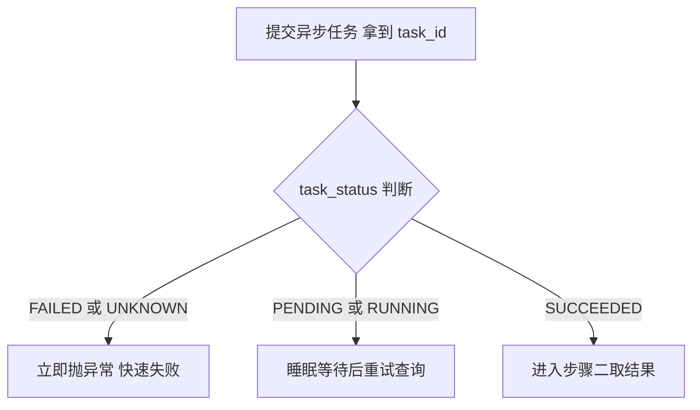

# 14-12 AI Agent图片编辑组件编写2

上一篇完成了人物风格重绘的契约分析与组件骨架，本节进入编码实现：构造请求头与请求体，从上下文中取出上文生成的图片 url，发起异步任务提交，解析第一步响应拿到 `task_id` 与 `task_status`，并完成第一版任务状态处理。

## 【学习目标】

- 掌握嵌套请求体的构造方式：`requestBody.set("input", inputBody)` 直接塞 JSON 对象。
- 理解上下文中图片 url 的取用方式：`getContextBean(CustomContext.class)` + 栈顶 `peek()`。
- 完成第一步 POST 的响应解析，取出 `task_id` 与 `task_status`。
- 建立「快速失败优于先睡眠再判断」的编码直觉，理解魔法值为何要收敛为枚举。

## 【正文】

### 一、请求构造

第一步仍然通过 Hutool 的 `HttpRequest` 发送 POST 请求，url 地址直接取自官方文档中给出的接口地址。

请求头需要加上 `X-DashScope-Async` 这一异步指令，值为 `enable`；再添加 `Authorization`，其值为 `Bearer` 拼接上 apiKey。apiKey 的获取方式与前面一致，从配置文件中读取，配置项为 `aliyun.apiKey`，定义为 String 类型的 apiKey，再把它拼进 `Bearer` 之后。此外还要指定内容类型为 JSON 格式。

接下来构造请求体。在传入 JSON 格式的 body 之前先把它创建出来，同样使用 Hutool 的 `JSONObject`，命名为 `requestBody`。`requestBody` 的第一项是 `model`，key 为 `model`，value 就是文档给出的模型名 `wanx-style-repaint-v1`。

然后放入 `input`，它的 value 又是一个 JSON 结构。严格来说，这类 JSON 请求体和响应结果都应该定义对应的实体对象，这才是规范做法；这里为了演示方便，直接用纯 JSON 格式进行传参。因此再 `new` 一个 `JSONObject`，命名为 `inputBody`，作为 `input` 这一 key 对应的 value。

完整实现如下：

```java
@LiteFlowComponent("editPhoto")
public class EditPhotoComponent extends NodeComponent {
    @Value("${aliyun.apiKey}")
    private String apikey;

    @Override
    public void process() throws Exception {
        JSONObject requestBody = new JSONObject();
        requestBody.set("model", "wanx-style-repaint-v1");
        JSONObject inputBody = new JSONObject();
        CustomContext context = this.getContextBean(CustomContext.class);
        String imageUrl = context.getMsg().peek();
        System.out.println("从上下文中拿到的图片url：" + imageUrl);
        inputBody.set("image_url", imageUrl);
        String styleIndex = this.getMetaData(String.class);
        inputBody.set("style_index", Integer.parseInt(styleIndex));
        requestBody.set("input", inputBody);

        // 发起 HTTP 请求
        HttpRequest.postRequest("https://dashscope.aliyuncs.com/api/v1/services/aigc/image-generation/generation")
            .header("X-DashScope-Async", "enable")
            .header("Authorization", "Bearer " + apikey)
            .header("Content-Type", "application/json")
            .body(requestBody.toString());
    }
}
```

两点如实说明。其一，代码块中 `HttpRequest.postRequest(...)` 这条链尚未赋值给变量，完整写法应把整条链赋给 `postRequest`（即 `HttpRequest postRequest = ...`），再调用 `postRequest.execute()`，正文随后即按此叙述展开。其二，`style_index` 的取值，正文叙述为通过 `this.getCmpData()` 获取，代码块中使用的是 `this.getMetaData(String.class)`，两种写法都指向同一能力：读取编排时为该组件绑定的数据，实际以代码块写法为准。

### 二、两个参数来源

`inputBody` 中，key 为 `image_url`，value 是要进行人物风格重绘的那张图片的 url。该 url 从上下文中获取：第一个组件生成图片时已经把它放入上下文，这里通过 `this.getContextBean()` 传入 `CustomContext.class` 拿到上下文，再把上下文中的栈取出来，取到栈顶元素 `imageUrl`，设置进去。为了验证取值是否准确，先把从上下文中拿到的图片 url 打印输出。

用 `peek()` 而非 `pop()` 是刻意选择：`peek()` 只读栈顶不移除元素，同一张图在链路中被多个下游组件消费时不会被提前弹掉；若某个组件真的需要「取走即消耗」的语义，才换 `pop()`。栈先进后出，天然保证组件拿到的是最近一次产生的产物。

除 `image_url` 之外还有一个 `style_index`，表示使用哪种风格进行重绘，它由 `flow.xml` 配置传入。传入的是 String 类型，取到后由于接口要求 Integer，用 `parseInt` 做一次转换再放入。

这样 `input` 对应的 value JSON 就构造完成了，接着在 `requestBody` 中 `set` 这一 `input`，value 为 `inputBody`，Hutool 会把它自动转成 JSON 结构。body 构造完成后，就可以在 POST 请求中通过 `.body(...)` 设置进去。这里既可以显式指定格式，也可以不指定；为了与生成图片那一步保持风格一致，在图片编辑这一步同样显式指定了 `contentType`。

### 三、执行与第一步响应

随后生成 `postRequest`，下一步执行请求：调用 `postRequest.execute()`。执行时可以传入参数指定是否异步，文档要求必须开启异步处理，因此这里设置为 true。

响应命名为 `postResponse`，通过 `.body()` 直接拿到响应体字符串 `postResponseBody`。回到文档确认第一步响应的格式。由于需要从响应 JSON 中取值，先将该 JSON 字符串转成 `JSONObject` 对象：通过 Hutool 的 `JSONUtil.parseObj` 把 `postResponseBody` 转成 `postResponseJsonObj`。

```json
{
  "output": {
    "task_id": "xxxxxxxx",
    "task_status": "RUNNING"
  },
  "request_id": "75b4ed0b-0000-0000-0000-000000000000"
}
```

接着取 `output` 这一 key 对应的值，它本身又是一个 JSON 结构，因此通过 `postResponseJsonObj` 的 `get` 方法传入 key `output`，并指定泛型转换为 `JSONObject.class`，得到 `outputJsonObj`。在 `outputJsonObj` 中取出 `task_id`，得到 String 类型的 `taskId`，并打印「人物风格重绘生成的 taskId」。

### 四、任务状态处理：从睡眠到快速失败

拿到 `taskId` 之后还要判断 `task_status`：只要不是执行失败、任务不存在或状态未知，其余状态都可以接受。排队、处理中、挂起或执行成功都可以先睡眠一段时间再继续调用。

判断方式仍然通过 `outputJsonObj` 取 key 为 `task_status` 的值，返回的是 String 类型结果，直接转成 String。判断条件是：只要不等于 `FAILED`（执行失败），且不等于任务不存在或任务未知，就可以睡眠一段时间，让大模型有时间处理。这里给大模型一分钟的处理时间。第一版写法如下：

```java
// 解析响应
JSONObject postResponseJson = JSONUtil.parseObject(postResponse.body());
String taskId = postResponseJson.get("output").get("task_id").toString();
String taskStatus = postResponseJson.get("output").get("task_status").toString();

// 轮询任务状态
if ("FAILED".equals(taskStatus) || "UNKNOWN".equals(taskStatus)) {
    Thread.sleep(1000 * 60); // 等待 1 分钟
}
```

如果调用大模型的人比较多，任务可能一直处于 `PENDING` 排队状态，此时就需要等待。具体等待时长不太好精确控制，因此先固定等待一分钟。

这版写法可以优化。原写法是「如果不是失败也不是未知则继续往下走」，考虑到编码时的短路原则，更好的写法是：如果是失败或未知，就直接抛出异常，否则才继续往下走，这样能够做到快速失败。因此改为抛出运行时异常，异常信息为「人物风格重绘失败」。否则睡眠一段时间让大模型处理，再执行步骤二。

| 任务状态 | 业务含义 | 处理策略 |
|---|---|---|
| PENDING | 排队中 | 等待后重试查询 |
| RUNNING | 处理中 | 等待后重试查询 |
| SUCCEEDED | 执行成功 | 进入步骤二取结果 |
| FAILED | 执行失败 | 立即抛异常，快速失败 |
| UNKNOWN | 任务不存在或状态未知 | 立即抛异常，快速失败 |



需要说明的是，在正常的项目开发中不要写这类魔法值，应当定义好枚举类型，包括这些 key 也要统一定义成枚举，避免散落在代码里。`"FAILED"`、`"UNKNOWN"` 这样的字符串一旦拼错，编译器不会报错，只会在生产上以诡异的方式失败，把状态收敛成枚举，是把「约定」变成「契约」的最省力手段。

## 【易错点 / 面试题】

1. **先睡眠后判断，把失败路径也拖慢一分钟。** 短路原则要求先处理异常分支：`FAILED`/`UNKNOWN` 直接抛异常快速失败，其余状态再等待。面试中可引申为「错误处理要尽早失败、尽早暴露」。
2. **`image_url` 用 `pop()` 取。** 上下文中的产物默认应可重复消费，`peek()` 只读不移除；选错方法会导致链路后半段拿不到数据，且只在多组件场景暴露，调试成本高。
3. **状态字符串散落。** 任务状态、JSON key 都应定义为枚举或常量。对照 980-demo 的工程化处理：`980-demo/src/main/java/com/carl/ai/transfer/extract/TransferOrderExtractor.java` 上对 LLM 调用直接加了 `@CircuitBreaker(name = "transferLlm", fallbackMethod = "extractFallback")`，把「外部调用可能失败」这件事用框架能力兜底，而不是散落的 try-catch。

## 【小结】

本节完成了图片编辑组件的编码：构造 `model` 为 `wanx-style-repaint-v1` 的请求体，`input` 内嵌从上下文栈顶 `peek()` 取出的 `image_url` 与由编排传入、经 `parseInt` 转换的 `style_index`；发起带 `X-DashScope-Async: enable` 的异步 POST；解析响应取出 `output.task_id` 与 `output.task_status`。状态处理从「先睡眠一分钟」重构为「失败即抛异常的快速失败」版本，并留下工程化提醒：魔法值应收敛为枚举。下一篇实现步骤二，根据 `task_id` 查询最终结果，并完整踩一次嵌套 JSON 的坑。
