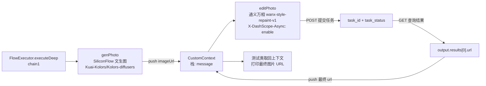

# 14-13 AI Agent图片编辑组件编写3

上一篇完成了异步任务的提交与第一步响应解析，本节实现步骤二，根据 `task_id` 查询结果，拿到最终图片地址。过程中会完整踩一次「嵌套 JSON 被双重序列化」的坑，最终把整条链路跑通，并对本章做架构回顾。

## 【学习目标】

- 完成 GET 查询请求，掌握深层嵌套 JSON 的逐层取值路径。
- 复盘嵌套 JSON 双重序列化问题：现象、定位手段、修复方式。
- 记住经验法则：外层 JSON 的某个 value 若是 JSON，直接塞对象，不要 `toString()`。
- 从组件、上下文、执行器三个层面回顾整条 AI Agent 链路的构成。

## 【正文】

### 一、步骤二：根据任务 ID 查询结果

通过 Hutool 的 HTTP 工具生成 GET 请求比较简单，只需要设置 header，并把 `taskId` 拼接到 url 后面即可。

把文档中的 url 拷贝过来，生成 `HttpRequest.get` 请求，url 部分拼接上 `taskId`。然后加上 header，即 `Authorization`，value 为 `Bearer` 拼接 API Key，这样就得到了一个 GET 请求。

接着同步执行请求，得到 `getResponse`。与之前同样，先取它的 body，body 就是一个 JSON 格式的字符串。

响应结果的 JSON 嵌套层次比较深，处理过程如下。先拿到 `getResponse` 的 body，得到 `getResponseBody`；再通过 `JSONUtil.parseObj` 把它转成 `JSONObject` 对象。然后取 key 为 `output` 的值，它又是一个 `JSONObject` 对象，因此再次执行 `get`，传入 key `output`，类型转换为 `JSONObject.class`（注意要使用 Hutool 的 `JSONObject`）。由于上面已经有同名变量，这里命名为 `outputImageJsonObj`。

拿到该 `JSONObject` 后，再取 key `results`，它对应的是一个 `JSONArray` 对象，通过 `get` 传入 key `results`，类型转成 `JSONArray.class`，得到 `resultArray`。由于只传入了一张图片，直接取 `resultArray` 的第一个元素，它同样是一个 JSON 结构，转成 `JSONObject.class` 后得到图片 url 对应的对象，最后通过 `get` 取出最终生成的图片 url。

可以看到，使用这种原始 JSON 格式逐层取值非常繁琐，四层嵌套要写四行取值代码，每层的 key 都是字符串，拼错不会报编译错。因此强烈建议为请求和响应都定义好对应的实体对象，这样通过 get、set 操作就会简单得多。

### 二、联调实录：执行太快反而是警报

拿到最终图片后打印「人物风格重绘最终 url」。之后还要把它放入结果上下文，通过 `getMsg().push()` 放进去，这样在测试类里就能拿到最终的 url，响应中可以取到上下文，进而取到里面的 url。

在测试方法中通过 `getContextBean()` 传入 `CustomContext.class` 拿到上下文，再用 `context.getMsg().peek()` 打印最终图片 url。

调用测试：如果一切正常，流程会按照 `flow.xml` 中的编排执行，先生成一张中国古代建筑的图片，再把这张图转成卡通风格的风格重绘。观察日志可以发现执行得异常快，这反而说明有问题，代码里明确写着睡眠一分钟，不可能秒回。

先查看生成的图片 url，它来自第一个节点的图片生成，把图片下载下来确认内容。继续查看日志：上下文中拿到的确实是第一个组件生成的图片 url（日志中的 `%3D`），随后果然报错了，正因为执行太快才暴露出问题。

定位报错位置：在获取 `taskId` 时报错，因为此时 `outputJsonObj` 已经是空的。

```java
// 解析响应
String postResponseBody = postResponse.body();
JSONObject postResponseJsonObj = JSONUtil.parseObj(postResponseBody);
String taskId = postResponseJsonObj.get("task_id", String.class);
String taskStatus = postResponseJsonObj.get("task_status", String.class);

// 检查任务状态
if ("FAILED".equals(taskStatus) || "UNKNOWN".equals(taskStatus)) {
    throw new RuntimeException("人物风格修复失败");
}
```

### 三、根因：嵌套 JSON 被双重序列化

在这里打断点重新调用。正常情况下不应该这么快，因为代码里会睡眠一分钟。先清空日志再观察结果：调用千问模型时返回了错误，提示输入的参数需要是 JSON 格式。

把 `requestBody.toString()` 的最终结果复制到 json.cn 上检查，发现整体结构看起来是对的，但问题出在 `input` 上，它本应是一个 JSON 结构，实际却带着转义符号，说明在 `requestBody` 中 set `input` 时 `inputBody` 的处理有问题。

进一步查看 `input.toString()`，其本身是一个正常的 JSON，问题出在外层 JSON 请求里嵌套一个 JSON 的环节上。当时的请求体构造代码如下：

```java
// 构造请求体
JSONObject inputBody = new JSONObject();
inputBody.put("model", "manx-style-repair-v1");
inputBody.put("image_url", imageUrl);
inputBody.put("style_index", styleIndex);
inputBody.put("input_body", inputBody.toString());

// 发起 POST 请求
HttpRequest postRequest = HttpRequest.post("https://dashscope.aliyuncs.com/api/v1/services/aigc/image-generation/generation")
    .header("X-DashScope-Async", "enable")
    .header("Authorization", "Bearer " + apiKey)
    .header("Content-Type", "application/json")
    .body(inputBody.toString());

// 执行请求并获取响应
HttpResponse postResponse = postRequest.execute();
```

问题机理：`inputBody.toString()` 把一个 JSON 对象序列化成了**字符串**，该字符串再作为 value 放进外层 JSON 时，引号、花括号全部被转义，服务端拿到的 `input` 就是一串带 `\` 的文本而非 JSON 对象，于是报「输入的参数需要是 JSON 格式」。

修改方式很明确：在给 `requestBody` set `input` 的这一步，不要再转成字符串，直接把 `JSONObject` 对象塞进去，框架会自动把它转成 JSON 格式，即 `requestBody.set("input", inputBody)`。

放行后重新调用测试方法。由此得到一个经验：**如果请求的外层 JSON 中某个 key 需要传的又是一个 JSON，就不要再调用 `JSONObject.toString()`，直接把对象塞进去，框架会默认转成 JSON 格式。** 用 json.cn 校验请求体是定位这类问题最直接的手段，肉眼审查长串转义符容易漏，格式化之后 `input` 变成字符串一眼可见。

### 四、完整跑通

再次执行时程序会卡在睡眠处等待一分钟，这说明流程已经正常走到这一步了。等待期间先在日志中确认接口是否已经成功调用，可以看到已经返回了 `taskId`。

执行完成后回看整个流程：第一个组件生成了图片 url，将其下载下来以便与最终结果对比；接着第二个组件从上下文中拿到了该图片 url（日志中的 `%3D`），取得 `taskId`，睡眠一分钟，执行步骤二「根据任务 ID 查询结果」，最终拿到生成图片的 url（同样以 `%3D` 结尾），与测试方法中打印的一致。

```json
{
  "image_url": "https://ic.mass.css-ch-shanghai.aliyuncs.com/outputs/2F302550607%2F2Fv2d4j6et.png?Expires=1748090727&OSSAccessKeyId=LT4iQF2RzvAaHfR8BmMzQy4&Signature=PMXxLsDOTM8cD8M0T66OMG%2FVqpeQZU1SD",
  "style_index": 7
}
```

将该最终 url 复制出来下载查看，可以看到人物的动作形象基本一致，一张真实人物的写实照片被转换成了漫画风格的照片，预期的效果就此实现。

### 五、架构回顾

最后做一个总结。在 `flow.xml` 中创建了一个 chain，规定它执行串行编排：第一个组件负责文生图生成图片，第二个组件负责图生图，对第一个组件生成的图片做人物风格重绘。

```yaml
# application.yml
flow:
  chain1:
    - genPhoto.data("生成一个中国古代风格的照片")
```

两个组件的分工是：文生图组件调用快手的模型（Kuai-Kolors/Kolors-diffusers），通过 SiliconFlow 的 API 生成人物图片；图生图组件调用通义万相的人物风格重绘 API（wanx-style-repaint-v1）完成风格转换。

此外还定义了一个自定义上下文 `CustomContext`，最后在测试方法中通过 `FlowExecutor` 执行器调用整条链路，该 AI Agent 应用的效果得以实现。

```java
@Test
public void testAligment() {
    // 执行流程
    LifeFlowResponse executeDeep = flowExecutor.executeDeep("chain1", null, CustomContext.class);
    CustomContext context = executeDeep.getContextBean(CustomContext.class);
    System.out.println("最终图片URL：" + context.getImageUrl());
}
```

整条链路可以概括为一张图：



需要说明的是，测试代码块中取最终 url 的写法是 `context.getImageUrl()`，正文此前的描述为 `context.getMsg().peek()`，两种方式都从自定义上下文取最终产物，以代码块写法为准。

若想将该 AI Agent 做得更完善、开放给他人使用，可以参照 Coze 的设计思路：先写好一批预制组件，例如文生图组件、图生图（人物风格重绘）组件，在组件内部预定义好要调用哪些大模型的 API；然后让用户在前端 UI 页面上拖动组件、传入对应的文本，系统就能按照编排自动执行。

对用户来说，使用体验会方便得多：只需给组件绑定「要让该组件干什么」，整个工作流就会按照编排执行。这一思路与本章开头对 LiteFlow 的定位完全咬合，组件是预制的能力积木，编排是用户可见的流水线，引擎负责驱动。

## 【易错点 / 面试题】

1. **嵌套 JSON 传参先 `toString()` 再 set。** 这是本节最核心的坑：外层 JSON 的 value 若是 JSON 结构，必须直接塞 `JSONObject` 对象，让框架自行序列化；先 `toString()` 会造成双重序列化，服务端报「参数需要是 JSON 格式」。定位手段是把最终请求体贴到 json.cn 上看转义。
2. **多层嵌套响应逐层 `get`。** 四层嵌套写四行取值代码，key 全是字符串，拼错无编译保护。规范做法是请求与响应都定义实体对象，用 get/set 访问。可对比 980-demo 的工程化路径：`980-demo/src/main/java/com/carl/ai/transfer/extract/TransferOrderExtractor.java` 用 `call().entity(TransferOrderParam.class)` 让 Spring AI 2.0.1 底层的 `BeanOutputConverter` 直接把模型输出绑定到 POJO，从根子上免去手工解析。
3. **把「执行快」当好消息。** 联调时链路秒回往往是静默失败的信号（本节就是执行太快才发现 `outputJsonObj` 为空）。对含固定等待、重试的链路，先核对耗时是否符合预期，再看结果。

## 【小结】

本节完成了图片编辑组件的最后一步并跑通全链路：GET 查询接口按 `task_id` 取回 `output.results[0].url`，压入上下文后由测试类读取；复盘了嵌套 JSON 双重序列化问题，外层 JSON 的 value 是 JSON 时直接塞对象、不要 `toString()`，修复后流程正常睡眠一分钟并返回 taskId 与最终图片 url，写实照片成功转为漫画风格。至此，本章用 LiteFlow 串起「文生图（SiliconFlow）→ 上下文传递 → 图生图（通义万相）」两个组件，完成了一个简易 AI Agent 应用。向后看，把它产品化的路径是 Coze 式的「预制组件 + 前端拖拽编排」；向后看工程规范，请求响应实体化、状态枚举化、外部调用兜底（熔断降级）是从演示走向生产的三级台阶，可对照 980-demo 的 `TransferOrderExtractor`、`TransferOrderConvert` 与 `TransferOrderServiceImpl` 逐一体会。
