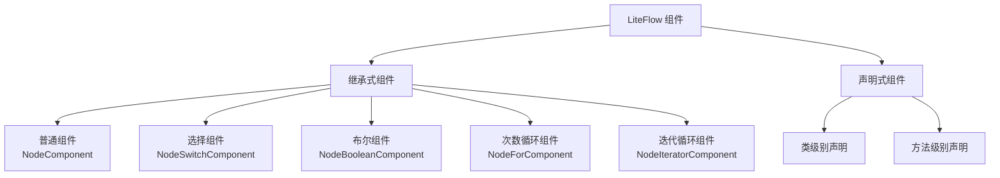

# 14-2 LiteFlow 组件讲解

## 【学习目标】

- 建立「组件 + 规则 + 执行器」三位一体的 LiteFlow 心智模型，说清各自职责
- 掌握继承式组件五大类型（普通 / 选择 / 布尔 / 次数循环 / 迭代循环）的父类与适用关键字
- 能独立写出普通组件与选择组件，并用 `@LiteFlowComponent` 注册进 Spring 上下文
- 看懂全局线程池配置项，知道复杂流程下为何需要调整

## 【正文】

### 1. 先回到 Hello World：LiteFlow 跑起来的三个动作

从官方文档「快速开始」的 Spring Boot 场景切入。一个最小可运行的 LiteFlow 应用由三个动作构成：

1. **引入依赖**：在 `pom.xml` 中加入 LiteFlow 的 starter 依赖，用 `liteflow.version` 声明版本，刷新 POM 等待下载完成。
2. **定义组件并编排规则**：组件通过 `@LiteFlowComponent` 注解标明、继承 `NodeComponent` 并重写方法（B、C 组件以此类推分别定义）；规则写在配置项的 `flow.channel` 中，示例为 `THEN(a, b, c)`，先执行 a，a 执行完之后执行 b，再执行 c。规则返回的 1、2、3 是各节点的返回值，此处无需关心，后文会讲到。
3. **启动执行**：启动类上加包扫描，确保组件被注册进上下文；运行时启动 LiteFlow 执行器，指定执行哪一条规则链，可传入初始化参数，也可指定上下文。

三个动作对应三个角色：**组件是演员，EL 规则是剧本，执行器是导演**。规则决定「谁先谁后、走哪条分支」，组件决定「每一步做什么」，执行器负责按规则把组件逐个调度起来。初次接触时的疑问也应沿这条主线展开：演员怎么定义（组件）、剧本怎么写（EL 编排）、导演怎么调度（执行器）。本节先解决第一个问题，组件。

### 2. Spring Boot 配置项：只有规则路径是必填

LiteFlow 在 Spring Boot 下的配置采用键值对风格，YAML 与 properties 均可被框架解析。其中**必填的只有规则文件路径**，框架只有知道规则放在哪里，才能加载编排定义；其余配置基本为非必填，实际需要什么参数再打开设置即可。本节只涉及配置规则文件路径这一项，线程池等参数在用到时再深入。

课程演示中给出的全局线程池配置片段如下（properties 格式，与正文前述 YAML 风格均可生效，LiteFlow 对两种写法都支持解析）：

```properties
# 线程池配置
global.thread-pool-executor-class: com.yomahub.liteflow.thread.LiteFlowGlobalExecutorBuilder
global.thread-pool-executor-size: 10
global.thread-pool-executor-max: 50
global.thread-pool-executor-keep-alive: 60
global.thread-pool-executor-queue-size: 1000
global.thread-pool-executor-allow-core-thread-timeout: true
global.thread-pool-executor-allow-queue-full: true
global.thread-pool-executor-allow-queue-full-timeout: 60
global.thread-pool-executor-allow-queue-full-timeout-unit: SECONDS
global.thread-pool-executor-allow-queue-full-timeout-unit: SECONDS
global.thread-pool-executor-allow-queue-full-timeout-unit: SECONDS
global.thread-pool-executor-allow-queue-full-timeout-unit: SECONDS
global.thread-pool-executor-allow-queue-full-timeout-unit: SECONDS
global.thread-pool-executor-allow-queue-full-timeout-unit: SECONDS
global.thread-pool-executor-allow-queue-full-timeout-unit: SECONDS
global.thread-pool-executor-allow-queue-full-timeout-unit: SECONDS
global.thread-pool-executor-allow-queue-full-timeout-unit: SECONDS
global.thread-pool-executor-allow-queue-full-timeout-unit: SECONDS
global.thread-pool-executor-allow-queue-full-timeout-unit: SECONDS
global.thread-pool-executor-allow-queue-full-timeout-unit: SECONDS
global.thread-pool-executor-allow-queue-full-timeout-unit: SECONDS
global.thread-pool-executor-allow-queue-full-timeout-unit: SECONDS
global.thread-pool-executor-allow-queue-full-timeout-unit: SECONDS
global.thread-pool-executor-allow-queue-full-timeout-unit: SECONDS
global.thread-pool-executor-allow-queue-full-timeout-unit: SECONDS
global.thread-pool-executor-allow-queue-full-timeout-unit: SECONDS
global.thread-pool-executor-allow-queue-full-timeout-unit: SECONDS
global.thread-pool-executor-allow-queue-full-timeout-unit: SECONDS
global.thread-pool-executor-allow-queue-full-timeout-unit: SECONDS
global.thread-pool-executor-allow-queue-full-timeout-unit: SECONDS
global.thread-pool-executor-allow-queue-full-timeout-unit: SECONDS
global.thread-pool-executor-allow-queue-full-timeout-unit: SECONDS
global.thread-pool-executor-allow-queue-full-timeout-unit: SECONDS
global.thread-pool-executor-allow-queue-full-timeout-unit: SECONDS
global.thread-pool-executor-allow-queue-full-timeout-unit: SECONDS
global.thread-pool-executor-allow-queue-full-timeout-unit: SECONDS
global.thread-pool-executor-allow-queue-full-timeout-unit: SECONDS
global.thread-pool-executor-allow-queue-full-timeout-unit: SECONDS
global.thread-pool-executor-allow-queue-full-timeout-unit: SECONDS
global.thread-pool-executor-allow-queue-full-timeout-unit: SECONDS
global.thread-pool-executor-allow-queue-full-timeout-unit: SECONDS
global.thread-pool-executor-allow-queue-full-timeout-unit: SECONDS
global.thread-pool-executor-allow-queue-full-timeout-unit: SECONDS
global.thread-pool-executor-allow-queue-full-timeout-unit: SECONDS
global.thread-pool-executor-allow-queue-full-timeout-unit: SECONDS
global.thread-pool-executor-allow-queue-full-timeout-unit: SECONDS
global.thread-pool-executor-allow-queue-full-timeout-unit: SECONDS
global.thread-pool-executor-allow-queue-full-timeout-unit: SECONDS
global.thread-pool-executor-allow-queue-full-timeout-unit: SECONDS
global.thread-pool-executor-allow-queue-full-timeout-unit: SECONDS
global.thread-pool-executor-allow-queue-full-timeout-unit: SECONDS
global.thread-pool-executor-allow-queue-full-timeout-unit: SECONDS
global.thread-pool-executor-allow-queue-full-timeout-unit: SECONDS
global.thread-pool-executor-allow-queue-full-timeout-unit: SECONDS
global.thread-pool-executor-allow-queue-full-timeout-unit: SECONDS
global.thread-pool-executor-allow-queue-full-timeout-unit: SECONDS
global.thread-pool-executor-allow-queue-full-timeout-unit: SECONDS
global.thread-pool-executor-allow-queue-full-timeout-unit: SECONDS
```

> 如实说明：此片段为课程讲稿的原始拷贝，其中 `allow-queue-full-timeout-unit` 一行被重复记录了多次（属录制时的拷贝残留，并非框架要求重复声明）。按代码守恒原则此处原样保留，未做删改；实际项目中每项配置写一行即可。

各配置项含义归纳如下：

| 配置项 | 作用 |
|---|---|
| `thread-pool-executor-class` | 全局执行器线程池的实现类，默认走框架内置构建器 |
| `thread-pool-executor-size` / `max` | 核心线程数与最大线程数 |
| `keep-alive` | 空闲线程保活时间 |
| `queue-size` | 任务队列容量 |
| `allow-core-thread-timeout` | 是否允许核心线程超时回收 |
| `allow-queue-full` / `-timeout` / `-timeout-unit` | 队列已满时的兜底策略与等待超时设置 |

该池正是后文 EL 编排中 `WHEN` 并行分支默认共用的线程池，默认情况下所有 `WHEN` 共享它，业务简单时够用；流程复杂、多业务并存时则需考虑隔离，具体参数在「EL 编排学习 1」中展开。

### 3. 核心概念：一切皆是组件

组件在 LiteFlow 中极其重要，可以理解为「一切皆是组件」：它把每一个节点都定义成一个组件，再通过编排组件来实现规则引擎或工作流。组件分为两大类：



继承式组件细分为普通、选择、布尔、次数循环、迭代循环等；声明式组件分为类级别声明与方法级别声明两种。本节重点看继承式组件，声明式组件只做简单了解，有兴趣可另行深入学习。受篇幅限制，只讲项目必需的部分。

### 4. 普通组件：最基础的节点

普通组件继承 `NodeComponent`，可用在任意关键字当中，只需实现 `process` 方法。它就是一个普通节点，没有特别之处：继承 `NodeComponent` 并重写方法，在方法内编写业务逻辑即可。

```java
@LiteFlowComponent("a")
public class AComponent extends NodeComponent {
    @Override
    public void process() {
        // do your business
    }
}
```

`process` 是框架在执行到该节点时回调的方法，业务逻辑全部落在其中。方法没有入参、也没有强制返回值，节点间的数据交互统一走数据上下文（下一节详解），这也是「一切皆是组件」能成立的前提：节点之间没有差异化的出入参契约，才能被任意编排。

### 5. 选择组件：流程图里的判断节点

选择组件可理解为流程图里的判断节点（排他网关），用在 `SWITCH` 关键字当中，需要继承 `NodeSwitchComponent` 并实现其中的方法。方法返回一个 String 类型的结果，即经过该节点判断之后选择哪一个分支执行，返回的是具体要执行的组件名称，框架据此决定继续往下走哪一条分支。

```java
@LiteFlowComponent("switch")
public class SwitchComponent extends NodeSwitchComponent {
    @Override
    public String processSwitch(String chainName) throws Exception {
        return "a";
        // return "b"; // 选择目标节点为 b
        // return "c"; // 选择目标节点为 c
        // return "d"; // 选择目标节点为 d
        // return "e"; // 选择目标节点为 e
        // return "f"; // 选择目标节点为 f
        // return "g"; // 选择目标节点为 g
        // return "h"; // 选择目标节点为 h
        // return "i"; // 选择目标节点为 i
        // return "j"; // 选择目标节点为 j
    }
}
```

文档中「根据表达式 ID 进行选择」这部分暂时用不到，掌握最简单的用法即可。更详细的用法可查看文档：组件上除了名字，还有 ID 和 Tag，都可以用于选择，既可以通过名字选择，也可以通过 ID 或 Tag 定位到对应节点。例如某个节点的 ID 为 `W1`，另一个为 `W2`，不写名字、直接按 ID 选 `W1`，同样能确定走哪条分支；Tag 同理，M 这边有 Tag 为 `M` 的节点，N 这边有 Tag 为 `N` 的节点，选择节点可以指定指向 Tag 为 `M` 的还是 Tag 为 `N` 的。ID 和 Tag 本质上是一种扩展：既可以通过组件名字选择组件，也可以通过组件 ID 或 Tag 来选择。

在本章要讲解的内容中不会用到 ID 和 Tag，只用组件名字就够了，每个组件的名字必然不同，通过名字就能唯一确定一个组件。

### 6. 布尔与循环组件：按命名规律记忆

对比三种已讲组件的命名规律：普通组件是 `NodeComponent`，选择组件是 `NodeSwitchComponent`，布尔组件是 `NodeBooleanComponent`。`Node` 与 `Component` 两部分固定不变，中间的部分表示它用在什么样的逻辑、什么样的关键字当中，`SWITCH` 对应 `NodeSwitchComponent`，布尔就对应 `NodeBooleanComponent`。记住这一命名规律，其余组件可触类旁通：

| 组件 | 父类 | 适用关键字 | 方法返回值 |
|---|---|---|---|
| 普通组件 | `NodeComponent` | 任意（`THEN`/`WHEN` 等均可） | 无 |
| 选择组件 | `NodeSwitchComponent` | `SWITCH` | String（目标组件名 / ID / Tag） |
| 布尔组件 | `NodeBooleanComponent` | `IF` / `ELSE` / `WHILE` / `DO` / `BREAK` | boolean |
| 次数循环组件 | `NodeForComponent` | `FOR` | int（循环次数） |
| 迭代循环组件 | `NodeIteratorComponent` | 迭代器循环 | Iterator |

次数循环组件对应关键字 `FOR`，在方法中返回要循环的次数，即一个 int 值。它还做了很多扩展：可以获取当前循环的下标值，也可以取到上一层循环的下标、上两层循环的下标。三层 for 循环时，既能取到当前层，也能取到上面一层和再上面一层，对应的方法分别是 `getLoopIndex()`、`getPreLoopIndex()`、`getPreLoopIndex2()`，即当前、前一层、前两层。按同样的思路，迭代器循环也会有嵌套场景，同样可以获取上一层、上两层的迭代器，对应的方法也按同一命名规律提供。

次数循环、迭代循环、布尔组件和选择组件在本项目的编排中都不会涉及。有兴趣的话可以基于这些组件编排非常复杂的规则；本项目只做简单的串行编排，让 AI Agent 能够执行、应用能够落地即可。如果有更复杂的构想，完全可以参照这些组件自行编排，官方文档的示例就展示了非常复杂的 AI Agent 应用编排。

### 7. `@LiteFlowComponent` 与 Spring 的关系

所有组件在声明时都要使用 `@LiteFlowComponent`。回看快速开始中的配置：A 组件名为 `a`，就需要用 `@LiteFlowComponent` 来定义，`a` 就是它的名字。

该注解继承自 Spring 的 `@Component` 注解，因此添加后能够被上下文扫描到、受 Spring 容器管理。从作用上讲它与 `@Component` 没有区别，只是新增了 `name` 属性用于给组件起别名，在打印调用链时会体现出来；当然，原始的 `@Component` 注解同样可以继续使用。使用该注解之后，可以在 Spring 中通过 `@Autowired` 或 setter 注入其他 bean，用法与 `@Component` 完全一致，这意味着组件内部可以直接注入 Service、Repository，把节点变成业务逻辑的天然落脚点。

### 8. 可覆盖方法与规则种类一览

组件上还有可覆盖的方法，例如 `isAccess`、`isContinueOnError`，这些内容本节不展开，因为它们会牵扯到规则，而规则本身非常多：串行规则、并行规则、选择、条件、循环、IF、异常、与或非、子流程、子变量、复杂编排例子、前置后置编排等等。可以先浏览一下复杂编排的例子，有的是判断之后合并再合并，复杂程度相当高。

本节暂不深入规则，重点转向上下文，组件之间不传递参数，所有数据交互都靠上下文完成，这正是下一节的主题。

## 【易错点 / 面试题】

1. **面试题**：为什么用 `@LiteFlowComponent` 而不是普通 `@Component`？它继承自 `@Component`，同样被 Spring 扫描和管理，额外提供 `name` 属性作为组件别名，调用链打印时更易读。老代码用 `@Component` 也能运行，但 EL 规则里引用的名字必须与 bean 名对应，这是新手常见的「组件明明写了却找不到」的根因。
2. **易错点**：选择组件返回值与目标分支对不上（拼写不一致、大小写不符、该用 ID/Tag 时却用了名字），流程会静默走到 `DEFAULT` 分支或直接报找不到组件。排查时先打开步骤走法打印，核对返回值与分支名是否逐字符匹配。
3. **面试题**：继承式与声明式组件怎么选？声明式对业务代码零侵入，适合给既有 Service 快速加节点；继承式生命周期钩子（`isAccess`、`isContinueOnError`）更全，适合从零编写的工作流节点。两者可在同一项目混用。

## 【小结】

组件是 LiteFlow 的最小执行单元：普通组件干活，选择组件分流，布尔与循环组件控制走向，`@LiteFlowComponent` 负责注册，`process` / `processSwitch` 承载业务。学完本节，「节点」不再是抽象概念，每个节点都是一个可单测的 Spring Bean，节点之间不直接传参，全部经数据上下文交互。

这种「节点即组件、数据经上下文流转」的思想与课程主线的 Spring AI 状态机一脉相承：在 `980-demo/src/main/java/com/carl/ai/transfer/agent/TransferAgent.java` 中，「自然语言 → 抽取 → 入库」被封装成一个节点动作，内部由 `980-demo/src/main/java/com/carl/ai/transfer/extract/TransferOrderExtractor.java` 完成模型调用与结构化抽取，节点无差别、可编排、可替换，这是各种工作流引擎的共同答案。下一节讲解组件之间唯一的数据通道：LiteFlow 数据上下文。
