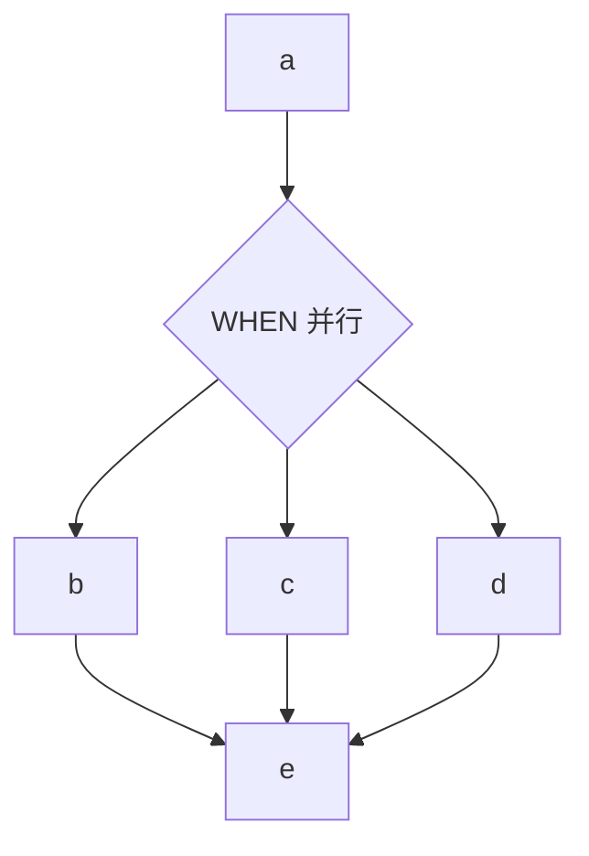
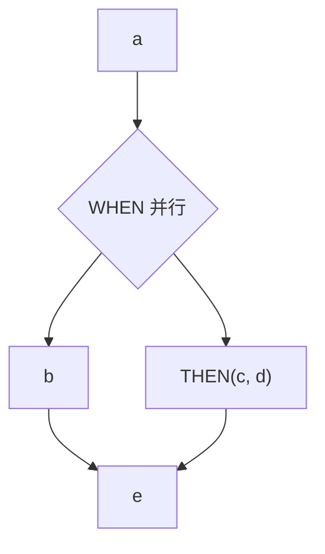

# 14-4 EL 编排学习 1

## 【学习目标】

- 掌握两种基础编排：串行 `THEN` / `SE`、并行 `WHEN` / `PAR`
- 理解 `WHEN` 的三个子关键字 `ignoreError` / `any` / `must` 的语义与差异
- 知道 `WHEN` 线程池隔离参数及其适用场景，理解「组」的概念
- 建立「EL 表达式像读课文一样从左到右理解」的阅读方法

## 【正文】

### 1. EL 规则是什么

本章说明如何撰写规则表达式。LiteFlow 在 2.8.X 版本中设计了非常强大的规则表达式：一切复杂的流程在 LiteFlow 表达式的加持下都异常丝滑简便，只需很短的时间就能学会编写很复杂的表达式。

不必担心「语法是否复杂、能否写对」，这些表达式本身都很简单。更进一步说，即使学完本章没有记住、不会用也没关系：后面会介绍一个前端 UI 项目，可以直接在页面上拖动组件，由它自动生成对应的规则表达式，再复制到规则文件中即可。

通过本章的学习，如果能够理解并会使用自然最好；如果短时间内掌握不了，也可以自行花时间查阅文档。总之先对这些基本流程建立一个认识。

### 2. 串行编排：THEN 与 SE

基本用法：如果要依次执行 A、B、C、D 四个组件，可以使用 `THEN` 关键字。需要注意的是 `THEN` 必须大写，EL 规则中的这类关键字基本都要大写，`THEN` 就表示串行。

串行非常直观：A 执行完再执行 B，B 执行完执行 C，C 执行完执行 D，这样一个流程只需要一个 `THEN` 关键字就能表达。

```java
@chain(name="chain1")
THEN(a, b, THEN(c, d));
```

由于 `THEN` 用来表示串行在语义上有所不妥，但为了兼容又无法完全替换，因此在后续版本中 `THEN` 也可以用 `SE` 关键字替换，两者完全等价。这是 2.11.4 之后版本做的兼容处理，可以兼容老版本的 `THEN`。所以使用 `THEN` 或者 `SE` 都可以，取决于具体使用的版本。

```java
@chain(name="chain1")
SE(a, b, c, d);
```

两段代码语义完全相同：前者用 `THEN` 嵌套 `THEN`，后者用 `SE` 平铺，都表达「a → b → c → d」的串行链路。

### 3. 并行编排：WHEN 与 PAR

先跳过说明直接看流程图：这张图对应的就是并行，有三个分支，由条件决定走哪一个分支。

基本用法：如果要并行执行 A、B、C 三个组件，可以使用 `WHEN` 关键字（同样要大写），用 `WHEN` 说明 A、B、C 是三个分支。它有一个等价用法 `PAR`，情况与串行一样：原关键字语义不够贴切，后续版本做了更新，但又无法把老版本的 `WHEN` 完全废弃，于是两个并行关键字都保留了下来。用 `PAR` 或 `WHEN` 都可以，看自己的版本和习惯。

再来看流程图是如何编排的：首先要串行执行 A 和三个组件中的一个，然后再串行执行 E。因此最外层应该套一个 `THEN` 串行编排；执行完 A 之后需要选择一个分支，而组件中是并行选择，所以此时用一个 `WHEN`。整体理解起来并不困难：



下例比上图更复杂：它虽然只有两个分支，但第二个分支下面又是一个串行编排。整体是先用 `THEN` 串行，先串行 A，再串行这两个分支，然后再串行 E；这两个分支用 `WHEN` 表达，其中 B 是单独的一条分支，下面则又是一个串行，也就是 C 和 D。

EL 表达式的理解方式有点像读课文：先串行，串行 A，然后选择是走 B 分支，还是串行执行 C、D 分支，最后再执行 E。

```java
@chain(name="chain1")
THEN(
    a,
    THEN(b, THEN(c, d)),
    e
);
```



关键字总览：

| 编排 | 关键字 | 兼容别名 | 语义 |
|---|---|---|---|
| 串行 | `THEN` | `SE`（2.11.4 后） | 依次执行 |
| 并行 | `WHEN` | `PAR` | 多分支同时执行，全部完成后汇合 |

### 4. WHEN 的子关键字

`WHEN` 中还提供了一些子关键字，它们不能用在 `THEN` 上，不同的关键字各自有各自的子关键字。

**ignoreError：忽略错误。** 如果把它用到 `THEN` 上，那肯定是不存在的。

```java
@chain(name="chain1")
THEN(
    a,
    ignoreError(b),
    c,
    d
);
```

> 如实说明：原稿文字说 `ignoreError` 只能用于 `WHEN`，而此代码块把它写在了 `THEN` 内，两处不一致。按代码守恒原则代码块原样保留，未做改写；子关键字的确切适用范围以 LiteFlow 官方文档为准，课程建议的稳妥做法是只把 `ignoreError` 用于 `WHEN` 分支。

**any：任意节点先执行完，则忽略其他。** `WHEN` 关键字提供了子关键字 `any`，默认为 false，用于提供并行流程中「任意一条分支先执行完，即忽略其他分支继续执行」的特性。

`any` 也很好理解：`any(true)` 表示在 B 分支、C 与 D 串行分支、E 分支这三条分支中，只要有一个执行完成，其余两条就不需要再考虑，可以直接忽略。换言之，只要匹配到任意一个，其余分支即不再执行。

```java
@chain(name="chain1")
THEN(
    a,
    any(b, c, d),
    e
);
```

假设某节点先执行完，其余分支无论是否执行完，都会立刻执行 F，执行完一个之后，其他分支无论是否还在执行都直接往后走，这两条就被忽略掉了。「指定任意节点先执行完，则忽略其他」本质上是对这一能力的扩展。

**must：指定节点必须执行完。** `WHEN` 关键字还新增了子关键字 `must`（不可为空），可用于指定需等待执行的任意节点，可以是一个或者多个；若指定的所有节点率先完成，则继续往下执行，忽略同级别的其他任务。

例如在 B、C、D 三个分支上指定了 `must: B、C`，意思是以上流程中 `must` 选定了 B 和 C，这两个分支必须执行完；如果 B 和 C 执行完了而 D 还没执行完，D 就会被忽略，直接执行下一个组件 F。

`any` 的含义是只要有一个执行完就忽略其他；`must` 的含义则是它指定的分支必须全部执行完才能往下走。这一点有点类似于 Java 中的 `CountDownLatch`：B 和 C 必须都到达同一个终点、都执行完了，才能放行继续往下执行。

往下看是单节点的用法：`must` 还可以指定一个或者多个表达式，用法非常灵活。示例为 `WHEN` 后跟 B，再跟 `THEN(C, D).id("T1")`，再跟 E，最后是 `must("B", "T1")`。在该表达式中，`WHEN` 里嵌套了一个 `THEN`；如需指定该表达式，需为其设置一个 ID，`must` 中指定该 ID。需注意：`must` 中指定 ID 时要用引号括起来。

理解方式是：如果 `WHEN` 的多个分支中又嵌套了一个并行或串行，要对这种嵌套结构做 `must` 指定，就要为该嵌套的串行或并行设置一个 ID，再通过该 ID 来指定。

三个子关键字对照：

| 子关键字 | 语义 | 类比 |
|---|---|---|
| `any` | 任一分支完成即放行，其余忽略 | 赛跑，第一名到即结束 |
| `must` | 指定分支全部完成才放行，其余忽略 | `CountDownLatch` |
| `ignoreError` | 分支出错不中断整体流程 | try-catch 静默跳过 |

### 5. WHEN 线程池隔离

下面说「开启 WHEN 的线程池隔离」。在目前 LiteFlow 的设计里，如果不单独设置自定义线程池，`WHEN` 会使用默认线程池，该线程池由所有 `WHEN` 共用。

看到这里自然会想到：实际生产中如果存在这类需求，还是要进行业务隔离，不要共用同一个线程池。如果业务比较简单，用默认的即可，让所有 `WHEN` 共用同一个线程池；如果流程比较复杂、有很多业务在用，则推荐做线程池隔离。

LiteFlow 从 2.11.1 开始提供了一个用于开启 `WHEN` 线程池隔离的参数，默认为 false。设置为 true 后会开启 `WHEN` 的线程池隔离机制，这意味着每一个 `WHEN` 都会有一个单独的线程池。该特性对运行复杂的嵌套 `WHEN` 可提升运行速率，且能规避一些锁的问题。如果流程非常复杂，就可以开启线程池隔离。

```properties
lifetime.when.thread-pool-isolate=true
```

这与 14-2 中讲过的全局线程池配置是配套的：全局参数定义「池子有多大」，隔离参数定义「一个 WHEN 一个池」。慢分支拖垮快分支、线程饥饿、锁竞争，都是共用池在复杂流程下的典型症状，隔离是最直接的解法。

### 6. 「组」的概念

此外还引入了「组」的概念。在以前的版本中，并行编排是有组的概念的；2.8 之后去掉了组的概念。用 EL 表达式写两个不同的 `WHEN`，就是两个组，一个 `WHEN` 里的 A、B 是一个组，另一个 `WHEN` 里的 C、D 是另一个组，这实际上默认就完成了分组。

```java
@chain(name="chain1")
THEN(
    WHEN(a, b),
    c
);
```

关于串行和并行这两种编排就先介绍到这里，主要目的是让大家先感受到 LiteFlow 具备非常强大的编排能力。

内容一时不太熟悉也没关系，后面可以通过前端来生成表达式，不需要关心手写细节，只要能看懂它表达的意思即可。通过前端 UI 生成的表达式，自行核对生成的链路是否为目标逻辑即可。

## 【易错点 / 面试题】

1. **面试题**：`THEN` 和 `SE`、`WHEN` 和 `PAR` 是什么关系？完全等价的兼容别名。`SE` 与 `PAR` 是后续版本为修正语义而引入的替代关键字（2.11.4 之后），老项目里的 `THEN` / `WHEN` 继续有效，两者可混用。
2. **易错点**：`any` 与 `must` 的方向容易记反，`any` 是「有一个就够」，`must` 是「指定的一个都不能少」。另外 `must` 指向嵌套表达式时必须给该 `THEN` / `WHEN` 设 ID 且用引号指定，漏引号或不设 ID 都会解析失败。
3. **易错点**：多个 `WHEN` 默认共用全局线程池，复杂流程下相互拖累。排查「某流程一慢全慢」时，先看是否开启了 `lifetime.when.thread-pool-isolate=true`（2.11.1+），再做业务级线程池隔离。

## 【小结】

串行与并行是 LiteFlow 编排的两块基石：`THEN` / `SE` 管顺序，`WHEN` / `PAR` 管并发；`any` / `must` / `ignoreError` 三个子关键字覆盖了并行放行策略的主要形态，线程池隔离参数解决共用池的相互干扰问题。读 EL 表达式的方法像读课文，从左到右，先串行后分支，遇到关键字就展开一层。

这种「编排外置成声明式规则」的思想，与工程配置外置一脉相承。课程主线的 AI 工作流把节点编排交给状态机定义，模型端点、密钥等易变项同样外置：在 `980-demo/src/main/java/com/carl/ai/transfer/config/ChatModelConfig.java` 中，离线与真实模型按 `transfer.offline` 开关装配（`980-demo/src/main/java/com/carl/ai/transfer/config/OfflineChatModel.java` 提供固定输出），切换环境无需改一行 Java 代码，规则与配置都不进编译产物，变更即可热生效。下一节继续讲选择、条件与循环编排。
