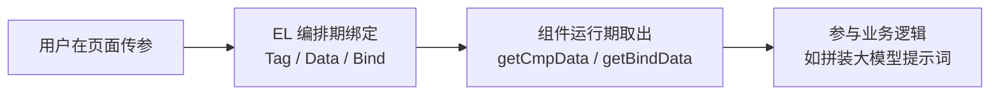

# 14-6 组件参数绑定与执行器

## 【学习目标】

- 理解组件参数语法存在的意义：让编排好的组件能接收用户传入的参数
- 分清 `Tag`、`Data`、`Bind` 三种参数关键字的适用场景与获取 API
- 掌握 `FlowExecutor` 的推荐重载与 `LiteflowResponse` 的常用查询方法
- 知道为什么 `LiteflowResponse` 不适合直接序列化返回应用层

## 【正文】

本节是 LiteFlow 文档基本介绍的收尾部分。讲完这一节，LiteFlow 的日常使用能力就基本齐备；从下一节开始进入编码阶段，把 LiteFlow 与两个大模型整合起来，落地一个基于工作流的 AI Agent 应用。

### 1. 组件参数语法：为什么重要

EL 规则里有一项非常关键的语法，叫做**组件参数语法**。它的作用是在组件编排时为组件设置特定参数，而这些参数可以在组件内部被直接取出，参与后续的逻辑运算。LiteFlow 给组件设置参数的关键字一共三个：`Tag`、`Data` 和 `Bind`。三者做的都是「设置参数」这件事，但各自的适用场景略有差别。

它之所以重要，可以从使用场景看出来。假设一条工作流编排里有三个组件，当这套能力开放给用户使用时，用户选中某个组件后必然要向组件传入参数。

第一个组件若是文生图的大模型组件，用户就必须传入用于生成图片的文字描述，例如「生成一个中国古代刀客照片」。用户不可能去写代码，参数只能由用户在页面上传入；第二个组件若是图片编辑（图生图）的大模型组件，用户则要传入「将照片风格改成二次元」这样的指令。「怎么改」同样只能由用户来告诉系统。

放到更高的视角看：如果要做 Coze 或 Dify 那种面向所有开发者的完善框架，就应该预先提供一批写好的插件与组件，前者为文生图组件，拖进来系统就知道它用于文生图，用户只需传入「生成什么样的图片」；后者为图片编辑组件，组件内部已经封装好图片编辑逻辑。本课程走的是后端自研路线，所以必须先让用户把参数绑定好，程序才知道要做什么。这正是组件参数语法存在的意义。



### 2. Tag、Data、Bind 三种语法

**`Tag`**：用于 `SWITCH` 语法，在选择分支时进行传入绑定，即 `Tag` 只能用在 `SWITCH` 当中做传入绑定。

**`Data`**：给组件设置外置参数，建议传 JSON 格式。三类参数各自推荐的传入格式不同：`Data` 推荐 JSON 格式，`Bind` 则推荐绑定 KV 键值对。

在 EL 语法中可以通过 `Data` 给组件设置外置参数。下面这段传入的是一个 JSON 块，一条人员信息（Jack，27 岁，生日），通过 `b.data(...)` 传给 B 组件，相当于把外置参数绑定到 B 组件上。

同一个组件 B 在不同的链路中可以被赋予不同的外置参数，运行期在组件内统一通过 `this.getCmpData()` 取出绑定的参数。即：用户传入的参数，在组件里用 `this.getCmpData()` 就能拿到，然后继续做业务逻辑处理。该方法的强大之处在于它能返回对应结构的 Java 对象，给它一个 JSON 串，它直接反序列化成 Java 对象。

还有一点需要注意：`Data` 关键字也可以用于表达式和子变量，其意义是被赋予的表达式或子变量；此外还能让链路中的所有组件设置相同的值，这也是它非常强大的一面。

```java
// 在流程中定义 data 组件
THEN(a, b.data("cpData"), c);
// 在组件中获取 data 数据
public class MyComponent extends NodeComponent {
    @Override
    public void process() {
        User user = this.getBindData(User.class);
    }
}
```

> 如实说明：该代码块按讲稿原样保留。块内注释写的是「获取 data 数据」，方法却调用了 `this.getBindData(User.class)`；按本节正文，`Data` 绑定参数的运行期取出 API 是 `this.getCmpData()`，`Bind` 才是 `getBindData()`。两处不一致属讲稿快照的笔误，未做改写，读者落地时注意「Data → getCmpData、Bind → getBindData」的对应关系。

**`Bind`**：绑定一个静态数据。LiteFlow 提供了 `bind` 运算关键字，它与 `Data` 的使用场景一致，区别在于 `Bind` 允许绑定 KV 键值对，类似于 `Map`。获取方式为 `getBindData()`，用法与 `getCmpData()` 相同。

`Bind` 还可以绑定**动态数据**，这是 `Tag` 和 `Data` 做不到的。所谓动态数据，是指在编写 EL 规则时无法确定的值：给 `bind` 传一个表达式，LiteFlow 会依该表达式到上下文中搜索。`bind` 的动态数据 value 必须是一个表达式，格式上就是绑定一个表达式。

举例来说：上下文里有一个 `order` 上下文表达式和一个 `member` 对象，`order` 订单中包含 `id`、订单编码以及会员信息。若要对 B 组件做动态绑定，key 是 `k1`，value 就是一个动态表达式，例如去上下文里取订单编码。订单编码无法在编排阶段预先传入，它只在组件执行过程中才会生成，因此这种场景只能通过动态绑定从上下文里把 `orderCode` 取出来。对于在链路中获取并绑定运行时数据，这种方式非常合适，功能也很强大。

```java
// 定义数据类
public class OrderContext {
    private Integer id;
    private String orderCode;
    private Member member;
    // getter setter
}
public class Member {
    private String memberCode;
    private String memberName;
    // getter setter
}
// 在流程中使用 bind 组件
THEN(a, b.bind("k1", String.class), c);
// 通过 getBindData 获取数据
OrderContext orderContext = this.getBindData(OrderContext.class);
String memberCode = orderContext.getMember().getMemberCode();
```

三种参数语法对照：

| 关键字 | 适用位置 | 推荐格式 | 运行期取出 API | 支持动态值 |
|---|---|---|---|---|
| `Tag` | 仅 `SWITCH` 分支 | - | 随分支参数传入 | 否 |
| `Data` | 任意组件 | JSON 串 | `getCmpData(Class)` | 否（也可用于表达式 / 子变量） |
| `Bind` | 任意组件 | KV 键值对 | `getBindData(Class)` | **是**（value 为上下文表达式） |

一句话记忆：**静态 JSON 用 `Data`，键值对用 `Bind`，要从上下文捞运行期数据也只能用 `Bind` 的动态表达式**。

### 3. 执行器 FlowExecutor

在此之前已经解决了三个问题：怎么写组件、怎么用 EL 把它们编排起来、怎么从外部给组件传入参数。现在还缺一个关键角色：**执行器**。组件和链路都写好了却无法执行，等于白搭。

执行器是流程的出发点，可以在代码的任何位置用它来启动流程。该执行方法在最开始的 Hello World 示例里已经出现过：在 Spring Boot 与 Spring 体系中，把被 Spring 容器管理的 `FlowExecutor` 注入进来即可。

`FlowExecutor` 提供了多个重载方法，官方推荐使用第三个和第四个：一个是传入链路 ID 加参数后再传入上下文的 Class，另一个是传入上下文对象。这两个重载的返回类型均为 `Future`。

```java
// 执行流程并获取响应
LiteflowResponse response = flowExecutor.execute("chain", new CustomContext());
// 获取步骤ID
String stepId = response.getStepId();
// 获取执行时间
long elapsedTime = response.getElapsedTime();
```

返回 `Future` 这一点值得注意：调用线程可以异步等待结果，也可以先去做别的事情再取。对 LLM 这类耗时不可控的节点来说，异步模型给了调用方选择权，同步等结果或超时放弃，由业务决定。

### 4. 响应对象 LiteflowResponse

执行完成后会拿到一个响应对象 `LiteflowResponse`，其中包含了大量的结果数据与过程数据。需要注意的是，该对象并不适合直接序列化返回给应用层；如果要返回业务数据，应当自己构建一个对象。

常用的响应信息如下：

- **是否成功**：通过 `isSuccess()` 返回 `true` 或 `false`，用于判断流程是否执行成功；
- **异常信息**：执行失败时，通过 `getCause()` 拿到异常信息；
- **步骤明细**：如果结果里封装了流程执行每一步的详细信息，可以通过 `getExecuteSteps()` 拿到一个 `Map`，也可以通过 `getExecuteStepQueue()` 拿到一个队列，从而获取每一步的详细执行信息；
- **上下文数据**：流程响应中同样应当包含上下文，通过 `response.getContextBean()` 可以拿到上下文对象；
- **步骤走法信息**：可以获得一个简单易懂的组件步骤走法拼接字符串，打印出来就是「A→B→M」这种形式，并且带有耗时，什么时候开始、执行了多久，据此了解执行时间。

`response` 还提供了 `getExecuteStepQueueStrWithoutTime()` 方法，用于返回不带耗时时间的步骤走法字符串，通过它可以看清整个链路中组件执行的先后顺序。

事实上，每一次流程执行结束后框架都会自动打印步骤走法，因此通常无需自己获取再打印。上面说明这些方法只是为了解决「如何取值」的问题：如果需要把这些信息持久化，可以按上述方法获取；如果不做持久化，就没必要调用，它已经打印在日志里了。

「框架自动打印步骤走法」这条在生产环境格外有用：排查线上问题时，日志里的「A→B→M」链路加每步耗时，直接指明慢在哪、断在哪，无需额外埋点。若需进一步结构化（如写入链路追踪系统），再用 `getExecuteStepQueue()` 自行取出。

到这里，LiteFlow 的基本讲解与介绍就告一段落。

## 【易错点 / 面试题】

1. **面试题**：组件参数与上下文数据有什么区别？组件参数（`Tag`/`Data`/`Bind`）是**编排期**为单个组件绑定的外置输入，运行期在该组件内取出；上下文数据是**运行期**全链路共享的数据总线。前者解决「用户给组件传什么」，后者解决「组件之间交换什么」。
2. **易错点**：`Data` 传非 JSON 字符串时，`getCmpData(Class)` 的反序列化会失败；`Bind` 的动态绑定 value 必须是上下文表达式，写成字面量则起不到动态取值的效果。选错关键字或格式，报错往往在运行期才暴露。
3. **易错点**：把 `LiteflowResponse` 直接序列化返回给前端，其中包含执行步骤队列、上下文 bean 等内部结构，既臃肿又可能泄露内部信息。正确做法是取出 `isSuccess()` / `getCause()` / 上下文后，自行组装对外响应体。

## 【小结】

组件参数语法让「写死的组件」变成「可传参的开放组件」：`Tag` 服务于 `SWITCH` 分支绑定，`Data` 传静态 JSON、`Bind` 传 KV 且独有动态表达式能力，运行期分别经 `getCmpData` / `getBindData` 取出；执行器 `FlowExecutor` 是流程入口，`LiteflowResponse` 承载成败、异常、步骤明细与上下文。至此「组件 → 编排 → 传参 → 执行 → 响应」的闭环完全打通。

放到课程主线的 AI Agent 语境里，「组件参数」就是用户给 LLM 组件的指令，正如文生图组件需要用户传入图片描述。工程上的对应实现可参考 `980-demo/src/main/java/com/carl/ai/transfer/extract/TransferOrderExtractor.java`：`extract(naturalLanguage)` 方法把用户输入作为参数，经 `ChatClient` 拼装进提示词（见 `980-demo/src/main/java/com/carl/ai/transfer/agent/TransferAgent.java` 的节点动作调用），再用 `call().entity()` 把模型输出结构化，参数在调用前绑定、在运行期取出参与逻辑，与 LiteFlow 组件参数的设计完全同构。下一节进入前端可视化编排，让 EL 表达式由页面拖动生成。
