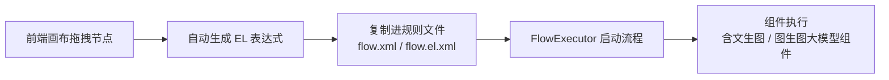

# 14-7 前端编排 UI 搭建

## 【学习目标】

- 找到并跑起来 LiteFlow 官方可视化编排前端 `liteflow-idea-plugin-client`
- 独立完成 Node.js LTS 环境、npm 镜像、依赖安装与项目启动
- 会用画布拖拽生成 EL 表达式，并复制进规则文件
- 理解「可视化生成 + 人工核对」这一协作方式为何适合生产

## 【正文】

### 1. 这是什么项目

本节介绍一个开源项目：用于 LiteFlow EL 表达式编排的前端可视化 UI 界面。

打开 Gitee 或 GitHub 搜索 LiteFlow Idea，可以找到 `liteflow-idea-plugin-client`，也就是 LiteFlow 可视化编辑器前端项目。

从项目主页可以看到它的 Star 数量不少。页面样式大致如下：左侧是组件区，可以拖出串行的编排、并行的编排，也可以拖出选择、条件、FOR 循环等节点，直接拖过来就能指定这是一个什么样的组件。

比如拖出串行就是依次执行 A、B、C、D；拖出的编排若是先执行 A，然后并行执行三个分支，再串行执行 E，同样可以直接拖动完成。

更重要的是，它能够自动生成对应的 EL 规则语法，直接复制到自己的规则文件中即可使用。

项目 README 中给出了启动步骤和启动服务的方式，也对项目原理做了说明，内容非常丰富。

可视化编排解决的是 EL 语法的「最后一公里」：前两节的手写关键字对简单链路足够，但分支一多、嵌套一深，手写表达式就容易出错。把编排动作变成拖拽，把语法生成交给工具，人只负责核对语义，这正是低代码平台验证过的协作模式。



### 2. 环境准备与启动

**第一步，克隆项目。** 在自己电脑上找一个位置，执行克隆，等待下载完成。下载完成后用 VS Code 打开。

**第二步，准备 Node.js 运行环境。** 搜索 Node.js 进入官网下载，选择 LTS 长期支持版本直接安装即可。Node.js 的安装比较简单，Windows 系统安装时可以直接让它帮忙配置好环境变量。

装完后可以用一个最小 HTTP 服务验证 Node 环境可用（课程演示用到的验证脚本）：

```javascript
// server.js
import { createServer } from 'http';

const server = createServer((req, res) => {
    res.writeHead(200, { 'Content-Type': 'text/plain' });
    res.end('Hello World!');
});

server.listen(3000, () => {
    console.log('Listening on 127.0.0.1:3000');
});

// run with 'node server.js'
```

> 如实说明：该脚本是课程用于验证 Node 环境的通用示例（Node 18+ 需存为 `.mjs` 或用 `"type": "module"` 才能以 ESM 方式运行 `import`），与编排 UI 项目本身无直接关系，按代码守恒原则原样保留。

**第三步，安装依赖。** 这一步可以理解为类似于 Spring Boot 后端项目中 `pom` 文件里声明的依赖下载。项目 `package.json` 就类似于后端的 `pom` 文件，里面列出了需要的依赖，数量不少：

```json
{
    "lint-staged": {
        "**/*.{js,jsx}": [
            "eslint --fix",
            "prettier --write"
        ],
        "**/*.{ts,tsx}": [
            "eslint --fix",
            "prettier --parser-typescript --write"
        ]
    },
    "publicConfig": {
        "access": "public"
    },
    "peerDependencies": {
        "react": ">=16.9.0",
        "react-dom": ">=16.9.0"
    },
    "devDependencies": {
        "commitlint": "^17.1.2",
        "commitlint/config-conventional": "^17.1.0",
        "eslint": "^4.17.0",
        "typescript": "^4.17.0",
        "typescript-eslint": "^5.0.0",
        "prettier": "^2.8.0",
        "react": "^17.0.0",
        "react-dom": "^17.0.0"
    }
}
```

如果使用 npm 安装，首先要配置 npm 的镜像源，把它改成淘宝镜像，不要使用官方镜像。配置方法可以在浏览器中搜索「npm 淘宝镜像」，随便找一篇文章都会讲怎么把 npm install 时使用的镜像设置为国内的淘宝镜像。

安装依赖既可以按照文档中的使用步骤来操作，也可以使用这里给出的命令 `npm install --legacy-peer-deps`，即忽略对相关版本依赖的强制校验（项目中指定了兼容版本），忽略之后即可通过该命令安装。也可以按照官网的说明文档来安装，如果用文档中的方式安装失败，就改用这条命令，按文档给出的命令安装会失败，使用 `npm install --legacy-peer-deps` 则可以成功。

配置好镜像之后再执行上面的安装命令。依赖较多，可能需要等待一段时间。安装完成之后，终端中只有警告、没有报错，就说明安装成功了。

**第四步，启动。** 项目介绍里有 `scripts` 配置，其中 `start` 对应的就是启动方式，可以通过 `npm run dev` 来启动。启动成功后会监听 8000 端口，点击链接进入。第一次进入需要等待构建，构建到 100% 之后就能看到页面了。

环境准备步骤汇总：

| 步骤 | 操作 | 说明 |
|---|---|---|
| 1 | 克隆 `liteflow-idea-plugin-client` 并用 VS Code 打开 | 前端项目，与后端规则文件配合使用 |
| 2 | 安装 Node.js LTS | Windows 安装时勾选配置环境变量 |
| 3 | 配置 npm 淘宝镜像 | 官方镜像国内下载慢 |
| 4 | `npm install --legacy-peer-deps` | 忽略 peer 依赖强校验；文档方式失败时用它 |
| 5 | `npm run dev` | 监听 8000 端口，首次进入等待构建完成 |

### 3. 使用：拖拽生成 EL 表达式

进入之后往下看，这就是我们需要的页面：可以直接进行拖动，选一个串行的拖进来，这就是一个串行节点；想要条件节点就拖一个条件进来，它会变成条件节点；选择节点、循环节点同理，拖进来就是对应的节点。

对应的属性面板中会直接给出 EL 表达式，将表达式复制进配置文件的 chain 当中，就可以直接运行了，只需要判断一下生成的部分是否正确即可。

页面上可能会提示「服务器连接失败」之类的错误，还有一大堆测试数据，这些都不用管，我们并不需要它们。

如果想知道这些报错是怎么回事，可以回到项目列表看一下：该作者不仅提供了前端，还提供了一个后端，也就是 `liteflow-idea-server`（LiteFlow 可视化编辑器的后端）。

把后端也拉到本地运行起来，它是用 Java 编写的，直接运行即可，运行之后前端这里的连接就不会报错了，会显示成绿色。不过我们其实用不到它：只需要用前端完成编排，然后取用生成好的表达式就可以了。

再看节点的编辑能力：先把画布上的节点删掉重新拖入，放大或缩小画布找到某个节点，这就是对应的一个节点，也就是对应的一个组件。

在该节点上还可以编辑节点的 ID、节点的参数、节点的 Tag 以及节点的超时时间。编辑完成之后生成 EL 表达式，把它拷贝到 `flow.xml` 的规则文件中执行即可。

节点属性与 EL 语法的对应关系：

| 节点属性 | 对应 EL 能力 |
|---|---|
| 节点 ID | 嵌套表达式的 `id(...)`，供 `must` / 选择组件按 ID 定位 |
| 节点参数 | `Tag` / `Data` / `Bind` 组件参数绑定 |
| 节点 Tag | `SWITCH` 分支的 Tag 定位 |
| 超时时间 | 组件级超时控制 |

拖拽生成只是起点，属性面板才是把「示意图」变成「可执行规则」的关键，ID、参数、Tag、超时都能在界面上配好，生成的表达式才真正可用于生产。

还有一处必须人工核对的衔接点：**前端节点名与后端组件名要对齐**。EL 表达式里的 `a`、`b` 并不是画布上的占位符，而是后端 `@LiteFlowComponent("a")` 注册进 Spring 容器的真实 bean 名。页面生成的表达式复制进规则文件后，若某个节点名在后端找不到对应组件，流程会在启动或执行时报错。因此规范的协作流程是：先后端把组件按约定命名写好，再在前端拖拽同名节点生成表达式，最后两端一起联调。

### 4. 为什么「生成 + 核对」适合生产

可视化编排常被误解为「低代码玩具」，但在此场景中它只承担**语法生成器**的职责：业务语义（走哪条分支、传什么参数、等待哪些节点）由人决策，工具负责把决策翻译成正确的 EL 语法。人从「记关键字」中解放出来，专注「核对生成的链路是否为预期逻辑」，生成的表达式始终是纯文本，可读、可 diff、可进版本库，并没有被锁死在黑盒里。

这与课程反复强调的工程原则一致：**易变的编排外置成配置，稳定的能力沉淀成组件**。LiteFlow 把规则放在 `flow.xml` / `flow.el.xml`，Spring AI 项目把模型端点与密钥放在 `application.yml`，在 `980-demo/src/main/java/com/carl/ai/transfer/config/ChatModelConfig.java` 中，离线与真实模型按 `transfer.offline` 开关装配（`980-demo/src/main/java/com/carl/ai/transfer/config/OfflineChatModel.java` 提供固定 JSON 输出），切换环境不改一行 Java 代码。两者同属「配置外置、变更免编译」的思路，也是规则文件必须纳入 Git 版本管理的原因：编排变更应与代码变更一样可追溯、可 Review。

## 【易错点 / 面试题】

1. **易错点**：`npm install` 按文档方式失败，先确认已切换淘宝镜像，再使用 `npm install --legacy-peer-deps` 忽略 peer 依赖强校验；终端只有警告没有报错即算成功，不必追求零警告。
2. **易错点**：页面提示「服务器连接失败」并显示测试数据，未启动 `liteflow-idea-server` 所致，只取表达式完全可以忽略；若需消除提示，再把 Java 后端跑起来。
3. **面试题**：可视化编排生成的表达式为什么还要人工核对、并纳入版本管理？工具只保证语法正确，不保证语义正确（分支连错、参数绑错都不会报错）；表达式进 Git 后才能 Review、回滚和追溯「谁在什么时候改了流程」。

## 【小结】

至此 LiteFlow 章节闭环：组件（14-2）是演员，上下文（14-3）是数据通道，EL 编排（14-4、14-5）是剧本，组件参数与执行器（14-6）让流程可传参、可启动、可观测，而前端 UI（本节）把写剧本变成拖画布。页面拖动生成 EL、复制进规则文件、人工核对语义，这套流程让复杂编排的维护成本大幅下降。

从工程视角看，可视化 UI 与 `980-demo` 的多 profile 配置是同一种思想的两个侧面：编排规则与模型端点都作为外置配置存在（规则在 `flow.xml`，端点在 `application.yml`，由 `980-demo/src/main/java/com/carl/ai/transfer/config/ChatModelConfig.java` 与 `980-demo/src/main/java/com/carl/ai/transfer/config/OfflineChatModel.java` 按开关装配离线 / 真实模型），变更都不需要重新编译。下一章起进入编码阶段：把 LiteFlow 与两个大模型整合，落地基于工作流的 AI Agent 应用。
