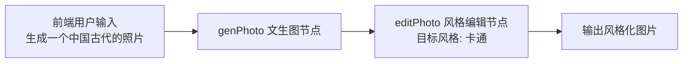

# 14-8 AI Agent文生图组件实现1

【学习目标】

- 独立完成 LiteFlow 规则文件 `flow.xml` 的编写与加载配置，说清 `<flow>`、`<chain>` 标签与 EL 表达式的对应关系。
- 掌握 `@LiteFlowComponent` 声明组件、`NodeComponent.process()` 承载节点逻辑的标准写法。
- 理解「前端编排 → EL 表达式 → `flow.xml` → Java 组件」整条链路的数据流向，为后续接入文生图大模型搭好骨架。

【正文】

## 1. 工程瘦身：先删掉用不到的两样东西

进入编码阶段的第一件事是清理工程结构：把 `resource` 目录下的 `static` 文件夹与 `template` 文件夹删掉。

原因很直接：该项目的所有能力最终都以 REST 接口对外暴露，页面渲染交给独立前端，服务端不再需要 Thymeleaf 模板目录与静态资源目录。及早删除可以避免「目录还在、内容全废」的误导，也让后续接手的人一眼看出：这是一个纯 API 工程。

## 2. 规则文件落地：flow.xml

在 `resource` 下新建 `flow` 文件夹，创建 `flow.xml`。首次编写时可以从 LiteFlow 官方文档复制一份 Spring Boot 启动相关的示例作为文件头，其中的核心结构如下：

- 所有规则必须写在 `<flow>` 标签内部；
- 每一条规则用一个 `<chain>` 标签区分，`name` 属性自定义，例如 `chain1`；
- `<chain>` 内部书写 EL 表达式描述组件执行顺序，例如 `a`、`b`、`c` 三个组件通过 `THEN` 串行编排。

有了规则文件，还要告诉 LiteFlow 去哪里读它。在 `application.yml` 中增加 `liteflow.rule-source` 配置项，指向 `classpath` 下的 `flow/flow.xml`：

```yaml
spring:
  application:
    name: langchainj-ai-helper
  servlet:
    encoding:
      charset: UTF-8
      enabled: true
      force: true
  logging:
    level:
      dev: debug
liteflow:
  rule-source: 
```

配置生效有一个前提：POM 中必须已有 `liteflow-springboot-starter` 依赖。此前已经引入过该依赖，所以 IDE 编写 YAML 时才会给出 `liteflow.*` 的自动提示。如果换一台机器 clone 代码后发现配置没有提示、启动报规则源无法识别，第一反应就应该是检查依赖是否遗漏，这也是「为了防止遗忘再次说明依赖」的价值所在。

## 3. 前端编排：把流程画出来，生成 EL 表达式

规则文件的另一种产出方式是前端编排页面。本例要做一条串行链路：

1. 第一个组件为文生图组件，页面显示名为「生成图片」，组件名 `genPhoto`；
2. 组件入参由前端用户传入，即「我要生成一张什么样的图片」。参数可以直接传字符串，也可以传 JSON；官方推荐传 JSON，因为复杂场景下（多字段、嵌套结构）JSON 的扩展性更好，这与「组件参数绑定」一节讲到的绑定机制一致；
3. 第二个组件负责图片风格编辑，组件名 `editPhoto`。此处先随手填一个「卡通」占位，具体传什么取决于后续调用的生图模型支持哪些编辑能力，只有摸清模型的约束后才能确定参数形态，后续调试时还会再改。

链路语义：第一步根据文字生成一张真实人物照片；第二步把照片风格从写实改成卡通。用 mermaid 画出来更直观：



编排完成后，前端会生成对应的 EL 表达式，把它复制进 `flow.xml` 的 `<chain>` 中，注意必须粘到 `<chain>` 里面，直接写在 `<flow>` 标签下是无效的。链路名可自定义，本例叫 `chain1`：

```xml
<?xml version="1.0" encoding="UTF-8"?>
<flow>
  <chain name="chain1">
    genPhoto.data("生成一个中国古代的照片"),
    editPhoto.data("卡通")
  </chain>
</flow>
```

EL 表达式中的标识符即组件名，也是节点 ID。后续用 Java 创建组件时，必须按这里的名字声明，两边才能对上。

`data(...)` 的作用是把字面量绑定为组件入参：编排时写死的值，运行期由 LiteFlow 透传给对应组件，组件内再从上下文里取出使用。参数直接传字符串还是传 JSON，取决于业务复杂度，只有一个字段时字符串最直观；字段一多（比如既要提示词、又要尺寸、又要风格），JSON 的结构化优势就体现出来了，这也是官方推荐 JSON 的原因。本例中 `genPhoto` 只有一个提示词参数，两种写法均可；`editPhoto` 后续可能要同时传风格、强度等参数，提前用 JSON 思路设计会省去一次返工。

## 4. 创建第一个 LiteFlow 组件

新建 `liteflow.component` 包，创建 `GenPhotoComponent`（类名首字母大写，拼写错误会直接导致 Bean 名与 EL 名对不上，发现后及时改名）：

```java
package com.carl.langchainjaihelper.liteflowcomponent;

import com.yomahub.liteflow.annotation.LiteFlowComponent;
import com.yomahub.liteflow.core.NodeComponent;

/**
 * @Description:
 * @Author: carl
 * @Date: 2025-06-05 22:03
 * @Since: 1.0
 */
@LiteFlowComponent("genPhoto")
public class GenPhotoComponent extends NodeComponent {

    @Override
    public void process() throws Exception {
        //1. 根据文字生成图片
    }
}
```

三个要点：

1. `@LiteFlowComponent("genPhoto")`：注解声明这是一个 LiteFlow 组件，注解值即组件名，必须与 EL 表达式里的名字逐字一致，否则运行期报「组件找不到」；
2. 继承 `NodeComponent` 并实现 `process()`：这是普通组件的标准形态，节点逻辑全部写在 `process()` 内；
3. 类名遵循课程工程规范，包名与既有工程保持一致。

`NodeComponent` 的完整生命周期还包括 `beforeProcess`、`afterProcess`、`onSuccess`、`onError` 等钩子（本课程用到时再展开）。生产工程里通常会覆写 `onError` 做节点级异常兜底，避免单节点失败直接炸断整条链路；需要异步的节点则改用异步组件形态，由线程池承载，不阻塞主流程。

## 5. 上下文对象：跨节点传值的载体

LiteFlow 节点之间靠上下文（Context）共享数据。本节提前定义好上下文对象：新建 `domain` 包，其下再划一个 `dto` 子包，创建 `CustomContext`，先用 `@Component` 声明为 Spring Bean，内容暂时留空，用到时再往里面加字段。

之所以提前建而不是用到再加：文生图链路里，第一个节点生成的图片 URL 需要传给第二个节点做风格编辑，跨节点传值是必然需求。上下文对象就是为此准备的载体，先占位可以让组件结构保持稳定，也便于后续统一维护跨节点数据的读写约定。

## 6. 文生图组件的三步逻辑

回到 `GenPhotoComponent.process()`，根据所使用的文生图大模型，逻辑分三步：

1. 构建（或调用）文生图大模型客户端；
2. 获取前端页面传进来的组件绑定参数；
3. 拿到模型返回的结果，写入上下文，供下游节点使用。

本节先把注释「文生图节点」补齐，具体实现放到下一节接入硅基流动生图模型后完成。

「节点 = 一个可独立测试的动作」与 980-demo 生产工程的节点化封装完全一致：`980-demo/src/main/java/com/carl/ai/transfer/agent/TransferAgent.java` 把「自然语言 → 结构化抽取 → 入库」封装为单个节点动作，内部由 `extract/TransferOrderExtractor.java` 与 `service/TransferOrderServiceImpl.java` 协作完成。读源码时可以对照理解一条分层原则：节点只关心编排，实现细节下沉到 Service。

「规则文件与代码分离」是声明式编排的通用红利：调整链路顺序、增删节点时只改 `flow.xml`，不碰 Java 代码，重新发布即可生效；反过来说，一旦链路出问题，排查路径也很清晰，先看 `flow.xml` 里的表达式是否符合预期，再看组件实现是否正确，两层职责互不纠缠。

两种编排框架的对照也有助于建立知识体系：

| 维度 | Spring AI Alibaba Graph（课程主线） | LiteFlow（本章组件化编排） |
|---|---|---|
| 编排载体 | StateGraph 状态机 + 节点 / 边 | EL 表达式 + `<chain>` |
| 规则定义 | Java 代码构建图 | `flow.xml` 声明式规则 |
| 节点实现 | NodeAction | NodeComponent |
| 上下文 | OverallState | 自定义 Context |
| 典型场景 | LLM 驱动的工作流 | 通用业务规则链路 |

【易错点 / 面试题】

1. **EL 表达式必须写在 `<chain>` 里**：直接写在 `<flow>` 下不生效，启动时规则解析会失败。面试中如果被问「LiteFlow 的规则是怎么定义的」，可以答：规则文件由 `<flow>` 包裹，每条规则是一个 `<chain>`，`<chain>` 内写 EL 表达式，组件间用 `THEN`、`WHEN`、`SWITCH` 等关键字编排。
2. **组件名与 EL 标识符必须逐字一致**：`@LiteFlowComponent("genPhoto")` 与 `genPhoto.data(...)` 中任何一处拼错，运行期都会报组件不存在；且组件名大小写敏感，`genphoto` 与 `genPhoto` 是两个不同的名字。
3. **`rule-source` 的 classpath 路径**：`classpath:flow.xml` 与 `classpath:flow/flow.xml` 指向两个不同位置，文件挪动后配置必须同步修改，否则启动即报错。

【小结】

本节完成了文生图链路的编排骨架：清理工程、落地 `flow.xml`、配置 `liteflow.rule-source`、用 EL 表达式把 `genPhoto` 与 `editPhoto` 串成 `chain1`，并创建了第一个 LiteFlow 组件与上下文对象。下一节接入硅基流动的生图模型，把「文字 → 图片」真正跑通。节点化编排加上下文传值的思想，在 980-demo 中有对应的生产级落地（`TransferAgent`），建议读完后续章节后回来对照，体会「编排框架可替换、节点动作设计不变」的架构一致性。
