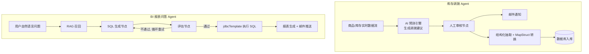

# 15-1 课程总结回顾与展望

【学习目标】

- 复盘课程落地的两个 Agent 的完整链路，建立「AI Agent + 传统业务」的全景能力地图。
- 说清课程的核心结论：AI Agent 解决什么痛点、Spring AI Alibaba 在其中的位置、对个人转型的意义。
- 明确课后三个优化方向（多模型适配、落地效率、案例复制）的具体动手路径。

【正文】

## 1. 课程总结：两个 Agent，一条主线

整门课程落地了两个 Agent：一个是**智能库存调拨优化系统**，另一个是**智能 BI 报表问答系统**。

课程的重心并不在传统业务开发上，库存调拨系统这类传统业务本身如何开发并未展开大量篇幅，而是放在 Agent 的开发，以及传统业务与 Agent 的融合上。在两个 Agent 开发完成之后，课程又介绍了企业级私有化大模型部署方案并做了实操，最后补充了简历与面试相关的讲解。

按章节把能力地图铺开，可以更清楚地看到「从单 Agent 到企业级」的爬坡路线：

| 章节 | 主题 | 沉淀的能力 |
|---|---|---|
| 2–3 | 技术选型与 Graph 基础 | 三条道路的取舍、StateGraph 三要素 |
| 4–7 | 库存调拨 Agent | 数据流构建、AI 预测引擎、结构化入库、人机协同、Redis 检查点 |
| 8 | 微服务化改造 | Nacos 配置中心、Kafka 异步化、高并发应对 |
| 9–11 | BI 报表问答 Agent | RAG 召回、提示词优化、评估节点与条件边循环 |
| 12 | 私有化部署 | Ollama、vLLM、Qwen 本地化落地 |
| 13 | 求职包装 | 亮点提炼、面试攻略 |
| 14 | LiteFlow 组件化编排 | EL 规则、文生图 / 图片编辑组件 |

两个 Agent 的链路形态也可以一目了然地对照起来：

两条链路形态不同，思想完全一致：**用节点把「感知 → 决策 → 执行」拆开，让 LLM 只承担它最擅长的决策环节，其余部分用确定的工程代码兜底**。这就是本课程最值得复用的架构模式。

顺着这张地图还能看出两个 Agent 的难度梯度：库存调拨 Agent 重点在「工程完整性」，全局状态机、Redis 持久化、人机协同、微服务化，把一条链路按生产标准补齐；BI 报表问答 Agent 重点在「效果攻坚」，RAG 召回质量、提示词优化、评估节点循环，把 LLM 输出的准确率往上拉。先立骨架、再抠效果，是企业 AI 应用的两段式打法。

## 2. 核心发现：快，是 AI Agent 解决传统业务痛点的钥匙

课程的核心发现是：AI Agent 技术能够有效解决传统业务流程中存在的效率低下、决策滞后等痛点。

怎么理解？AI 最突出的一个特点就是「快」，准不准暂且不论，它最大的优点是快。哪怕给出的结果是编造的，也会很快给出一个结论。传统业务流程里，一份调拨建议要汇总多个仓库数据、人工比对、层层审批；接进 Agent 之后，数据流就绪的前提下，秒级就能给出建议，人只需要做最终审核。「快」直接压缩了决策周期，效率低下与决策滞后两个痛点因此被同时缓解。

同时，Spring AI Alibaba 框架的引入，极大简化了把先进的 AI 能力集成到现有 Java 应用栈中的开发门槛，为企业级应用的智能化升级提供了强有力的技术支撑。对 Java 工程师而言，这意味着一条清晰的转型路径：**先积累「企业级应用智能化升级」的实战经验，之后去其他公司面试、或者承接其他项目时，才有可能逐步转型为 AI 应用开发工程师，而不是终日陷在传统业务的 CRUD 开发里。**

## 3. 课程展望：三个课后方向

课程虽然讲完了，但还有一份展望留给大家。它更像是课下作业，希望你能基于这三个方向自行思考，并动手对项目做优化。

### 方向一：多模型适配优化：应对快速发展的 AI 模型生态

先看现状：目前项目里用到的是一个通义千问 Max 这样的文本生成大模型，以及一个把文本转换成向量的向量大模型。

但不同大模型在不同方向上的能力本就不一样，完全可以让多种模型协作。例如在文本生成这一环，既可以使用通义系列大模型，也可以使用 DeepSeek 这样的大模型，用多个模型配合把效果做得更好。

更具体的例子在工作流里：有一个 SQL 生成节点，由文本生成大模型来生成 SQL。对于 SQL 生成这类代码任务，可以选用在代码生成上表现更好的大模型（例如千问 / Qwen）；而后续的 SQL 评估节点，则可以换用另一个大模型来做代码评估工作。这样一来，就实现了多种大模型配合执行同一个工作流。

落到 Spring AI 的工程实现上，多模型的核心是「按节点装配不同的 ChatModel，再各自构建 ChatClient」。980-demo 给出了可参照的开关式装配：`980-demo/src/main/java/com/carl/ai/transfer/config/ChatModelConfig.java` 用 `@ConditionalOnProperty` 在 `OfflineChatModel`（离线固定返回）与真实 `OpenAiChatModel`（prod）之间切换，把这种「一个节点一种模型」的思路扩展开，就是每个节点绑定各自擅长领域的模型：生成节点用代码强的模型，评估节点用推理强的模型， embedding 节点用向量模型，互不干扰、各自可替换。

### 方向二：落地效率提升：沉淀工具链与最佳实践

落地效率的提升没有捷径，需要自己做总结，沉淀出一套属于自己的工具链和最佳实践：提示词模板库、评估节点脚手架、结构化抽取的 POJO 约定、模型切换的配置模板。课程中反复出现的「评估 → 循环 → 微调」三件套、少样本提示、自定义分割器等技巧，都是可以固化为模板的素材。工具链的价值在于：第二个 Agent 的开发成本应显著低于第一个。

落到 Spring AI 的工程习惯上，至少有三样东西值得模板化：一是提示词的组织方式（少样本 + 输出格式约束 + 负面清单），二是结构化抽取的目标 POJO 与转换层约定，参考 980-demo 中 `domain/param` 与 `domain/model` 的分层，`convert/TransferOrderConvert.java`（MapStruct）负责两者之间的映射，LocalDate 这类边界类型在转换层统一处理，不在业务代码里散落；三是模型配置的多 profile 模板，让「离线跑通 → 接真实模型」的切换只改配置不改代码。

### 方向三：成功案例复制：把 AI 价值规模化赋能到更多业务场景

只要落地过一个 Agent 与传统业务整合的项目，之后在其他业务上稍加思考，往往也能发现不少适合集成 AI Agent 的点。到了这一步，就已经可以把本课程的案例复制到公司的其他业务线上了。判断标准也很简单：凡是存在「信息汇总慢、人工决策滞后」的环节，都是 Agent 的候选落地场景。

以上三点，就是本课程对大家的期许。希望学完课程之后，能在这三个方向上持续发力。

## 4. 用 980-demo 复盘整条主线

课程章节繁多，复盘时容易陷入「都学过，但连不成线」的窘境。破解办法是找一个最小闭环，把主线上的关键设计都浓缩进去。980-demo 承担的就是复盘载体的角色：

- `980-demo/src/main/java/com/carl/ai/transfer/extract/TransferOrderExtractor.java`：对应课程 5-9「提取大模型内容转 JSON」，用 Spring AI 2.0.1 的 `ChatClient.prompt().user(...).call().entity(TransferOrderParam.class)` 直接把 LLM 输出绑定为 POJO，底层即 `BeanOutputConverter`；
- `980-demo/src/main/java/com/carl/ai/transfer/convert/TransferOrderConvert.java`：对应课程 5-15「MapStruct 实现 POJO 转换」，`param → model` 转换层，LocalDate 边界在转换层统一处理；
- `980-demo/src/main/java/com/carl/ai/transfer/repository/BbTransferOrderRepository.java`：对应课程 5-16「JSON 数据解析与入库节点」；
- `980-demo/src/main/java/com/carl/ai/transfer/config/ChatModelConfig.java` 与 `OfflineChatModel`：对应课程第 12 章私有化部署，`default` profile 离线固定返回，`prod` profile 切换真实模型端点。

把这条最小链路读通，两个 Agent 的共同架构就都在里面了。

【易错点 / 面试题】

1. **「项目里 AI 部分你负责什么」不要答成 CRUD**：库存调拨、报表查询本身不是亮点，亮点是 Agent 链路的设计，数据流怎么喂、节点怎么拆、LLM 输出怎么结构化、评估循环怎么闭环。面试官想听的是这些，回答时主动把话题往节点设计与工程约束上引。
2. **多模型不是银弹**：每接一个模型就多一份密钥、端点、参数与监控成本，评估链路还会成倍增加调用量。先用评估数据证明效果差距，再决定是否拆分模型，避免为了技术炫技拖垮成本。
3. **「为什么不用 Dify / Coze」要能脱口而出**：低代码平台整合进老旧业务系统笨重、不灵活，定制化节点受制于人；自研工作流最核心的优势就是定制化程度高。这类追问的完整答案在 2-3 节，课程结尾时应该能做到条件反射式回答。

【小结】

到这里，整门课程的内容就全部结束了。从 Graph 三要素到两个生产级 Agent，从微服务化到私有化部署，再到面试包装与组件化编排，主线始终只有一条：**AI Agent 解决传统业务痛点，Spring AI Alibaba 简化开发**。

课程有终点，工程没有。把三个展望方向当作起点，从跑通 980-demo 的最小闭环开始，亲手改造、亲手优化，下一次把一个真实的业务痛点变成 Agent 落地案例时，这门课才算真正上完。
