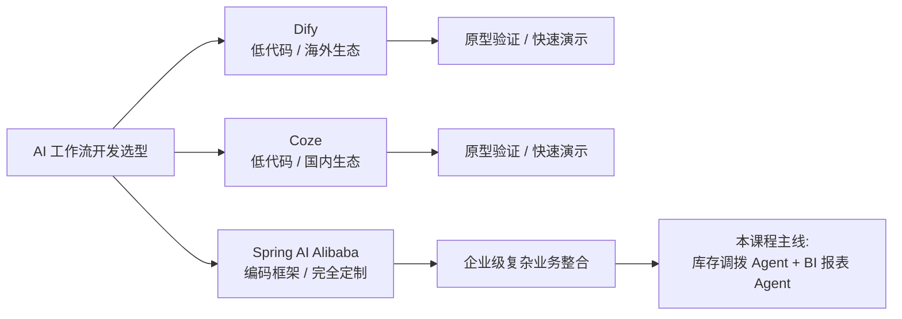

# 2-1 AI工作流开发的「三条道路」

【学习目标】

- 说清 AI 工作流开发的三条主流道路各自的定位、优势与门槛。
- 建立「低代码平台 vs 自研框架」的选型判断标准，能独立回答「为什么选 Spring AI Alibaba」。
- 为后续章节的学习建立路线图：哪些内容对应哪条道路。

【正文】

## 1. 本章要回答的问题

进入第二章「技术选型与架构筑基：为什么是 Spring AI Alibaba Graph？」，核心要回答的就是一个问题：**为什么最终选择 Spring AI Alibaba Graph 来开发我们的 AI Agent。**

技术选型是项目的地基。地基选错，后面写得越勤返工越狠。所以这一章不急着写代码，先把选项摆清楚。

选型之前先明确一个前提：本课程的目标不是「把 Demo 跑起来」，而是「做出能进生产的企业级 AI 应用」。这一前提会直接淘汰一批看似省事的选项，因为省事往往以牺牲可控性为代价。

对 Java 团队来说，选型问题还多一层特殊性。Python 生态里有 LangChain、LlamaIndex 等成熟编排框架，而 Java 生态长期缺少同级别的原生方案，很多团队被迫在「调用 Python 服务」与「硬啃 HTTP 接口」之间二选一。Spring AI Alibaba 的出现正是为了填补这块空白。至于它凭什么被称为「Java 生态的终极答案」，课程 2-5 节会用一整节来论证。

## 2. 三条道路全景

AI 工作流开发目前有三条主流道路：**Dify、Coze 和 Spring AI Alibaba**。

Dify 和 Coze 这两个平台在业内已有相当知名度。如果还没接触过，说明在 AI 技术这块的学习节奏有些滞后，建议先补一补。本门课程不会展开讲解它们的具体用法，只做概览性介绍，多掌握一门工具总归没有坏处，技多不压身。

三条道路的差异可以放在一张表里对照：

| 维度 | Dify | Coze | Spring AI Alibaba |
|---|---|---|---|
| 出品方 | 国人团队 | 国内团队 | 阿里巴巴（Spring 生态） |
| 目标市场 | 海外市场 | 国内市场 | 开发者（无市场边界） |
| 产品形态 | 低代码平台 | 低代码平台 | 编码框架 |
| 插件生态 | 非常丰富，以国外插件为主 | 数量少于 Dify，以国内插件为主 | 无插件市场，按需自研工具 |
| 私有化部署 | 支持，Docker 本地落地 | 商业化倾向明显，付费环节多 | 天然私有化（代码即部署） |
| 使用门槛 | 需科学上网才能顺畅使用 | 国内可直接访问 | 需 Java / Spring 开发能力 |
| 定制化程度 | 受平台预设能力约束 | 受平台预设能力约束 | 完全定制 |

表格里每一行都是一次取舍。挑三行最关键的解读：

- **产品形态**决定天花板。低代码平台的节点类型是平台预设的，你能编排的只是平台允许的组合；编码框架没有这层天花板，任何逻辑都能写成节点。
- **私有化部署**决定数据边界。Dify 可以 Docker 本地落地，代码与数据都在自己手里；Spring AI Alibaba 作为框架则天然私有化，部署形态与普通 Spring Boot 应用没有任何区别。
- **使用门槛**决定团队配置。低代码平台产品经理、运营都能上手；编码框架要求开发者具备 Java 与 Spring 能力，换来的是对系统的完全掌控。

一句话概括：**Dify 和 Coze 是「用平台」，Spring AI Alibaba 是「造框架」**，前者在页面上拖拖拽拽完成编排设计就能把流程跑起来，后者通过编码直接开发工作流。这不是好坏之分，而是路线之分，适用场景完全不同。

## 3. 逐条展开

### 3.1 Dify：插件生态最丰富的海外向平台

Dify 由国人开发，但面向的是海外市场，内置了非常多的插件，同时支持私有化部署，可以通过 Docker 在本地完成私有化落地。

使用 Dify 有一个现实门槛：因为面向海外市场，插件生态也以国外为主，所以需要一个前置条件，具备「科学上网」的能力，有梯子才能顺畅地安装插件、使用平台。对国内团队而言，这一条就直接决定了它的易用性：网络条件不达标时，插件装不上、平台打不开，功能再丰富也只存在于文档里。

Dify 的插件生态是它的核心卖点。插件数量非常多，国内外的都有：既有支付宝支付这样的国内插件，也有谷歌、亚马逊、微软、K8S 等国际工具，需要什么直接安装即可。对「重度依赖外部 SaaS 工具」的场景，这种生态能省下大量自研适配工作。安装部分插件时还需要获取插件自己的 API Key，按提示去对应官网注册登录账号、申请密钥即可。

### 3.2 Coze：国内向、商业化更明显的平台

Coze 同样出自国内团队，主要面向国内市场。相比 Dify，它的插件数量要少一些，而且商业化倾向非常明显，使用过程中需要付费的环节比较多。

私有化部署这一点上，Dify 是可以支持的，这也是选型时的一个分水岭：数据必须自主可控的团队，会优先考虑支持私有化部署的方案，不会把核心业务数据放在一个无法私有化的平台上。

国内团队的另一个便利是访问：Coze 分国外站与国内站，coze.com 是国外网站，需要科学上网；coze.cn 是国内官网，可以直接访问。国内站里的插件同样很多，不过基本都是国内插件，并不面向海外市场。这也是它相比 Dify 在本土场景下的优势，网络条件不构成额外门槛。

### 3.3 Spring AI Alibaba：编码路线

Spring AI Alibaba 走的是完全另一条路：作为一个框架，开发者可以通过编码直接开发工作流。

它不提供页面编排，也不预置节点类型，换来的是彻底的自由度，任何 Spring 生态能做的事（事务、安全、消息、调度、缓存），都能原样搬进工作流节点里。本课程后续会看到：库存调拨 Agent 里的邮件通知、Kafka 消息、Redis 检查点，全都是普通 Spring 组件的复用，不需要任何平台侧的特殊支持。

自由度也意味着责任自担：编排逻辑、节点抽象、状态管理都要自己设计，出问题没有平台兜底。但换个角度看，这也正是可测试性的来源，链路里的每个节点都是普通 Java 类，可以脱离大模型单独做单元测试，这对追求确定性的企业级项目而言恰恰是刚需。

三条道路的关系可以这样理解：

## 4. 三条道路与后续章节的对应

本节只做概览，三条道路会在后续学习中逐步展开，对应关系如下：

| 后续章节 | 内容 | 对应道路 |
|---|---|---|
| 2-2 | Dify 与 Coze 的基本用法 | 低代码平台路线 |
| 2-3 | 低代码平台遍地，为何还要从零造轮子 | 路线取舍 |
| 2-4 / 2-5 | 从工具使用者到架构创造者；为什么 SAA Graph 是 Java 生态的终极答案 | 编码框架路线 |
| 第 3 章起 | Graph 三要素与全部实战 | 编码框架路线落地 |

可以看出：课程会用一节把两个低代码平台「认识完即放下」，然后用整本书的篇幅走通编码路线。这种篇幅分配本身就是一种态度，低代码平台值得了解，但 Java 工程师的立身之本是编码能力。

这一态度也回应了 2-4 节的主题「从工具使用者到架构创造者」：会用平台是工具使用者的素养，能造框架才是架构创造者的底气。两条路都要走，但重心必须放对。

从工程视角再看一层：本课程的配套工程 980-demo（`980-demo/src/main/java/com/carl/ai/transfer/agent/TransferAgent.java` 及其上下游模块）就是「编码路线」的缩影，没有任何平台预置节点，每一个环节（抽取、转换、入库）都是普通的 Spring Bean，可以自由使用 Spring 的全部能力，也经得起单元测试的检验。平台路线给不了这种确定性。

把镜头再推近一些：自研框架下的一个节点，从编写、单测、代码评审到上线，走的完全是团队既有的研发流程；低代码平台下的一个节点，配置存在平台数据库里，改动留痕、评审、回滚都要依赖平台提供的能力。对研发管理成熟的团队而言，「回到既有流程」本身就是一项容易被低估的效率来源，这也是很多团队试过平台之后又回到代码路线的原因之一。

【易错点 / 面试题】

1. **「为什么不用 Dify / Coze，而用 Spring AI Alibaba？」**：这是本章对应的面试高频题。答题结构建议三层，先承认低代码平台的价值（快、适合原型验证），再指出企业整合的痛点（老旧系统集成笨重、定制节点受制于人），最后落到自研框架的优势（定制化程度高、与 Spring 生态无缝融合）。完整话术见 2-3 节。
2. **Dify 与 Coze 的区别不要只说「都差不多」**：市场定位（海外 vs 国内）、插件生态（丰富且偏海外 vs 较少且偏国内）、商业化程度、私有化部署支持，这四个维度至少能展开两个。
3. **选型题没有标准答案，只有场景答案**：全新业务线、需求明确、追求速度 → 低代码平台；整合进既有复杂系统、需要深度定制 → 编码框架。面试中主动分场景回答，比背结论更得分。
4. **不要贬低低代码平台**：面试官问这类问题，往往也在考察你的技术判断力是否成熟。把低代码平台说成一无是处，反而暴露认知片面；承认其在原型验证阶段的价值，再论证企业整合阶段为何不够用，才是成熟工程师的回答。

【小结】

本节建立了 AI 工作流开发的三条道路全景：Dify 与 Coze 两个低代码平台，以及作为编码框架的 Spring AI Alibaba，并用对照表与选型图梳理了各自的定位与适用场景。下一节先分别认识 Dify 和 Coze 的基本用法，再回答本章的关键问题，低代码平台遍地，为何还要从零造轮子。
