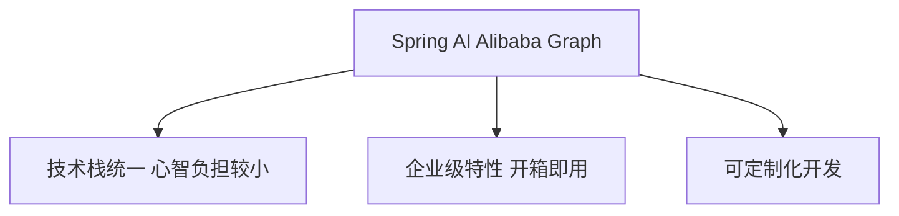

# 2-5 为什么Spring AI Alibaba Graph是Java生态的「终极答案」？

【学习目标】

- 说清 Spring AI Alibaba Graph 的三个核心优势：技术栈统一、企业级特性开箱即用、可定制化开发。
- 理解「与 Spring 生态天然适配」在工程上具体意味着什么：安全、事务、监控、依赖注入如何直接作用于 AI 工作流。
- 掌握「为什么选 Spring AI Alibaba Graph」的面试标准答法，并与「为什么不用 Dify / Coze」组合成完整回答。

【正文】

本节的主题可以概括为「天作之合」，为什么 Spring AI Alibaba Graph 是 Java 生态开发 Agent 工作流的「终极答案」。标题里的引号需要先说明：它不是宣称某个框架完美无缺，而是回答一个具体的工程问题：**在 Java 生态里落地生产级 AI Agent 工作流，哪条路线的综合成本最低？**

它同时也是上一小节「面试官可能会问的问题」的补充。上一节讨论的是：已经有 Dify、Coze 这样的低代码平台，为什么还要从零造轮子？那一节侧重说明低代码平台的问题；本节反过来讲：使用 Spring AI Alibaba Graph 开发 Agent 工作流，好处究竟是什么。两篇合起来，才是一个完整的面试回答。

## 一、技术栈统一，心智负担较小

从 Controller 到 Service，再到 AI 工作流，全程就是 Java + Spring。这里的 Spring 是泛指，Spring Boot、Spring Cloud、Spring Cloud Alibaba 都可以，无需在 Python 和 Java 之间来回切换。

「无需切换语言」省的不是敲键盘的力气，是两套工程范式之间的上下文切换成本。混合栈团队对此应该有体感：算法侧用 Python 做模型实验，工程侧用 Java 做业务系统，两边各自为政，AI 模块和业务模块之间永远隔着一层跨语言接口，需求变更要在两个仓库、两套构建、两类依赖里来回改。

| 成本项 | Java + Python 混合栈 | Java + Spring AI Alibaba Graph |
|---|---|---|
| 语言范式 | 两套语法、两套工程习惯 | 全程 Java，一套 Spring 思维 |
| 团队协作 | AI 模块与业务模块割裂 | 同一套代码规范与评审流程 |
| 数据传递 | 跨进程 / 跨语言序列化 | 进程内 POJO 直接传递 |
| 部署运维 | 两个运行时、两套依赖树 | 一个 Spring Boot 可执行产物 |
| 人员复用 | AI 与业务团队彼此隔离 | 一套 Spring 后端团队全覆盖 |

无论对个人学习成本，还是对企业开发成本与开发周期而言，统一栈的负担都小得多。对个人，意味着不需要在「学好 Java」之后再补一轮 Python 工程化；对企业，意味着现有 Spring 团队可以直接承接 AI 需求，不需要为 AI 项目单独组建一支技术栈不同的团队。生态层面同样在持续向 Java 侧倾斜：Spring AI Alibaba 在 Graph 编排之外已陆续补齐 A2A、Nacos 等能力，多 Agent 协同与服务发现可以在同一套 Spring 体系内闭环，不需要再拼一套异构基础设施。

## 二、企业级特性，开箱即用

Spring AI Alibaba Graph 天然继承 Spring 生态的安全、事务、监控、依赖注入，可以为 AI 工作流轻松添加权限控制、分布式事务、链路追踪，满足企业生产级要求。说得通俗一点，就是能够和现有的企业级项目完美融合，成本比较低。

「天然继承」不是修辞，而是有明确的结构原因：Graph 里的每个 Node 本质上就是一个普通 Spring Bean，能作用在 Bean 上的横切能力，都能作用在节点上。

- **安全**：Security 的过滤器链、方法级注解（如 `@PreAuthorize`）可以直接保护承载 Agent 的 Controller 与 Service，AI 入口和普通业务入口遵循同一套认证鉴权。
- **事务**：`@Transactional` 可以包住节点的副作用，把「大模型生成 + 入库」这类组合操作纳入同一事务边界，避免模型生成了、库却没落干净。
- **监控**：Micrometer + Actuator 可以给每个节点加计时与计数，token 消耗、节点耗时、失败率都进 `/actuator/metrics`，与既有监控大盘同源。
- **依赖注入**：节点通过构造注入获得 Repository、ChatClient 等依赖，和写普通 Service 没有任何区别。

这套能力在配套工程 980-demo 里都有实证：`extract/TransferOrderExtractor.java` 上的 LLM 调用直接标注 resilience4j 的 `@CircuitBreaker` 做熔断降级；`service/TransferOrderServiceImpl.java` 的入库走 Spring Data JPA 事务；`config/ChatModelConfig.java` 用 `@ConditionalOnProperty` 区分 offline / 真实模型两个 profile。这些在自研框架里都是顺手可得的 Spring 生态能力，换到平台方案里则每一项都要重新论证可行性。

## 三、可定制化开发

企业级项目的需求往往比较复杂，很多系统要求高度的定制化，而 Spring AI Alibaba Graph 可以简单、快速地提供支持。

定制化的底气来自「节点就是 Java 类」：能调 Spring 的地方就能调一切，祖传的 SOAP 服务、私有协议、内部审批中台、特定格式的报表引擎，都不存在「平台未提供对应节点」的天花板。980-demo 的 extract → convert → repository 三段式就是最小样例：`extract/TransferOrderExtractor.java` 用 `ChatClient` 调模型，`convert/TransferOrderConvert.java` 用 MapStruct 做 POJO 转换，`repository/BbTransferOrderRepository.java` 直接复用 Spring Data JPA 落库。每一步都可以按自家规范替换，而不需要等工作流引擎提供对应能力。

反观平台方案，「高度定制化」恰恰是它结构性薄弱的一环：平台只能提供「大多数人」需要的通用节点，而企业定制需求往往长在自家历史系统的形状上。这也是为什么同样的需求，自研路线三天交付、平台路线要先论证「平台内能不能做」，定制能力不是功能点多少之差，是「能不能碰到底层」之差。

## 四、面试时怎么答

把三点归纳一下，就是一段完整的面试回答：

**第一，学习成本低、开发成本低、开发周期短。** 因为不需要再去学 Python，也不存在把 Spring 技术栈切换到 Python 开发语言的问题。

**第二，可以很轻松地与企业级项目整合，开箱即用。** Spring AI Alibaba 支持 Spring AI，而 Spring AI 本身就是 Spring 框架体系里的东西，天然与 Spring 框架适配；因此 Spring AI Alibaba Graph 与 Spring 框架同样是天然适配的。而绝大部分企业级项目都构建在 Spring 框架之上，Spring Boot 也是在 Spring 基础上做的封装，核心同样是 Spring。

**第三，可定制化开发。** 使用 Spring AI Alibaba Graph 能够满足企业高度定制化的需求。

这三点可以用来告诉面试官：我们为什么要用 Spring AI Alibaba Graph；而上一节的内容则用来告诉面试官：我们为什么不用 Dify 和 Coze。前者讲 Spring AI Alibaba 的好处，后者讲前两者的缺陷，两者配合起来就是一个完整的回答。面试时切忌只答一半，只贬低平台显得偏激，只夸框架显得单薄，正反结合才是成熟的选型叙事。

【易错点 / 面试题】

1. **「为什么用 Spring AI Alibaba Graph？」**：标准答案就是上面的三点式，技术栈统一（心智负担小）、企业级特性开箱即用（安全/事务/监控/DI）、可定制化。每一点最好带一个工程证据，例如讲监控时引 `980-demo/src/main/java/com/carl/ai/transfer/extract/TransferOrderExtractor.java` 上的 resilience4j 熔断注解，说明 AI 调用纳入了项目既有治理体系。
2. **「'终极答案'是否言过其实？」**：要承认边界。Python 生态在模型研究、训练侧更厚，这是事实；但企业级落地侧的比拼维度是集成成本、治理能力、定制自由度，这三项 Java + Spring 栈优势明显。答题时主动划出边界，比全盘吹嘘更可信。
3. **「它和直接用 Spring AI 有什么区别？」**：Spring AI Alibaba 构建在 Spring AI 之上，Graph 模块借鉴 LangGraph 的 StateGraph 思路做编排，并深度整合通义；开发者面向的 API 仍是 `ChatClient` 那一套。版本线上需要注意：课程演示基线为 Spring AI 1.0.3 + Spring AI Alibaba 1.0.4（见 3-3 环境搭建），而配套 980-demo 的基线为 Java 21 + Spring Boot 4.1.1 + Spring AI 2.0.1，2.0 的工具循环由 `ToolCallingAdvisor` 在 Advisor 链中统一驱动，但 `ChatClient`、`@Tool`、`BeanOutputConverter` 等开发者 API 保持不变，博客名词与工程代码一一对应，不会脱节。

【小结】

本节用技术栈统一、企业级特性、可定制化三个角度，论证了 Spring AI Alibaba Graph 在 Java 生态里的综合成本优势，并给出了与上一节「为什么不用低代码平台」配合使用的面试答法。三个角度的共同前提是：Graph 的节点就是普通 Spring Bean，因此 Spring 生态几十年沉淀的安全、事务、监控、依赖注入能力可以原样复用到 AI 工作流上，这是「天作之合」的真正含义。下一节进入课程规划的第四条路线：自研工作流 Agent 开发框架，看大厂如何在原生框架之上做二次封装。
