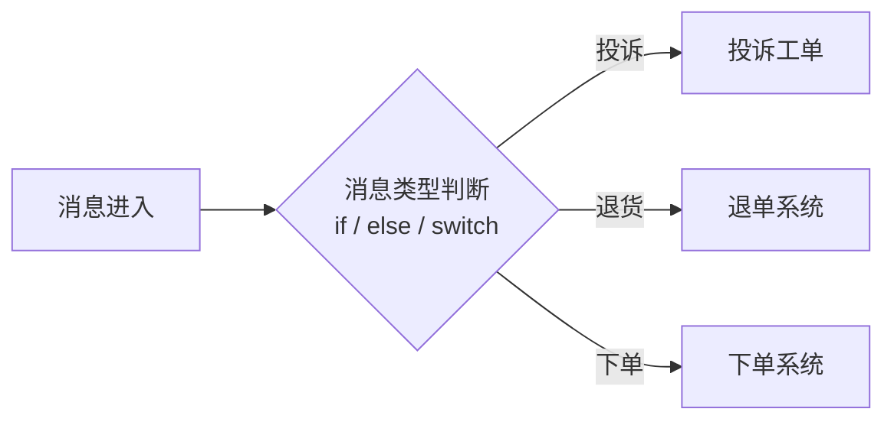
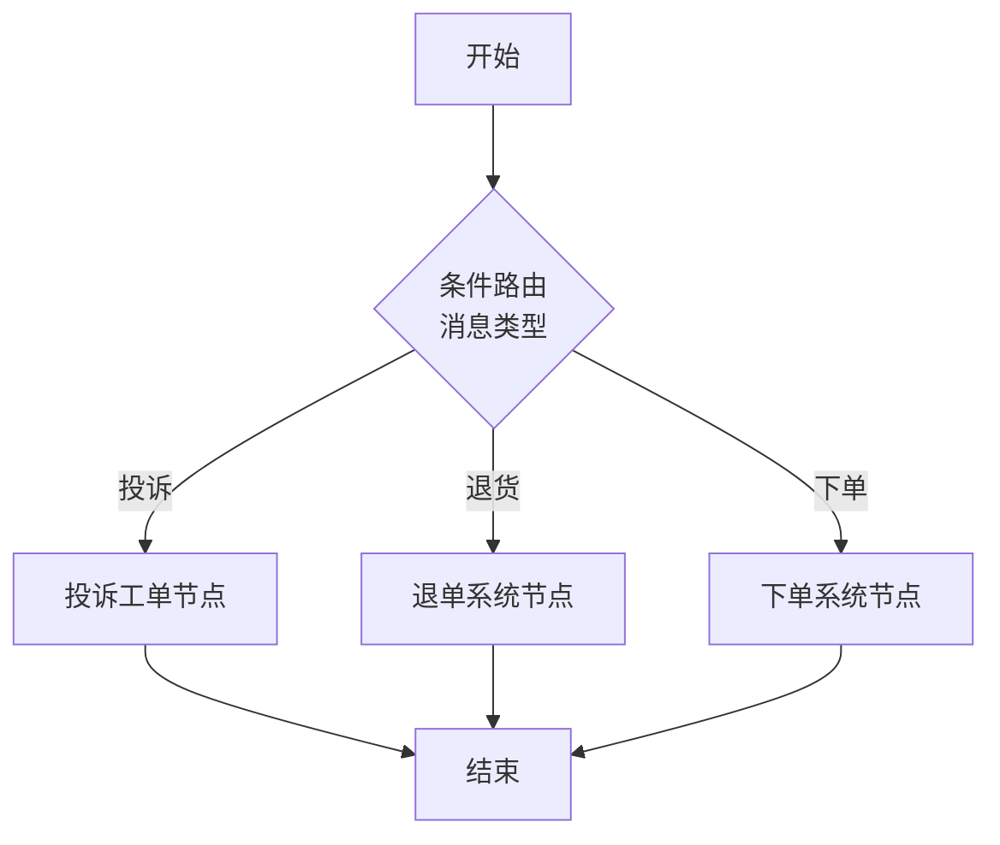

# 3-1 什么是Graph？为什么它是AI工作流的终极解决方案？

【学习目标】

- 说清 Graph 的定义：可视化业务流程引擎，以及它和传统 if / else 硬编码的本质区别。
- 理解 Graph 成为 AI 工作流主流形态的四个理由：编排可视化、原生支持分支与循环、支持人机协同、代码可读性。
- 建立从「写好一个方法」到「设计一个业务流程」的架构师思维转换。

【正文】

从本节课开始进入第三章的学习。

第三章主要进行 Spring AI Alibaba Graph 框架的核心精讲。后面要实现两个项目级 Agent 的开发（库存调拨优化系统、智能 BI 报表问答系统），它们需要一些前置知识，这一章就是把这些前置知识补上。

先提出本节要回答的问题：**什么是 Graph？为什么它是 AI 工作流的终极解决方案？**

## 一、从一个熟悉的困境说起

在讲解该问题之前，先回想一个场景：在公司的业务代码开发中，是否遇到过这样的困境。

比如老板让你开发一个消息系统或者工单分流系统，你需要根据消息的类型把它分到某一条业务线：如果这是一条投诉消息，就分到投诉工单；如果是一条退货消息，就发到退单系统；如果是一条下单消息，就分到下单系统。

使用传统的 Spring Boot 代码，如果不考虑使用设计模式，最原始、一拍脑袋就能想到的方法是什么？就是在业务代码中使用大量的 if else 嵌套，或者加一些 switch case 来做判断，拿到消息类型之后去执行对应的代码，这是最常见的实现思路。

如果未来又加了一个需求，比如需要再加一个身份验证的步骤，那就还得去代码里到处找，小心翼翼地修改，生怕影响到其他逻辑。这让传统代码显得非常痛苦：代码臃肿、难以维护、不易可视化。

当然，可以通过一些设计模式来进行优化，比如策略模式把每个分支收敛成一个策略类，但它依然存在缺陷：分支的拓扑关系仍然埋藏在代码里，「谁在谁之前、谁失败走哪条支线」这类信息无法被一眼看清，也无法被画出来给产品经理和运维看。传统业务开发中这种 if else 或 switch case 的判断方式本身就存在问题，这就引出了一个概念，Graph。

把两种实现方式的差异逐条对照，能更直观地看到问题出在哪：

| 维度 | if / else 硬编码 | Graph 编排 |
|---|---|---|
| 新增一个分支 | 在方法里插一段判断，回归全部老路径 | 在图上加一个节点和一条边 |
| 流程可见性 | 拓扑埋在代码里，读代码才能还原 | 代码直接生成流程图 |
| 与低代码平台对齐 | 无对应物 | 图结构一一对应，可双向翻译 |
| 单元测试 | 分支互相缠绕，难以孤立测 | 节点即独立单元，可单独测 |
| 加身份验证这类横切步骤 | 到处找入口逐个插入 | 在图里统一加一个节点 |

以「新增身份验证步骤」为例：if / else 版本要把这段逻辑塞进每一个入口，漏一个就是一次线上事故；Graph 版本只在流程里插一个身份验证节点，流向由一条边决定，改动范围一张图就能审完。企业里真正贵的从来不是写代码的时间，而是「改一处、查全身」的回归成本和说不清道不明的流程状态。

## 二、Graph 是什么

Graph 是一种可视化的业务流程引擎。说得通俗易懂一点，它就是 Spring AI Alibaba 的工作流开发框架，可以直接让我们把低代码平台上看到的那种图结构设计变成代码。

简单说就是：在 Dify 或者 Coze 上，产品经理通过拖拖拽拽生成了这样一个图，这样的工作流就是一个图。生成该图之后，开发人员就可以使用 Spring AI Alibaba Graph，把低代码平台上的图变成代码。

同样一个工单分流需求，用 Graph 表达出来是这样的：

和上面那张 if / else 的图对比，形状几乎一致，这不是巧合。低代码平台画出来的流程图，与 Graph 代码描述的是同一种结构：节点是动作，边是流向，条件是分叉。区别只在于交付形态：一个是画出来的，一个是写出来的。Spring AI Alibaba Graph 让「写代码」和「画图」变成同一件事，代码写完之后可以直接生成对应的图。

## 三、为什么它是 AI 工作流的终极解决方案

把 Graph 的优势逐条摆开，一共四点。

**第一，天生支持对应的设计模式。** 比如在低代码平台上有循环执行、分支等结构，Spring AI Alibaba Graph 都是支持的。评估-重试循环、多路分支、人工审核中断，这些 AI 工作流里的高频结构都有对应的一等公民，不需要靠嵌套 if / else 硬撑。课程第 11 章 BI 报表问答里的「评估-循环」结构，就是 Graph 循环边的直接应用。为什么 AI 工作流格外需要这些结构？因为大模型输出天然带不确定性，一次生成不达标就重试，多个候选就路由择优，高风险动作就中断等人，这些「带控制流的容错逻辑」恰恰是 if / else 最难维护的部分，却是 Graph 最擅长表达的部分。

**第二，支持人机协同。** 在 AI 领域有一个很严重的问题，尤其在对话大模型上，就是大模型的幻觉，大模型可能会出现胡编乱造的情况。针对这种情况，业务中就需要进行人机协同来处理，Spring AI Alibaba Graph 同样支持。落到形态上，就是在流程里插入人工审核节点：流程执行到该节点时暂停，等待人工确认或修改，确认后再继续往下走。高风险动作（写库、发邮件、对外回复）前挂一道人工关卡，是当前落地 AI 应用最现实的止损手段。人机协同之所以依赖 Graph 这类结构，是因为它需要「暂停-等待-恢复」的流程控制能力，线性代码里很难自然地表达这种中途挂起。

**第三，代码可读性非常好。** 使用 Spring AI Alibaba Graph 进行开发，代码的可读性非常好，它可以直接生成对应的图，换句话说，通过编写代码就能直接生成一张类似低代码平台上拖拖拽拽出来的流程图。对代码评审是实打实的减负：评审人不再需要在大段分支逻辑里还原流程，看一眼图就知道节点和流向；对运维和排障同理，线上出了问题时，定位到「哪个节点失败了」比定位到「哪一行 if 判断出了问题」要快得多。

**第四，也是最核心的一点，思维层面的升维。** 它可以让你从一个程序员升华到架构师的思维。过去程序员的思维一般是 CRUD，考虑的是如何写好一个方法，比如通过设计模式把某个方法写好；而现在可以让我们向 AI 架构师的思维转型，思考更多的是如何使用这些方法设计一个业务流程，而不是局限于如何写好一个方法。

如何写好一个方法，那是普通程序员的思维逻辑；而作为架构师，应该考虑的是如何设计好一个业务流程。

把两种思维的分工整理成表：

| 维度 | 程序员思维 | 架构师思维 |
|---|---|---|
| 关注单位 | 一个方法、一个类 | 一条业务流程、一张图 |
| 核心问题 | 这段逻辑写得正确与否 | 节点划分是否合理、边怎么连 |
| 变更响应 | 在方法里加分支 | 在图上加节点或改边 |
| 交付物 | 一段实现 | 一张可运行的图 + 可复用的节点 |
| 沟通对象 | 编译器 | 产品、运维、评审者 |

## 四、落到工程里对应什么

Graph 的三个核心要素（State、Node、Edge）会在下一节展开，这里先用配套工程 980-demo 建立第一印象。`agent/TransferAgent.java` 的 `createTransferFromText` 就是一个完整的节点动作：读入自然语言（State 的初始内容），调用抽取与入库，返回结果。其中 `param.getSourceWarehouseId() == null` 的判断，就是一条最简形式的条件边，抽取失败走降级文案，抽取成功继续入库。课程第 5 章之后，就是在这张图上不断增加节点、边与条件，最终长成完整的库存调拨工作流。

需要提醒的是，「用代码描述图」并不等于「放弃设计」。图画得是否合理，节点切分是否恰当、状态是否最小充分、条件是否完备，这些决策仍然依赖架构能力，Graph 只是把设计结果变得可视、可评审、可测试。工具降低的是表达成本，不是思考成本。

【易错点 / 面试题】

1. **「什么是 Graph？它和直接写 if / else 有什么区别？」**：一句话版本，Graph 是把业务流程可视化的编排引擎，用代码描述节点与边，代码可直接生成流程图；if / else 把流程拓扑埋藏在代码里，无法可视化、难以评审。展开时点出三个差异：变更成本（加分支是改图还是改方法）、可读性（能不能生成图给非开发角色看）、可测试性（节点是独立单元，可以脱离大模型单测）。
2. **「为什么说 Graph 是 AI 工作流的终极解决方案？」**：按课程四点答：天生支持分支与循环等设计模式、支持人机协同（应对幻觉）、代码可读性高可直接生成图、推动思维从写好方法升维到设计流程。每条最好带一个课程内的证据，比如人机协同对应高风险动作前的人工审核，循环对应第 11 章的评估-循环。
3. **「Graph 和低代码平台画出来的流程图是什么关系？」**：同一种结构、两种交付形态。Graph 把低代码平台上的图结构设计变成代码，节点是动作、边是流向、条件是分叉，这也是面试里体现「看得穿平台本质」的好机会，直接呼应 2-4 节的技术视野论点。

【小结】

本节回答了「什么是 Graph」与「为什么它是终极解决方案」：Graph 是 Spring AI Alibaba 的可视化工作流开发框架，用代码描述节点与边，代码可直接生成流程图；它相对 if / else 的优势体现在可视化编排、原生支持分支与循环、支持人机协同、代码可读性四个方面，更深远的价值在于推动思维从「写好一个方法」转向「设计好一个业务流程」。下一节深入 Graph 的核心三要素，State、Node、Edge，看这套结构在代码里如何落地。
