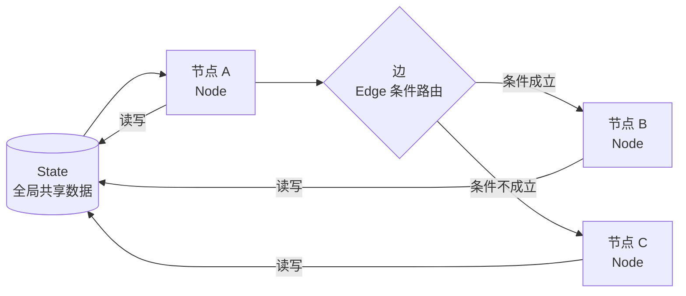

# 3-2 Graph核心三要素深度解析

【学习目标】

- 说清 Graph 核心三要素 State、Node、Edge 各自的职责与代码对应物。
- 理解 `KeyStrategy` 存在的必要性，掌握覆盖与追加两种策略的语义及典型用途。
- 能区分 `AsyncNodeAction` 与 `AsyncNodeActionWithConfig`、条件边与固定边，知道上下文该由谁传递。

【正文】

本节课讲解图（Graph）核心的三个要素，做一个深度解析。

先明确一下什么是图：在 Dify 平台或者 Coze 平台上做工作流开发时，会有一个开始节点和一个结束节点，我们可以自己拖拽增加一些节点，让它形成一个工作流。整个工作流其实就是一个 Graph，一个图。

在这张图里面，有核心的三个要素，分别是 State、Node 和 Edge。三者的分工可以用一张图概括：

State 是数据，Node 是动作，Edge 是流向。三者中任何一个缺位，流程都跑不起来，下面逐个展开。

## 一、State：全局共享的状态机

第一个是 State，其实就是一个状态机。它是一个全局的共享数据结构，表示应用程序当前的快照，由 `OverallState` 对象来表示。

「全局共享」是理解 State 的关键词。工作流里的每个节点都可能需要一些前置数据，也可能产生一些新数据供下一个节点使用，这些数据不能靠方法参数逐个传递，节点数量一多，传递链就变成一张乱网。State 提供了一个统一的数据总线：节点从里面取前置数据，往里写产出，下一个节点再从里面取。这也就是为什么把它称为状态机：它存储着整个工作流在某一时刻的完整快照。

配套工程 980-demo 里能找到直接对应物：`domain/param/TransferOrderParam`（模型生成阶段的载体）与 `domain/model/BbTransferOrder`（入库阶段的载体）就是贯穿流程的状态载体。抽取节点往里写调拨单字段，转换节点从里面读字段做 MapStruct 映射，入库节点再把它持久化，每个节点都只和 State 打交道，不直接依赖其他节点的返回值。

## 二、Node：节点即动作

第二个是 Node。在 Spring AI Alibaba Graph 框架中，Node 可以理解为 Dify 平台里面的每一个小方框，也就是一个节点。在框架中，每一个 Node 都是一个函数式接口（例如 `AsyncNodeAction`），需要在里面编码智能体的逻辑，因此 Node 非常核心，它决定了对应节点要执行什么样的代码逻辑、去干什么事情。

Node 的输入输出契约非常清晰：接收当前的 State 作为输入，执行一些计算或者副作用，并返回更新后的 State。「计算或副作用」覆盖了节点的两种典型形态，纯计算（改写 State 里的字段，如抽取、转换、评估）与副作用（发消息、写库、调外部接口，如入库、邮件通知）。判断一个节点设计得是否合理，标准就是这条契约是否被守住：只依赖 State 拿输入，只通过返回值交产出。

此外还可以使用带配置的接口（例如 `AsyncNodeActionWithConfig`），借助 `RunnableConfig` 来传递上下文。这些内容在后面的代码编写中会用到，这里先有一个初步印象即可。两种接口的分工如下：

| 接口 | 输入 | 适用场景 |
|---|---|---|
| `AsyncNodeAction` | 当前 State | 逻辑自包含，不依赖外部上下文 |
| `AsyncNodeActionWithConfig` | State + `RunnableConfig` | 需要线程标识、调用元数据等上下文信息 |

「为什么需要第二个接口」是常见疑问：某些节点的行为要依赖运行环境（例如按会话 ID 隔离记忆、按调用链传递 traceId），这类信息不属于业务 State，塞进 State 会污染数据模型，因此框架单独提供了 `RunnableConfig` 通道。选型原则：业务数据走 State，运行上下文走 `RunnableConfig`，两条线不要混。

## 三、Edge：边即流向

第三个要素是 Edge，也就是「边」。边可以理解成 Dify 里面的那些线，一条条的线就是一条边。通过边进行编排，让节点知道往哪个地方走，决定节点和节点之间怎么串联起来。

在 Spring AI Alibaba 框架中，Edge 同样是一个函数式接口（例如 `AsyncEdgeAction`），它根据当前的 State 来确定接下来执行哪个 Node。它们可以是条件分支，也可以是固定转换，或者使用带配置的边（`AsyncEdgeActionWithConfig`）；它同样可以额外接收一个 `RunnableConfig` 来传递上下文。

在框架中，边还分为条件边、循环边等等。把边的类型与 Node 接口对照着看，可以归纳成一张表：

| 类型 | 行为 | 课程中的对应 |
|---|---|---|
| 固定边 | 执行完 A 节点，固定流向 B | 顺序编排（抽取 → 转换 → 入库） |
| 条件边 | 按 State 内容选择下一个 Node | 抽取失败走降级、成功走入库 |
| 循环边 | 满足条件时回到上游节点重试 | 第 11 章 BI 报表的「评估-循环」 |
| `AsyncEdgeActionWithConfig` | 条件边 + `RunnableConfig` 上下文 | 需要运行元数据参与路由判断时 |

980-demo 的 `agent/TransferAgent.java` 中 `param.getSourceWarehouseId() == null` 就是一条最典型的条件边：按 State 里的字段值决定流程走向，为空返回「抽取失败」，非空继续转换入库。课程第 11 章要实现的「评估-循环」，则是循环边的完整形态：评估节点打分不达标时，边把流程带回上游重新生成，直到达标或达到重试上限。

## 四、KeyStrategy：状态机里每个 key 的更新规则

此外还有一个 `KeyStrategy`，也就是 key 的策略。在讲 key 的策略之前，先要说明什么是 key。key 是状态机里的概念：可以把状态机想象成存储整个工作流数据的容器，每个 key-value 键值对就是容器里的一项数据。

在整个工作流当中，每个节点都可能需要一些前置数据，也可能产生一些新数据供下一个节点使用。这些数据放在哪里呢？其实就是放在状态机里面。状态机里面存放的这些数据，是通过 key-value 这样的键值对 Map 来进行存储的：这是一个 key，这是 value，这是一个键值对，同样还有别的 key 和 value。

同一个 key，它的 value 是需要 `KeyStrategy` 这样的 key 策略的。`KeyStrategy` 可以理解成：如何将节点的更新应用到 State 上。State 中的每个键都有自己独立的策略，如果没有显式指定对应策略，则默认使用覆盖策略，即假定该键的所有更新都应该覆盖它。

`KeyStrategy` 要解决的问题很具体：多个节点都可能写同一个 key，后写的值怎么和前值相处？框架给出两种策略：

**一种是覆盖策略。** 比如第一个节点生成了一个 key，它的 value 是 v1；第二个节点又生成了一个同样的 key，值变成了 v2，对应 key 的原值就被覆盖掉了，最终变成 v2。语义是「后者为准」，适合状态型字段，`status`、`result`、`transferDate` 这类「最新值即有效值」的数据。

**另一种是追加策略。** 比如第一个节点生成的 key 对应 value 是 v1，第二个节点生成的同一个 key 对应 value 是 v2，最终在状态机里面，通过这种追加策略，该 key 后面就变成了 v1、v2 这样的一个集合。语义是「历史累积」，适合流水型数据，评估意见、重试记录、消息列表这类「每一次写入都有价值」的数据。

两种策略对照如下：

| 维度 | 覆盖策略（默认） | 追加策略 |
|---|---|---|
| 语义 | 后者覆盖前者 | 前后值并入集合 |
| 典型字段 | `status`、`result`、`transferDate` | 评估意见、重试记录、消息历史 |
| 踩坑 | 误将流水数据用覆盖，历史丢失 | 误将状态字段用追加，读到陈旧值 |
| 配置方式 | 不显式指定即默认 | 建图时为该 key 显式指定 |

这就是 `KeyStrategy`，也就是每个 key 所对应的策略。面试里这一条经常被追问「默认策略是什么」，答案是覆盖，且每个键独立配置、互不影响。

【易错点 / 面试题】

1. **「Graph 三要素是什么？各自职责？」**：State 是全局共享数据（`OverallState`），Node 是动作（函数式接口，接收 State 返回更新后的 State），Edge 是流向（按 State 决定下一个 Node）。答题时主动补一句「节点契约」，只从 State 取输入、只通过返回值交产出，这是判断节点设计是否合理的标准。
2. **「KeyStrategy 默认策略是什么？两种策略怎么选？」**：默认覆盖。选型看数据语义：状态型字段（后者为准）用覆盖，流水型数据（历史有价值）用追加。可以举 980-demo 的例子：调拨单的状态字段天然适合覆盖，而如果把评估记录、重试日志也设成覆盖，历史会被无声抹掉，这类 bug 不会报错，只会让排查时缺线索，是最难发现的一类。
3. **「AsyncNodeActionWithConfig 比 AsyncNodeAction 多了什么？什么时候用？」**：多一个 `RunnableConfig` 上下文通道。当节点行为依赖运行环境（会话隔离、链路追踪标识、调用元数据）而非常规业务数据时使用；原则是业务数据走 State、运行上下文走 `RunnableConfig`，两条线不混用。

【小结】

本节把 Graph 拆成 State、Node、Edge 三要素：State 是由 `OverallState` 表示的全局共享状态机，Node 是接收 State、返回更新后 State 的函数式动作，Edge 是按 State 决定流向的函数式路由（固定、条件、循环），外加控制每个 key 更新语义的 `KeyStrategy`（默认覆盖、可配追加）。三要素在 980-demo 里都有最小对应物，`TransferOrderParam` / `BbTransferOrder` 是状态载体，`TransferAgent` 的抽取-入库是节点动作，`sourceWarehouseId == null` 的判断是条件边。下一节进入动手环节：搭建代码环境，把「大模型生成一句话 → 翻译成英文」的 Dify 工作流用代码复刻出来。
