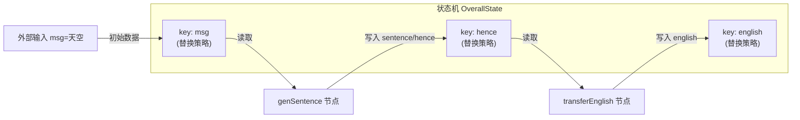

# 3-4 配置大模型参数与定义节点、边

## 【学习目标】

- 独立完成 Spring AI Alibaba 工程的模型参数配置：API-Key、OpenAI 兼容 `base-url`、模型名三者的落位与写法。
- 理解 `KeyStrategyFactory` 与 `ReplaceStrategy` 的职责：声明状态机里有哪些 key、每个 key 用什么合并策略。
- 掌握 `StateGraph` 两参构造的含义，能用 `NodeAction` + `AsyncNodeAction.node_async` 定义节点，并弄清 `ChatClient` 为什么必须走 `ChatClient.Builder` 注入。
- 提前认清流式输出收集（`Flux` + `blockFirst`/`blockLast`）的隐藏陷阱，避免复现「模型原封不动返回输入」的事故。

## 【正文】

### 一、配置大模型参数：OpenAI 兼容端点

课程演示使用通义千问（Qwen）作为底层模型，因此需要先去阿里云官网申请 API-Key：打开阿里云并登录，搜索「大模型服务平台百炼」，进入后点击「模型服务」，找到「密钥管理」，在其中创建 API-Key，创建完成后把 Key 复制出来，放进配置文件。注意 YAML 语法要求冒号后面必须带一个空格，否则解析会直接报错。

`base-url` 的写法是：进入模型广场，选择通义千问 Qwen3-max，页面往下翻能看到 OpenAI 兼容调用地址。将该地址里的 `v1` 去掉，Spring AI 的 OpenAI 客户端会自动拼接 `/v1`，多写一层反而导致 404。`base-url` 既可以放在 `chat` 节点下，也可以挪到 `spring.ai.openai` 外层，两种写法等价，集中放外层更利于多模型场景统一切换。

模型本身通过 `chat` 节点下的 `options` 定义，比如指定 `model` 名称，从模型详情页直接复制即可。核心配置如下：

```yaml
spring:
  application:
    name: simple-ai-alibaba-demo
  ai:
    openai:
      api-key: sk-e836ecd744a14cncca23c7d06b09d1f1f
    chat:
      base-url: []
```

如实说明转录稿中的两处问题，避免照抄踩坑：其一，`api-key` 是课程录制时展示的密钥，早已失效，且生产工程绝不能把真实 Key 提交进仓库，必须走环境变量或配置中心（本课配套工程 `980-demo` 即用 `${ENV}` 占位，见后文「小结」）；其二，`base-url: []` 是转录稿留下的占位符，实际应填去掉 `/v1` 后的完整端点 URL。

此外要理解这条链路的生产含义：Spring AI Alibaba 的 Graph 模块复用了 Spring AI 的模型抽象，`ChatClient`/`ChatModel` 与具体厂商解耦，换成 DeepSeek、智谱或本地 Ollama 时只改 `base-url`、`api-key`、`model` 三项，节点代码一行不动。后面章节会讲企业内部私有化部署，届时不可能再用第三方云端模型，数据安全没有保证，现在的配置仅作演示。

### 二、包结构与启动类

使用之前先搭好目录结构：定义一个基础包（课程中为 `ai.alibaba.demo`），把 Spring Boot 启动类放进去，加上启动注解，主方法保持标准写法。启动类就绪后，即可开始按 Dify 的编排思路写代码，先定义图的结构，再逐个补节点和边。

### 三、KeyStrategyFactory：声明状态机的 key 与合并策略

在 `config` 包中新建配置类 `TestGraphConfig`，加 `@Configuration` 注解使其被 Spring 扫描进 IOC 容器。定义图之前，先要定义 key 的策略工厂。

`KeyStrategyFactory` 是一个函数式接口，返回一个 `Map`：key 是状态机中存放数据的字段名，value 是该字段的合并策略。按 Dify 的编排，需要至少三个 key：用户输入的单词、第一个节点生成的句子、第三个节点翻译出的英文。三个 key 全部使用替换策略（`ReplaceStrategy`），语义是「新数据覆盖老的数据」：

```java
@Configuration
public class TestGraphConfig {
    @Bean
    public KeyStrategyFactory keyStrategyFactory() {
        return Map.of(
            "msg", new ReplaceStrategy(),
            "hence", new ReplaceStrategy(),
            "english", new ReplaceStrategy()
        );
    }
}
```

如实说明：正文叙述中三个 key 依次为 message、sentence、english，而代码块里第二个 key 写作 `hence`，两者不一致，属于转录稿的命名出入；实际编写时任选一套统一命名即可，但节点读取与写入必须与这里的声明严格对应，否则状态机里取不到值。策略为什么选「替换」：每个节点产出的都是完整结果（整句、整段译文），后一次输出理应整体覆盖前一次，而不是拼接。



### 四、StateGraph 的两参构造与节点定义

`StateGraph` 的构造方法有多个重载，本节使用两个参数的版本：第一个参数是图的名字（如「testGraph」），第二个参数是刚刚定义的 `KeyStrategyFactory`。

向图中添加节点用 `addNode` 方法，它有两个参数：第一个是节点名，推荐用英文（中文不会报错，但不利于排查），如 `genSentence`；第二个是异步执行的 `NodeAction`。`AsyncNodeAction` 提供了静态方法 `node_async`，把同步的 `NodeAction` 包装成异步执行；`NodeAction` 本身是函数式接口，核心方法是 `apply(OverallState state)`，返回一个 `Map` 表示本节点要写入状态机的数据。

第一个节点的逻辑是「根据用户输入的单词生成一句话」。新建 `nodes` 包，写节点类 `GenSentencNode` 实现 `NodeAction`。注意 `ChatClient` 的注入方式：它不是一个普通 bean，无法通过 `@Resource`/`@Autowired` 注入，必须以 `final` 字段 + 构造参数的形式从 `ChatClient.Builder` 传入（这一点在 3-5 启动报错时还会再次验证）。

节点内部先通过 `state.value(key, defaultValue)` 从状态机取出用户输入，再调用 `chatClient.prompt(...)` 让模型生成句子。模型走流式返回（`Flux<String>`），需要把分片内容收集起来：定义一个 `StringBuilder`，用 `doOnNext` 逐段追加，最后用 `blockFirst`/`blockLast` 阻塞等待流结束，把结果写入状态机。课程现场依次写了两版代码，都如实保留：

```java
public class GenSentencNode implements NodeAction {
    private final ChatClient chatClient;

    @Override
    public Map<String, Object> apply(OverallState state) throws Exception {
        String msg = state.value(key: "msg", defaultValue: "");
        chatClient.prompt("生成一个句子：{msg}")
            .stream().content()
            .collect(Collectors.joining());
        return Map.of("sentence", sb.toString());
    }
}
```

```java
@Override
public Map<String, Object> apply(OverallState state) throws Exception {
    String msg = state.value(key: "msg", defaultValue: "");
    chatClient.prompt("生成一个句子：{msg}")
        .stream().content()
        .doOnNext(c -> sb.append(c))
        .blockFirst();
    return Map.of("sentence", sb.toString());
}
```

如实说明转录稿中的几处问题，不要照抄：第一版是中间稿，`sb` 没有声明，`Collectors.joining()` 的结果也没有赋给任何变量，等于白收集；第二版补上了 `doOnNext` 追加逻辑，但仍缺 `StringBuilder sb = new StringBuilder();` 的声明，且 `state.value(key: "msg", defaultValue: "")` 里的 `key:` 前缀是转录稿 artifact，Java 没有命名实参语法，实际写法是 `state.value("msg", "")`。另外 `blockFirst` 在这里是错的，它只等第一个分片就返回，必须改成 `blockLast` 才能拿到完整句子，3-5 会演示由此引发的「模型原样返回输入」故障。

### 五、第二个节点：翻译成英文

第二个节点与第一个结构相同：复制节点类并改名 `TransferEnglishNode`，区别在于读取的来源不是用户输入，而是上一个节点写入状态机的句子；提示词改为「根据输入的句子翻译成英文」，最终返回的 key 是 `english`。向图中添加该节点同样借助 `AsyncNodeAction.node_async` 包装，`ChatClient.Builder` 在配置类中通过 `@Resource` 注入后再传给节点构造函数。至此两个节点创建完成，边的定义放到下一节。

## 【易错点 / 面试题】

1. **面试题：`ChatClient` 为什么不能 `@Resource` 注入，必须用 `ChatClient.Builder`？** 答：Spring AI 的自动装配产出的不是单个 `ChatClient` bean，而是 `ChatClient.Builder`（builder 模式，由自动配置的 `ChatModel` 构建）。直接按类型注入 `ChatClient` 会启动报「找不到 bean」，把 builder 注入进来再 `build()` 才是官方姿势。同一姿势在本课配套工程 `980-demo/src/main/java/com/carl/ai/transfer/extract/TransferOrderExtractor.java` 的构造器中可以看到。
2. **面试题：流式收集大模型输出，`blockFirst` 和 `blockLast` 差在哪？** 答：`blockFirst` 只阻塞到拿到第一个分片，用它收集整句只会得到开头几个字（表现为「输入什么就返回什么」）；`blockLast` 会等流自然结束，拿到完整内容。生产环境更推荐 `Flux.collectList()` 或 `reduce` 聚合，避免手动维护 `StringBuilder`。
3. **易错点：key 名前后不一致。** `KeyStrategyFactory` 声明的 key、节点写入的 key、节点读取的 key 是三处独立代码，任何一处拼错都不会报编译错，只会表现为「状态机里没数据」。建议把 key 收敛成常量类，杜绝魔法字符串。

## 【小结】

本节完成了「模型参数配置 → 状态机 key 策略 → 节点定义」三件套：YAML 里摆好 OpenAI 兼容端点的三要素；用 `KeyStrategyFactory` + `ReplaceStrategy` 声明状态机的 key 与新覆盖旧的合并语义；用 `NodeAction` + `AsyncNodeAction.node_async` 挂载调用 `ChatClient` 的业务节点。边（Edge）与 `compile()` 编译在 3-5 收尾，之后图才真正可执行。

想看到「离线可跑、双 profile 切换」的同款配置，见配套工程 `980-demo/src/main/java/com/carl/ai/transfer/config/ChatModelConfig.java`：`transfer.offline=true` 时装配 `OfflineChatModel` 返回固定 JSON，`transfer.offline=false` 时按 `transfer.llm.base-url/model/api-key` 接真实端点，正是本节 YAML 的生产化写法；`ChatClient.Builder` 构造注入的范例见 `980-demo/src/main/java/com/carl/ai/transfer/extract/TransferOrderExtractor.java`。
