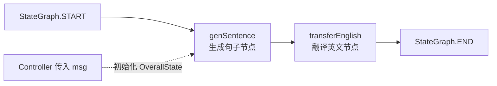

# 3-5 节点与边定义及实操演示

## 【学习目标】

- 用 `addEdge` 把 `START` → 业务节点 → `END` 连成完整流程，理解 source id / target id 的含义。
- 掌握 `compile()` 的作用：未编译的 `StateGraph` 只是图纸，编译后的 `CompiledGraph` 才可执行。
- 能在 Controller 中初始化状态机数据、调用图并取出 `OverallState` 返回前端。
- 复现并根治两个真实故障：`ChatClient` 注入失败、流式收集用错 `blockFirst`。

## 【正文】

### 一、添加边：把节点连成流程

图的节点就绪后，用 `addEdge(source, target)` 添加边，两个参数都是节点 id（也可理解为节点名），语义是「由哪一个节点流向哪一个节点」。本节编排共三条边：

1. `StateGraph.START` → `genSentence`：框架内置的静态常量，表示开始节点，无需自定义；
2. `genSentence` → `transferEnglish`：生成句子节点流向翻译节点；
3. `transferEnglish` → `StateGraph.END`：框架内置的结束节点常量。

开始与结束节点由框架提供常量，业务只关心中间部分，这与 Dify 中「开始/结束节点不用管」的编排体验一致。

### 二、编译：StateGraph → CompiledGraph

图定义好之后还不能用，`StateGraph` 只是结构描述，必须调用 `compile()` 生成 `CompiledGraph` 才能执行。因此定义图的 bean 方法返回类型从占位的 `void` 改为 `CompiledGraph`：

```java
@Configuration
public class TestGraphConfig {
    @Bean
    public CompiledGraph testGraph() throws Exception {
        KeyStrategyFactory keyStrategyFactory = new KeyStrategyFactory();
        keyStrategyFactory.apply();
        StateGraph testGraph = new StateGraph("testGraph", keyStrategyFactory);
        testGraph.addNode("genSentence", AsyncNodeAction.node_async(new GenSentencNode(chatClientBuilder)));
        testGraph.addNode("transferEnglish", AsyncNodeAction.node_async(new TransferEnglishNode(chatClientBuilder)));
        testGraph.addEdge(StateGraph.START, "genSentence");
        testGraph.addEdge("genSentence", "transferEnglish");
        testGraph.addEdge("transferEnglish", StateGraph.END);
        return testGraph.compile();
    }
}
```

如实说明：这段代码是课程现场的速写稿，`new KeyStrategyFactory()` 后直接 `apply()` 并不是完整写法，函数式接口的 `apply` 需要返回 `Map<String, KeyStrategy>`，正确形态就是 3-4 中已经写好的工厂 bean；`chatClientBuilder` 也没有在片段中声明注入，实际应由配置类持有。把握主干即可：**先声明 key 策略，再建图，再加节点，再加边，最后 compile**。



### 三、Controller 调用：初始化状态、执行、取结果

新建 `controller` 包，定义 `TestController` 加 `@RestController`。把编译好的 `CompiledGraph` 注入进来，写一个 GET 接口，用 `@RequestParam` 接收用户传来的单词。调用图的 `call` 方法传入初始状态（状态机的 key-value Map），只有用户输入先落进状态机，后续节点才拿得到。执行后通过 `get` 拿到 `OverallState`，其 `data()` 静态方法/`data` 属性即为状态机中的全部数据，直接作为 Map 返回前端：

```java
@RestController
public class TestController {
    @Resource
    private CompiledGraph testGraph;

    @GetMapping("/test")
    public void test(@RequestParam String msg) {
        OverallState overallState = testGraph.call(msg, msg);
        // 返回结果
    }
}
```

如实说明：`testGraph.call(msg, msg)` 传了两个相同的字符串，第一个参数按 `CompiledGraph` 的签名应是初始数据 Map，正确写法是 `testGraph.call(Map.of("msg", msg))`；返回类型也应从 `void` 改为 `Map<String, Object>`，取 `overallState.data()`。课程视频中正是边写边发现了这两处问题，转录稿保留了修正前的手稿。

### 四、现场排错一：ChatClient 注入失败

启动即报错：提示 `chatClient` 没有发现，说明它没有自动装配上。原因是 Spring AI 的自动装配 POM 走的是 builder 机制，产出的 bean 是 `ChatClient.Builder` 而非 `ChatClient` 本体，`@Resource` 按类型找不到。修法：改用 `ChatClient.Builder`（即 `chatClientBuilder`）注入，再在节点构造时传进去。改完后服务正常启动，监听 8873 端口。

### 五、现场排错二：blockFirst 导致「原样返回」

调用 `localhost:8873/test?msg=天空`，返回的 message 和 english 都是「天空」，句子没有生成。在节点里打印调试信息后重启，确认节点拿到的输入是「天空」，但输出原封不动。问题出在收集流式输出的 `blockFirst`：它只等待第一个分片，句子刚开头就返回，调试稿如下：

```java
public class GenSentencNode implements NodeAction {
    @Override
    public Map<String, Object> apply(OverallState state) throws Exception {
        StringBuilder sb = new StringBuilder();
        sb.append("天空");
        content.doOnNext(c -> sb.append(c)).blockFirst();
        System.out.println("sentence:" + sb.toString());
        return Map.of("sentence", sb.toString());
    }
}
```

如实说明：这是为了定位问题临时加的调试稿，`content` 变量没有声明，真实代码里应是 `chatClient.prompt(...).stream().content()` 的返回值；`sb.append("天空")` 是临时打印残留。真正的问题是 `blockFirst`：改成 `blockLast`，等流式输出自然结束后再取完整内容，两个节点同步修改，重启后链路恢复正常：输入「天空」，生成「天空湛蓝如洗，几朵白云悠然飘过」，译文与 Dify 演示一致，最终 `OverallState` 中三个 key 齐整返回。

```java
public class TransferEnglishNode implements NodeAction {
    @Override
    public Map<String, Object> apply(OverallState state) throws Exception {
        String sentence = (String) state.get("sentence");
        String translated = translate(sentence);
        return Map.of("sentence", translated);
    }
}
```

如实说明：该片段是课程手稿的简写，`translate` 方法未在片段中给出，实际应为一次 `ChatClient` 调用；注意最后返回的 key 写成了 `sentence`，而按 3-4 的策略工厂声明，译文应写入 `english`，否则会覆盖上游节点写入的句子。这两处按前述完整逻辑修正后即可对齐 Dify 编排效果。

### 六、全流程回顾

整个图分三部分：预定义状态机 key 及替换策略；定义节点（实现函数式接口 `NodeAction`，借 `AsyncNodeAction.node_async` 异步执行，节点内部声明自己要干什么）；定义边（把节点按流程连起来）。最后用 Controller 初始化输入、调用、取结果，完成一次「单词 → 句子 → 英文」的最小闭环。

## 【易错点 / 面试题】

1. **面试题：`StateGraph` 和 `CompiledGraph` 的关系是什么？** 答：`StateGraph` 是可变的图纸（可不断 `addNode`/`addEdge`），`CompiledGraph` 是编译后的不可变执行体，线程安全、可被多个请求并发 `call`。企业里通常把编译产物作为单例 bean，像 `TestController` 那样共享；每请求编译一次会带来无谓开销与竞态。
2. **面试题：为什么 `call` 的入参要是 Map？** 答：Map 就是状态机的初始 key-value，节点的读取全部基于它。入参缺 key，节点只能拿到默认值（如空串），表现为「模型收到空提示词」或「原样回显」，且不报错，这类静默故障要靠打印中间状态排查。
3. **易错点：流式收集用 `blockFirst`。** 这是本课现场踩过的坑：不报错、有返回，但内容只有第一个分片。收集完整输出用 `blockLast` 或 `collectList()`；同时警惕把上游写入的 key 被下游误覆盖（`ReplaceStrategy` 下同名 key 后写覆盖先写）。

## 【小结】

本节补齐了 3-4 的图定义：三条边串起 `START → genSentence → transferEnglish → END`，`compile()` 产出可执行的 `CompiledGraph`，Controller 完成「初始化状态 → 调用 → 取 `OverallState.data()`」的闭环，并现场排除了 `ChatClient.Builder` 注入与 `blockFirst` 两个故障。至此第三章「用 Spring AI Alibaba Graph 编排最小工作流」的主线已经打通，第四章起把它升级为「会思考的智能库存调拨优化系统」的企业级工程。

与该小节对应的生产级参考实现见 `980-demo`：`src/main/java/com/carl/ai/transfer/agent/TransferAgent.java` 展示了 `ChatClient` + 工具节点 + 状态机编排的组合，`src/main/java/com/carl/ai/transfer/controller/TransferController.java` 复刻了「接口层触发工作流」的入口写法。
