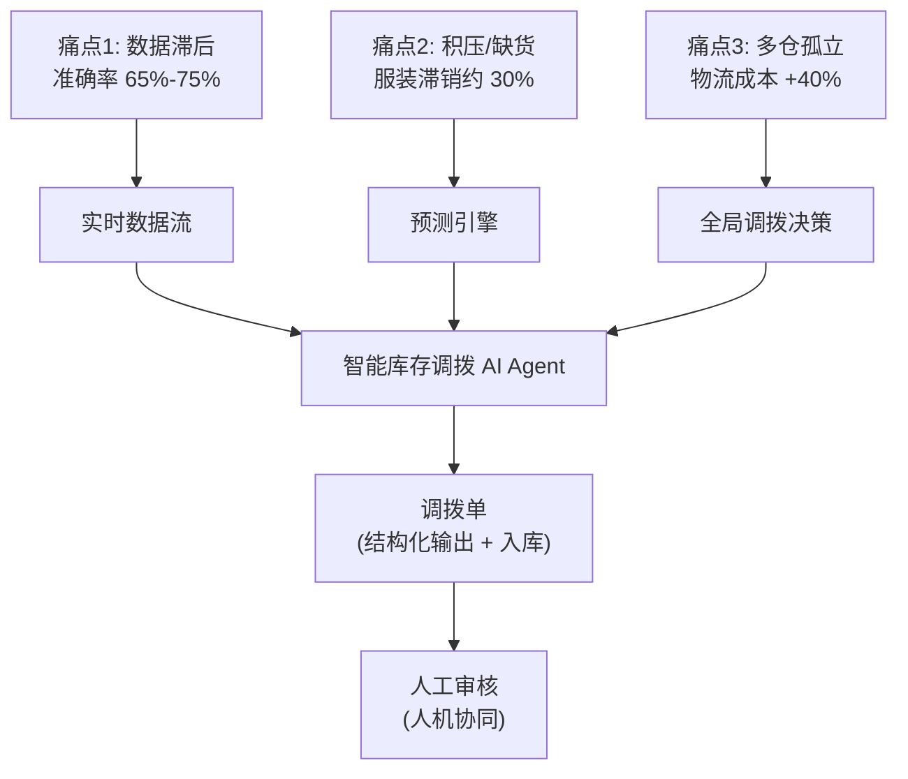

# 4-1 从痛点出发的架构思维

## 【学习目标】

- 说清传统库存调拨系统的三大痛点及其数据根因，能把「数据与决策的困境」讲成面试里的业务分析案例。
- 理解人工预测为什么无法解决实时性问题，尤其是 24 小时连续售卖与退货两类场景。
- 建立「痛点 → 能力 → 系统设计」的架构推导习惯：每一个功能点都能回溯到一个具体业务痛点。

## 【正文】

### 一、进入实战篇：智能库存调拨优化系统

经过前三章的铺垫（工作流三条道路、Graph 核心三要素、Spring AI Alibaba Graph 的最小编排），本章正式进入代码实战：打造「会思考的智能库存调拨优化系统」。动工之前先做业务蓝图设计，从痛点出发进行架构思维。

先思考一个问题：传统库存调拨系统的问题在哪里？本节给出一条分析思路：传统库存系统的痛点可以归结为「数据与决策的困境」，集中在三点。

### 二、三大痛点

**痛点一：数据滞后，准确率低。** 传统系统的库存调拨数据更新缓慢，导致决策依据过时，调拨决策的准确率通常仅在 65% 到 75%。换句话说，每四次调拨决策里大约有一次是错的，而错误的调拨直接转化为运费与资金占用。

**痛点二：库存积压或缺货。** 供需预测偏差大，常导致库存积压，服装行业滞销占比高达 30%，或者是关键商品缺货。积压与缺货是一对镜像问题：预测拍脑袋往左偏，仓库堆满滞销品；往右偏，货架卖空、错失销售窗口。

**痛点三：多仓库管理孤立。** 各仓库系统管理独立，数据不能及时互通，导致资源调配困难，物流成本因此增加 40%。单仓视角的「本地最优」叠加起来，往往是全局次优：A 仓积压的 SKU，可能正是 B 仓的断货款，但两个系统数据不打通，谁都看不到对面。

三条痛点串起来看，根子是同一个：**决策依赖的数据是滞后的、割裂的、人工解读的**。

三条痛点之间还存在传导关系：数据滞后（因）→ 预测偏差（果）→ 积压与缺货（果的果）→ 各仓各自为战、重复备货（放大器）→ 物流成本上升（最终账单）。做架构分析时要学会画这条链，它决定了改造的切入点：链条的源头是数据，所以系统的第一步不是接模型，而是把实时数据流打通（第五章的商品数据流与库存数据流）；模型只是链条中段的「决策器」。反过来先接模型、后补数据，得到的是一个「用陈旧数据做快速错误决策」的系统，比没有系统更危险。

### 三、人工分析为什么救不了场

一些公司的解法是招专人做预测和分析：让市场部或营运部的人员根据商品销售情况、库存情况人工分析，生成库存调拨单。这条路线有两个绕不开的问题。

第一，人力成本高。需要找一个较专业的人，实时查看、实时分析，这是一笔持续性的人力资源投入。

第二，数据依然不及时。原因在于业务是 7×24 的：一个商品可能一直在售卖，一天 24 小时内的任何时刻都可能发生售卖，一旦发生售卖库存就减少，换言之任何时刻都可能触发库存变化。即使安排专人盯盘，也无法做到真正的实时分析，数据滞后性依旧存在，积压和缺货依旧可能发生。

此外，业务不只有销售，还有退货。退货同样导致商品库存修改，同样影响调拨判断，人工盯「销售出库」尚且力有不逮，再叠加「退货入库」的逆向流，实时分析的难度进一步放大。

### 四、AI Agent 的价值主张

正是基于上述痛点，才引入智能库存管理的 AI Agent。它的价值不是「炫技」，而是逐条对打痛点：

| 痛点 | 传统方式 | AI Agent 方式 |
|---|---|---|
| 数据滞后、准确率低（65%–75%） | T+1 离线报表、人工解读 | 实时数据流接入，模型持续分析 |
| 库存积压 / 缺货（服装滞销约 30%） | 经验预测、供需偏差大 | 基于实时库存与历史销售的量化建议 |
| 多仓库孤立（物流成本 +40%） | 各仓系统独立、数据不互通 | 全局视角的跨仓调拨建议 |
| 人力成本 | 专人盯盘、实时分析 | 7×24 自动生成调拨单，人只做审核 |

具体而言，这套系统可以尽可能地减少数据滞后性，尽可能减少库存积压与缺货，可以统一管理多个仓库的库存，并做到较好的实时性数据分析。注意「尽可能」三个字，这是架构上的诚实：LLM 输出有概率波动，因此系统保留人工审核环节（后续「人机协同」章节展开），把「AI 生成建议、人类把关执行」作为默认链路，而不是全自动放行。

「会思考」三个字拆开是四步：会读数据（实时数据流）、会推理（大模型 + 提示词工程）、会产出（结构化调拨单）、会划清责任边界（人工审核）。四步合起来才构成生产级 Agent，缺任何一步都会退化，只读不推是报表，只推不产是聊天框，只产不审是裸奔。

### 五、从痛点到模块的推导

「痛点 → 能力」的推导直接决定了系统骨架：要治数据滞后，就需要实时数据流（商品数据流、库存数据流）；要生成调拨建议，就需要接大模型的预测引擎，并把模型输出转成可落库的结构化数据；要让建议真正生效，就需要调拨单主表/明细表与库存变动日志；要控风险，就保留人工审核节点。这正是后续章节的顺序：数据建模（4-4）→ 状态机定义（5-1）→ 各数据流（5-2 至 5-5）→ 预测引擎（5-6）→ 提示词优化（5-7、5-8）→ JSON 提取与入库（5-9、5-16）→ 人机协同（第六章）。

这种「每个功能点都能回溯到痛点」的架构叙述，也是面试中讲项目的高分结构：先讲业务困境与量化损失，再讲技术方案如何逐条回应，最后用数据验证效果。

### 六、双 Agent 系统的定位

本节聚焦智能库存调拨优化系统，但父工程命名为 `Double-AI-Agent`，一个系统中集成两个 AI Agent（4-2 详解工程搭建）。先明确该定位：多 Agent 协同不是本章重点，但架构上要预留位置。两个 Agent 各自独立编排、各自持有状态机，同时共享同一套基础能力（统一响应体、数据访问层、模型配置）。这种「编排独立、底座共享」的形态，正是「父工程 + 多业务子模块」结构的存在理由：每个 Agent 一个业务模块，公共能力下沉 `ai-common`，版本与依赖在父层统一治理。后续每个工程决策都可以放到该坐标系里检验：它服务的是某个 Agent 的独有逻辑，还是所有 Agent 的公共底座，这决定了代码该放业务模块还是通用模块。

## 【易错点 / 面试题】

1. **面试题：为什么不用传统规则引擎（阈值 + 定时任务），非要上大模型 Agent？** 参考答法：规则引擎只能表达「库存低于 X 就补货」这类单点阈值，无法综合销售趋势、多仓分布、商品关联等模糊语义；LLM 的价值在于把非结构化需求（运营人员一句话）和结构化数据（实时库存、历史销售）放在一起推理，生成可解释的调拨单。但 LLM 不是银弹，输出必须经结构化抽取（`BeanOutputConverter`/`call().entity()`）与人工审核兜底，这就是本课程把「JSON 提取」和「人机协同」单独设章的原因。
2. **面试题：65%–75% 的准确率、30% 滞销、40% 物流成本这些数字哪来的？** 它们来自课程对行业现状的概括性描述，用于量化痛点、支撑立项叙事。面试中引用这类数字时应主动说明是「行业调研/经验口径」，落到自己的项目则必须换成自己系统的前后对比指标（如调拨单生成耗时、人工审核通过率），切忌把课程数字说成自己项目的实测结果。
3. **易错点：把「尽可能减少滞后」讲成「完全实时」。** 再快的链路也有采集、传输、推理延迟，面试官追问「到底多实时」时，应给出链路各环节的量级（数据流间隔、模型响应时间），而非停留在概念。
4. **面试题：系统保留了人工审核，是否说明 AI 不可靠？** 参考答法：恰恰相反，这是生产级 Agent 与演示 Demo 的分界线。LLM 输出具有概率性，库存调拨又直接关联资金与实物，生产链路必须给人类留否决权。可展开的点有三层：其一，审核是工作流中的普通节点，第六章「人机协同」会讲「审核 → 对话召回 → 工作流激活」的全链路；其二，审核结果可以回流，成为后续评估与提示词优化的素材（11-8 的「评估-循环-微调」三件套）；其三，界面展示应把「模型建议 + 数据依据」一并给出，审核者的决策成本才够低。

## 【小结】

本节是第四章的总纲：传统库存系统的三大痛点，数据滞后（准确率 65%–75%）、积压/缺货（服装滞销约 30%）、多仓孤立（物流成本 +40%），加上人工预测在 7×24 售卖与退货场景下的无力，共同构成引入 AI Agent 的业务依据；而 Agent 的价值定位是逐条回应痛点，并以人工审核兜底概率风险。这套「痛点 → 能力 → 模块」的推导，将直接映射为后续章节的工程结构。

想看到痛点如何最终落成代码，可对照配套工程 `980-demo`：`src/main/java/com/carl/ai/transfer/agent/TransferAgent.java` 是「自然语言 → 调拨单」的 Agent 编排，`src/main/java/com/carl/ai/transfer/extract/TransferOrderExtractor.java` 负责把模型输出结构化为 `TransferOrderParam`，`src/main/java/com/carl/ai/transfer/repository/BbTransferOrderRepository.java` 完成落库，实时数据进、结构化单据出、人机审核留口，正是本节蓝图的最小闭环。
