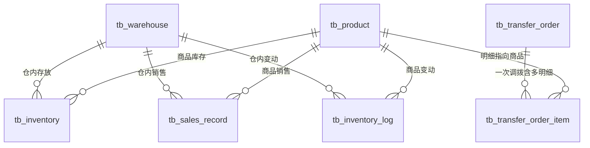

# 4-4 数据建模：核心数据库实体设计

## 【学习目标】

- 记住智能库存调拨优化系统的七张核心表及其字段构成，说清每张表服务哪条业务流。
- 理解两个关键设计取舍：销售表为什么不设更新时间、调拨单为什么必须保留创建人与审核人。
- 掌握主从表（调拨单主表 + 明细表）的拆分逻辑，以及 `tb_` 前缀 + 审计字段的命名与审计规范。
- 理解「AI 分析依赖哪几张表」的数据视角，为后续预测引擎的取数逻辑打基础。

## 【正文】

### 一、表结构总览与命名规范

本节讲解智能库存调拨优化系统的表结构设计，这是开发的前置准备工作。系统定义了若干张表，都是常见 ERP 系统都会有的数据表。所有业务单据相关的表都以 `tb` 开头，表示业务相关，前缀规范的价值在于把业务表与配置表、日志表、字典表在命名层面区分开，后续写 SQL、配权限、做数据迁移时一目了然。

| 表名 | 用途 | 关键字段 |
|---|---|---|
| `tb_warehouse` | 仓库主数据 | 仓库编码、仓库名称、位置、负责人、状态 |
| `tb_product` | 商品主数据 | 商品编码、商品名称、规格型号、计量单位、商品分类 |
| `tb_sales_record` | 商品销售流水 | 仓库 id、商品 id、销售日期、销售数量、销售金额 |
| `tb_inventory` | 仓内库存现状 | 仓库 id、商品 id、当前库存数量、当前锁定库存数量 |
| `tb_transfer_order` | 调拨单主表（一次调拨行为） | 调拨单号、出库仓库、入库仓库、状态、调拨类型、创建人、审核人 |
| `tb_transfer_order_item` | 调拨单明细 | 主表 id、商品 id、调拨数量、实际到货数量、备注 |
| `tb_inventory_log` | 库存变动日志 | 仓库 id、商品 id、变动类型、变动数量、关联单据号 |

审计字段方面有一条总体策略：创建时间、更新时间在很多表里是默认字段，因为业务表通常都会涉及创建时间、创建人、更新时间、更新人。本系统把创建人和创建时间保留，其余省略，因为这里只进行 AI Agent 的开发，不会具体涉及整个 ERP 系统的编写（入库、出库、销售等原有 ERP 业务不详细展开）。字段裁剪的依据是「当前系统是否真的会写这些字段」：没人维护的字段等于脏数据温床。

### 二、七张表逐一拆解

**仓库表 `tb_warehouse`**：id、仓库编码、仓库名称、位置（如华北仓、华东仓、华南仓，即仓所在的地域）、负责人、状态，以及创建时间和更新时间。位置字段是「多仓调度」的空间维度，调拨建议的本质就是在地理维度上重新分配库存。

**商品表 `tb_product`**：id、商品编码、商品名称、规格型号、计量单位、商品分类、状态，以及创建时间和更新时间。商品分类是预测粒度的控制开关，按品类聚合看趋势，还是按 SKU 精细看，决定了后续提示词与取数口径。

**销售表 `tb_sales_record`**：id、仓库 id、商品 id、销售日期、销售数量、销售金额，以及创建时间。**为什么没有更新时间？** 因为销售一般都是一次性的，销售一次就记录一次，不存在更新这一说；对每一次销售而言它只属于一次创建过程，不会有更新，所以不定义更新时间。该取舍是审计字段设计的典范：字段跟着「数据会不会被改」走，而不是机械地全套复制。

**库存表 `tb_inventory`**：记录每个仓库中每种商品的库存数，字段为仓库 id、商品 id、当前库存数量、当前锁定的库存数量，还有更新时间。「锁定库存」字段常被初学者漏掉：已下单未出库的货物理上还在仓里，但已不可调，调拨建议必须基于「可用量」而非「账面量」，否则会超卖。

**调拨单主表 `tb_transfer_order`**：记录一次调拨行为，字段含调拨单号、从哪个仓库出库、要到哪个仓库（即入库仓）、状态信息、调拨类型、调拨时间、说明、创建人，以及审核人和创建时间、更新时间。**创建人和审核人这两个字段不能省略**，因为调拨肯定和人相关：需要知道是谁创建的、谁审核的，这是要追溯责任的。这正是 AI Agent 产出的落点，模型生成调拨建议，人审核拍板，两个字段把「机器建议」与「人类决策」的责任边界写进了 schema。

**调拨单明细表 `tb_transfer_order_item`**：主表记录一次调拨行为，而这一次调拨可能涉及多个商品的调拨，或者同一商品在多个仓库之间的调拨，这些信息放进明细表：主表 id、商品 id、调拨数量、实际到货数量、备注。「实际到货数量」与「调拨数量」分立，是为在途差异留出记录位，运输损耗、分批发货都会让两者不等，这是从「计划」到「事实」的常见设计。

**库存变动日志表 `tb_inventory_log`**：记录库存的变动情况，字段为仓库 id、商品 id、变动类型（入库还是出库，还是调拨出库、调拨入库）、变动数量、关联单据号、创建时间、备注。这里的入库可以理解成进货，出库可以理解成销售即销售出库；入库也可能是退货入库，再加上销售出库、调拨出库、调拨入库，还可以进一步细分。变动类型是枚举化的动作语义，配合「关联单据号」回链到具体业务单据，库存数字的任何一次跳动都能回答「因为哪张单、因为什么动作」。

### 三、ER 关系与核心数据视角

七张表中比较核心的是三张：商品的销售数据表、商品的库存表、商品的调拨信息表，因为需要基于这些表让大模型进行分析。所谓「核心三表」的判断标准值得记住：AI 预测引擎的取数链路是「历史销售（tb_sales_record）→ 当前库存（tb_inventory）→ 生成调拨（tb_transfer_order + item）」，其余表或为主数据（仓库、商品），或为流水凭证（库存日志），服务的是可解释与可追溯，而不是预测本身。

### 四、数据初始化：让演示有血有肉

表建好后需要灌入初始数据。课程提供了 SQL 脚本，拿到资料后直接复制粘贴运行即可，也可以按自己的要求修改。

为什么要预置数据？因为没有实现一套完整的 ERP 系统，销售、进货、出货、退货这些都没有实现，所以需要预先初始化一批数据，系统才有「现状」可分析。

脚本的构造逻辑：

1. 仓库表插入三条数据，对应三个仓库；
2. 创建一批商品，并为这些商品创建库存信息；
3. 模拟过去三年每个季度的销售数据，从 2023 年 1 月 1 日到 2025 年 12 月 31 日这三年的销售数据，模拟的销售数量通过 `rand` 函数生成随机数；
4. 创建调拨单主表数据：模拟每个季度进行一次调拨，插入时随机插入调拨单数据，并排除掉相同的仓库（自己不能调拨给自己），这里用到一些 SQL 写法，同样使用大量 `rand` 随机数函数；
5. 创建调拨明细，再插入一些库存变动日志。

如果想模拟更多数据，不必局限于提供的脚本：可以把数据结构告诉 ChatGPT 或 DeepSeek，让它帮忙写一个造数脚本再执行，取决于自己的需要。但要清楚两种选择的后果，使用课程提供的 SQL，后续演示的运行结果会和课程代码效果非常相像，便于验证自己做对了没有；自己让大模型生成数据，演示过程中的结果可能不太一样。两种方案都可以，关键是知道差异来自数据而非代码。

## 【易错点 / 面试题】

1. **面试题：销售表为什么没有更新时间？调拨单为什么必须有审核人？** 答：前者因为销售流水是一次性事实数据，只增不改，更新时间是无意义字段；后者因为调拨涉及真金白银的库存移动与责任归属，AI 生成建议后必须有人审核拍板，创建人 + 审核人是追溯链的两端。面试官问这类题，想听的是「字段设计跟着数据生命周期与业务责任走」的判断力。
2. **面试题：主从表怎么拆，什么情况该拆？** 答：当「一次业务行为」包含多个同质条目（一次调拨多个商品）时，主表存行为级信息（单号、仓库、状态、人员），明细表存条目级信息（商品、数量）。不拆会让表出现重复组违背第一范式，拆了则要接受 JOIN 查询成本，本系统调拨单与明细正是一对多。
3. **易错点：把「锁定库存」当普通字段漏掉。** 只记当前库存不记锁定库存，调拨建议会把已下单未出库的量算成可调量，直接引发超卖。可用量 = 当前库存 - 锁定库存，该口径要在文档与代码注释里写死。

## 【小结】

本节完成数据库层设计：七张表覆盖主数据（仓库、商品）、流水（销售）、现状（库存）、业务单据（调拨主从表）与凭证（库存变动日志），以 `tb` 前缀与审计字段策略保证规范，用「销售表无更新时间、调拨单必有审核人」两个取舍示范了字段设计跟着数据生命周期与业务责任走的原则。核心三表（销售、库存、调拨）构成后续 AI 预测引擎的取数基础，预置 SQL 则让演示数据与课程效果对齐。

配套工程 `980-demo` 复刻了调拨相关实体：`src/main/java/com/carl/ai/transfer/domain/model/BbTransferOrder.java` 对应 `tb_transfer_order` 主表（JPA 实体 + H2，字段与课程一致），`src/main/java/com/carl/ai/transfer/domain/model/BbTransferOrderItem.java` 对应明细表，`src/main/java/com/carl/ai/transfer/repository/BbTransferOrderRepository.java` 负责落库查询；与之配合的 `src/main/java/com/carl/ai/transfer/domain/param/TransferOrderParam.java` 则是「模型输出 → 接口入参」的传输层，model 对表、param 对契约，正是 4-3 分层目录的直接落地。
