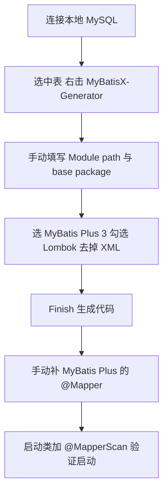

# 4-5 使用代码生成器进行通用业务组件开发

## 【学习目标】

- 独立完成 `ai-transfer` 库表初始化，理解字符集与时区配置对数据正确性的影响。
- 掌握 MySQL 驱动 + MyBatis Plus 的依赖引入方式与 `application.yml` 数据源配置。
- 熟练使用 MyBatisX-Generator 生成通用业务组件，并能修复生成结果的常见缺失。
- 分清 MyBatis Plus `@Mapper` 与 MyBatis `@Mapper`，避免启动报错。

## 【正文】

### 1. 初始化数据库与表数据

数据库表结构与数据初始化 SQL 已随课程资料提供。执行步骤：打开本地数据库客户端，创建一个名为 `ai-transfer` 的新数据库，与项目名保持一致，避免多项目混用时连错库；字符集选 `utf8mb4`，排序规则选对应的 `utf8mb4` 规则，确认创建。

选 `utf8mb4` 而非 `utf8` 的理由：MySQL 的 `utf8` 实际只占 3 字节，无法存储 emoji 与部分生僻汉字；商品名称、备注字段一旦出现这类字符，写入会直接报错或变成问号。`utf8mb4` 是真正的 4 字节 UTF-8 实现，建库时一次性选对，可免去后续改字符集的迁移成本。

随后把建表脚本复制进去执行，无报错；再把插入数据的脚本执行一遍，同样无报错。刷新后可见库里已经有数据：

```sql
INSERT INTO bb_warehouse (warehouse_code, warehouse_name, location, manager)
VALUES
('W001', '华南仓', '广州', '王五'),
('W002', '华北仓', '北京', '李四');

INSERT INTO bb_product (product_code, product_name, spec, unit, category)
VALUES
('P001', '苹果手机', '6.5英寸', '个', '电子产品'),
('P002', '华为手机', '6.7英寸', '个', '电子产品');

INSERT INTO bb_inventory (warehouse_id, product_id, quantity, locked_quantity)
VALUES
(1, 1, 100, 0),
(1, 2, 50, 0);

SELECT SUM(quantity) as total_quantity
FROM bb_inventory
WHERE warehouse_id = 1;
```

这段初始化脚本覆盖三张基础表：仓库（`bb_warehouse`）、商品（`bb_product`）、库存（`bb_inventory`），外加一条按仓库维度的库存汇总查询。后续库存调拨建议的生成、调拨单的落库，都依赖这批种子数据。

### 2. 引入数据层依赖

项目初始的 pom 中并未引入操作数据库的依赖，需要补充两个：MySQL 驱动与 MyBatis Plus。

先看 MyBatis Plus。打开官网，点击「快速开始」→「安装」，其中给出了 Spring Boot 3 的引入方式。本项目基于 Spring Boot 3 开发，因此直接选用 MyBatis Plus 3 版本：

```xml
<dependency>
    <groupId>com.baomidou</groupId>
    <artifactId>mybatis-plus-spring-boot-starter</artifactId>
    <version>3.8.1</version>
</dependency>
```

规范做法：版本号不写死在依赖里，提取到 properties 中统一管理，命名为 `mybatis-plus.version`，依赖处通过 `${mybatis-plus.version}` 引用。这样做的价值在于：多模块父工程中，一处升级全局生效，不会出现 A 模块用 3.8.1、B 模块停留在旧版本的依赖漂移。

MySQL 依赖使用 8.0.32，因为本地数据库是 MySQL 8 版本。连接依赖的 groupId 是 `mysql`，artifactId 是 `mysql-connector-java`，不要引错；版本同样通过 `${}` 引入。刷新 Maven，无报错即就位。

强调驱动版本与数据库版本对齐的原因：MySQL 8 的默认认证插件为 `caching_sha2_password`，旧版驱动在部分场景下无法完成握手；8.x 驱动对 `caching_sha2_password` 与 `sha2_password` 均有完整支持，可避免「连接到数据库时报认证插件不支持」类问题。

### 3. 配置数据源与 SQL 日志

依赖就位后，到配置文件中增加数据库相关配置：

```yaml
spring:
  application:
    name: ai-transfer
  datasource:
    driver-class-name: com.mysql.cj.jdbc.Driver
    url: jdbc:mysql://localhost:3306/ai-transfer?useUnicode=true&characterEncoding=utf-8&useSSL=false&serverTimezone=Asia/Shanghai
    username: root
    password: 123456
mybatis-plus:
  configuration:
    log-impl: org.apache.ibatis.logging.stdout.StdOutImpl
```

逐项说明关键参数：

| 配置项 | 取值 | 说明 |
|---|---|---|
| `driver-class-name` | `com.mysql.cj.jdbc.Driver` | MySQL 8 必须使用带 `cj` 的新驱动，旧的 `com.mysql.jdbc.Driver` 已废弃 |
| `url` | `jdbc:mysql://localhost:3306/ai-transfer?...` | 连接刚创建的库，参数控制编码、SSL、时区 |
| `useSSL=false` | - | 本地开发关闭 SSL，避免握手告警；生产按需开启 |
| `serverTimezone` | `Asia/Shanghai` | 显式指定时区；填 UTC 会让 DATETIME 读写产生 8 小时偏移 |
| `mybatis-plus.configuration.log-impl` | `StdOutImpl` | 开发期把 SQL 语句与执行结果打印到控制台，便于核对 |

时区是最容易踩的坑：MySQL 服务端时区与 JVM 时区不一致时，DATETIME 字段读写会出现整点偏移，表现为「入库时间对不上」。课程演示中最初填了 UTC，检查后改为 `Asia/Shanghai`，且首字母需大写。

日志配置方面，希望通过 MyBatis Plus 操作数据库时，把执行的 SQL 与输出结果都打印到控制台，因此加上 `log-impl: org.apache.ibatis.logging.stdout.StdOutImpl`。该配置只建议开发期开启：它会把每条 SQL 与完整结果集打到标准输出，排查问题非常直观，但生产环境会暴露敏感数据并拖慢吞吐，应换成 Slf4j 实现按包设 DEBUG 级别，或直接关闭。

用户名 `root`、密码 `123456` 是本地开发环境的值，实际使用时按自己情况填写。

### 4. MyBatisX-Generator 实操

代码生成器在 IDEA 右侧 Database 面板完成。先连上本地 MySQL：用户名 `root`、密码 `123456`、数据库 `ai-transfer`，测试连接显示成功，应用后等待加载，即可看到刚建的那些表。

选中一张表，在上方右击，选择 `MyBatisX-Generator`，打开配置界面：

1. **Module path**：指定生成的代码放到哪个模块，即父工程下名为 `ai-transfer` 的子工程。这里有一个已知问题：该插件长期未更新，存在一个 bug，选中模块后不会自动把选择回填进去，必须手动编写。基础路径填 `src/main/java`，base package 写 `com.carl.ai.transfer`。
2. **生成层级**：想让它生成到 `model` 层，直接点 Next 即可。
3. **ORM 选项**：由于使用 MyBatis Plus 3 版本，这里选择 MyBatis Plus 3；勾选 Lombok；把生成 `toString` 之类的选项去掉，Lombok 的 `@Data` 会自动生成 `toString`、`equals`、`hashCode`，重复勾选会产生两份重复方法，改动字段时两份不同步，徒增排查成本。
4. **XML 选项**：依然选择 MyBatis Plus 3，并且不使用 XML。后续若要写复杂 SQL，会通过 MyBatis Plus 的注解来编写，因此去掉 XML 这一项。

点 Finish 后代码生成完毕。表面看没有报错，但实际有一处缺失：生成的 mapper 上没有加 `@Mapper` 注解。

必须手动补上，且要用 MyBatis Plus 对应的 `@Mapper`（`com.baomidou.annotation.Mapper`），不要引成 MyBatis 的注解（`org.apache.ibatis.annotations.Mapper`）。课程反复强调：自带的注解需要手动加上，才会被扫描到；引错依赖会导致启动报错。

第一张表验证无误后，选中其余几张表批量生成（日志表现在用不到，先不生成）。同样注意：module path 一定要自己手动编写，点选是选不上的；其他选项不动，去掉 XML，点 Finish，代码全部生成。生成完后可以关掉数据库连接并隐藏面板。

批量生成的 mapper 层也都没有注解，都需要手动补上；补的时候一定要看清楚，不要把 MyBatis 的注解依赖加进来，否则会导致启动报错。继续处理完毕后，把这些实现类也拖到 `base` 包下的实现类包中，与接口同包规整。

最后一步：在主启动类里加上 `@MapperScan` 注解，告诉框架之后去扫描哪个包下的 mapper。把 mapper 包的路径复制过来（Copy Reference），直接粘进去。不配或配错路径，容器启动时找不到 Mapper Bean，注入处直接报错。

点启动验证：控制台显示成功启动，无报错，说明用代码生成器开发通用业务层没有问题。

可以看到它成功在 8876 端口上启动了，也没有什么报错。到这里就说明，通过 MyBatisX 这样的代码生成器来生成通用业务组件是成功的。



### 5. 生成结果与人工校正对照

| 生成器行为 | 需要的人工处理 | 原因 |
|---|---|---|
| Mapper 无 `@Mapper` 注解 | 手动补 MP 的 `@Mapper` | 生成器模板遗漏，缺注解则扫描不到 |
| Module path 不自动回填 | 手动填写 | 插件版本 bug，点选无效 |
| Service 包位置固定 | 拖入 `base` 包 | 对齐项目既定包规则 |
| XML 生成项默认勾选 | 取消勾选 | 复杂 SQL 用注解写，保持单一出口 |

## 【易错点 / 面试题】

1. **面试题：MyBatis Plus 的 `@Mapper` 和 MyBatis 的 `@Mapper` 能混用吗？**
   不能。两者包名不同，Spring Boot 整合 MyBatis Plus 时以 MP starter 的自动配置为准。课程实操结论：使用 MP 的注解才能被正确扫描，误引入 MyBatis 原生注解会导致启动报错。
2. **易错点：`serverTimezone` 填 UTC。** DATETIME 字段读写产生 8 小时偏移，表现为「入库时间对不上」。统一改为 `Asia/Shanghai`。
3. **易错点：Lombok 与生成项重复勾选。** 勾选 `toString` 又启用 `@Data`，会生成重复方法；后续改字段时两份方法不同步，排查困难。有 Lombok 就不勾生成项。

## 【小结】

本节完成智能库存调拨系统的数据层地基：建库建表、引入 MySQL 驱动与 MyBatis Plus、配置数据源与 SQL 日志、用 MyBatisX 生成通用业务组件，并校正 `@Mapper` 注解与包结构，最终以 8876 端口成功启动验证。

后续所有节点，销售数据采集、库存查询、调拨单落库，都复用这批生成的 Mapper 与 Service。工程侧的对应实现可参考 `980-demo/src/main/java/com/carl/ai/transfer/repository/BbTransferOrderRepository.java` 与 `980-demo/src/main/java/com/carl/ai/transfer/service/TransferOrderServiceImpl.java`：同样是「Repository 管数据访问、Service 管业务编排」的分层，博客与工程互为参照。

下一篇 4-6 进入 Graph 工作流的全链路设计：先画图纸，再写代码。
