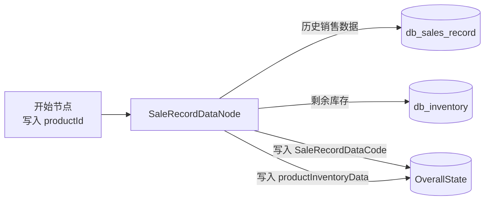

# 5-1 全局状态机定义与声明

## 【学习目标】

- 理解 Spring AI Alibaba Graph 全局状态机的运作方式：`KeyStrategyFactory`、`ReplaceStrategy`、`OverallState` 三者的关系。
- 能根据业务流程规划状态机 key，并用匿名内部类 / Lambda 构建策略工厂。
- 掌握 `NodeAction` 节点的标准写法：从 `OverallState` 取参、判空保护、调用业务层、返回写入的 key。
- 理解四张核心表的结构设计与四维度聚合查询的建模思路。

## 【正文】

### 1. 状态机 key 的规划

上一节讲解了 Graph 工作流全链路设计，即智能库存调拨优化系统如何设计。从本节开始完成第一个节点的开发，也就是销售数据采集节点（商品数据的实时数据流），正式进入代码编写过程。

编码之前先看 POM：目前只引入了 `spring-ai-alibaba-graph-core` 一个依赖，尚未引入 Spring AI 的那些依赖。引也可以、不引也可以，全链路图的设计中，前两个节点不需要接触大模型，只针对业务层开发，因此先不引入；等做到第三个节点、需要接触大模型进行预测分析时，再引入对应依赖。按需引入，保持编译期依赖图最小。

key 的规划跟着业务流程走。开始节点由代码触发，触发时传入商品 ID：只有知道是哪一个商品发生了变化，才能相应进行分析、生成库存调拨单。因此商品 ID 是第一个 key。

销售数据采集节点内部会产出两个 key：一个存储商品历史销售数据，一个存储商品当前剩余库存。加上入口的商品 ID，共三类 key。可以在创建图时就把这些 key 定义好，因此先创建策略工厂，使用匿名内部类的方式（后续可直接改成 Lambda 表达式）。

在 `config` 包下创建图配置类 `GraphConfig`，加上 `@Configuration` 注解，先用一个 bean 定义策略工厂：

```java
@Configuration
public class GraphConfig {
    @Bean
    public void graph(KeyStrategyFactory keyStrategyFactory) {
        // 定义策略工厂，返回一个包含多个替换策略的Map
        keyStrategyFactory.apply();
    }
}
```

随后定义各 key 的策略。第一个 key 是传过来的商品 ID，使用替换策略（`ReplaceStrategy`）；第二个 key 是节点中查询出的商品历史销售数据，命名为 `SaleRecordDataCode`，策略同样使用替换策略；此外该节点还会查询商品当前库存数量，创建 key `productInventoryData`（商品库存数据）存储商品当前剩余库存数量，同样使用替换策略：

```java
@Override
public Map<String, KeyStrategy> apply() {
    return Map.of(
        "saleRecordId", new ReplaceStrategy(),
        "productInventoryData", new ReplaceStrategy()
    );
}
```

如实说明：上面代码块按课程原稿保留，其中 `apply()` 返回的 Map 展示了 `saleRecordId` 与 `productInventoryData` 两个 key 的 `ReplaceStrategy` 写法，属于节选演示；完整状态机还需覆盖入口商品 ID 与销售数据 key（`SaleRecordDataCode`），定义方式与块中完全一致。

`ReplaceStrategy` 的语义是覆盖写入：节点返回 Map 中同一 key 再次出现时，新值替换旧值。本流程每个 key 只有一个写入方，替换策略即可满足；若未来出现多节点累加同一 key 的场景（例如多次采集的日志汇总），需要换成支持合并的策略，否则后写覆盖先写，数据丢失。

策略工厂定义完成后即可创建图：命名为 `InventoryTransferGraph`（库存调拨 Graph），策略用刚才定义的工厂，然后返回图实例。接下来往图中增加节点信息。

### 2. 定义第一个节点

在添加节点之前，按之前 demo 案例的做法：在 `node` 包中创建节点类，实现 `NodeAction`，再通过 `AsyncNodeAction` 的静态方法调用它，变成基于 `CompletableFuture` 异步调用的节点。

创建 `SaleRecordDataNode`（销售数据采集节点），实现 `NodeAction` 并实现 `apply` 方法，在其中编写实际业务逻辑：

```java
public class CollectSaleRecordNode implements NodeAction {
    @Override
    public Map<String, Object> apply(OverallState state) throws Exception {
        // 从状态中提取productId
        String productId = state.value("productId", defaultValue: "");
        return Map.of();
    }
}
```

`NodeAction.apply(OverallState)` 是 Graph 中每个节点的统一入口：从全局状态机读取上游写入的 key，执行本节点逻辑，把结果以 Map 形式返回，由框架合并回状态机。`AsyncNodeAction` 包装后，并行节点才能真正并行执行，两个采集节点之间无依赖，各自返回 `CompletableFuture`，框架等待两者汇合后再进入下游。

节点要做的三步：第一步，从状态机里获取商品 ID；第二步，写 SQL 查询对应的历史销售数据；第三步，写 SQL 查询商品剩余库存。

编码前先明确第二步的查询口径，通过三个维度查询：第一个维度是年份，第二个维度是季度，第三个维度是仓库。即查询该商品在过去三年里，每一年、每一个季度、在每一个仓库的销售数据。三个维度既具体到年份，又具体到季度，还具体到仓库，能很好地分析商品在某一地方的销售情况。

先拿到 `productId`，默认给空数据。为代码健壮性，使用 Hutool 工具包的字符串工具判断是否为空：商品 ID 为空、没拿到时，直接返回空 Map；有值才往下执行：

```java
@Override
public Map<String, Object> apply(OverallState state) throws Exception {
    String productId = state.value("productId", defaultValue: "");
    if (StringUtils.isBlank(productId)) {
        return Map.of();
    }
    return Map.of();
}
```

判空不是可选项：触发入口可能来自消息重投、定时任务补跑，productId 缺失时若继续执行，SQL 可能查全表或直接报错；返回空 Map 短路是最安全的处理。

### 3. 表结构设计

查询依赖四张表，建表脚本如下：

```sql
CREATE TABLE db_warehouse (
    id BIGINT PRIMARY KEY AUTO_INCREMENT COMMENT '主键',
    warehouse_name VARCHAR(255) NOT NULL UNIQUE COMMENT '仓库名称',
    location VARCHAR(255) DEFAULT NULL COMMENT '位置',
    manager VARCHAR(255) DEFAULT NULL COMMENT '负责人',
    status TINYINT DEFAULT 1 COMMENT '状态：1.启用，0.禁用',
    create_time DATETIME DEFAULT CURRENT_TIMESTAMP COMMENT '创建时间',
    update_time DATETIME DEFAULT CURRENT_TIMESTAMP ON UPDATE CURRENT_TIMESTAMP COMMENT '更新时间'
) ENGINE=InnoDB CHARSET=utf8mb4 COMMENT='仓库表';
```

仓库表：`warehouse_name` 加唯一索引，防止同名仓库重复录入；`status` 用 TINYINT 表达启用/禁用，留出状态扩展位；`create_time` / `update_time` 由数据库自动维护，免去应用层补字段。

```sql
CREATE TABLE db_product (
    id BIGINT PRIMARY KEY AUTO_INCREMENT COMMENT '主键',
    product_code VARCHAR(255) NOT NULL UNIQUE COMMENT '商品编码',
    product_name VARCHAR(255) DEFAULT NULL COMMENT '商品名称',
    spec VARCHAR(255) DEFAULT NULL COMMENT '规格',
    category VARCHAR(255) DEFAULT NULL COMMENT '品类',
    status TINYINT DEFAULT 1 COMMENT '状态：1.启用，0.禁用',
    create_time DATETIME DEFAULT CURRENT_TIMESTAMP COMMENT '创建时间',
    update_time DATETIME DEFAULT CURRENT_TIMESTAMP ON UPDATE CURRENT_TIMESTAMP COMMENT '更新时间'
) ENGINE=InnoDB CHARSET=utf8mb4 COMMENT='商品表';
```

商品表：`product_code` 唯一。注意商品 ID 用 `bigint` 定义，对应 Java 的 Long 类型，这是后续 Service 接口参数类型选型的依据。

```sql
CREATE TABLE db_sales_record (
    id BIGINT PRIMARY KEY AUTO_INCREMENT COMMENT '主键',
    product_id BIGINT NOT NULL COMMENT '商品ID',
    warehouse_id BIGINT NOT NULL COMMENT '仓库ID',
    sale_date DATE NOT NULL COMMENT '销售日期',
    quantity DECIMAL(18,2) DEFAULT 0 COMMENT '数量',
    revenue DECIMAL(18,2) DEFAULT 0 COMMENT '金额',
    create_time DATETIME DEFAULT CURRENT_TIMESTAMP COMMENT '创建时间',
    update_time DATETIME DEFAULT CURRENT_TIMESTAMP ON UPDATE CURRENT_TIMESTAMP COMMENT '更新时间'
) ENGINE=InnoDB CHARSET=utf8mb4 COMMENT='销售记录表';
```

销售记录表：`sale_date` 用 DATE，查询按天汇总；`quantity`、`revenue` 用 `DECIMAL(18,2)`，数量与金额涉及求和，DECIMAL 是精确十进制，不会出现 double 累加误差，这是金额字段的底线。

```sql
CREATE TABLE db_inventory (
    id BIGINT PRIMARY KEY AUTO_INCREMENT COMMENT '主键',
    product_id BIGINT NOT NULL COMMENT '商品ID',
    warehouse_id BIGINT NOT NULL COMMENT '仓库ID',
    locked_quantity DECIMAL(18,2) DEFAULT 0 COMMENT '锁定数量',
    available_quantity DECIMAL(18,2) DEFAULT 0 COMMENT '可用数量',
    create_time DATETIME DEFAULT CURRENT_TIMESTAMP COMMENT '创建时间',
    update_time DATETIME DEFAULT CURRENT_TIMESTAMP ON UPDATE CURRENT_TIMESTAMP COMMENT '更新时间'
) ENGINE=InnoDB CHARSET=utf8mb4 COMMENT='库存表';
```

库存表：`locked_quantity` 与 `available_quantity` 拆分，锁定数量（已被在途单据占用）与可用数量分开，调拨时扣减可用量，避免超卖。

### 4. Service 接口与实现

写 SQL 查询需要引入接口层，通过接口层的实现类查询数据。在 `service` 包定义接口 `SaleRecordService`，声明本节点需要的两个逻辑：查询历史销售数据、查询商品剩余库存。返回结果先不定义，因为现在还不明确要返回什么样的 VO 实体，先定义方法签名。

第一个方法命名为 `collectSaleRecordDataByProductId`，即通过商品 ID 收集销售数据，参数接收 `Integer` 类型。课程选择 `Integer` 的理由：看表结构设计，商品信息的 ID 用 `bigint` 定义，也就是 Long 类型，改用 `int` 肯定没有什么问题。工程上补充一句：若 ID 规模可能超过 int 上限（约 21 亿），与 `bigint` 对齐使用 Long 更稳妥，接口参数类型与表定义保持一致，可避免隐式转换导致的索引失效。

实现类 `SaleRecordServiceImpl` 创建在对应包中，实现 `SaleRecordService` 接口，添加 `@Service` 注解；再通过 Lombok 加上 `@Slf4j` 日志注解。

查询逻辑按四个维度（商品、年份、季度、仓库）做 `group by` 分组查询。最终要拿到：商品的 ID、商品的代码、商品的名称、仓库的代码、仓库的名称、年份、季度，以及总的销售数量。同一年度、季度、仓库下同一商品可能有多条销售记录，把销售数量求和，只返回一个总的销售数量。

据此定义 VO：新建 `vo` 包，创建 `SaleRecordVO`，加上 `@Data` 注解，字段即上述分组字段与聚合结果。

本节点的数据流：



## 【易错点 / 面试题】

1. **面试题：`ReplaceStrategy` 与追加策略如何选？**
   看 key 的写入方数量：单节点写入选替换策略；多节点累加同一 key（例如多个采集节点往同一个列表追加）需要合并语义的策略，否则后写覆盖先写，数据丢失。
2. **面试题：为什么金额 / 数量字段用 DECIMAL 而不是 double？**
   double 是二进制浮点，0.1 无法精确表示，累加后误差不可预期；DECIMAL(18,2) 是精确十进制。库存调拨涉及成本核算，精度不能让步。
3. **易错点：状态机 key 命名与节点写入不一致。** 下游节点按 key 读取，写错一个字符只会拿到默认值且不报错，问题在链路末端才暴露。约定：key 常量集中在策略工厂处定义，节点引用常量而非字面量。

## 【小结】

本节完成全局状态机的定义与第一个节点的骨架：三类 key（入口商品 ID、销售数据 `SaleRecordDataCode`、库存数据 `productInventoryData`）用 `ReplaceStrategy` 声明，`SaleRecordDataNode` 实现「取参、判空、调用业务层」的标准结构，查询口径按商品 / 年份 / 季度 / 仓库四维度聚合。

后续章节继续填充该节点的查询细节，把 `SaleRecordVO` 填上真实数据。工程侧的对应设计可参考 `980-demo/src/main/java/com/carl/ai/transfer/agent/TransferAgent.java`：节点动作被建模为「自然语言 → 抽取 → 入库」的单一职责动作，与 `NodeAction.apply(OverallState)` 的节点契约一致；数据访问层见 `980-demo/src/main/java/com/carl/ai/transfer/repository/BbTransferOrderRepository.java`。
