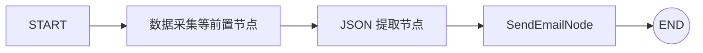

# 5-13 构建邮件推送节点并执行节点测试

## 【学习目标】

- 掌握 Thymeleaf 模板引擎的完整配置：`prefix`、`suffix`、`cache`、`check-template` 各自解决什么问题，不配会怎样。
- 理解模板定位机制：前缀定目录、后缀定文件、调用时只传模板名，三段拼接。
- 完成 `SendEmailNode` 的开发与图结构改造，把上一节「定义好但没调用」的 `EmailService` 真正接进工作流。
- 建立生产化视角：收件人硬编码的问题，以及配置中心与状态机两种动态化方案。

## 【正文】

### 1. 补齐模板引擎配置

上一节遗留一个问题：`EmailServiceImpl` 里注入了 `TemplateEngine`，但模板引擎本身还没有配置，模板放在哪个目录、按什么后缀扫描，框架一概不知道。现在直接在 `mail` 同级位置补上模板引擎的配置。

先开启 `cache`（缓存），然后开启 `check-template`，同时把 `check-template-location`（模板位置检查）也打开。下面指定 `content-type`，这几项用的都是默认值，不写也一样。再把 `enabled` 打开，它默认也是开启的；`encoding` 配置为 `UTF-8`，同样是默认值。此外还有一项排除配置，把空的排除掉。模式（`mode`）这里使用 `HTML`。

逐项拆开看含义：

| 配置项 | 取值 | 作用 | 不配的后果 |
|---|---|---|---|
| `cache` | `true` | 缓存解析后的模板，避免重复 IO | 每次请求都重新读盘解析模板，吞吐受损 |
| `check-template` | `true` | 渲染时检查模板是否存在 | 模板名拼错要到运行期才抛异常 |
| `check-template-location` | `true` | 检查模板目录是否存在 | 目录配错时启动期毫无感知 |
| `prefix` | `classpath:/templates/` | 模板扫描目录 | 引擎定位不到模板文件 |
| `suffix` | `.html` | 模板文件后缀 | 扫描到目录也匹配不到文件 |
| `mode` | `HTML` | 模板模式 | 标准网页模板场景保持该模式 |
| `encoding` | `UTF-8` | 模板读取编码 | 中文内容乱码 |
| `content-type` | `text/html` | 输出内容类型 | 邮件客户端按错误类型渲染 |

按讲解中的取值整理成配置如下（其中排除项置空，即不排除任何视图）：

```yaml
spring:
  thymeleaf:
    # 开启模板缓存，避免每次请求都重新解析
    cache: true
    # 检查模板与模板目录是否存在，把路径错误暴露在启动期
    check-template: true
    check-template-location: true
    content-type: text/html
    enabled: true
    encoding: UTF-8
    # 排除项置空：不排除任何视图
    mode: HTML
    prefix: classpath:/templates/
    suffix: .html
```

关键的两项是前缀和后缀。`prefix` 用来指定模板存在于哪个文件夹下面，默认就是在 `classpath` 下的 `templates` 文件夹里扫描，所以按默认结构来写即可：`classpath:/templates/`。后缀 `suffix` 自然就是 `.html`。通过前缀扫描到位置、通过后缀匹配到文件，模板就能被找到了。

项目里可能不止一个模板，如何指定用哪一个？答案是在调用模板引擎执行的时候传入模板的名字，这里传的是 `EmailTemplate`，不需要写后缀，因为配置文件里已经把后缀配好了。

### 2. 模板定位原理

模板定位是「前缀 + 名称 + 后缀」的三段拼接：`templateEngine.process("EmailTemplate", context)` 执行时，引擎拿着 `EmailTemplate` 到 `classpath:/templates/` 下寻找 `EmailTemplate.html`。后缀由配置补齐，所以调用处只写模板名。

三段各自拼错时的报错形态不同，排查时可以对号入座：目录段错（`prefix` 写错路径），`check-template-location` 在启动期就会报模板目录不存在；文件名段错，`check-template` 在渲染期抛出模板解析异常；后缀段错，能进目录但匹配不到文件。把检查开关全部打开，等于让这类错误尽量前移到启动期，而不是等管理员收不到邮件才发现。

### 3. SendEmailNode：把 Service 真正接进节点

测试之前依然要先改造图的结构：新增一个节点 `SendEmailNode`，还是通过 `NodeAction` 的静态方法注册，把 `SendEmailNode` 传进去。

这里少了一步，也是教程里特意留的坑，不要完全照着走，自己要有独立的开发思路。问题在于：我们定义了 `EmailService` 接口和实现类，却没有使用它。不调用的话，怎么真正把邮件发出去？所以要在节点里真正发起调用：收件人这里先写一个 163 邮箱，然后传入需要的 `Map`。

`Map` 的内容要根据模板来写，模板里有三个占位符，所以对应要构造三个键值。第一个占位符对应的就是前面拿到的 `comment`，把它作为邮件正文内容传进去；第二个占位符暂时传空（这部分后面才会讲到）；第三个同样先传空。三个参数准备好之后格式化一下即可。

回到节点代码，`SendEmailNode` 需要把 Service 注入进来，通过 `@Resource` 注入 `emailService` 就可以调用了。

该坑值得单独说。接口与实现类写完之后，「具备发邮件的能力」和「工作流会使用该能力」是两件事：Spring 的依赖注入只保证 Bean 存在，不保证 Bean 被调用。节点里不做这次调用，前面的 `EmailService`、`EmailServiceImpl`、模板文件全部是死代码，接口跑一遍不报错，也不会有任何邮件发出。开发的自觉性体现在：每定义一个能力，立刻追问「谁在什么时候调用它」。占位符传空的两个键同理，属于「链路先占位、内容后补齐」的渐进开发，比留 TODO 注释更可验证。

### 4. 改造边：让邮件节点串进工作流

注入完成后继续改造边：按照图的规划，JSON 提取节点直接连到邮件发送节点，邮件发送节点再连到结束，因为后面两个节点还没有开发。即提取节点不再直接连结束，而是连到发送邮件节点；再补一条边，从发送邮件节点连到 `state.end`。图到这里就改造完毕了。



工作流的演进方式是「逐段接通」：每开发完一个节点，就把它的上游边从「直连结束」改到「指向新节点」，再补一条新节点到结束的边。边是数据流的地图，节点没接进边之前，写得再完整也不会被执行。

### 5. 联调测试：参数名 500 与邮件验收

接下来启动项目并调用接口，看会不会报错，毕竟引入了邮件发送和模板引擎之后还没有重启验证过。启动成功，端口 `8876` 起来了。

调用接口时需要传一个商品 ID，还是用 ID 为 1 的商品来发送。请求之后返回了 500，检查一下发现是接口参数名改过（变成了 `saleProductId` 之类），把参数名改正后重新请求，这次正常执行了。

500 的排查价值在于边界清晰：参数名不一致属于「请求根本没进到业务逻辑」的低级错误，修复成本一分钟，但漏掉它就会误以为邮件链路有问题。联调期先核对契约（URL、参数名、类型），再深入业务，是固定的排查次序。

登录邮箱查看，邮件已经发过来了。日志里可以看到时间戳：11 月 26 号 8 点 54，和收到的邮件时间一致。邮件内容就是按模板生成的，和 PPT 里演示的效果一样，正文部分填充的正是大模型输出的 `comment`，也就是它分析出来的、为什么要生成这样一张库存调拨单的说明。管理员拿到这份内容，就可以做人工分析，觉得回答不错就采纳，也有可能拒绝。

到这一步，「大模型生成调拨建议 → 提取 JSON → 渲染模板 → 推送邮件」的前半条链路已经闭环。邮件正文不是写死的文案，而是模型对库存数据的分析结论，这是 AI 工作流与普通定时报表的本质区别，也是后续人类反馈（采纳/拒绝）能有对象的前提。

### 6. 生产化扩展：收件人不要写死

第一，收件人目前是硬编码写死的，不够灵活。实际项目中，如果你们是 Spring Cloud 项目，可以引入 Nacos 作为配置中心，把收件人邮箱配置到配置中心里，实现实时动态的发送。

第二，可以在流程刚开始触发的时候就扩展：业务场景触发库存调拨单分析时，把人员信息一并传进来。因为这类邮件都是推给公司内部的人，公司统一的推送渠道无论是企业微信、钉钉、飞书还是邮箱，邮箱后缀一定是相同的，不同的只是前缀，比如每个人的手机号或者工号。触发的时候公司内部一定有对应的方法可以拿到人员信息，公司内部系统必然有权限控制，权限控制那块肯定能拿到用户信息。既然能拿到用户信息，就可以把它做成动态：触发时直接把人员信息放进状态机，推送的时候从状态机里取出该人员的邮箱，直接动态发送。

两种方案的分层：

| 方案 | 收件人来源 | 改动点 | 适用场景 |
|---|---|---|---|
| Nacos 配置中心 | 配置项，全局或按环境 | 节点改为读取配置 | 固定运营收件人，需要热更新 |
| 人员信息入状态机 | 触发请求携带 | 初始 `Map` 增加人员字段，节点从 `state` 取 | 谁触发就发给谁，多租户 |

方案二与状态机的设计哲学完全一致：节点的全部输入都来自 `OverallState`，节点本身无环境耦合，可单测、可回放。邮件推送「发给谁」从一个常量变成状态机里的一个 key 之后，同一个节点就能服务所有调用方。这样一来「发送给谁」就不再笨重，而是非常灵活，可以实现「谁调用就发给谁」的场景。

## 【易错点 / 面试题】

1. **面试题：为什么 `process` 传模板名时不带后缀？** 后缀已在 `spring.thymeleaf.suffix` 中配置，定位流程是「前缀 + 名称 + 后缀」三段拼接；调用处重复带后缀会拼出 `EmailTemplate.html.html`，直接找不到模板。
2. **易错点：定义了 Service 却没在节点里调用。** 依赖注入只保证 Bean 存在，不保证被使用。定义能力与接入编排是两步，漏掉第二步时接口「不报错也不发信」，属于静默失败，联调时很难第一时间发现，必须靠「端到端验收」兜底。
3. **面试题：邮件发送失败会影响工作流吗？** 取决于异常策略。本课程的 `EmailServiceImpl` 捕获异常后包装运行时异常上抛，节点失败即工作流失败，适合「通知必达」场景；若允许降级，则应在节点内捕获并记录失败状态，交由人工补偿。选择哪种，取决于业务对「漏通知」的容忍度。

## 【小结】

本节补齐模板引擎配置并完成邮件推送节点：`prefix`/`suffix` 决定模板定位，`SendEmailNode` 通过 `@Resource` 注入 `EmailService` 发起真实调用，图结构改为「JSON 提取 → 邮件发送 → 结束」；联调期修复参数名问题后，邮件正文填充的正是模型输出的 `comment`，人工审核（采纳/拒绝）由此有了对象。

收件人动态化（Nacos 配置中心，或人员信息入状态机）是该节点从演示走向生产的关键一跃。节点编排与业务实现的分层可对照 `980-demo/src/main/java/com/carl/ai/transfer/agent/TransferAgent.java`（节点动作只做串联）与 `980-demo/src/main/java/com/carl/ai/transfer/controller/TransferController.java`（入口触发）。

下一篇进入「自动生成调拨单」节点：从状态机取 JSON、转实体、落库。
